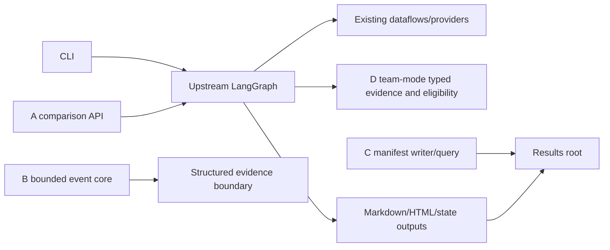

# CS5351 TradingAgents — D6 Process Report

**See Report.md in the same directory in the submitted zip file.**

**Repository:** [sui-feng-cb/CS5351-TradingAgents](https://github.com/sui-feng-cb/CS5351-TradingAgents)

**Upstream baseline:** `9fa1196fffbcfd9de5146d2dd2869df84ab99838`
([baseline record](docs/baseline.md)).

## 1. Title, report status and executive summary

This project preserves the upstream Tauric Research TradingAgents financial
research framework and adds four supervised workstreams:

- **A:** same-day two-ticker comparison with partial-failure preservation;
- **B:** bounded cross-ticker common-event grouping with evidence validation;
- **C:** versioned per-run manifests and a read-only local query;
- **D:** an explicit team-mode deterministic eligibility gate.

TradingAgents remains a research and analysis tool. The repository does not
promise financial returns and does not execute broker trades ([README.md](README.md)).
The project keeps the upstream Python package and CLI under `src/`, targets
Python `>=3.13,<3.14`, and adds no runtime dependency for A–D
([pyproject.toml](pyproject.toml), [docs/baseline.md](docs/baseline.md)).

The principal engineering decision was to preserve the upstream graph, dataflow,
provider, report, memory and checkpoint boundaries, then add narrow modules and
coordinated integration points. The architecture therefore separates model
narrative from authoritative structured results. B's deterministic validator
owns evidence legitimacy; C treats unknown metadata explicitly and never scans
or changes reports during a query; D uses typed execution/evidence metadata and
can replace an unqualified model candidate with `REVIEW` before public
publication. A reuses the upstream graph and report writer rather than
reimplementing them.

## 2. Team members and relative contributions

| Module | Name | Student ID | Contribution evidence to review | Percentage of contribution |
|---|---|---|---|---|
| A | [Name] | [ID] | A implementation/review history: `src/tradingagents/enhancements/comparison.py`, `test/offline/test_comparison.py`, PR #7/#8, `docs/ai-use-log.yaml` entries `A-COMPARE-001` and `A-COMPARE-FIX-*`. | 20% |
| B | [Name] | [ID] | B implementation/review history: `src/tradingagents/enhancements/events.py`, `test/offline/test_events.py`, PR #6, B entries in `docs/ai-use-log.yaml`, `docs/architecture/evaluation-logbook.md`. | 20% |
| C | [Name] | [ID] | C implementation/review history: `src/tradingagents/enhancements/manifest.py`, CLI integration, `test/offline/test_manifest.py`, PR #5/#9, `C-MANIFEST-*` entries in `docs/ai-use-log.yaml`. | 20% |
| D | [Name] | [ID] | D architecture, implementation and correction history: `src/tradingagents/enhancements/eligibility.py`, graph/CLI/report adapters, PR #2/#3/#4, D entries in `docs/ai-use-log.yaml`. Analyze task requirements and divide the work, initialize the repository, review all PRs, and write the main body of Report.md.| 40% |

## 3. Project background, upstream baseline and scope

### 3.1 Upstream capability and locked boundary

The upstream system is a multi-agent financial research framework. Its existing
capabilities include analyst agents, research and risk debate, portfolio/trader
flow, data vendors, date-aware tools, reports, memory/checkpoints, a CLI and
multiple LLM providers. Those capabilities are baseline contributions, not
team feature credit. The baseline commit is `9fa1196fffbcfd9de5146d2dd2869df84ab99838`;
the path mapping and byte-comparison evidence are in [docs/baseline.md](docs/baseline.md)
and [docs/verification/initialization.md](docs/verification/initialization.md).

The migration moved the upstream package and CLI once into `src/tradingagents/`
and `src/cli/`, retained public imports and entry points, relocated tests into
`test/offline/`, and separated the genuine DeepSeek integration test into
`test/live/`. The migration record reports 95 upstream production/resource
files byte-identical after relocation and a clean-install import/resource
smoke. Three path-sensitive tests were adapted without changing their semantic
assertions.

### 3.2 Added scope and exclusions

The project adds research-support functionality only. A is an orchestration and
artifact layer around two upstream runs; B's current PR delivery is the
injectable deterministic core rather than a completed live news/model adapter;
C records and queries execution metadata; D adds an opt-in qualification
boundary. Broker execution, portfolio simulation for A, prediction/impact
ranking for B, guessed provider provenance, and implicit secret collection are
outside scope.

The intended security boundary is that credentials remain local and untracked.
`.env.example` contains empty placeholders and documentation, while manifests
allowlist provider/model identifiers and omit endpoints and keys. Shared
fixtures are synthetic or sanitized. The governance credential scan is a basic
pattern scan, not a complete secret detector.

## 4. Requirements, acceptance criteria and requirements evolution

The authoritative registry is [docs/req/requirements.yaml](docs/req/requirements.yaml)
and its structure is checked by [docs/req/req-schema.json](docs/req/req-schema.json).

| Requirement | Requirement statement and measurable acceptance | Owner | Acceptance / contract role | Priority | Verification evidence | Current state and source |
|---|---|---|---|---|---|---|
| FR-A | Exactly two distinct stock tickers, one date, two isolated upstream runs; write comparison Markdown and `comparison_manifest.json`; preserve row order and authoritative ratings. Input errors create no comparison artifacts. | A | D is recorded as acceptance owner and contract approver in A-IC-001; confirmation of the current amendment remains a human item. | Must | `test/offline/test_comparison.py` (40 cases in the recorded verification), `src/tradingagents/enhancements/comparison.py`, A-IC-001. | Implemented in code and merged through PR #7/#8; the registry still says `planned`; independent current-head review is not evidenced by the GitHub API. Source: requirements FR-A, A-IC-001, PR #8 review memo. |
| NFR-A | A single ticker failure cannot remove or overwrite the other successful report; failed rows carry null rating, summary and path; no cross-ticker data transfer. | A | D, as above. | Must | A failure and cross-talk cases in `test_comparison.py`; INV-A; `docs/bug-diary.md` BUG-A-002–005. | Locally verified for the recorded 40-case suite and merged; formal acceptance and independent re-review remain to be confirmed. Source: requirements NFR-A and trace matrix. |
| FR-B | Group 2–3 tickers over at most 7 days and at most 5 in-window records per ticker, using one bounded grouping call and publishing only groups with at least two tickers. | B | Team/module review role is not identified by name; the PR review memo records scope approval only. | Must | `test/offline/test_events.py`; ADR-001 event-merge decision; `events.py` input validation and `merge_once`. | Injectable deterministic core implemented and merged in PR #6. Full live data/model wiring is explicitly not implemented; the registry remains `planned`. |
| NFR-B | Every published evidence reference resolves to the current run and matches authoritative ticker/date/source metadata; forged and cross-run references are discarded. | B | Team/module review role is not identified by name. | Must | `EvidenceRegistry`, deterministic `validate`, forged/mismatch/date/shape negatives in `test_events.py`; semantic dataset and log. | Deterministic evidence checks are locally tested; real-model semantic evidence is recorded with a failed item and is not a current CI/formal quality acceptance. |
| FR-C | Write versioned `run_manifest.json` for successful and failed analysis attempts and expose a read-only ticker/date query with per-file warnings. | C | Non-C independent review is recorded as pending in the C verification document; no named approver is supplied. | Must | `test/offline/test_manifest.py`, `docs/architecture/run-manifest-v1.schema.json`, `docs/verification/c-manifest.md`, PR #9. | Implemented and merged. The PR #9 review memo reports 50 C cases after the save-failure fix; the C test-plan header still says 47, so the document count needs human reconciliation. |
| NFR-C | Query 1,000 synthetic manifests within the proposed 2-second budget on a fixed Python 3.13 CI runner, measured by three independent processes. | C | Team confirmation of runner, method and threshold is still listed as pending. | Must | `test/benchmarks/bench_manifest_query.py`; local WSL measurements 1.889/1.837/1.808 seconds; [c-manifest verification](docs/verification/c-manifest.md). | Local baseline is inside the proposed budget; formal CI-runner acceptance is not evidenced. |
| FR-D | In explicit `team` mode require actual market-analyst execution, trusted critical evidence and an exact five-tier rating; otherwise publish authoritative `REVIEW` with ordered reasons. | D | Safety acceptance is required from a member other than D; no named identity or final independent approval is recorded. | Must | `test/offline/test_eligibility.py`, `test_eligibility_adapter.py`, `test_team_rating.py`, graph cases, ADR-002, D verification log. | Implemented, merged through PR #3, locally verified against the fixed contract; independent safety/integration review is not claimed. |
| NFR-D | The deterministic boundary cannot be bypassed by model prose, malformed evidence or secondary adapters; `REVIEW` cannot enter pending settlement/reflection. | D | Non-D safety review and current-head review are required by ADR-002/GOV-01. | Must | INV-D; graph stream, reports, CLI, checkpoint, settlement and fixed negative cases; local D log reports zero observed bypasses in the fixed set. | Implemented and locally verified for the fixed tests; no universal safety guarantee or completed independent human review is claimed. |
| BASE-01 | Preserve upstream imports, resource discovery, date/look-ahead semantics and regression behavior through the layout migration. | Team | Human review of migration and current CI. | Must | `docs/baseline.md`, initialization verification, full offline suite, clean-install workflow. | Migration evidence exists; current source includes the enhancements and current CI is green. |
| SEC-01 | Shared artifacts contain no credentials, tokens, passwords or private account inputs. | Team | Human export/repository review plus governance scan. | Must | `.env.example`, `INV-SECRET`, governance credential-pattern scan, manifest allowlisting, sanitized fixtures. | Policy and local checks exist; complete human D5 export review and a complete detector are pending. |
| GOV-01 | Human plan/test approval before implementation, updated AI-use evidence, passing project CI and independent final review; safety-critical changes also require ADR/current-head safety review. | D / team | Prompt and ADR-003 distinguish required human supervision from advisory same-PR test review. | Must | `Prompt.md`, `AGENTS.md`, `.opencode/rules.md`, `.agent/rules.md`, workflows, AI-use log, PR metadata. | Workflow changes and latest `main` runs are verified; branch protection is unresolved because GitHub API reads returned HTTP 403. |
| QUA-01 | Validate requirement-registry structure and local reference integrity. | Team | Governance script and CI. | Must | `scripts/check_governance.py`, `req-schema.json`, governance workflow. | Local and latest remote governance checks pass for the checked commit. |

### 4.1 How requirements evolved

The project began with an upstream-preservation and `src/`-layout proposal. ADR-001
records the alternatives: retaining root packages was smaller but missed the
course layout; nesting a second repository created duplicate boundaries; a single
`src` migration with narrow extensions was selected. Human supervision was
specified before application code in `Prompt.md`: plan and test intent must be
approved, tests must expose failures independently, and review/verification gates
must stop the agent again.

The four feature contracts then became bounded acceptance rules. A-IC-001 added
strict date/ticker validation, stock-only scope,
fixed failure messages, resolved-path attribution and a separate comparison
manifest after review exposed unsafe exception and symlink behavior. B's scope
was explicitly narrowed to an injectable deterministic core when its default
structured news and model adapters were not available; the implementation must
fail loudly instead of emitting incomplete evidence. C froze a v1 manifest field
allowlist, root-relative report paths, warning-and-continue query behavior and
the distinction between analysis failure, skipped report save and report-save
failure. D froze an opt-in `standard`/`team` mode, typed evidence metadata,
five-tier exact ratings, reason ordering and the rule that `REVIEW` is excluded
from settlement/reflection.

## 5. Architecture and integration

### 5.1 System boundary and data flow

The trusted boundary is between model-generated narrative/candidates and
deterministic metadata. The graph and dataflow remain responsible for analysis;
the new modules validate identity, evidence, paths, dates and publication state.
The results directory is local application state. C manifests may record
allowlisted configuration identifiers, but not keys, endpoints or raw exception
text. Live API credentials are outside shared artifacts.

### 5.2 Module connections and contracts

- **A:** `run_comparison` validates exactly two canonical stock symbols and one
  strict non-future date, calls `graph.propagate` sequentially, validates returned
  ticker/date identity, accepts only an authoritative allowed rating, calls the
  existing `save_reports`, and verifies the resolved report path is exactly a
  ticker-owned `complete_report.md`. It writes a comparison Markdown and a
  comparison-level manifest. A failure is isolated to one row; the other report
  remains available.
- **B:** `build_window` restricts the input to 2–3 tickers and 1–7 days.
  `fetch_records` filters dates before deduplication and the five-record cap.
  `merge_once` validates direct callers before any model call, calls an injected
  LLM once, and passes its suggestion to `validate`. `EvidenceRegistry` is the
  authority for run-scoped IDs; the model cannot invent metadata or make a
  single-ticker group authoritative. The current default fetcher and default LLM
  intentionally fail loudly because the structured live adapters are not wired.
- **C:** Each attempt is stored beneath
  `<results_root>/<ticker>/<date>/runs/<uuid>/run_manifest.json`. The v1 schema
  has an explicit field whitelist, UUID/date/time validation, relative report
  paths and safe errors. A query scans read-only, resolves containment including
  symlinks, warns about malformed/missing/unsafe records and continues. CLI
  startup defers heavy graph/model/vendor imports; the manifest query does not
  launch analysis, backtesting or a vendor.
- **D:** `standard` preserves the upstream path. In `team`, the graph records
  actual market-analyst execution separately from typed market evidence, obtains
  a snapshot date from the requested ticker/date data path, and runs the gate
  after Portfolio Manager candidate generation. The gate uses the existing
  10-calendar-day OHLCV freshness policy and rejects nonfinite latest Close
  values, invalid dates/statuses and non-exact ratings. Public graph frames and
  CLI panels withhold candidate/Trader proposals until qualification. Rejected
  output becomes `REVIEW`, carries stable reasons in CLI/Markdown/HTML/state
  output, and is not sent to pending settlement/reflection.

### 5.3 Important alternatives and consequences

ADR-001 selected one `src/` migration rather than duplicate application trees.
For B, [ADR-001 event merge](docs/architecture/adr/001-event-merge-single-llm-call.md)
selected one whole-batch model call plus deterministic validation over pairwise
calls or a second validation model. The consequence is a clear call-count and
evidence boundary, at the cost of needing a maintained semantic evaluation set.

ADR-002 rejected trusting market-analyst prose or asking another model to certify
the result. The selected typed adapter/gate is deterministic and opt-in, but it
requires coordinated changes across graph, state, CLI, reports and settlement.
ADR-003 made same-PR test-plan review advisory while retaining human plan/test
approval, independent final review, project CI and a safety-specific review.

## 6. Software-engineering process and Agent governance

The process is defined by [AGENTS.md](AGENTS.md), [Prompt.md](Prompt.md),
[.opencode/rules.md](.opencode/rules.md), [.agent/rules.md](.agent/rules.md),
the permission model, the requirements registry, ADRs and the verification
constraints. The default plan stage reads the scoped project artifacts and stops
before application implementation. Build edits require the approved scope and
human confirmation; shell is confirmation-gated and not an operating-system
sandbox. The rules prohibit changing permissions or global configuration to
avoid a refusal, preserve upstream behavior, require independent negative tests,
and require complete real session exports rather than synthesized transcripts.

The normal sequence was:

1. classify a proposed enhancement as FR/NFR/invariant/security/governance work;
2. compare architecture candidates and freeze the interface/ADR boundary;
3. obtain human plan and test-intent direction;
4. write independent offline tests and establish a red baseline where applicable;
5. implement only the approved scope;
6. run focused tests, the previous offline suite, static/governance/dependency
   checks and applicable live tests separately;
7. perform review, record findings, make a red-to-green correction and rerun;
8. merge through a feature PR, then run current-main integration and release
   preparation checks.

### Real supervision and interventions

- For D, the user approved the implementation blueprint and requested D1–D9
  records, implementation, local verification and staging. The original
  tests-only contract from PR #2 was retained as the fixed acceptance contract
  ([D AI-use entries](docs/ai-use-log.yaml), [D annotations](transcripts/annotations/d-implementation-2026-11-22.md)).
- The PR #3 review found finite-price, own-rating and pre-gate stream bypasses
  even though the earlier suite passed 1,470 tests. The user then directed repair.
  The agent first wrote independent red regressions, fixed the production paths,
  and recorded the corrections separately from the original review verdict in
  [docs/verification/d-eligibility.md](docs/verification/d-eligibility.md).
  Later review found Markdown code-block and multiline-inline-code cases; those
  were separately reproduced and fixed without weakening the acceptance tests.
- For A, the evidence records member A's approval of the plan, tests-first intent,
  INV-A and the API-first scope; D is recorded as contract approver/acceptance
  owner. Review findings then narrowed A to stock-only input and required
  resolved-path checks. These approvals are role-level records; the member's
  name/ID still needs manual completion.
- For B, review findings forced a branch synchronization and then a scope
  decision: the shipped PR explicitly became an injectable core because the
  existing news API did not preserve structured per-article dates. Later review
  added direct-entry date-window validation. The evidence distinguishes the
  team-confirmed fixed evaluation set from a fresh independent live measurement.
- For C, implementation was authorized after the tests-first contract. A review
  found that skipped report saving and report-save failure were indistinguishable.
  The user confirmed the v1 interpretation: keep `status=succeeded`, write a
  fixed `report_save_failed` error for save failure, and retain the query match;
  skipped saving remains `error: null`. The implementation and five targeted
  red-to-green cases are recorded in the C verification log.

## 7. A–D module implementation and integration evidence

### 7.1 A — same-day two-ticker comparison

**What was built.** `src/tradingagents/enhancements/comparison.py` owns the
orchestration and artifact contract. It does not replace the upstream graph,
providers, prompts or rating parser. `run_comparison` validates two distinct
stock tickers and a canonical date, runs each ticker sequentially, writes the
comparison report/manifest and returns root-relative paths.

**Why.** Sequential isolated runs preserve the upstream behavior and make a
single failure observable without losing the successful ticker. A separate
comparison manifest avoids changing C's run-manifest schema.

**Verification and negative cases.** The recorded A suite has 40 cases covering
normal two-success behavior, `REVIEW` as a successful rating, either/both
failures, save failure, missing rating, wrong ticker/date, exception sanitization,
summary extraction, invalid/future/duplicate/unsupported symbols, report
cross-talk and directory/file symlink attribution. BUG-A-002–005 document the
review-driven repairs. The successful row remains intact when the other row is
failed, while a failed row has null rating, summary and path.

**Review and current state.** PR #7 introduced A and PR #8 addressed the review
findings; PR #8 is reported merged in public metadata with merge commit
`6cb3f5cc7c86aacd6ee61e4fd81b130797339eb6`. The local review memo records
`APPROVE` for the repaired code at `7242599`, but the retrieved GitHub review
objects do not show a final independent approval. The requirements registry
still says planned and the A contract amendment remains a human-confirmation
item. A is therefore **implemented and merged; locally tested**.

### 7.2 B — cross-ticker common-event core

**What was built.** `src/tradingagents/enhancements/events.py` consolidates the
bounded deterministic core. It creates run-scoped evidence IDs, normalizes
records, enforces the 2–3 ticker/7-day/5-record boundaries, invokes one injected
model callable, parses its JSON and validates evidence against the registry.
Invalid IDs, cross-run references, ticker/date/source mismatches, malformed
events and single-ticker groups are dropped or left unmerged.

**Why and degradation.** Pairwise or dual-model designs violate the one-call
constraint. The selected whole-batch model suggestion plus deterministic
validator makes evidence legitimacy testable without trusting model metadata.
No records become `DATA_UNAVAILABLE`; a valid model response with no group is
`NO_COMMON_EVENT`; model exceptions or malformed output become
`ANALYSIS_INCOMPLETE` with all records unmerged. The default live fetcher and
model are intentionally loud failures because the current upstream news API
does not provide the structured per-record metadata required by the contract.

**Verification and review.** The B test history progressed from 39 to 53 and
then 56 focused cases as review found future/over-limit/direct-entry date gaps.
The final local review record reports 56 B cases passing, with Ruff, mypy for the
governance script, pip/dependency and diff checks passing. PR #6 was merged at
`4ad1fa0f4801a58ff59d36a69313be3c65d99e1c`; the public PR metadata still shows
the earlier owner `CHANGES_REQUESTED` review object and no final independent
review object, while the local memo records `APPROVE` for the final B scope.

The semantic log records a human-labeled v1 dataset and a historical real-model
measurement of 23 attempted pairs, one failed item, TP=8, FP=0, FN=3,
precision=1.0 and recall=0.7273. The log itself identifies this as a historical
measurement and the review record identifies limitations in the runner and
coverage handling. It is not presented as current CI quality acceptance. B is
therefore **merged and locally verified as an injectable core**.

### 7.3 C — run manifests and read-only query

**What was built.** `src/tradingagents/enhancements/manifest.py` provides
validated v1 records, atomic writing, safe metadata extraction, root-relative
report paths and a read-only scan. `src/cli/run.py`, `src/cli/main.py`,
`src/cli/console.py` and `src/cli/display.py` integrate attempt recording and
the lazy `manifest query` command. Every attempt receives a fresh UUID and a
separate directory. Query warnings do not rewrite or delete records.

**Why and degradation.** The explicit field whitelist prevents accidental
serialization of credentials or endpoints. Unknown and malformed files are
skipped with fixed warnings; declared missing reports warn while retaining the
record. A successful analysis with a failed report save retains
`status=succeeded` and records fixed `report_save_failed` metadata; an explicit
skip retains `error: null`. This preserves the distinction needed for later
audit without changing the v1 field structure.

**Verification and review.** The C verification log reports 47 base acceptance
cases and 50 after the PR #9 save-failure correction; the test-plan header and
verification count are not fully synchronized and must be reconciled. The
recorded focused correction run passed five cases, the related three-file run
passed 116 cases, and the full local run passed 1,678 tests with one optional
skip, two deselections and 100 subtests. The local WSL benchmark measured
1.889/1.837/1.808 seconds for three independent 1,000-manifest queries, but the
fixed CI runner, threshold and formal NFR-C acceptance remain pending.

PR #9's implementation head was `2a245507a77839823f9e380335f45214d0d7544d`
and its merge commit is `7c8a715e948ccd72dc9b40605f53d3741e605a7a`. The public
PR metadata reports successful tests, governance, safety review, clean install,
Ruff and B-module checks for that head. The implementation's independent
non-C review is still marked pending in repository documents; no human final
approval is claimed. C is **implemented and merged; locally and remotely gated
for the recorded commit**.

### 7.4 D — deterministic team-mode eligibility gate

**What was built.** `src/tradingagents/enhancements/eligibility.py` provides a
frozen `EligibilityDecision` and pure evaluator. Coordinated graph, adapter,
rating-parser, CLI, report, state-log, checkpoint and settlement changes apply
the evaluator in explicit `team` mode. `standard` remains the default.

**Why and degradation.** Model prose cannot prove that the market analyst ran,
that the critical evidence was actually acquired, or that a snapshot is current.
The gate therefore uses typed execution/evidence status, canonical dates, the
existing ten-day freshness bound and exact five-tier values. Invalid conditions
produce `REVIEW` and ordered reason codes. A nonfinite latest Close is rejected
before valid evidence is emitted. Team free text uses exact model-owned rating
fields; quoted consensus and Markdown examples cannot rescue an invalid field.
Public streams withhold the Trader proposal until qualification, and a blocked
`REVIEW` is excluded from pending settlement/reflection.

**Verification and rework.** The initial implementation focused run found two
presentation/publication defects and the first full run found 25 compatibility
failures. These were repaired without weakening the fixed D tests. Independent
review then found three qualification bypasses despite the earlier 1,470-test
pass: infinite Close, consensus-rating substitution and pre-gate stream
publication. Red regressions were written first; later parser and checkpoint
rework addressed code examples and multiline inline-code cases. The final
recorded local run at the corrected D head passed 1,536 tests, one skip, one
deselection and 100 subtests; earlier correction runs passed 1,512 and 1,528
with the relevant scope. The fixed tested negative set observed zero bypasses.

PR #3's final implementation head was `9c53f95fae53ed75a984568a4e0007fd06ed4764`
and it merged as `f8bbf6584ada88720e4124a144bcae8a346c49cc`. PR #4 then merged
the safety-review workflow. Current `main` CI and governance runs succeed, and
the PR #9 safety-review check also succeeded. The public API query showed no
independent final review object for PR #3. D is **implemented, merged and locally
verified against the fixed contract**.

## 8. Verification, quality, performance and security results

The following results are separated by evidence source. Local numbers are taken
from the repository verification logs; remote results are linked to public GitHub
runs.

### 8.1 Structural and repository checks

| Check | Environment / command | Result and boundary |
|---|---|---|
| Requirements and governance | Project Python 3.13; `python scripts/check_governance.py` | Passed registry/schema, layout, permission synchronization and basic credential-pattern scan in the recorded runs. The scan is not a complete secret detector. |
| Lint | `python -m ruff check .` / CI `ruff check .` | Passed in recorded local runs and latest `main` CI. |
| Governance-script type check | `python -m mypy scripts/check_governance.py` | Passed; scope is the governance script, not all application modules. |
| Dependency consistency | `uv pip check --python .venv/bin/python` | Passed in recorded project runs. The environment record reports 102/103 compatible packages depending on the historical point in time. |
| Schema and manifest structure | `test/offline/test_manifest.py`, Draft 2020-12 schema | Valid/invalid field, UUID, date/time, report/error and secret-exclusion cases are recorded; the C suite is green for the current implementation record. |
| Package/install boundary | CI clean-install smoke and initialization wheel test | Current CI clean-install checks pass; initialization also recorded package, CLI and resource imports. |
| Diff whitespace | `git diff --check` and targeted PR diff checks | Passed for the recorded implementation/review diffs. The current worktree's pre-existing README change is not treated as a project feature commit. |

### 8.2 Regression and behavior checks

The project-local Python 3.13 records report these full offline results at
different historical heads: 1,427 before D implementation; 1,470 after the
first D implementation; 1,512/1,528/1,536 through D repair stages; 1,572 after
the A repair head; 1,601 after B's final focused scope; 1,665 after the C
implementation merge; and 1,678 after the C report-save correction. The latest
public `main` CI for `91a5c34` completed successfully.

The relevant behavioral evidence is:

- A's 40-case suite covers both partial-failure directions, result identity,
  report attribution, symlinks, safe errors, stock-only validation and manifest
  consistency.
- B's final recorded focused suite has 56 cases, including one-call behavior,
  future/stale/missing date rejection, five-record limits, malformed model
  output, forged/cross-run IDs and metadata mismatch. No live default adapter is
  claimed.
- C's current implementation record has 50 cases after the report-save fix,
  including CLI filters, read-only behavior, unsafe paths, malformed records,
  secret exclusion, save-failure distinction and path recording. The test-plan
  says 47 in its header, which is an unresolved documentation mismatch.
- D's fixed evaluator, graph, adapter, parser, stream, checkpoint, report, CLI
  and settlement tests cover the positive eligible path and independent
  candidate-`Buy` negative cases. The observed bypass denominator is fixed and
  finite; it does not prove universal safety.

### 8.3 Live/model, performance and remote checks

- B's evaluation log records a historical real-model result of precision `1.0`
  and recall `0.7273` on its v1 labeled set, with one failed item. The log and
  review artifacts do not establish a current CI replay of the production merge
  path with complete failure coverage. This is retained as evidence, not
  overstated as formal NFR-B acceptance.
- C's 1,000-manifest timing was measured locally in WSL at 1.889, 1.837 and
  1.808 seconds. The proposed two-second target and fixed CI-runner method
  still require formal confirmation.
- The latest public `main` CI and Project governance runs for `91a5c34` are
  successful. Historical PR runs are not retroactively rewritten: PR #7/#8
  have historical test failures in their check rollups, while PR #9's recorded
  implementation checks, including its safety-review check, pass. The current
  `main` run shown above does not itself create a separate safety-review or
  human review identity.
- Branch protection and repository rulesets were queried read-only and returned
  GitHub HTTP 403 because the repository plan does not expose that feature.
  No remote protection setting is claimed or changed.

## 9. Traceability and co-evolution of artifacts

### 9.1 Complete trace example: C manifest safety and query boundary

`FR-C/NFR-C/SEC-01` → C section of
[`interface-contracts.md`](docs/architecture/interface-contracts.md),
`run-manifest-v1.schema.json`, and the read-only/path-containment rules →
[`src/tradingagents/enhancements/manifest.py`](src/tradingagents/enhancements/manifest.py)
plus CLI hooks in `src/cli/run.py` and `src/cli/main.py` → fixed samples in
`test/fixtures/run_manifests/` and literal negatives in
[`test/offline/test_manifest.py`](test/offline/test_manifest.py) → local
red-to-green report-save correction and full-suite results in
[`docs/verification/c-manifest.md`](docs/verification/c-manifest.md) → PR #5
tests-first review and PR #9 implementation/fix history → public PR #9 checks
and current `main` CI run 45220420246.

The path was corrected when review found that a query test did not prove the
external file was not opened and that save failure looked identical to skipped
save. The tests, implementation, contract, AI-use entry `C-MANIFEST-PR9-FIX-001`
and verification log were updated together. The remaining unsynchronized test
count and performance confirmation are recorded as debt rather than silently
closed.

### 9.2 Complete trace example: D qualification and publication boundary

`FR-D/NFR-D/INV-D` → [`ADR-002`](docs/architecture/adr/002-deterministic-eligibility-gate.md),
`invariants.md`, runtime policy and the fixed D test plan →
[`src/tradingagents/enhancements/eligibility.py`](src/tradingagents/enhancements/eligibility.py),
typed Yahoo snapshot/execution metadata, graph gate and public-state adapters →
`test_eligibility.py`, `test_eligibility_adapter.py`, `test_team_rating.py`,
`test_graph_end_to_end.py` and fixtures → red reproductions and green reruns in
[`docs/verification/d-eligibility.md`](docs/verification/d-eligibility.md) →
PR #3 correction/review records and commits `a8d60b6`, `a99b017`, `29ce124`,
`9c53f95` → PR #3 merge and current safety-review workflow evidence.

The artifacts co-evolved after reviewers found that a green original suite did
not exercise finite-price validity, model-owned free-text ratings or every
public stream frame. The team added red regressions before the repairs, preserved
the original fixed acceptance tests, changed the gate/parser/projection and
checkpoint signature, then recorded the failed focused run, fixes and final
counts. The remaining gap is independent current-head human review, not an
unreported test failure.

### 9.3 Artifact synchronization observations

The best-synchronized changes are the D correction and C save-failure fix: each
has a bug record, code, independent tests, verification entry, review memo and
AI-use log entry. Earlier artifacts were temporarily out of sync: C's test-plan
count and pending wording lagged the implementation; A's first review found
unresolved report attribution and asset-scope assumptions; D's verification log
contained historical pre-implementation facts that required a current-head
follow-up. These were corrected where evidence exists. The remaining count,
identity, D5 export and formal acceptance gaps are explicitly listed in §11.

## 10. Defects, rework, ambiguity resolution and process improvement

| Time / area | Discovery and impact | Human judgment and rework | Verification / prevention |
|---|---|---|---|
| Initialization | A YAML statement containing `: ` broke registry loading before schema validation. | The defect was treated as a governance syntax problem, not hidden by changing the schema. Statements were quoted. | Governance check then passed; future requirement edits must run the authoritative loader first ([BUG-A-001](docs/bug-diary.md)). |
| A review | Exception text leaked synthetic credentials; wrong result identity and report paths, including symlink paths, could be published. | Review required fixed safe messages, identity checks before save, resolved-path attribution checks and stock-only rejection. | 40-case A suite and BUG-A-002–005 cover the repairs; current independent approval remains unverified. |
| B review | Future/old records could bypass the direct merge entry point; malformed model outputs could crash or be confused with no common event; default live adapters were placeholders. | Scope was narrowed honestly to injectable core; date and count validation was moved to the merge boundary; parser and failure states were made explicit. | Final B focused suite recorded 56 passes; live integration remains a named follow-up. |
| C review | Unsafe-path and CLI read-only tests were initially too weak; later, report-save failure was indistinguishable from a skipped save. | Tests were strengthened with access/write sentinels. The team confirmed the v1 `status`/`error` distinction and the implementation was revised without changing the public field set. | Five targeted cases and the recorded 1,678-test run pass; test-count and formal performance debt remain. |
| D implementation | First focused run had two presentation/publication failures; full regression had 25 compatibility failures. | The completion notice, blocked report, bare-fixture compatibility and exact CLI flags were corrected while retaining acceptance assertions. | Affected subset passed 208 cases, then full runs passed; BUG-D-001/002 record the root causes. |
| D review | Green prior suite missed three safety bypasses: nonfinite Close, consensus substitution and transient Trader proposal. Later parser review found code-example and multiline-code confusion. | Reviewer findings were accepted as real defects. Red tests were created before fixes; parser structure and checkpoint signatures were revised. | D verification records zero bypasses in the fixed set and the later full counts; no universal guarantee is claimed. |
| Governance | The original same-PR test-review workflow coupled a historical review marker to merge status. | ADR-003 made that evidence advisory while retaining human plan/test approval, independent final review and safety-specific current-head review. | Local governance tests and latest workflow runs pass; remote branch protection remains unverified due HTTP 403. |

The process improvement is therefore evidence-driven red-to-green review rather
than success-path reporting: preserve the original finding, add a reproducer,
repair the narrow boundary, rerun the affected and full suites, and leave the
review verdict and remaining gate separate from the author repair response.

## 11. Individual reflections

### A — [Name] / [ID]

Module A was my main responsibility in this project. I owned the same-day two-ticker comparison report, including its interface contract, implementation, tests, and the review fixes.

I started by reading the upstream analysis flow and the course requirements, then helped freeze the A contract before writing application code. The contract fixed the seven result fields, the difference between a failed run and a successful run with a REVIEW rating, the null semantics, the report-path rules, and the stock-only input scope. This was useful later because many review comments were about boundaries that the contract could describe precisely: what a failure means, what is allowed to be null, and which ticker owns a report.

The second lesson was the value of test-first work with a fake graph. The tests let me exercise partial failure, both-fail, save failure, invalid ratings, missing identity, report attribution, and multi-line summaries without spending time or API cost on real model runs. The red baseline was especially helpful. When a test failed before implementation, I could see whether the failure matched the intended requirement rather than a mistake in the test setup.

Human supervision also changed the result. The first review found that raw exception text could leak through the failure reason, and that the code trusted the graph’s returned state too much. A later review found two more edge cases: a report directory or file symlink could cross tickers, and non-USD crypto symbols could enter the stock pipeline. Each time, I asked the coding agent to add failing tests first, then fix the behavior, and then re-run the full A suite. The final version checks the resolved report path, rejects symlinks that break ownership, rejects known crypto base and quote combinations, and uses fixed safe failure messages. These changes made the module stricter without rewriting the upstream analysis.

I also learned to keep scope under control. I kept the module API-first instead of adding a CLI, reused the existing analysis flow, and did not modify the graph or agent internals. The work was still substantial, but the boundary was understandable and reviewable. The main remaining weakness is that my local verification used an isolated test run because the environment lacked some project dependencies; the complete CI is the final authority.

Overall, this module taught me that AI-assisted coding is most useful when the human sets the contract, insists on independent tests, and reviews the boundaries. The agent could implement quickly, but the human had to decide what “correct” meant, reject unsafe shortcuts, and keep the final submission honest.

### B — [Name] / [ID]

As owner of the cross-ticker event-merge module, I reflect on requirement evolution, defect convergence, and where human oversight outperformed the agent.

**Process quality evidence.** My scope underwent three refinements. FR-B began as an open question of whether I only needed to "collect samples"; it then settled into "implement events.py plus a fixed evaluation set", and finally converged on a deliberately narrowed, injectable core-component boundary (the default fetcher/llm are placeholders; full integration is out of scope). I froze a 24-pair, human-annotated semantic evaluation set and secured team approval of it, guided by ADR-001's single-call-plus-deterministic-validator design. The defect trend across PR #6's four review rounds is the strongest quality signal: findings progressed from "future news / quantity overrun", to "output schema crashes / empty events", to "failure status disguised as no_common_event", and finally to "per-record date-window validation missing in merge_once". They all trace to one systematic weakness — incomplete boundary validation — which converged by round five. On ambiguity, I resolved three open questions (D5 is "one file or five", whether ai-use-log.yaml records only OpenCode input/output, and whether requirements.yaml's planned status must change) by consulting team conventions and the existing member-A module rather than guessing.

**Artifact co-evolution.** Each fix round updated code, tests, and records together: requirements.yaml, ADR-001, test_events.py, docs/ai-use-log.yaml, and docs/review-memo.md moved in lockstep. The test_events.py count grew 39 to 53 to 56 as each review fix added negatives (round four added three date-window negatives), and every round appended a matching ai-use-log entry (B-EVENTS-IMPL-001/002/003) so no change landed without a traceable record.

**Human oversight vs agent.** The agent's earlier rounds validated ticker, window, and quantity but missed per-record date; the fourth review caught that merge_once still accepted future- and past-dated records. I personally annotated real publication dates for all 24 pairs, corrected the D5 file-count and ai-use-log scope, and froze the evaluation set — work the agent could not fabricate or independently authorise.

### C — [Name] / [ID]

I owned the run-manifest and local query work for Module C. I helped make FR-C observable. Each CLI analysis attempt writes a versioned manifest with its own run ID. The local query can filter by ticker or date. If it encounters a bad record, it warns and keeps scanning. I limited the initial work to CLI analysis. How to record backtests and link A’s comparison runs to C’s manifests were still open integration questions. That scope kept the first implementation and its acceptance cases manageable.

The tests-first review made me reconsider what counted as enough coverage. One probe could read a file outside the results directory even though the original path test passed. Another could modify a report without failing the CLI test. I used those findings to tighten the assertions around file access, invalid schemas, filtering, and actual report paths. The 20 expected failures at first and 29 later reflected behavior that the tests-only branch had yet to implement. I tracked the six review findings separately because they showed gaps in what the tests could prove.

PR #9 revealed a case the earlier passing tests had missed. When an analysis succeeded but the report failed to save, it produced the same record as a deliberate skip. I talked with the team lead about how to represent this in v1. We agreed to keep the analysis status as successful, record the fixed error `report_save_failed`, and warn while keeping the query match. I asked OpenCode to reproduce the defect with a failing test before the fix. The change had to be reflected in the schema description, interface contract, tests, trace matrix, verification record, and AI-use log together. At the corrected PR head, 50 C tests and 1,678 offline tests passed.

Measuring performance taught me to look for the bottleneck before telling the agent what to change. I compared a fresh CLI invocation with a query inside an existing process and found that startup imports were the main cost. After the heavy imports were deferred, three WSL runs each searched 1,000 synthetic manifests and returned 137 matches. The runs took 1.889, 1.837, and 1.808 seconds. I recorded those results as local evidence while the fixed CI runner and candidate budget were still open questions. Next time, I would agree on the benchmark environment earlier and export each supervised session while its decisions and checks are still easy to find.

### D — [Name] / [ID]

Working on Module D changed how I think about developing software with coding agents. My main responsibility was the deterministic eligibility gate, which checks whether a model-generated financial rating has sufficient supporting evidence before it becomes the final output. Through this work, I learned that generating a convincing answer and producing a trustworthy result are different engineering problems.

One important lesson was the need to define clear authority boundaries. A model can describe market evidence confidently, but that description cannot prove that the market analyst actually ran or that the underlying data is valid. I learned to translate broad safety goals into explicit conditions involving execution status, evidence availability, snapshot dates, and allowed ratings. Returning `REVIEW` when these conditions are not satisfied made uncertainty visible instead of allowing a confident narrative to conceal it.

Testing and review were the most challenging parts of the work. Initially, a passing test suite seemed like strong evidence that the implementation was ready. However, review exposed cases involving nonfinite prices, quoted ratings, and intermediate streaming output that the existing tests had missed. Later Markdown parsing issues showed how small presentation details could affect a safety decision. These experiences taught me to examine assumptions at interfaces and to test the complete path from input evidence to published output. Positive controls were equally important because a gate that rejects every result would also satisfy many negative tests.

I also learned that safety extends beyond the final rating. The CLI, reports, state logs, checkpoints, and settlement flow must interpret the result consistently. Preventing an unqualified proposal from appearing in an intermediate stream was just as important as correcting the final response. This made me more aware of integration risks and the limits of testing individual functions in isolation.

Using a coding agent helped with implementation and repetitive verification, but it did not remove my responsibility for defining scope, questioning assumptions, and evaluating evidence. I came to see approvals, review records, and verification logs as practical tools for maintaining control over the development process. Distinguishing a local test pass from an independent review or a remote CI result also improved the precision of my technical communication.

If I repeated the project, I would identify publication boundaries and recovery scenarios earlier, then use them to design stronger tests before implementation. Overall, Module D taught me to treat safety as a property of the whole workflow and to view failed tests and review findings as opportunities to improve both the software and my engineering judgment.

## 12. Evidence index / appendix

This index is intentionally short; it points to evidence rather than copying
source, logs, diffs or raw sessions.

### Requirements and governance

- [AGENTS.md](AGENTS.md), [Prompt.md](Prompt.md),
  [.opencode/rules.md](.opencode/rules.md), [.agent/rules.md](.agent/rules.md)
- [Requirements registry](docs/req/requirements.yaml) and
  [requirements schema](docs/req/req-schema.json)
- [Baseline and contribution boundary](docs/baseline.md)
- [Structural constraints](docs/code-governance/structural-constraints.md)
- [Verification constraints](docs/code-governance/verification-constraints.md)
- [AI-use log](docs/ai-use-log.yaml) and [debt register](docs/debt-register.md)

### Architecture and contracts

- [Architecture blueprint](docs/architecture/architecture-blueprint.md)
- [Interface contracts](docs/architecture/interface-contracts.md)
- [Invariant register](docs/architecture/invariants.md)
- [Runtime policy catalog](docs/architecture/runtime-policy-catalog.md)
- [Trace matrix](docs/architecture/trace-matrix.md)
- [ADR-001 layout](docs/architecture/adr/001-layout-and-extension-boundaries.md)
- [ADR-001 B event merge](docs/architecture/adr/001-event-merge-single-llm-call.md)
- [ADR-002 D eligibility](docs/architecture/adr/002-deterministic-eligibility-gate.md)
- [ADR-003 advisory test-first review](docs/architecture/adr/003-advisory-test-first-review.md)

### Implementation and tests

- A: [comparison.py](src/tradingagents/enhancements/comparison.py),
  [test_comparison.py](test/offline/test_comparison.py)
- B: [events.py](src/tradingagents/enhancements/events.py),
  [test_events.py](test/offline/test_events.py),
  [semantic evaluation log](docs/architecture/evaluation-logbook.md)
- C: [manifest.py](src/tradingagents/enhancements/manifest.py),
  [test_manifest.py](test/offline/test_manifest.py),
  [manifest schema](docs/architecture/run-manifest-v1.schema.json)
- D: [eligibility.py](src/tradingagents/enhancements/eligibility.py),
  [test_eligibility.py](test/offline/test_eligibility.py),
  [test_eligibility_adapter.py](test/offline/test_eligibility_adapter.py),
  [test_team_rating.py](test/offline/test_team_rating.py),
  [D test plan](docs/testing/d-eligibility-test-plan.md)

### Verification and review history

- [Initialization verification](docs/verification/initialization.md)
- [D eligibility verification](docs/verification/d-eligibility.md)
- [C manifest verification](docs/verification/c-manifest.md)
- [GitHub Flow verification](docs/verification/github-flow.md)
- [Review memo](docs/review-memo.md)
- [Bug diary](docs/bug-diary.md)
- [Transcripts README and export policy](transcripts/README.md)
- [D-specific annotated transcript record](transcripts/D5_transcript_D.md)
- PR #3: <https://github.com/sui-feng-cb/CS5351-TradingAgents/pull/3>
- PR #6: <https://github.com/sui-feng-cb/CS5351-TradingAgents/pull/6>
- PR #7: <https://github.com/sui-feng-cb/CS5351-TradingAgents/pull/7>
- PR #8: <https://github.com/sui-feng-cb/CS5351-TradingAgents/pull/8>
- PR #9: <https://github.com/sui-feng-cb/CS5351-TradingAgents/pull/9>
- Current `main` CI: <https://github.com/sui-feng-cb/CS5351-TradingAgents/actions/runs/45220420246>
- Current governance: <https://github.com/sui-feng-cb/CS5351-TradingAgents/actions/runs/45220420716>
