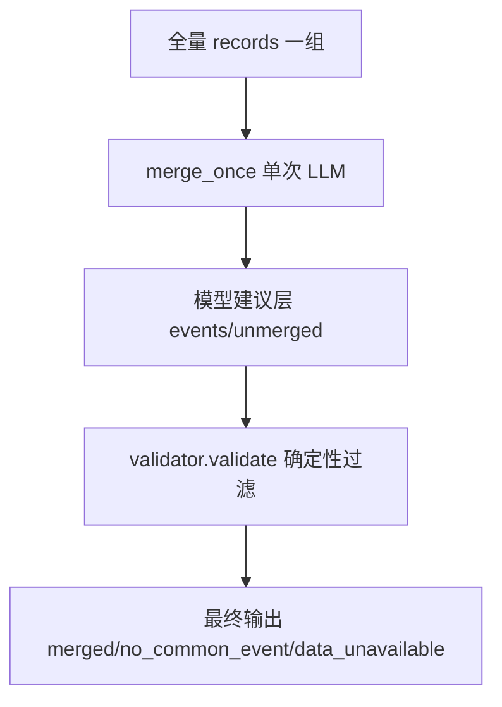
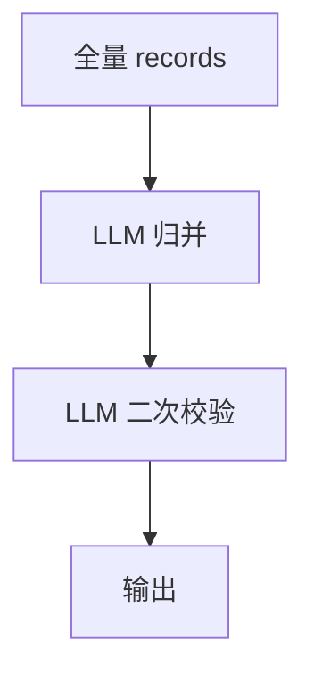

# ADR-001: 单次 LLM 调用 + 确定性 validator 权威 + 复用上游新闻

| Field | Value |
|---|---|
| **Status** | Accepted |
| **Date** | 2026-11-22 |
| **Decision ID** | ADR-001 |

---

## 1. 设计问题

B 模块需要把 2–3 个 ticker、每个最多 5 条新闻记录归并为「跨标的共同事件」。核心矛盾：

1. **调用粒度**：模型应一次处理全部记录，还是逐条/逐对调用？
2. **信任边界**：模型的归并建议能否直接作为最终事实输出？
3. **数据复用**：新闻抓取逻辑是自己重写，还是复用上游既有能力？

---

## 2. Driving Requirements

| REQ ID | Why This Decision Matters |
|---|---|
| FR-B-3 | 全量记录一组交模型，最多一次 LLM 调用 — 谁约束调用次数？ |
| FR-B-7 | 确定性 validator 校验 evidence ID/ticker/date — 谁做权威？ |
| NFR-B-1 / NFR-B-2 | 解析率 100%、伪造/跨运行 ID = 0 — 由哪层保证？ |
| INV-B-1 | 每次归并最多一次 LLM 调用 — 不可妥协 |
| INV-B-3 / INV-B-5 | validator 权威、模型不覆盖确定性边界 |

---

## 3. Options Considered

### 方案 A：逐条/逐对调用（N×M 次 LLM）

> 对每条新闻或每对记录分别调用模型判断是否同事件，再聚合。

| Risk / Trade-off | Detail |
|---|---|
| 调用次数失控 | 15 条记录可产生数十次调用，违反 FR-B-3/INV-B-1 |
| 成本与延迟 | token 成本、墙钟时间随 N 放大 |
| 一致性差 | 各次调用上下文割裂，难以做全局归并 |
| 违背硬约束 | v3 §3「不得逐条新闻分别调用模型」 |

**判定：拒绝（违反硬性不变量）。**

---

### 方案 B：单次 LLM 归并 + 确定性 validator ← CHOSEN

> 一次调用把全部限定记录交给模型，产出事件分组建议；确定性 validator 再逐项校验证据合法性并过滤，二次检查每个事件 ≥2 ticker。

| Gate | What It Catches |
|---|---|
| **merge_once 单次调用** | 约束 LLM 调用次数 == 1（INV-B-1） |
| **validator 权威** | 伪造 ID、错配 ticker/date/source、单一 ticker 事件 |
| **状态机** | 无记录 / 无共同事件 / 有归并 三态区分（FR-B-6） |

---

### 方案 C：双 LLM（一次归并 + 一次独立校验）

> 用第二个 LLM 调用复核第一个模型的归并结果，再输出。

| Trade-off | Detail |
|---|---|
| Gains | 多一层语义复核 |
| Costs | 额外一次 LLM 调用（违反 INV-B-1「最多一次」） |
| 无必要 | 证据合法性是确定性可判定的，不需要第二个模型；语义质量由固定评估集 + 阈值门禁覆盖 |

**判定：拒绝（违反单次调用硬约束，且证据校验应由确定性代码承担）。**

---

## 4. Chosen

**方案 B：单次 LLM 归并 + 确定性 validator 权威 + 复用上游新闻能力。**

> 模型负责「判断新闻内容是否同事件」（语义、建议），确定性 validator 负责「证据是否合法可输出」（ID 归属、ticker/date/source 匹配、≥2 ticker）。二者分层，模型不能覆盖确定性边界。

---

## 5. AI 上下文分层与关键约束

### 上下文分层

| 层 | 内容 | 注入时机 |
|---|---|---|
| **系统层** | 归并规则：同事件判据、≥2 ticker、不强配、输出 schema | 每次调用固定注入 |
| **数据层** | 全量 `NewsRecord[]`（≤15 条，每条含 evidence_id/ticker/date/source/title/snippet） | 本次运行一次注入 |
| **约束重注入** | 关键约束（≥2 ticker、evidence_id 必须原样引用、不强配泛化词） | prompt 内显式列出，防止模型越界 |

### Token 预算

- 输入上限：2–3 ticker × ≤5 条 = ≤15 条记录；每条 `title + snippet` 截断到固定长度，保证单次调用 token 可控。
- 约束：snippet 取 title + summary 前 N 字（`news_source` 截取），避免整篇文章注入。

### 关键约束重新注入政策

- prompt 显式要求模型**原样引用** `evidence_id`，不得自行编造。
- validator 作为兜底：即便模型编造/错配，也在确定性层被剔除（INV-B-5）。

---

## 6. Consequences

| Easier | Harder |
|---|---|
| 调用次数可证明（==1），成本/延迟可控 | 需要确定性 validator 层，增加组件 |
| 证据合法性可离线确定性测试，不需真实模型 | prompt 设计需显式约束原样引用 evidence_id |
| 权威边界清晰可审计 | 语义质量依赖固定评估集持续维护 |

---

## 7. Re-Open Triggers

| Trigger | Threshold |
|---|---|
| LLM 调用次数 >1 | 任何实例 |
| 伪造/跨运行 ID 通过 validator | 任何实例（>0） |
| 语义阈值连续不达标 | 连续 2 次 CI 失败 |
| 需求变更要求第二类模型调用 | 新需求 |
| 模型/provider 替换 | 重放固定语义评估集 |

---

## 8. Re-Opening Conditions

| Condition | Process |
|---|---|
| 触发任一 reopen trigger | 一 sprint 内新建下一编号 ADR，评估本 ADR 是否仍成立 |
| 模型替换 | 重放 `test/fixtures/semantic_eval.json`，未达阈值不得合并 |
| 评估集版本变化 | 记录样例版本，更新 `evaluation-logbook.md` |
