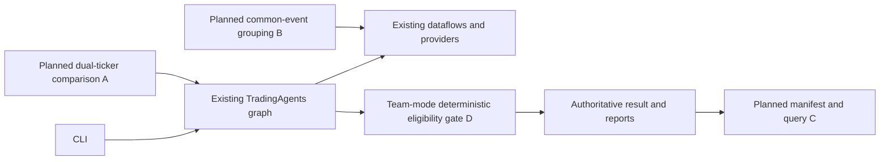

# Architecture blueprint

Status: draft for human review. ADR-001 selects layout migration plus narrow
extensions. FR-A–C remain planned; FR-D has a local implementation with full
offline regression passing; remote CI and independent reviews remain pending.

## Drivers and boundaries

Preserve TradingAgents capabilities and Python imports; target Python 3.13; keep
four owners independent after interface approval; avoid new runtime dependencies;
require deterministic evidence and final-rating authority boundaries.

LLM narrative is advisory. Validated provider/evidence metadata and D's final
rating govern published structured results. The local D implementation adds an
explicit `team` decision mode and a deterministic graph gate after the Portfolio
Manager; `standard` remains the default. INV-D is not claimed verified until the
full offline suite and independent safety/integration reviews pass. ADR-002
records the implemented design and the remaining review boundaries.

## Components and integration

Upstream agents/graph/dataflows/llm_clients/memory/reporting and CLI retain their
responsibilities. Module ownership is listed in AGENTS.md. Shared schemas and
the implemented D interface are recorded in interface-contracts.md.
Default config and existing provider interfaces are reused.

## Supervision, verification and observability

Prompt.md imposes human plan/test/build/verification gates. Project OpenCode
permissions use default-deny tool rules with explicit read scopes and per-edit
confirmation. Shell execution always requires confirmation; it is not an OS sandbox.
Three-tier verification follows verification-constraints.md. Results record real
commands and failures; PRs update trace links, reviews and AI-use metadata.

## Change policy

Interface, dependency, safety and context-budget changes require ADR updates and
human review. Schema/model/prompt changes require relevant re-evaluation; a fixed
model evaluation runner/data remains a prerequisite for B delivery. No live API
calls, broker execution or remote repository modification are part of initialization.
