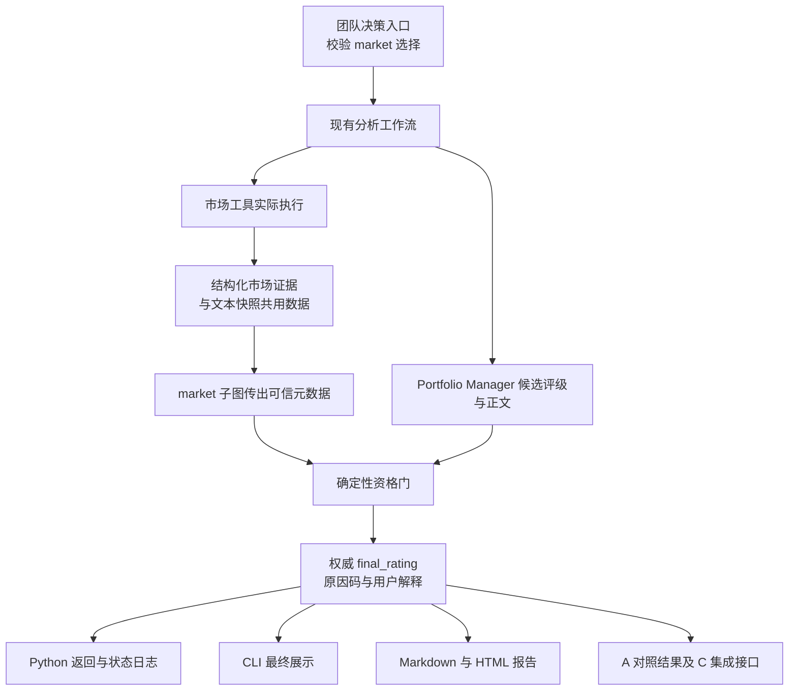

# New session - 2026-11-21T17:29:15.043Z

**Session ID:** ses_e00d849dcffeM5LLQ7MmYPMw3L
**Created:** 11/22/2026, 1:29:15 AM
**Updated:** 11/22/2026, 2:29:39 AM

---

## User

你现在所在的目录是仓库根目录，远端仓库已设置好，现在处于main分支，新建一个分支名字叫D，在新分支中进行开发，不得私自向远端main分支提交，阅读仓库目录中./docs/reference下的project-requirements.md和module-acceptance.md，你的任务是完成其中的D模块，先给我一版任务流程的详细蓝图方案，注意在过程中记录D1-9需要提交的东西，例如需求决策、会话记录等等，Report.md也应该随开发过程整理并更新。 

---

## Assistant (Plan · GPT-6.1 Sol · 13.8s)

 

我会先核对分支状态、D 模块的要求和仓库的开发约束，再给出可审阅的详细蓝图，涵盖测试审批、D1–D9 证据留存及 `Report.md` 的更新安排。当前是只读规划阶段；创建 `D` 分支会列为实施第一步，本轮不修改仓库，也不提交或推送。


**Tool: bash**

**Input:**
```json
{
  "command": "git status --short --branch && git branch --list && git log --oneline -5",
  "workdir": "/home/sb1111111/cs5351-project/CS5351-TradingAgents"
}
```

**Output:**
```
## main...origin/main
* main
830fc86 fix(ci): resolve governance imports with pytest entry point
11f112d Chore: initialize CS5351-TradingAgents
9fa1196 announce Trading-R1 official release
c454491 Merge pull request #1613 from TauricResearch/v0.7.1
3e44faa release: 0.7.1

```

**Tool: read**

**Input:**
```json
{
  "filePath": "/home/sb1111111/cs5351-project/CS5351-TradingAgents/docs/reference"
}
```

**Output:**
```
<path>/home/sb1111111/cs5351-project/CS5351-TradingAgents/docs/reference</path>
<type>directory</type>
<entries>
module-acceptance.md
project-requirements.md

(2 entries)
</entries>
```

**Tool: read**

**Input:**
```json
{
  "filePath": "/home/sb1111111/cs5351-project/CS5351-TradingAgents/docs/architecture"
}
```

**Output:**
```
<path>/home/sb1111111/cs5351-project/CS5351-TradingAgents/docs/architecture</path>
<type>directory</type>
<entries>
adr/
architecture-blueprint.md
evaluation-table.md
interface-contracts.md
invariants.md
memory-design.md
permission-model.md
runtime-policy-catalog.md
trace-matrix.md

(9 entries)
</entries>
```

**Tool: read**

**Input:**
```json
{
  "filePath": "/home/sb1111111/cs5351-project/CS5351-TradingAgents/docs/req/requirements.yaml"
}
```

**Output:**
```
<path>/home/sb1111111/cs5351-project/CS5351-TradingAgents/docs/req/requirements.yaml</path>
<type>file</type>
<content>
1: schema_version: 1
2: status: draft-awaiting-human-review
3: source_documents:
4:   - docs/reference/project-requirements.md
5:   - docs/reference/module-acceptance.md
6: requirements:
7:   - id: FR-A
8:     type: functional
9:     owner: A
10:     status: planned
11:     statement: Analyze exactly two distinct tickers on one date and save a comparison report with per-ticker state, authoritative rating, summary and report link.
12:     priority: Must
13:     tradeoff: Sequential existing graph calls; no portfolio simulation.
14:     source: project-requirements section 4
15:     fit_criterion:
16:       metric: approved comparison scenarios passed
17:       threshold: 100%
18:       verification: "test/offline/test_comparison.py (planned): normal, invalid and duplicate ticker, future date and failure cases"
19:   - id: NFR-A
20:     type: quality
21:     owner: A
22:     status: planned
23:     statement: Preserve the successful ticker report whenever the other ticker fails.
24:     priority: Must
25:     tradeoff: Explicit partial results instead of whole-request failure.
26:     source: project-requirements section 5
27:     fit_criterion:
28:       metric: successful report retention in both injected single-failure cases
29:       threshold: 100%
30:       verification: test/offline/test_comparison.py (planned)
31:   - id: FR-B
32:     type: functional
33:     owner: B
34:     status: planned
35:     statement: Group common events for 2–3 tickers, at most 7 days and 5 records per ticker, using actual news text and at most one grouping model call; publish evidence-backed groups involving at least two tickers.
36:     priority: Must
37:     tradeoff: No heat score, impact ranking or prediction; ungrouped and unavailable records remain explicit.
38:     source: project-requirements section 4; module-acceptance section 3
39:     fit_criterion:
40:       metric: pairwise semantic precision and recall plus schema and evidence checks
41:       threshold: precision at least 0.80 and recall at least 0.70 on 20 or more human-reviewed pairs (at least 10 positive and 10 negative)
42:       verification: "test/offline/test_events.py (planned); fixed real-model evaluation dataset and runner pending human review"
43:   - id: NFR-B
44:     type: quality
45:     owner: B
46:     status: planned
47:     statement: All published evidence references resolve to this run and match their ticker and date metadata.
48:     priority: Must
49:     tradeoff: Discard unverified groups rather than infer citations.
50:     source: project-requirements section 5
51:     fit_criterion:
52:       metric: valid reference rate and fabricated or cross-run references
53:       threshold: 100% valid references and zero fabricated or cross-run references
54:       verification: test/offline/test_events.py (planned), including forged IDs and mismatched metadata
55:   - id: FR-C
56:     type: functional
57:     owner: C
58:     status: planned
59:     statement: Write a versioned run_manifest.json for successful and failed runs and provide read-only local ticker/date query with per-file warnings.
60:     priority: Must
61:     tradeoff: Only known configuration metadata; no guessed provider provenance.
62:     source: project-requirements section 4
63:     fit_criterion:
64:       metric: approved manifest/query cases passed
65:       threshold: 100%
66:       verification: "test/offline/test_manifest.py (planned): malformed/unknown schemas, missing reports, filters and unsafe paths"
67:   - id: NFR-C
68:     type: performance
69:     owner: C
70:     status: planned
71:     statement: Query 1000 synthetic manifests within the approved CI timing budget.
72:     priority: Must
73:     tradeoff: The 2-second threshold is proposed and requires human approval before feature implementation.
74:     source: project-requirements section 5
75:     fit_criterion:
76:       metric: wall-clock seconds on a fixed CI runner
77:       threshold: at most 2 seconds (proposed)
78:       verification: versioned dataset generator and performance runner pending implementation
79:   - id: FR-D
80:     type: functional
81:     owner: D
82:     status: planned
83:     statement: Publish REVIEW with reason codes if critical market evidence is missing, unavailable, not run or future-dated, or if the rating is invalid, regardless of model narrative.
84:     priority: Must
85:     tradeoff: Only approved critical evidence blocks; optional sources follow explicit degradation policy.
86:     source: project-requirements section 4
87:     fit_criterion:
88:       metric: eligible and ineligible fixtures correctly reflected in structured result, CLI and report
89:       threshold: 100%
90:       verification: "test/offline/test_eligibility.py (planned): model Buy conflicts with unavailable evidence"
91:   - id: NFR-D
92:     type: security
93:     owner: D
94:     status: planned
95:     statement: The deterministic eligibility boundary cannot be bypassed by model text or a secondary output adapter.
96:     priority: Must
97:     tradeoff: REVIEW replaces actionable output under uncertainty.
98:     source: project-requirements section 5
99:     fit_criterion:
100:       metric: gate bypasses in approved negative fixtures
101:       threshold: zero
102:       verification: test/offline/test_eligibility.py (planned), safety-path PR review and ADR
103:   - id: BASE-01
104:     type: invariant
105:     owner: team
106:     status: baseline
107:     statement: Preserve upstream imports, resource discovery and date/point-in-time safety semantics through layout migration.
108:     priority: Must
109:     tradeoff: Path adaptation only; upstream functionality is not counted as team implementation.
110:     source: upstream 9fa1196fffbcfd9de5146d2dd2869df84ab99838
111:     fit_criterion:
112:       metric: upstream offline regression failures after migration
113:       threshold: zero
114:       verification: python -m pytest test/offline; package/import/resource smoke checks
115:   - id: SEC-01
116:     type: security
117:     owner: team
118:     status: draft
119:     statement: Shared repository artifacts must exclude secrets and private account inputs.
120:     priority: Must
121:     tradeoff: Use synthetic fixtures and allowlisted metadata.
122:     source: project-requirements section 6
123:     fit_criterion:
124:       metric: confirmed secret occurrences in submission artifacts
125:       threshold: zero
126:       verification: CI credential-pattern scan and human export/repository review
127:   - id: GOV-01
128:     type: governance
129:     owner: D
130:     status: draft
131:     statement: Feature code requires prior human test/plan approval and an updated AI-use log.
132:     priority: Must
133:     tradeoff: Block unapproved feature changes; initialization does not fabricate approval.
134:     source: project-requirements D3/D9 and CI gate requirements
135:     fit_criterion:
136:       metric: unapproved feature code merges
137:       threshold: zero
138:       verification: "scripts/check_governance.py --base BASE plus required GitHub reviews/branch protection (remote configuration pending)"
139:   - id: QUA-01
140:     type: quality
141:     owner: team
142:     status: draft
143:     statement: Validate the requirement registry structure and reference integrity in CI.
144:     priority: Must
145:     tradeoff: Schema validation checks format, not implementation completion.
146:     source: project-requirements D1
147:     fit_criterion:
148:       metric: schema and local reference validation errors
149:       threshold: zero
150:       verification: python scripts/check_governance.py

(End of file - total 150 lines)
</content>
```

**Tool: read**

**Input:**
```json
{
  "filePath": "/home/sb1111111/cs5351-project/CS5351-TradingAgents/.opencode/skills/session-artifacts/SKILL.md"
}
```

**Output:**
```
<path>/home/sb1111111/cs5351-project/CS5351-TradingAgents/.opencode/skills/session-artifacts/SKILL.md</path>
<type>file</type>
<content>
1: ---
2: name: session-artifacts
3: description: Use at CS5351 session completion to record reusable outcomes, actual validation and complete OpenCode transcript exports.
4: ---
5: 
6: # Session completion
7: 
8: Record the real scope, changed files, requirement/ADR links, commands, results,
9: failures and next decisions in `.opencode/skills/<name>/SKILL.md`. Never label
10: planned features, incomplete tests or missing approvals as delivered.
11: 
12: Use the TUI `/export` for the complete active session and save under
13: `transcripts/raw/`; preserve original content and add human annotations separately.
14: Native CLI JSON export is an additional lossless backup, not a forged Markdown
15: export. If no active-session export tool is available, state that blocker and
16: ask the human to run `/export`. Add real paths to the AI-use log only after export.
17: Check all shared artifacts for credentials and private account details.

(End of file - total 17 lines)
</content>
```

**Tool: read**

**Input:**
```json
{
  "filePath": "/home/sb1111111/cs5351-project/CS5351-TradingAgents/docs/baseline.md"
}
```

**Output:**
```
<path>/home/sb1111111/cs5351-project/CS5351-TradingAgents/docs/baseline.md</path>
<type>file</type>
<content>
1: # Baseline and contribution boundary
2: 
3: - Upstream: https://github.com/tauricresearch/tradingagents
4: - Baseline: `9fa1196fffbcfd9de5146d2dd2869df84ab99838` (2026-11-04).
5: - License: upstream Apache-2.0, preserved in root LICENSE.
6: - Team remote: https://github.com/sui-feng-cb/CS5351-TradingAgents
7: - The local repository retains upstream history; the local clone has been deepened
8:   from the official `upstream` remote so the historical baseline is available.
9: - Initialization changes are uncommitted pending human review. No migration or
10:   feature commit ID is claimed before one actually exists.
11: 
12: | Upstream path | Project path | Classification |
13: |---|---|---|
14: | `tradingagents/` | `src/tradingagents/` | Baseline moved, public imports retained |
15: | `cli/` | `src/cli/` | Baseline moved, entry point retained |
16: | `tests/conftest.py` | `test/conftest.py` | Shared upstream fixture |
17: | `tests/test_*.py` | `test/offline/test_*.py` | Upstream offline regression pending path review |
18: | DeepSeek live class in mixed test | `test/live/test_deepseek_structured.py` | Same real-API assertions, relocated |
19: | Upstream README | `docs/upstream/README.md` | Preserved reference, relative image links adjusted |
20: 
21: Three path-sensitive upstream tests require root/src path adjustments:
22: test_version, test_layering, test_i18n_coverage. Test assertions and acceptance
23: semantics must remain intact. Production Python sources are not feature changes.
24: The migration is not accepted until all such paths are adapted and the baseline
25: suite passes.
26: 
27: Existing parallel analysts, date guards, reports, backtests, memory, portfolio
28: context and rating parser remain upstream contributions. The planned comparison,
29: event grouping, manifest query and decision gate cannot be claimed as delivered.
30: See `docs/verification/initialization.md` for actual installation/test results.

(End of file - total 30 lines)
</content>
```

**Tool: read**

**Input:**
```json
{
  "filePath": "/home/sb1111111/cs5351-project/CS5351-TradingAgents"
}
```

**Error:**
```
The user has specified a rule which prevents you from using this specific tool call. Here are some of the relevant rules [{"permission":"*","action":"allow","pattern":"*"},{"permission":"read","pattern":"*","action":"allow"},{"permission":"read","pattern":"*.env","action":"ask"},{"permission":"read","pattern":"*.env.*","action":"ask"},{"permission":"read","pattern":"*.env.example","action":"allow"},{"permission":"*","action":"deny","pattern":"*"},{"permission":"read","pattern":"*","action":"deny"},{"permission":"read","pattern":"AGENTS.md","action":"allow"},{"permission":"read","pattern":"Prompt.md","action":"allow"},{"permission":"read","pattern":"README.md","action":"allow"},{"permission":"read","pattern":"Report.md","action":"allow"},{"permission":"read","pattern":"architecture-blueprint.md","action":"allow"},{"permission":"read","pattern":"LICENSE","action":"allow"},{"permission":"read","pattern":"pyproject.toml","action":"allow"},{"permission":"read","pattern":"requirements*.txt","action":"allow"},{"permission":"read","pattern":"src/**","action":"allow"},{"permission":"read","pattern":"test/**","action":"allow"},{"permission":"read","pattern":"docs/**","action":"allow"},{"permission":"read","pattern":"scripts/**","action":"allow"},{"permission":"read","pattern":"prompts/**","action":"allow"},{"permission":"read","pattern":"transcripts/**","action":"allow"},{"permission":"read","pattern":".github/**","action":"allow"},{"permission":"read","pattern":".opencode/**","action":"allow"},{"permission":"read","pattern":".agent/**","action":"allow"},{"permission":"read","pattern":".env*","action":"deny"},{"permission":"read","pattern":".env.example","action":"allow"},{"permission":"read","pattern":".env.enterprise.example","action":"allow"}]
```

---

## Assistant (Plan · GPT-6.1 Sol · 13.9s)

 

_Thinking:_

**Reading main docs**

**Tool: read**

**Input:**
```json
{
  "filePath": "/home/sb1111111/cs5351-project/CS5351-TradingAgents/docs/reference/project-requirements.md"
}
```

**Output:**
```
<path>/home/sb1111111/cs5351-project/CS5351-TradingAgents/docs/reference/project-requirements.md</path>
<type>file</type>
<content>
1: # CS5351 小组项目要求 v4
2: 
3: > 团队确认草案。课程交付要求依据课程项目规格、课程介绍和教师补充说明整理。课程通知或教师最新说明优先。成员用 A、B、C、D 代称，正式提交时使用真实姓名和学号。
4: 
5: ## 1. 项目目标
6: 
7: 在现有 TradingAgents 代码基线上，使用 OpenCode 和可审计的人类监督完成有明确需求、架构约束、验证证据和工程治理的增强。项目须保留 TradingAgents 的 AI 应用能力，并至少包含一项由确定性代码执行的安全相关边界。模型输出不能覆盖该边界。
8: 
9: 四名成员各负责 **一项功能需求（FR）和一项非功能需求（NFR）**，全组共形成四项 FR 和四项 NFR。项目定位为金融分析研究工具，输出用于研究分析。团队贡献以新增或实质修改的组件及实际工程工作为准。
10: 
11: ## 2. 原项目功能基线与新增边界
12: 
13: 上游仓库为 `https://github.com/tauricresearch/tradingagents`。本次分析所用基线 commit 为 `9fa1196fffbcfd9de5146d2dd2869df84ab99838`（2026-11-04）。建立团队仓库时再次核对并记录该 commit。
14: 
15: ### 2.1 上游已有能力
16: 
17: - Python 应用使用 LangGraph 编排多 agent 分析流程，提供 CLI 与 Python 调用方式。
18: - 可针对指定标的和日期运行分析。market、social/sentiment、news、fundamentals 分析员能够并行工作。
19: - 分析流程还包括看多/看空研究、研究管理、交易计划、激进/中性/保守风险讨论及 Portfolio Manager 最终评级。
20: - 数据工具涵盖价格、技术指标、基本面、公司财报、新闻、社交内容、宏观指标和预测市场，支持多个模型和供应商配置。
21: - 可保存分节和完整 Markdown 报告及可选 HTML，也支持运行记忆、checkpoint/resume 和多标的/日期历史回测。
22: - 团队增强复用已有的日期边界、历史数据时点约束、数据不可用处理和评级解析。
23: 
24: ### 2.2 四项增强的上游依据
25: 
26: | 模块 | 上游已覆盖 | 团队新增范围 |
27: |---|---|---|
28: | A 同日双标的对照 | 可分析单标的，也可遍历标的与日期做历史回测。 | 将同日运行的两份分析并列在一份报告中。 |
29: | B 跨标的共同事件归并 | 有单标的新闻和情绪报告，也有全球宏观新闻工具。 | 模型根据具体新闻内容识别跨标的共同事件，并关联输入证据。 |
30: | C 运行记录与查询 | 有报告目录及部分运行配置记录。 | 保存统一的机器可读运行清单，并提供标的与日期查询。 |
31: | D 确定性决策资格门 | 有 LLM 风险讨论，无法解析的评级会标记 `REVIEW`。 | 最终评级须通过确定性关键市场证据检查。 |
32: 
33: ## 3. 团队分工原则
34: 
35: - A–D 根据第 4、5 节分别负责各自的 FR 和 NFR。共同输入与输出契约冻结后，四个模块可独立分支开发，通过 PR 集成。
36: - D 同时协调任务、接口依赖和集成进度。各 PR 由非作者评审，D 的安全关键变更由其他成员评审。
37: - 编码和验证按 [D3、D4 与 D9](#9-必交成果-d1d9) 执行。基线、团队新增及实质修改的归属通过 `docs/baseline.md`、Git 历史和报告追踪。
38: 
39: ## 4. 四项 FR 的统一行为约束
40: 
41: ### FR-A 同日双标的对照报告
42: 
43: 用户提供两个不同的有效标的和一个共同分析日期。系统分别调用上游现有分析流程，生成一份汇总 Markdown 报告，至少列出每个标的的运行状态、最终评级或 `REVIEW`、简要结果和完整报告路径。
44: 
45: 两次运行可顺序执行，交付范围限于同日分析对照。任一标的运行失败时，保留另一个标的的成功结果，并在失败项显示原因。数据、评级和报告须对应正确的标的。
46: 
47: ### FR-B 跨标的共同事件归并
48: 
49: 用户提供 2–3 个标的和最多 7 天的回看窗口。系统从现有新闻数据中取得每个标的最多 5 条记录，将标的、日期、来源 ID 和标题或内容片段交给模型。模型根据新闻内容判断记录是否描述同一具体事件，并生成简短摘要。热度评分、影响力排序和价格预测均在本模块范围之外。
50: 
51: 每个输出事件至少关联两个标的，并列出被归并的新闻来源 ID、标的和日期。证据不足的记录保留为未归并项。没有可用记录时标记“数据不可用”或“无记录”。只有在有可用记录且未检测出跨标的共同事件时，才报告“没有发现共同事件”。
52: 
53: 确定性校验须确认引用的来源 ID 来自本次输入，且标的与日期匹配对应记录。只展示通过校验的事件证据。用固定人工标注样例评估模型对同一事件的判断，证据引用校验按 NFR-B 单独验证。
54: 
55: ### FR-C 运行 Manifest 与本地查询
56: 
57: 每次分析运行在结果目录保存 `run_manifest.json`，至少包含 schema version、run ID、代码版本或 commit（可取得时）、标的、资产类型、分析日期或 as-of、起止时间、所选分析员、模型和供应商标识、配置的数据供应商、运行状态及报告相对路径。数据供应商字段标明是配置值。未知值用 `null` 或 schema 定义的 unknown 状态表示。
58: 
59: CLI 按标的、日期或两者查询运行清单，并显示对应报告路径。查询只读结果目录，无需外部服务。单个清单损坏、缺失或版本不受支持时，提示原因并继续查询其他记录。清单使用允许的字段记录运行信息，排除密钥、含凭证的 URL 和敏感账户数据。
60: 
61: ### FR-D 确定性决策资格门
62: 
63: 在团队决策模式中要求 market analyst 参与。最终输出前，由确定性代码检查关键市场证据和评级。market analyst 未运行、市场快照缺失或不可用、快照日期晚于分析日期，或评级不在五级允许值内时，最终结果为 `REVIEW`，并提供机器可读及用户可见的触发原因。
64: 
65: 证据有效性来自实际数据和执行状态。资格门给出的评级是 CLI、报告与机器可读结果使用的权威评级。其他非关键分析源缺失时按运行时策略降级。
66: 
67: ## 5. A–D 的 NFR 指标与验收
68: 
69: | 成员/ID | NFR | 指标及验收阈值 | 验证方法 |
70: |---|---|---|---|
71: | A / NFR-A | 部分失败恢复 | 双标的运行中，任一标的失败时，另一标的成功报告的保留率为 100%。 | 固定 mock graph，分别注入第一个和第二个标的失败。 |
72: | B / NFR-B | 证据可追溯性 | 输出证据 ID 的解析率为 100%，伪造或跨运行 ID 数为 0。 | 用确定性校验器核对固定样例，加入非法 ID 和跨运行 ID 的负向测试。 |
73: | C / NFR-C | 响应性能 | 在固定 CI runner 上查询 1,000 份合成 manifest，墙钟时间不超过 2 秒。 | 固定生成器、机器类型与计时脚本，重复运行并记录结果。若基线证明目标不可行，在实现前批准替代阈值。 |
74: | D / NFR-D | 安全资格 | 预先列出的关键证据失败用例中，资格门绕过次数为 0。 | 构造模型评级 `Buy`，注入缺失、不可用或晚于 as-of 的关键证据，并验证最终 `REVIEW`。 |
75: 
76: 按 D1 登记四项 NFR 的输入、环境、阈值、验证命令和通过条件。实现前用固定样例或 CI 环境核验并批准目标值。
77: 
78: ## 6. 技术参考与版本
79: 
80: - 统一使用 Python 3.13。初始依赖和开发工具沿用锁定上游 commit 的 `pyproject.toml`，复用现有 LangGraph、LangChain、Typer、数据供应商接入、报告和 pytest 实现。确需新增运行时依赖时，通过 PR 和 ADR 记录理由及批准。
81: - 比较质量、Token 成本和耗时时，记录样本版本、模型与供应商配置、运行环境和真实测量结果。测试分类及运行方式见 D8。
82: - 源码、环境配置、运行记录、测试、会话、PPT 与视频均须排除真实密钥、凭证 URL 和敏感账户资料。
83: 
84: ## 7. 团队仓库结构与文件用途
85: 
86: 以下为单一团队仓库的目标目录。课程交付文件的具体内容统一在 [第 9 节](#9-必交成果-d1d9) 说明。
87: 
88: ```text
89: <team-app>/
90: ├── README.md
91: ├── LICENSE
92: ├── AGENTS.md
93: ├── architecture-blueprint.md
94: ├── Prompt.md
95: ├── Report.md
96: ├── pyproject.toml
97: ├── .env.example
98: ├── .opencode/
99: │   ├── permissions.jsonc
100: │   └── rules.md
101: ├── .agent/rules.md
102: ├── .github/workflows/ci.yml
103: ├── docs/
104: │   ├── baseline.md
105: │   ├── req/
106: │   │   ├── requirements.yaml
107: │   │   └── req-schema.json
108: │   ├── architecture/
109: │   │   ├── architecture-blueprint.md
110: │   │   ├── adr/001-<decision>.md
111: │   │   ├── invariants.md
112: │   │   ├── trace-matrix.md
113: │   │   ├── memory-design.md
114: │   │   ├── permission-model.md
115: │   │   ├── runtime-policy-catalog.md
116: │   │   ├── evaluation-table.md
117: │   │   ├── evaluation-logbook.md       # 可选
118: │   │   ├── risk-list.md                # 可选
119: │   │   └── option-ledger.md            # 可选
120: │   ├── code-governance/
121: │   │   ├── structural-constraints.md
122: │   │   ├── verification-constraints.md
123: │   │   └── mcp-tool-manifest.md
124: │   ├── ai-use-log.yaml
125: │   ├── review-memo.md
126: │   ├── debt-register.md
127: │   └── bug-diary.md
128: ├── prompts/
129: ├── src/
130: │   ├── tradingagents/
131: │   └── cli/
132: ├── test/
133: │   ├── offline/
134: │   ├── live/
135: │   └── fixtures/
136: └── transcripts/
137:     └── <student-id>-<student-name>.md
138: ```
139: 
140: | 工程文件及目录 | 内容与作用 |
141: |---|---|
142: | `LICENSE` | 保留上游许可证及适用的版权声明。 |
143: | `pyproject.toml` | 管理构建、依赖、CLI 入口、包发现和测试工具设置。 |
144: | `.env.example` | 提供运行所需的变量名和无效占位值。 |
145: | `docs/baseline.md` | 登记上游 URL、锁定 commit、路径映射、迁移提交与验证证据，以及上游既有代码和团队成果的归属。 |
146: 
147: ## 8. 原仓库并入及结构迁移方案
148: 
149: 1. 核对上游 URL、锁定 commit、许可证和干净工作树。以该 commit 建立团队仓库并保留上游历史。上游官方仓库用 `upstream`，团队 GitHub 仓库用 `origin`。
150: 2. 在同一仓库加入团队交付文件。同名文件包括 `README.md` 和 `pyproject.toml`，以可审查的增量修改接入。
151: 3. 按上游原布局先运行基线测试并留证，再以独立迁移提交将应用包和 CLI 移至 `src/tradingagents/`、`src/cli/`，把上游 `tests/` 按实际依赖归入 D8 指定的目录。同步调整包发现、CLI、资源路径、pytest 和 CI。
152: 4. 迁移后验证包安装、CLI 启动、资源发现、离线回归、live 测试收集以及缓存和报告路径，再集成 A–D 功能。提交树中保留一套源码和一份 Git 历史，以 `docs/baseline.md` 标出迁移与增强的提交边界。
153: 
154: ## 9. 必交成果 D1–D9
155: 
156: ### D1 — 机器可读需求
157: 
158: - `docs/req/requirements.yaml` 使用 YAML 表达产品需求，兼作统一需求注册表和机器可读 PRD。Introduction 第 24 页将该文件标为 machine-readable PRD。
159: - 每条记录至少含 ID、类型、需求陈述、可机器检查的 fit criterion 和 MoSCoW 优先级，并说明来源与取舍。团队需求同时标明负责人及验收人。
160: - 类型覆盖功能、不变量、质量属性、性能、成本、治理和安全。不变量是不可妥协的规则，验收实行零容忍。NFR 使用指标、阈值和验证方式。
161: - 纳入基线分析发现的相关需求并关联来源，区分既有能力、需保持的约束、本次影响范围和新增或修改需求。
162: - `docs/req/req-schema.json` 定义注册表的 JSON Schema。CI 校验见第 12 节。
163: 
164: ### D2 — 架构文档
165: 
166: 八类必需工件均使用 Markdown，权威正文放在 `docs/architecture/`。根目录 `architecture-blueprint.md` 仅保留指向 `docs/architecture/architecture-blueprint.md` 的 Markdown 链接。
167: 
168: | 工件 | 应包含的内容 |
169: |---|---|
170: | `architecture-blueprint.md` | 范围、驱动因素、系统与组件边界、建议性和权威性决策的分界，以及 agent 工作流、权限、验证、可观测性和变更政策。 |
171: | `adr/001-<decision>.md` 等 | 设计问题、比较过的方案、选择理由、后果及重新考虑条件。记录 AI 上下文分层和组装流程、Token 预算、压缩阈值、关键约束重新注入政策。 |
172: | `invariants.md` | 各不变量的陈述、来源需求、负责执行的组件、验证方法及违反后采取的具体兜底动作。 |
173: | `trace-matrix.md` | 各项需求到执行组件、测试或其他证据、运行时监控的映射。随实现与验证持续更新。 |
174: | `memory-design.md` | 跨会话、中断和版本保留的状态，以及其读写、所有权、保留期限、恢复和隐私规则。 |
175: | `permission-model.md` | 按 coding agent 角色规定文件级读写权限，默认无权限，允许路径逐项加入白名单。 |
176: | `runtime-policy-catalog.md` | 各类降级和失败路径的触发条件及运行时动作。 |
177: | `evaluation-table.md` | 候选架构比较、评价依据和设计取舍。 |
178: 
179: 详细规格正文列为可选的三类工件是 `evaluation-logbook.md`（架构评估过程与证据）、`risk-list.md`（风险及复查条件）和 `option-ledger.md`（被否决的方案、理由与重新考虑条件）。
180: 
181: ### D3 — 编码治理
182: 
183: | 文件 | 应包含的内容 |
184: |---|---|
185: | `AGENTS.md` | Coding agent 的统一入口。说明构建目标、读取顺序、代码基线、模块组织、集成契约、权限范围和验证要求。 |
186: | `docs/code-governance/structural-constraints.md` | 架构元素到模块的映射、扩展现有基线的边界、模块与函数对应的 ADR 和不变量，以及权威接口与决策边界。 |
187: | `docs/code-governance/mcp-tool-manifest.md` | 可用工具及各角色的调用权限。记录项目实际采用的工具和 MCP 配置。 |
188: | `.opencode/permissions.jsonc` | 机器可读的角色权限、守卫规则和执行机制。 |
189: | `.opencode/rules.md` | 始终生效的 agent 行为规则，由人类专门维护。 |
190: | `.agent/rules.md` | 抽象、依赖和测试独立性约定。每项功能至少有一个负向测试，安全关键变更需架构决策和人工批准，需求变化后一个 sprint 内更新相关规则。 |
191: 
192: `.opencode/` 和 `.agent/` 分别保留其课程指定工件。
193: 
194: ### D4 — 验证治理与质量记录
195: 
196: `docs/code-governance/verification-constraints.md` 规定每个验收标准至少对应一个测试，每个不变量至少有一个在被违反时会失败的测试。测试须引用需求或不变量。每轮验证运行全部此前测试，要求零回归。
197: 
198: 1. **结构验证**检查导入、架构和组件边界、权限，以及实现是否符合架构约束。
199: 2. **回归验证**检查此前测试套件是否全部通过。
200: 3. **行为验证**依据可测质量阈值检查应用行为，例如忠实度、相关性和零安全逃逸。
201: 
202: | 持续维护的文件 | 应包含的内容 |
203: |---|---|
204: | `docs/review-memo.md` | 每个 PR 的需求、架构、代码、测试、运行元数据、安全和效率评审，结论为 `APPROVE`、`CHANGES REQUIRED` 或 `REJECT`。 |
205: | `docs/debt-register.md` | 记录提示词腐化、虚构或隐藏依赖、难改代码、agent 膨胀、评估债、护栏债和人类认知债等技术债。 |
206: | `docs/bug-diary.md` | 记录显著缺陷的症状、复现、分类、根因、修复及暴露的不变量缺口。 |
207: 
208: ### D5 — 带人工注释的 Agent 会话记录
209: 
210: - 在 `transcripts/` 保留完整原始会话，文件名体现学号和姓名。以注释标记真实的人工中断、重定向、批准和拒绝，并解释理由。注释与原始记录须同时保留。
211: - 会话合起来覆盖六个过程环节：需求分类、架构候选与评估、编码前计划批准、团队组件构建、验证合规、根据测试证据修订架构。
212: - 按规格总体提交说明准备 **5 份**。D5 正文和目录示例与总体说明在数量或组织方式上的表述有差异，最终提交格式以课程确认为准。团队需为四名成员和六个过程环节安排实际覆盖。
213: - 按教师对基线的澄清，构建证据针对团队由 agent 实现的新增或实质修改组件。以锁定的上游基线标明贡献边界。
214: 
215: ### D6 — 过程报告
216: 
217: - 根目录 `Report.md` 是单一 Markdown 文件，列出四名成员的姓名、学号和相对贡献。相对贡献的平均值为 **1.0**，分配依据实际工作与证据。
218: - 正文不超过 **10,000 words**，图示不计入。按 **12 号字、单倍行距排版时超过 15 页**。Markdown 渲染和页数计算方式以课程确认为准。
219: - 说明软件工程流程及其改进。用需求变化、缺陷趋势或歧义解决等实例展示过程质量，说明工件如何随变更同步演进，以及人类监督发现了哪些 agent 未发现的问题。
220: - 每位成员提供简短个人反思，课程示例长度为 **300–500 words**，注明姓名和学号。
221: 
222: ### D7 — GitHub 仓库
223: 
224: - 团队 GitHub 仓库包含完整源码与测试、有意义的提交历史、真正运行的 CI/CD 阻断机制和分支保护。`.github/workflows/ci.yml` 承载具体检查，门禁及保护规则见 [第 12 节](#12-cicd-强制阻断门禁)。
225: - 根目录 `README.md` 说明项目目的、架构、基线和增强范围、文件组织、安装与运行方式、offline/live/完整测试命令、团队 GitHub 地址和门禁设计。
226: - `docs/ai-use-log.yaml` 按相关 PR 记录 coding agent、需求、实际会话引用、人工监督、变更与验证结果，提交时保持最新。
227: 
228: ### D8 — 源码与测试
229: 
230: - `src/` 放置完整应用源码，模块名称与架构元素对应。上游源码的具体适配方式见第 8 节。
231: - `test/` 放置完整测试。`test/offline/` 包含无需网络或密钥的确定性测试，默认 CI 运行。`test/live/` 包含需要 API 的测试，独立标记并说明运行方式。`test/fixtures/` 放置适用的固定样例、模拟响应和预期结果。
232: 
233: ### D9 — 静态启动提示词
234: 
235: Coding agent 从 `AGENTS.md` 进入项目后读取根目录 `Prompt.md`，先提出包含需求追踪、接口契约、范围、测试策略和执行步骤的计划。**生成代码前必须停止，等待人工批准。** 后续构建和自验证也按阶段经过人工关卡。
236: 
237: 根目录 `Prompt.md` 是开发用启动指令。`prompts/` 用于需要版本管理的应用运行时提示词及其评估信息。
238: 
239: ## 10. Demo Video
240: 
241: 团队 GitHub 仓库代码与 `demo.mp4` 的提交截止时间为 **2026 年 11 月 25 日 23:59，香港时间（UTC+8）**。视频时长为 **10 分钟**，通过课程入口独立提交，放在项目 ZIP 之外。项目 ZIP 按课程仓库结构打包。录制和提交材料均须符合第 6 节的密钥保护要求。
242: 
243: 1. **产品演示**使用可对照的输入和场景展示同一项能力在增强前后的行为或效果。可以演示 FR 或 NFR 的改进，画面应能看出具体变化。
244: 2. **原创软件工程思想**解释团队采用的工程方法、解决的问题和实际效果。用需求细化、架构决策、开发治理或验证方法上的贡献说明工程原创性。单独新增业务功能不计为原创软件工程思想。
245: 3. **可追踪性与 Agent 治理**展示代表性需求如何关联实现和测试，再用真实的规则、权限、审批、评审或门禁记录说明团队怎样监督和控制 coding agent。
246: 
247: 课程材料未明确 10 分钟的允许容差，以正式通知为准。
248: 
249: ## 11. 课堂 Presentation
250: 
251: 课堂时段为 **2026 年 12 月 2 日 18:00–18:30**，问答与各环节安排依课程通知。团队内部在 **2026 年 11 月 30 日** 完成并冻结 PPT。团队可安排一名或多名成员主讲，展示须说明全部四名成员的实际贡献。个人演讲稿可按团队需要准备，是否正式提交以课程通知为准。
252: 
253: 课堂展示须讲清团队如何从初始想法走到可验证的交付，并覆盖以下七个方面。
254: 
255: 1. **需求与规范**。解释初始想法如何变成清晰的 FR 和 NFR，哪些需求经过澄清、细化或修订，以及团队如何用验收标准判断需求已满足。
256: 2. **架构设计与集成**。说明主要设计决策、选择依据、对实现的约束、接入现有 TradingAgents 的方式，以及如何控制复杂度和耦合。
257: 3. **团队协调与个人贡献**。展示实际分工、协调和交接，说明四名成员在需求、设计、agent 监督、实现、测试、评审或项目管理中的真实贡献，以过程记录和成果支撑。
258: 4. **人类与 Agent 交互**。交代 agent 负责什么，何时、为何及怎样调用。展示人类在哪些节点审查、批准、纠正、拒绝或重定向其输出，并说明判断依据。
259: 5. **开发全过程的可追踪性**。用真实变化说明需求、设计、代码、测试之间的链接如何建立和维护。展示加入新需求、调整实现或修复 bug 时，受影响的工件如何同步更新。
260: 6. **代码评审、质量保证与 CI/CD**。解释如何评估生成代码、采用哪些评审和测试策略。用实际运行记录说明门禁怎样阻止不合适的变更合并或发布。
261: 7. **挑战、返工与改进**。展示重要问题如何被发现、定位和解决，哪些需求、设计、实现、测试或流程经历返工，以及团队如何根据经验调整后续开发。
262: 
263: 录制视频聚焦产品行为对比、工程思想与治理证据。课堂展示按工程过程组织需求演进、架构集成、人员协作、验证与返工。两种交付可以引用同一份证据，叙事按各自目标组织。
264: 
265: ## 12. CI/CD 强制阻断门禁
266: 
267: | 门禁 | 触发时机与通过条件 | 失败后的阻断 |
268: |---|---|---|
269: | 测试审批 | 关联测试须在实现开始前获批，代码变更须有可核对的审批记录。 | 缺少事前批准的代码变更不得合并。 |
270: | 静态分析 | 每次 commit 运行 lint、类型和依赖检查。触及安全相关路径的 PR 额外检查契约、安全、API surface 和权限。 | 任一适用检查失败即阻止合并。 |
271: | Schema | 验证 `docs/req/requirements.yaml` 符合 `docs/req/req-schema.json`。 | 注册表校验失败即阻止合并。 |
272: | 语义评估 | prompt 或模型变化时，使用固定评估集复核已批准的质量阈值，并记录结果。 | 未达标则报告失败，阻止合并和进入生产。 |
273: | 回归 | 每次变更运行全部既有回归测试。 | 任一回归阻止合并。 |
274: | AI 使用日志 | 修改代码或 prompt 的 PR 须更新 `docs/ai-use-log.yaml`。 | 日志未更新即阻止合并。 |
275: 
276: 分支保护须将 CI 通过设为合并条件。安全关键变更还须经过人工评审，并附对应的架构决策。验收以实际运行的 workflow、分支保护设置和能说明阻断行为的证据为准。
277: 
278: ## 13. 需求冻结与提交前待确认事项
279: 
280: 1. 冻结 FR-B 的评估样例、同事件人工标注规则和语义质量阈值。
281: 2. 确认四项 NFR 的环境、样本、阈值和验证命令并录入需求注册表。
282: 3. 明确 FR-D 的市场证据状态字段及有效性判定方式，记录阻断条件和非阻断警告。
283: 4. 冻结 manifest schema、结果目录和 CLI 查询参数。
284: 5. 确认上游测试的 offline/live 分类、迁移负责人和基线测试证据。
285: 6. 核对 D5 最终提交格式、各阶段的会话覆盖、`Report.md` 页数计算方式及课程展示细节。

(End of file - total 285 lines)
</content>
```

**Tool: read**

**Input:**
```json
{
  "filePath": "/home/sb1111111/cs5351-project/CS5351-TradingAgents/docs/reference/module-acceptance.md"
}
```

**Output:**
```
<path>/home/sb1111111/cs5351-project/CS5351-TradingAgents/docs/reference/module-acceptance.md</path>
<type>file</type>
<content>
1: # CS5351 小组项目 A–D 模块的最低任务与验收标准 v3
2: 
3: > 团队确认草案。A、B、C、D 为成员代号。每人须完成一项 FR 和一项 NFR。课程代码及 Demo video 截止为 2026-11-25 23:59 HKT（UTC+8）；PPT 于 2026-11-30 作为团队内部节点完成。
4: 
5: ## 1. 总体分工
6: 
7: | 成员 | 功能需求 | 配套 NFR | 附加责任 |
8: |---|---|---|---|
9: | A | FR-A 同日双标的对照报告 | NFR-A 部分失败恢复 | 负责 A 功能需求、实现、测试和 PPT 模块页。 |
10: | B | FR-B 跨标的共同事件归并 | NFR-B 证据可追溯性 | 负责 B 功能需求、固定评估样例、实现、测试和 PPT 模块页。 |
11: | C | FR-C 运行 Manifest 与本地查询 | NFR-C 本地查询性能 | 负责 schema、查询功能、实现、测试和 PPT 模块页。 |
12: | D | FR-D 确定性决策资格门 | NFR-D 安全资格 | 同时协调项目计划、依赖和集成，整合 PPT；D 的安全 PR 由其他成员评审。 |
13: 
14: 四个人各有一项 FR 和一项 NFR，总计四项 FR 与四项 NFR。需求 ID、fit criterion、NFR 指标/阈值、测试和责任人均须登记到 `docs/req/requirements.yaml`。
15: 
16: ## 2. A：FR-A 同日双标的对照报告
17: 
18: **目标**：让用户在同一分析日期并列查看两个标的的现有分析结果，方便比较，而不重复实现上游分析流程。
19: 
20: ### 至少完成
21: 
22: - 提供两个不同有效 ticker 和一个共同 `YYYY-MM-DD` 日期作为输入。
23: - 顺序调用上游现有 graph 分别分析两个标的；不新增 provider，不要求并行执行或组合模拟。
24: - 保存每个标的的原有完整报告，并生成一份比较 Markdown，至少包含 ticker、日期、运行状态、最终评级/`REVIEW`、摘要和完整报告路径。
25: - 某一 ticker 失败时保留另一 ticker 的成功结果，并为失败项显示原因。
26: 
27: ### 完成标准
28: 
29: - 两个固定离线 mock 结果可生成一份比较报告，字段/顺序符合批准的输出契约。
30: - 分别模拟第一项失败和第二项失败：成功的那项报告都仍存在；失败项不得被填成有效评级。
31: - 覆盖重复/非法 ticker、未来日期、部分失败、两项均失败；证明两 ticker 的报告、评级和数据没有交叉错配。
32: - **NFR-A：**两个运行中任意一个失败时，成功报告保留率为 100%；使用离线 mock graph 注入失败并由测试自动断言。
33: - PR 关联 FR-A 与 NFR-A，包含需求追踪、正常/负向测试、使用说明、AI-use log 更新、同伴评审和 CI 结果。
34: 
35: ## 3. B：FR-B 跨标的共同事件归并
36: 
37: **目标**：让模型阅读具体新闻内容，并找出同时涉及至少两个标的的同一底层事件。这里的“热点”指跨标的共同新闻主题，不等于全市场热度或事件影响力排名。
38: 
39: ### 最低输入与范围
40: 
41: - 输入 2–3 个 ticker，回看窗口不超过 7 天。
42: - 对每个 ticker 使用上游已有新闻数据能力，最多取 5 条记录；每条输入都分配本次运行唯一的 evidence ID，并保留 ticker、日期、来源和模型可读的标题/内容片段。
43: - 将本次所有限定记录作为一组交给模型进行事件归并，最多一次归并 LLM 调用；不得逐条新闻分别调用模型。
44: - 不增加新闻供应商、不做未来价格预测、不计算热度分数、不排列影响力、不要求社交网络趋势分析。
45: 
46: ### 输出与失败行为
47: 
48: - 每个归并事件输出简短摘要、涉及的 ticker，以及支持该事件的 evidence ID、来源和日期。
49: - 一个事件须至少有两个 ticker 的输入记录作支持。
50: - 无法确认属于同一事件的记录留作未归并，不得强行配组。
51: - 无可用新闻应标记数据不可用/无记录；有新闻但未发现跨 ticker 共同事件时，才可报告没有发现共同事件。
52: - 确定性 validator 检查 evidence ID 是否属于本次输入、ticker/date 是否与该记录相符；validator 失败时，该条不得作为已验证事实输出。
53: 
54: ### 完成标准
55: 
56: - 团队准备固定、人工标注的离线评估样例：至少涵盖同一事件、不同事件、同标的重复报道、时间窗口外报道、无数据和证据不足。
57: - 模型输出符合结构化 schema；同事件有来源支持，不同事件不应因共享泛化词语而强行归并。
58: - 离线测试 mock 模型输出，覆盖合法分组、伪造 evidence ID、错配 ticker/date、单一 ticker 事件和无记录状态。
59: - 固定语义评估集至少含 20 对人工标注的新闻记录，其中至少 10 对为同一事件、10 对为不同事件；pairwise precision 不低于 0.80、recall 不低于 0.70。每次 prompt/model 变化均记录模型/provider、样例版本和 precision/recall；CI 评估未达阈值则阻断变更。团队应在编码前共同审阅并冻结标注集。
60: - **NFR-B：**所有输出 evidence ID 的解析率为 100%，伪造/跨运行 ID 为 0；由确定性 validator 测试验证。
61: - PR 关联 FR-B 与 NFR-B，包含固定评估记录、来源策略、prompt 变更记录、测试和同伴评审。
62: 
63: ## 4. C：FR-C 运行 Manifest 与本地查询
64: 
65: **目标**：每次运行的基本配置与产物路径能够被机器读取，并可从本地结果目录按标的/日期找到。
66: 
67: ### 至少完成
68: 
69: - 每次成功或失败的运行在其结果目录写入 `run_manifest.json`。
70: - 字段至少包括：schema version、run ID、ticker、asset type、analysis date/as-of、开始/结束时间、代码版本（可取得时）、所选分析员、模型/provider 标识、配置的数据供应商、运行状态、报告相对路径及错误/未知字段说明。
71: - 供应商字段准确标记为“配置的数据供应商”，不得声称是每项数据请求的真实返回来源；无法取得的值用批准的 unknown/null 表示。
72: - 增加 CLI 查询命令，支持 ticker 和/或日期过滤，并显示匹配的运行及报告路径。
73: - 查询遇到单个坏 JSON、未知 schema version 或缺失报告时显示警告并继续，不修改/删除报告。
74: - manifest 不得保存 API key、secret 值、凭证 URL 或真实账户隐私。
75: 
76: ### 完成标准
77: 
78: - 两个固定 manifest 能被写入、schema 校验并通过 CLI 查询得到正确结果。
79: - 测试覆盖无筛选、ticker 筛选、日期筛选、无匹配、坏 JSON、未知 schema、报告缺失、secret 字段及不安全路径。
80: - 单个损坏 manifest 不影响其余有效 manifest 的结果。
81: - **NFR-C：**在固定 CI runner 上对 1,000 个合成 manifest 查询不超过 2 秒；使用版本化生成器和脚本测量。若基线测量显示此值不适用，应在实现前由团队确定替代阈值。
82: - PR 关联 FR-C/NFR-C，更新 schema、使用说明、AI-use log 和追踪矩阵，并通过 CI/同伴评审。
83: 
84: ## 5. D：FR-D 确定性决策资格门与项目协调
85: 
86: **目标**：确保关键市场证据未通过确定性资格检查时，LLM 无法给出可行动评级。
87: 
88: ### 至少完成
89: 
90: - 团队决策模式要求 market analyst 被选中；其市场数据执行结果应提供明确的机器可读状态，至少区分有效、不可用和未执行。
91: - 最终评级提交给调用者/报告前，由确定性代码检查 market evidence status 和日期：未执行、缺失、不可用或晚于分析日期时强制将权威 `final_rating` 置为 `REVIEW`，并记录触发原因。
92: - 最终评级不属于上游允许的 `Buy`、`Overweight`、`Hold`、`Underweight`、`Sell` 集合时，同样置为 `REVIEW`。
93: - 若 gate 失败，即使模型正文写有 `Buy`，CLI、报告和机器可读结果也必须以 `REVIEW` 为准。
94: - 只把上述关键条件列为阻断项；其它分析员缺失按团队 runtime policy 处理，不自动扩大安全门范围。
95: - D 同时维护会议/里程碑、依赖阻塞、集成状态和 PPT 合并进度；安全规则、阈值及 PR 结论由团队共同审阅，D 不批准自己的安全改动。
96: 
97: ### 完成标准
98: 
99: - 正常市场证据和有效评级通过；逐项注入未执行、缺失、不可用、晚于 as-of、未知评级时均得到 `REVIEW` 及正确原因。
100: - 至少有一个冲突负向测试：模型输出 `Buy`、市场状态不可用，最终 `final_rating`、CLI 和保存报告均显示 `REVIEW`。
101: - gate 为确定性函数或可隔离组件；离线测试不调用真实模型/API。
102: - 不变量登记、ADR、追踪矩阵、结构/安全 CI 检查和非 D 人工评审齐全。
103: - **NFR-D：**所有预先列出的 gate 绕过负向用例中 bypass 数为 0；测试集固定并由 CI 自动执行。
104: - D 的协调工作留有真实任务/决策/阻塞记录，不代替其他人的模块实现、测试或个人贡献证据。
105: 
106: ## 6. 四人共同完成定义
107: 
108: 1. 四项 FR、四项 NFR 均在 `requirements.yaml` 中有唯一 ID、Owner、MoSCoW、机器可检查 fit criterion、阈值和验证方式；NFR 阈值在实现前批准。
109: 2. 每项功能有正常和负向离线测试；安全不变量有违反即失败的测试。每项测试引用需求或不变量 ID。
110: 3. OpenCode 编码先经人工批准计划；PR 说明上游基线/团队增量、范围、接口、失败路径、测试结果和影响的需求。
111: 4. PR 更新 `docs/ai-use-log.yaml`；适用时同步 ADR、invariants、trace matrix、review memo、debt/bug diary。
112: 5. CI 运行项目规定的 lint、类型、依赖、schema、安全/权限、固定模型评估和全回归检查；门禁实际生效后才能声称已完成。
113: 6. A–D 每人提供自己的 PPT 内容：需求、设计、实现、测试/测量结果、人类监督证据和实际贡献；D 汇总，所有成员校对。
114: 
115: ## 7. PPT、会话记录及团队日期
116: 
117: ### PPT
118: 
119: - **2026-11-30** 是团队内部 PPT 完成/冻结日期。
120: - A–D 各自提交本模块和 NFR 的真实证据；D 负责整合、结构、引用和时间检查；全员审阅。
121: - 课堂 PPT 覆盖课程要求的需求与验收、架构/集成、团队贡献、人类-Agent 监督、全过程追踪、评审/QA/CI、困难与返工改进。
122: - Demo video 与课堂过程展示是不同交付物：视频强调产品变化、工程原创思想、追踪与治理；课堂展示解释开发全过程。
123: 
124: ### D5 会话记录
125: 
126: - 最终项目提交按课程要求包含五份完整、带人工注释的 agent-session transcript。
127: - 注释标出真实的计划审批、人工中断、重定向、批准/拒绝及理由；不得用摘要替换原始会话，也不得编造实验、审批或 agent 会话。
128: - 五份记录合起来覆盖需求分类、架构候选和评估、编码前批准计划、团队组件构建、验证及根据测试证据的架构修订。成员姓名/学号在正式交付时填写。
129: 
130: ### 交付日期
131: 
132: | 日期 | 交付 |
133: |---|---|
134: | **2026-11-25 23:59 HKT（UTC+8）** | 团队 GitHub 仓库代码和 `demo.mp4` 截止。Demo video 按课程入口单独提交，不放入项目 ZIP。 |
135: | **2026-11-30** | 团队内部 PPT 冻结节点。 |
136: | 2026-12-02 18:00–18:30 | 已记录的课堂展示时段，具体安排按课程通知。 |
137: 
138: ## 8. 文件结构说明
139: 
140: 最终目录及文件用途详见 [项目要求第 7、9 节](./project-requirements.md#7-团队仓库结构与文件用途)。A–D 模块实现与测试放在 `src/`、`test/offline/`；需外部 API 的验证单独置于 `test/live/`；需求、架构决定、AI-use log 和 PR 评审记录按目录表维护。

(End of file - total 140 lines)
</content>
```

**Tool: read**

**Input:**
```json
{
  "filePath": "/home/sb1111111/cs5351-project/CS5351-TradingAgents/docs/architecture/architecture-blueprint.md"
}
```

**Output:**
```
<path>/home/sb1111111/cs5351-project/CS5351-TradingAgents/docs/architecture/architecture-blueprint.md</path>
<type>file</type>
<content>
1: # Architecture blueprint
2: 
3: Status: draft for human review. ADR-001 selects layout migration plus narrow
4: extensions; FR-A–D have not been implemented.
5: 
6: ## Drivers and boundaries
7: 
8: Preserve TradingAgents capabilities and Python imports; target Python 3.13; keep
9: four owners independent after interface approval; avoid new runtime dependencies;
10: require deterministic evidence and final-rating authority boundaries.
11: 
12: ```mermaid
13: flowchart LR
14:   CLI[CLI] --> Graph[Existing TradingAgents graph]
15:   Graph --> Sources[Existing dataflows and providers]
16:   Graph --> D[Planned deterministic eligibility gate D]
17:   D --> Reports[Authoritative result and reports]
18:   A[Planned dual-ticker comparison A] --> Graph
19:   B[Planned common-event grouping B] --> Sources
20:   Reports --> C[Planned manifest and query C]
21: ```
22: 
23: LLM narrative is advisory. Validated provider/evidence metadata and D's final
24: rating govern published structured results. Actual application guardrails remain
25: the upstream implementation until D is built and tested. INV-D is a target rule,
26: not an initialized enforcement claim.
27: 
28: ## Components and integration
29: 
30: Upstream agents/graph/dataflows/llm_clients/memory/reporting and CLI retain their
31: responsibilities. Four planned modules are listed in AGENTS.md. Shared schema
32: proposals are in interface-contracts.md and require approval before implementation.
33: Default config and existing provider interfaces are reused.
34: 
35: ## Supervision, verification and observability
36: 
37: Prompt.md imposes human plan/test/build/verification gates. Project OpenCode
38: permissions use default-deny tool rules with explicit read scopes and per-edit
39: confirmation. Shell execution always requires confirmation; it is not an OS sandbox.
40: Three-tier verification follows verification-constraints.md. Results record real
41: commands and failures; PRs update trace links, reviews and AI-use metadata.
42: 
43: ## Change policy
44: 
45: Interface, dependency, safety and context-budget changes require ADR updates and
46: human review. Schema/model/prompt changes require relevant re-evaluation; a fixed
47: model evaluation runner/data remains a prerequisite for B delivery. No live API
48: calls, broker execution or remote repository modification are part of initialization.

(End of file - total 48 lines)
</content>
```

**Tool: read**

**Input:**
```json
{
  "filePath": "/home/sb1111111/cs5351-project/CS5351-TradingAgents/docs/architecture/interface-contracts.md"
}
```

**Output:**
```
<path>/home/sb1111111/cs5351-project/CS5351-TradingAgents/docs/architecture/interface-contracts.md</path>
<type>file</type>
<content>
1: # Proposed interface contracts
2: 
3: Status: draft. No executable feature interfaces are claimed.
4: 
5: - A: exactly two distinct tickers, shared canonical date/config; sequentially call
6:   upstream propagate/save_reports, isolating each run. Return per-ticker status,
7:   rating, summary and report path, plus a comparison report.
8: - B: 2–3 tickers, window ≤7 days, ≤5 records per ticker. Each record contains a
9:   run-scoped evidence ID, ticker, published_at, source and title/snippet. Output
10:   groups reference input IDs; deterministic validation requires ≥2 tickers and
11:   correct provenance. At most one grouping call; no silent SDK retries in that cap.
12: - C: versioned manifest records run ID, ticker, date/as-of, start/end, available
13:   code version, configured providers/models/analysts, status and relative paths.
14:   Unknowns are explicit. Query is read-only and tolerates individual bad files.
15: - D: market execution status and snapshot date are machine metadata, not inferred
16:   from model text. Missing/unavailable/not-run/future evidence or invalid rating
17:   yields authoritative REVIEW plus reason codes before publication/settlement.
18: 
19: Use UTC-aware stored timestamps; analysis dates remain explicit trading dates.
20: Freeze schema, null semantics, identifiers and errors before parallel coding.
21: Reserve `test/offline/test_comparison.py`, `test_events.py`, `test_manifest.py`,
22: `test_eligibility.py` for owners A, B, C, D respectively. Shared CLI/graph/report
23: files require coordinated integration PRs; no direct private cross-module imports.

(End of file - total 23 lines)
</content>
```

**Tool: read**

**Input:**
```json
{
  "filePath": "/home/sb1111111/cs5351-project/CS5351-TradingAgents/docs/architecture/invariants.md"
}
```

**Output:**
```
<path>/home/sb1111111/cs5351-project/CS5351-TradingAgents/docs/architecture/invariants.md</path>
<type>file</type>
<content>
1: # Invariant register
2: 
3: Status: target rules awaiting feature implementation; no feature tests yet exist.
4: 
5: | ID / source | Rule | Planned enforcing component | Verification | Fallback |
6: |---|---|---|---|---|
7: | INV-B / NFR-B | All published evidence references belong to current inputs and match ticker/date | events validator | fabricated/cross-run ID and metadata mismatch tests | Discard invalid group and return validation error |
8: | INV-D / FR-D,NFR-D | Invalid critical market evidence cannot publish an actionable rating | eligibility gate and output adapters | model Buy with invalid evidence; CLI/report/result all REVIEW | Publish REVIEW with reasons, prevent actionable downstream use |
9: | INV-SECRET / SEC-01 | No credentials in shared artifacts | allowlisted metadata, review, CI secret scan | seeded fake credential pattern test and artifact review | Block merge/export and remediate; rotate any real leaked key |
10: | INV-ASOF / BASE-01 | Preserve upstream date/point-in-time constraints | upstream date_window/tools | upstream date/lookahead regressions | Withhold unsupported/future data |

(End of file - total 10 lines)
</content>
```

**Tool: read**

**Input:**
```json
{
  "filePath": "/home/sb1111111/cs5351-project/CS5351-TradingAgents/docs/architecture/adr"
}
```

**Output:**
```
<path>/home/sb1111111/cs5351-project/CS5351-TradingAgents/docs/architecture/adr</path>
<type>directory</type>
<entries>
001-layout-and-extension-boundaries.md

(1 entries)
</entries>
```

**Tool: read**

**Input:**
```json
{
  "filePath": "/home/sb1111111/cs5351-project/CS5351-TradingAgents/docs/verification"
}
```

**Output:**
```
<path>/home/sb1111111/cs5351-project/CS5351-TradingAgents/docs/verification</path>
<type>directory</type>
<entries>
initialization.md

(1 entries)
</entries>
```

**Tool: read**

**Input:**
```json
{
  "filePath": "/home/sb1111111/cs5351-project/CS5351-TradingAgents/Report.md"
}
```

**Output:**
```
<path>/home/sb1111111/cs5351-project/CS5351-TradingAgents/Report.md</path>
<type>file</type>
<content>
1: # CS5351 process report — working outline
2: 
3: Status: initialization draft, not the completed D6 submission.
4: 
5: ## Team and contributions
6: 
7: | Member | Name | Student ID | Effective contribution evidence | Relative weight |
8: |---|---|---|---|---|
9: | A | Pending | Pending | Pending | Not assessed |
10: | B | Pending | Pending | Pending | Not assessed |
11: | C | Pending | Pending | Pending | Not assessed |
12: | D | Pending | Pending | Pending | Not assessed |
13: 
14: Final relative weights must average 1.0. Do not assume equal contribution.
15: 
16: ## Requirements and ambiguity resolution
17: 
18: Document FR/NFR evolution, source requirements, acceptance and volatility.
19: 
20: ## Architecture and integration
21: 
22: Explain alternatives, ADD iterations, boundaries, interface decisions and the
23: distinction between upstream baseline, layout migration and substantive changes.
24: 
25: ## Human–agent supervision
26: 
27: Link real plans, approvals, interventions, rejected outputs and annotated sessions.
28: 
29: ## Verification and process quality
30: 
31: Include actual structural/regression/behavior results, defect trends, cost and
32: timing measurements, CI blocking evidence and branch-protection evidence.
33: 
34: ## Co-evolution, rework and lessons
35: 
36: Show how requirements, architecture, code and tests changed together and what
37: human reviewers caught that the coding agent missed.
38: 
39: ## Individual reflections
40: 
41: A, B, C and D each add a genuine 300–500 word reflection with name/student ID.
42: No reflections or contribution scores have been fabricated at initialization.
43: 
44: Final D6: a single Markdown report, at most 10,000 words excluding diagrams,
45: more than 15 pages at 12-point single spacing; confirm rendering with the course.

(End of file - total 45 lines)
</content>
```

**Tool: read**

**Input:**
```json
{
  "filePath": "/home/sb1111111/cs5351-project/CS5351-TradingAgents/transcripts/README.md"
}
```

**Output:**
```
<path>/home/sb1111111/cs5351-project/CS5351-TradingAgents/transcripts/README.md</path>
<type>file</type>
<content>
1: # Full session evidence
2: 
3: No student names, IDs or five annotated sessions are fabricated at initialization.
4: From the repository-root OpenCode TUI use `/export` to save the complete active
5: session under `transcripts/raw/`. Preserve the export, then add human annotations
6: with timestamps/message references, decisions and rationale. Link both artifacts
7: from the AI-use log and actual PR. D5 submission names must include student IDs
8: and names; five full annotated sessions collectively cover all supervised stages.
9: 
10: The CLI `opencode export <sessionID>` exports native JSON; it is a useful additional
11: lossless backup but is not to be relabeled as a TUI Markdown `/export`. Review
12: exports for secrets before sharing; retain originals locally, and document any
13: redactions in shared evidence. A skill summary never replaces the full export.

(End of file - total 13 lines)
</content>
```

---

## Assistant (Plan · GPT-6.1 Sol · 20.3s)

 

_Thinking:_

**Inspecting tool metadata**

已确认当前位于 `main`，工作区干净。两份要求都将 D 定义为“确定性资格门 + 项目协调”，而现有需求表和接口仍是待批准草案。设计中最关键的是：市场证据状态必须来自实际工具执行，并让资格门结果成为 CLI、报告和结构化结果共同使用的权威评级。我会继续核对上游调用链，确定接入点。

会话留存将按仓库的 [session-artifacts 技能](/home/sb1111111/cs5351-project/CS5351-TradingAgents/.opencode/skills/session-artifacts/SKILL.md) 安排：保留完整原始会话，再单独记录真实人工批注。


**Tool: read**

**Input:**
```json
{
  "filePath": "/home/sb1111111/cs5351-project/CS5351-TradingAgents/docs/architecture/adr/001-layout-and-extension-boundaries.md"
}
```

**Output:**
```
<path>/home/sb1111111/cs5351-project/CS5351-TradingAgents/docs/architecture/adr/001-layout-and-extension-boundaries.md</path>
<type>file</type>
<content>
1: # ADR-001: preserve upstream and extend a src layout
2: 
3: Status: proposed; initialization work authorized by the repository setup request.
4: Feature contracts and safety logic await human approval.
5: 
6: ## Alternatives and rationale
7: 
8: Keep root packages (smallest diff but fails target D8 layout), nest a second
9: repository (duplicate boundaries and deployment ambiguity), or migrate packages
10: once into src and retain imports (selected). Preserve all upstream regression
11: assertions, only adapting path-based fixtures and separating the real-API class.
12: 
13: Consequences: editable installs/package discovery and resources must be verified;
14: Git rename history exposes structural work separately from substantive changes.
15: Reopen if the course requires a different layout or installation regressions appear.
16: 
17: ## AI context design proposal
18: 
19: For B: identity/task, standing constraints, trusted schema and evidence-ID map,
20: untrusted dated news blocks, bounded session state, then current request. Filter
21: window, deduplicate, assign IDs, cap 3 tickers × 5 records, trim snippets, prioritize
22: evidence, budget and assemble. Propose 8,000 input tokens and 1,500 output tokens;
23: compact at 80% input budget. These values await provider-specific measurement.
24: Never compact away evidence IDs, date/ticker mapping, invariant rules or schema;
25: re-inject them after every compaction and reject references to dropped evidence.
26: No cross-run news memory is required for the MVP.
27: 
28: Coding-agent context starts at AGENTS/Prompt and the requirements/ADR/invariants;
29: after compaction reload these authoritative files and pending approval state.
30: Skills are navigational summaries, not substitutes for current specifications.

(End of file - total 30 lines)
</content>
```

**Tool: read**

**Input:**
```json
{
  "filePath": "/home/sb1111111/cs5351-project/CS5351-TradingAgents/docs/code-governance/verification-constraints.md"
}
```

**Output:**
```
<path>/home/sb1111111/cs5351-project/CS5351-TradingAgents/docs/code-governance/verification-constraints.md</path>
<type>file</type>
<content>
1: # Verification constraints
2: 
3: Every fit criterion has a test; every invariant has a violation-triggered failing
4: test. New tests name requirement/invariant IDs. Feature tests must be approved
5: before implementation. Keep expected outcomes independent of production logic.
6: 
7: 1. Structural: package/CLI imports, resource discovery, dependency/module boundary,
8:    permissions and requirement schema validation.
9: 2. Regression: all previously established offline suites must pass each round.
10: 3. Behavioral: frozen evidence-ID, REVIEW safety, recovery, timing and semantic
11:    grouping thresholds. Mock model output tests cannot prove real model quality.
12: 
13: B needs at least 20 human-labeled news pairs (10 positive/10 negative), pairwise
14: precision ≥0.80 and recall ≥0.70 under the approved model/evaluation procedure.
15: The evaluation dataset/runner and live credentials are not present at initialization;
16: model/prompt changes fail closed until approved, replayable evidence exists.
17: Feature acceptance tests, mutation checks and performance results are not claimed.
18: 
19: Record the baseline before moving packages and the migrated suite afterward.
20: Initialization authorizes structural path changes only. CI bootstrap checks do not
21: prove every D7 gate or remote branch protection is already operational.

(End of file - total 21 lines)
</content>
```

**Tool: read**

**Input:**
```json
{
  "filePath": "/home/sb1111111/cs5351-project/CS5351-TradingAgents/docs/code-governance/structural-constraints.md"
}
```

**Output:**
```
<path>/home/sb1111111/cs5351-project/CS5351-TradingAgents/docs/code-governance/structural-constraints.md</path>
<type>file</type>
<content>
1: # Structural constraints
2: 
3: ADR-001: one upstream application copy under src; CLI imports public services,
4: domain agents use existing dataflows rather than importing vendor SDKs directly.
5: Each new architecture element has exactly one owning module, defined in AGENTS.
6: New modules/functions reference requirement/ADR/invariant IDs in docstrings or
7: adjacent documentation. No cyclic imports or copy-pasted upstream replacements.
8: 
9: INV-D requires final structured rating to be authoritative over narrative text.
10: INV-B requires source metadata to be authoritative over model citations. The
11: upstream layering regression remains mandatory; relocating tests must not make it
12: silently inspect an empty directory. Interface and security changes need ADRs and
13: human review. Packaging moves preserve CLI resource files and test assertions.

(End of file - total 13 lines)
</content>
```

**Tool: read**

**Input:**
```json
{
  "filePath": "/home/sb1111111/cs5351-project/CS5351-TradingAgents/docs/architecture/runtime-policy-catalog.md"
}
```

**Output:**
```
<path>/home/sb1111111/cs5351-project/CS5351-TradingAgents/docs/architecture/runtime-policy-catalog.md</path>
<type>file</type>
<content>
1: # Runtime policies
2: 
3: Status: proposed for enhancements; preserve upstream error handling meanwhile.
4: 
5: | Trigger | Action | Evidence |
6: |---|---|---|
7: | One A ticker fails | preserve other result; error row for failed ticker | per-ticker status/error code |
8: | B no data / provider unavailable | distinguish unavailable from no common event; skip model on empty input | source availability |
9: | B model timeout/invalid schema | return explicit failure; no invented grouping | error, call count |
10: | B invalid evidence reference | discard unverified group | validation reason |
11: | C malformed/unsupported manifest | warn and continue query; never modify file | skipped path/reason |
12: | D critical evidence not run/missing/unavailable/future, invalid rating | authoritative REVIEW in CLI, report and structured result | reason codes |
13: | Optional analyst unavailable | approved partial-output policy, explicit warning | partial status |
14: | Credentials detected in shared artifacts | stop publication and human incident review | redacted diagnostic |

(End of file - total 14 lines)
</content>
```

**Tool: read**

**Input:**
```json
{
  "filePath": "/home/sb1111111/cs5351-project/CS5351-TradingAgents/docs/architecture/trace-matrix.md"
}
```

**Output:**
```
<path>/home/sb1111111/cs5351-project/CS5351-TradingAgents/docs/architecture/trace-matrix.md</path>
<type>file</type>
<content>
1: # Requirement trace matrix
2: 
3: All planned feature tests below are targets, **not existing passing evidence**.
4: 
5: | Requirement | Component / ADR | Planned test/evidence | Runtime observation | State |
6: |---|---|---|---|---|
7: | FR-A,NFR-A | comparison / ADR-001 | test_comparison normal and either ticker failing | per-ticker statuses, saved reports | Planned |
8: | FR-B,NFR-B | events / ADR-001, INV-B | test_events ID/schema negatives; fixed semantic pairs | validated/dropped references | Planned |
9: | FR-C,NFR-C | manifest / ADR-001 | test_manifest malformed input and 1,000-record timer | query warnings and elapsed time | Planned |
10: | FR-D,NFR-D | eligibility / ADR-001, INV-D | test_eligibility Buy/invalid-evidence conflict | REVIEW reasons in all outputs | Planned |
11: | BASE-01 | upstream src / baseline commit | migrated upstream regression suite | upstream date guards | Baseline |
12: | SEC-01 | metadata/export policy, INV-SECRET | credential-pattern and export review | blocked leak reports | Draft policy |
13: | GOV-01 | AGENTS/Prompt/CI | test_governance_gates; GitHub approval API checks untested remotely | PR status checks | Partial initialization |
14: | QUA-01 | requirement schema / CI | scripts/check_governance.py | schema failure status | Initialized check |

(End of file - total 14 lines)
</content>
```

**Tool: read**

**Input:**
```json
{
  "filePath": "/home/sb1111111/cs5351-project/CS5351-TradingAgents/docs/ai-use-log.yaml"
}
```

**Output:**
```
<path>/home/sb1111111/cs5351-project/CS5351-TradingAgents/docs/ai-use-log.yaml</path>
<type>file</type>
<content>
1: schema_version: 1
2: entries:
3:   - id: INIT-001
4:     scope: repository-initialization
5:     agent: OpenCode
6:     requirements: [BASE-01, GOV-01, QUA-01]
7:     user_direction: Initialize repository and wait for final approval before commit/push.
8:     human_approval: user-explicitly-approved-initialization-publication
9:     publication_direction: "User message: 批准上传. Commit message: Chore: initialize CS5351-TradingAgents. Target: origin/main."
10:     files: [pyproject.toml, src, test, docs, .opencode, scripts, .github]
11:     transcript: transcripts/raw/initialization-session.json
12:     transcript_status: native-json-snapshot-local-only-pending-final-tui-export-and-annotations
13:     validation: docs/verification/initialization.md
14:     feature_status: not-implemented
15:   - id: FIX-001
16:     scope: ci-pytest-import-path
17:     agent: OpenCode
18:     requirements: [BASE-01, QUA-01]
19:     user_direction: Fix the reported CI tests import error without committing.
20:     human_approval: user-approved-ci-repair-and-subsequent-commit-push
21:     publication_direction: "User subsequently requested: commit然后推送."
22:     files: [pyproject.toml, docs/bug-diary.md, docs/verification/initialization.md, docs/ai-use-log.yaml, .opencode/skills/pytest-entrypoint-imports/SKILL.md]
23:     transcript: transcripts/raw/initialization-session.json
24:     transcript_status: local-native-session-snapshot-pending-final-tui-export
25:     validation: docs/verification/initialization.md
26:     feature_status: application-features-unchanged

(End of file - total 26 lines)
</content>
```

**Tool: read**

**Input:**
```json
{
  "filePath": "/home/sb1111111/cs5351-project/CS5351-TradingAgents/scripts/check_governance.py"
}
```

**Output:**
```
<path>/home/sb1111111/cs5351-project/CS5351-TradingAgents/scripts/check_governance.py</path>
<type>file</type>
<content>
1: """QUA-01/GOV-01 initialization checks; feature gates fail closed until approved."""
2: 
3: from __future__ import annotations
4: 
5: import argparse
6: import fnmatch
7: import json
8: import re
9: import subprocess
10: from pathlib import Path
11: 
12: import yaml
13: from jsonschema import Draft202012Validator
14: 
15: ROOT = Path(__file__).resolve().parents[1]
16: BASELINE = "9fa1196fffbcfd9de5146d2dd2869df84ab99838"
17: REQUIRED = [
18:     "AGENTS.md", "Prompt.md", "Report.md", "architecture-blueprint.md",
19:     "docs/architecture/architecture-blueprint.md", "docs/architecture/invariants.md",
20:     "docs/architecture/trace-matrix.md", "docs/architecture/memory-design.md",
21:     "docs/architecture/permission-model.md", "docs/architecture/evaluation-table.md",
22:     "docs/architecture/runtime-policy-catalog.md", "docs/architecture/adr/001-layout-and-extension-boundaries.md",
23:     "docs/architecture/interface-contracts.md",
24:     "docs/code-governance/structural-constraints.md",
25:     "docs/code-governance/verification-constraints.md",
26:     "docs/code-governance/mcp-tool-manifest.md", "docs/ai-use-log.yaml",
27:     "docs/review-memo.md", "docs/debt-register.md", "docs/bug-diary.md",
28:     "docs/testing/test-approval-process.md",
29:     ".opencode/permissions.jsonc", ".opencode/rules.md", ".agent/rules.md",
30:     ".github/workflows/ci.yml", "transcripts/README.md",
31:     ".github/PULL_REQUEST_TEMPLATE.md",
32:     ".opencode/skills/session-artifacts/SKILL.md",
33:     ".opencode/skills/repository-initialization/SKILL.md",
34:     "docs/reference/project-requirements.md", "docs/reference/module-acceptance.md",
35:     "docs/verification/initialization.md", "docs/test-approvals.json",
36: ]
37: 
38: 
39: def git(*args: str) -> bytes:
40:     return subprocess.check_output(["git", *args], cwd=ROOT)
41: 
42: 
43: def validate() -> None:
44:     """QUA-01: verify registry, reference files and effective permission source."""
45:     registry = yaml.safe_load((ROOT / "docs/req/requirements.yaml").read_text())
46:     schema = yaml.safe_load((ROOT / "docs/req/req-schema.json").read_text())
47:     Draft202012Validator.check_schema(schema)
48:     Draft202012Validator(schema).validate(registry)
49:     ids = [entry["id"] for entry in registry["requirements"]]
50:     if len(ids) != len(set(ids)):
51:         raise ValueError("Duplicate requirement IDs")
52:     for owner in "ABCD":
53:         for prefix in ("FR", "NFR"):
54:             entries = [r for r in registry["requirements"] if r["id"] == f"{prefix}-{owner}"]
55:             if len(entries) != 1 or entries[0]["owner"] != owner:
56:                 raise ValueError(f"Missing/wrong owner for {prefix}-{owner}")
57:     for filename in [*REQUIRED, *registry["source_documents"]]:
58:         if not (ROOT / filename).is_file():
59:             raise ValueError(f"Missing required file: {filename}")
60:     config = json.loads((ROOT / ".opencode/opencode.json").read_text())
61:     artifact = json.loads((ROOT / ".opencode/permissions.jsonc").read_text())
62:     if config["permission"] != artifact["permission"]:
63:         raise ValueError("Course permission artifact differs from loaded OpenCode config")
64:     if config["permission"].get("*") != "deny":
65:         raise ValueError("Default permission must deny")
66:     for package in ("tradingagents", "cli"):
67:         if not (ROOT / "src" / package / "__init__.py").is_file():
68:             raise ValueError(f"Missing src package: {package}")
69:     print("Registry/schema, course layout and permission synchronization passed")
70: 
71: 
72: def changed_code(base: str) -> list[str]:
73:     """Ignore exact relocations of baseline code; detect substantive app changes."""
74:     names = changed_paths(base)
75:     changed = []
76:     for name in names:
77:         if not name.startswith(("src/", "cli/", "tradingagents/")) and name != "main.py":
78:             continue
79:         if name.startswith(("cli/", "tradingagents/")) and _blob_at("HEAD", name) is None:
80:             old_blob = _blob_at(base, name)
81:             if old_blob and old_blob == _blob_at("HEAD", f"src/{name}"):
82:                 continue
83:         if name.startswith("src/") and _blob_at(base, name) is None:
84:             moved_blob = _blob_at(base, name.removeprefix("src/"))
85:             if moved_blob and moved_blob == _blob_at("HEAD", name):
86:                 continue
87:         if _blob_at(base, name) == _blob_at("HEAD", name):
88:             continue
89:         changed.append(name)
90:     return changed
91: 
92: 
93: def changed_paths(base: str) -> list[str]:
94:     return list(filter(None, git("diff", "--no-renames", "--name-only", "-z", base, "HEAD").decode().split("\0")))
95: 
96: 
97: def _blob_at(revision: str, filename: str) -> str | None:
98:     result = subprocess.run(
99:         ["git", "rev-parse", f"{revision}:{filename}"], cwd=ROOT,
100:         capture_output=True, text=True, check=False,
101:     )
102:     return result.stdout.strip() if result.returncode == 0 else None
103: 
104: 
105: def _is_ancestor(commit: str, base: str) -> bool:
106:     return subprocess.run(
107:         ["git", "merge-base", "--is-ancestor", commit, base], cwd=ROOT,
108:         stdout=subprocess.DEVNULL, stderr=subprocess.DEVNULL, check=False,
109:     ).returncode == 0
110: 
111: 
112: def pr_gates(base: str) -> None:
113:     """GOV-01: require frozen tests and a human-owned approval before implementation."""
114:     names = changed_paths(base)
115:     application = changed_code(base)
116:     test_changes = [
117:         name for name in names
118:         if name.startswith(("test/offline/", "test/live/")) and name.endswith(".py")
119:         and _blob_at(base, name) != _blob_at("HEAD", name)
120:     ]
121:     prompt_change = any(n.startswith("prompts/") and n != "prompts/README.md" for n in names)
122:     if (application or test_changes or prompt_change) and "docs/ai-use-log.yaml" not in names:
123:         raise ValueError("Code, test or prompt changes require an AI-use log update")
124:     if application:
125:         approvals = json.loads(git("show", f"{base}:docs/test-approvals.json"))["approvals"]
126:         covered: set[str] = set()
127:         for approval in approvals:
128:             approval_commit = approval.get("approval_commit", "")
129:             if not approval_commit or not _is_ancestor(approval_commit, base):
130:                 continue
131:             if not approval.get("approved_by") or not approval.get("approved_at"):
132:                 continue
133:             patterns = approval.get("implementation_paths", [])
134:             if not patterns or not approval.get("requirement_ids"):
135:                 continue
136:             test_blobs = approval.get("test_blobs", {})
137:             if not test_blobs or not all(
138:                 blob and _blob_at(base, path) == _blob_at("HEAD", path) == blob
139:                 for path, blob in test_blobs.items()
140:             ):
141:                 continue
142:             covered.update(path for path in application
143:                            if any(fnmatch.fnmatchcase(path, pattern) for pattern in patterns))
144:         if set(application) - covered:
145:             raise ValueError(
146:                 "Feature code is blocked until a human-reviewed approval record in "
147:                 "docs/test-approvals.json covers every implementation path with a "
148:                 "base-contained test-only PR and frozen test blobs. Uncovered: "
149:                 f"{sorted(set(application) - covered)}"
150:             )
151:     if any(path.endswith("events.py") for path in application) or prompt_change:
152:         raise ValueError("Semantic changes are blocked until the approved evaluation is wired into CI")
153:     if test_changes:
154:         print("Test-only PR: require human review before merge; record frozen test approval for implementation")
155:     print("Local PR governance checks passed")
156: 
157: 
158: def scan() -> None:
159:     """SEC-01: basic credential-pattern scan; human artifact review still required."""
160:     # Scan tracked AND untracked nonignored text, including initial scaffolding.
161:     paths = git("ls-files", "--cached", "--others", "--exclude-standard", "-z").decode().split("\0")
162:     pattern = re.compile(r"(?:gh[pousr]_)[A-Za-z0-9]{30,}|sk-[A-Za-z0-9_-]{32,}|-----BEGIN (?:RSA |OPENSSH |EC )?PRIVATE KEY-----")
163:     for filename in filter(None, paths):
164:         path = ROOT / filename
165:         if not path.is_file():
166:             continue
167:         try:
168:             text = path.read_text(encoding="utf-8")
169:         except (UnicodeError, OSError):
170:             continue
171:         if pattern.search(text):
172:             raise ValueError(f"Possible credential detected in {filename}; inspect locally")
173:     print("Basic credential-pattern scan passed (not a complete secret detector)")
174: 
175: 
176: def main() -> None:
177:     parser = argparse.ArgumentParser()
178:     parser.add_argument("--base")
179:     args = parser.parse_args()
180:     validate()
181:     scan()
182:     if args.base:
183:         pr_gates(args.base)
184: 
185: 
186: if __name__ == "__main__":
187:     main()

(End of file - total 187 lines)
</content>
```

**Tool: read**

**Input:**
```json
{
  "filePath": "/home/sb1111111/cs5351-project/CS5351-TradingAgents/pyproject.toml"
}
```

**Output:**
```
<path>/home/sb1111111/cs5351-project/CS5351-TradingAgents/pyproject.toml</path>
<type>file</type>
<content>
1: [build-system]
2: requires = ["setuptools>=61.0"]
3: build-backend = "setuptools.build_meta"
4: 
5: [project]
6: name = "tradingagents"
7: dynamic = ["version"]
8: description = "TradingAgents: Multi-Agents LLM Financial Trading Framework"
9: readme = "README.md"
10: requires-python = ">=3.13,<3.14"
11: dependencies = [
12:     "cryptography>=42.0",
13:     "langchain-core>=1.6.5",
14:     "langchain-anthropic>=1.7.4",
15:     "langchain-google-genai>=4.4.0",
16:     "langchain-openai>=1.6.6",
17:     "langgraph>=1.2.12",
18:     "langgraph-checkpoint-sqlite>=3.1.1",
19:     "markdown-it-py>=4.0",
20:     "packaging>=24.0",
21:     "pandas>=3.0.6",
22:     "python-dotenv>=1.0.0",
23:     "pytz>=2025.2",
24:     "questionary>=2.1.0",
25:     "requests>=2.32.4",
26:     "rich>=14.0.0",
27:     "typer>=0.21.0",
28:     "stockstats>=0.6.5",
29:     "typing-extensions>=4.14.0",
30:     "yfinance>=1.7.0",
31: ]
32: 
33: [project.optional-dependencies]
34: dev = [
35:     "ruff>=0.16",
36:     "pytest>=8.0",
37:     "pytest-subtests>=0.13",
38:     "jsonschema>=4.0",
39:     "mypy>=1.0",
40:     "types-jsonschema",
41:     "types-PyYAML",
42:     "PyYAML>=6.0",
43: ]
44: # Amazon Bedrock support (AWS SigV4 auth + boto3). Optional so the core install
45: # stays lean: pip install "tradingagents[bedrock]".
46: bedrock = [
47:     "langchain-aws>=1.7.9",
48: ]
49: 
50: [project.scripts]
51: tradingagents = "cli.main:app"
52: 
53: [tool.setuptools.dynamic]
54: version = {attr = "tradingagents.__version__"}
55: 
56: [tool.setuptools.packages.find]
57: where = ["src"]
58: include = ["tradingagents*", "cli*"]
59: 
60: [tool.setuptools.package-data]
61: cli = ["static/*"]
62: tradingagents = ["assets/*.svg"]
63: 
64: [[tool.uv.index]]
65: name = "tsinghua"
66: url = "https://pypi.tuna.tsinghua.edu.cn/simple/"
67: default = true
68: 
69: [tool.pytest.ini_options]
70: testpaths = ["test"]
71: # Repository governance scripts are not part of the installed src packages.
72: # Make them importable with both `pytest` and `python -m pytest` entry points.
73: pythonpath = ["."]
74: addopts = "-ra --strict-markers -m \"not integration\""
75: markers = [
76:     "unit: fast isolated unit tests",
77:     "integration: tests requiring external services; run only when asked for, with -m integration",
78:     "smoke: quick sanity-check tests",
79: ]
80: filterwarnings = [
81:     "ignore::DeprecationWarning",
82: ]
83: 
84: [tool.ruff]
85: line-length = 100
86: target-version = "py311"
87: extend-exclude = ["results"]
88: 
89: [tool.mypy]
90: python_version = "3.13"
91: files = ["scripts/check_governance.py"]
92: strict = true
93: 
94: [tool.ruff.lint]
95: # Standard "good defaults" rule set (pyflakes + pycodestyle + isort + bugbear +
96: # pyupgrade + comprehensions/simplify). Line length (E501) and layout are owned
97: # by the formatter; whole-repo `ruff format` adoption is deferred until the
98: # open-PR backlog clears, to avoid mass merge conflicts.
99: select = ["E", "W", "F", "I", "B", "UP", "C4", "SIM"]
100: ignore = ["E501"]
101: 
102: [tool.ruff.lint.per-file-ignores]
103: "**/__init__.py" = ["F401"]   # intentional re-exports
104: 
105: [tool.ruff.lint.isort]
106: # Keep multiple aliased names from one module in a single combined import block
107: # (e.g. the vendor imports in router.py) instead of one statement per name.
108: combine-as-imports = true

(End of file - total 108 lines)
</content>
```

**Tool: glob**

**Input:**
```json
{
  "pattern": "src/**/*{graph*,report*,rating*,signal*,market*}*.py"
}
```

**Output:**
```
/home/sb1111111/cs5351-project/CS5351-TradingAgents/src/tradingagents/reporting.py
/home/sb1111111/cs5351-project/CS5351-TradingAgents/src/tradingagents/agents/analysts/market_analyst.py
/home/sb1111111/cs5351-project/CS5351-TradingAgents/src/tradingagents/report_html.py
/home/sb1111111/cs5351-project/CS5351-TradingAgents/src/tradingagents/graph/trading_graph.py
/home/sb1111111/cs5351-project/CS5351-TradingAgents/src/tradingagents/agents/rating.py
/home/sb1111111/cs5351-project/CS5351-TradingAgents/src/tradingagents/dataflows/vendors/polymarket.py
/home/sb1111111/cs5351-project/CS5351-TradingAgents/src/tradingagents/dataflows/vendors/yahoo/market.py
```

**Tool: grep**

**Input:**
```json
{
  "pattern": "final_rating|process_signal|save_reports|market_report",
  "path": "/home/sb1111111/cs5351-project/CS5351-TradingAgents/src",
  "include": "*.py"
}
```

**Output:**
```
Found 30 matches
/home/sb1111111/cs5351-project/CS5351-TradingAgents/src/tradingagents/reporting.py:
  Line 5: CLI and ``TradingAgentsGraph.save_reports`` both call this, so a headless / API

  Line 52:         ("Market Analyst", "market.md", ("market_report",)),


/home/sb1111111/cs5351-project/CS5351-TradingAgents/src/tradingagents/agents/researchers/bear_researcher.py:
  Line 18:         market_research_report = report_or_absent(state["market_report"], "market")


/home/sb1111111/cs5351-project/CS5351-TradingAgents/src/tradingagents/agents/researchers/bull_researcher.py:
  Line 18:         market_research_report = report_or_absent(state["market_report"], "market")


/home/sb1111111/cs5351-project/CS5351-TradingAgents/src/tradingagents/agents/analysts/market_analyst.py:
  Line 81:             "market_report": report,


/home/sb1111111/cs5351-project/CS5351-TradingAgents/src/tradingagents/agents/state.py:
  Line 52:     market_report: Annotated[str, "Report from the Market Analyst"]

  Line 70:     final_rating: Annotated[str, "The Portfolio Manager's 5-tier rating, or REVIEW when it has none"]


/home/sb1111111/cs5351-project/CS5351-TradingAgents/src/tradingagents/agents/managers/portfolio_manager.py:
  Line 5: ``final_rating``, and the decision is rendered to markdown as

  Line 83:             final_rating = decision.rating.value

  Line 86:             final_rating = parse_rating(final_trade_decision)

  Line 103:             "final_rating": final_rating,


/home/sb1111111/cs5351-project/CS5351-TradingAgents/src/tradingagents/agents/trader/trader.py:
  Line 32:         market_report = (state["market_report"] or "").strip()

  Line 35:         if market_report:

  Line 41:             report_section = f"Technical Market Report:\n{market_report}\n\n"


/home/sb1111111/cs5351-project/CS5351-TradingAgents/src/tradingagents/agents/rating.py:
  Line 109:     The fallback serves a state without ``final_rating``, such as a run an older

  Line 112:     return final_state.get("final_rating") or parse_rating(final_state.get("final_trade_decision", ""))


/home/sb1111111/cs5351-project/CS5351-TradingAgents/src/tradingagents/agents/risk_mgmt/aggressive_debator.py:
  Line 23:         market_research_report = report_or_absent(state["market_report"], "market")


/home/sb1111111/cs5351-project/CS5351-TradingAgents/src/tradingagents/agents/risk_mgmt/neutral_debator.py:
  Line 23:         market_research_report = report_or_absent(state["market_report"], "market")


/home/sb1111111/cs5351-project/CS5351-TradingAgents/src/tradingagents/agents/risk_mgmt/conservative_debator.py:
  Line 23:         market_research_report = report_or_absent(state["market_report"], "market")


/home/sb1111111/cs5351-project/CS5351-TradingAgents/src/tradingagents/graph/trading_graph.py:
  Line 277:     def save_reports(self, final_state, ticker, save_path=None, html=True) -> Path:

  Line 443:             "market_report": final_state["market_report"],

  Line 464:             "final_rating": run_rating(final_state),


/home/sb1111111/cs5351-project/CS5351-TradingAgents/src/tradingagents/graph/propagation.py:
  Line 61:             "market_report": "",


/home/sb1111111/cs5351-project/CS5351-TradingAgents/src/tradingagents/graph/analyst_execution.py:
  Line 24:         report_key="market_report",


/home/sb1111111/cs5351-project/CS5351-TradingAgents/src/cli/run.py:
  Line 449:             report_file = graph.save_reports(final_state, ticker, save_path, html=html)


/home/sb1111111/cs5351-project/CS5351-TradingAgents/src/cli/display.py:
  Line 47:         "market_report": ("market", "Market Analyst"),

  Line 144:                 "market_report": "Market Analysis",

  Line 386:     if final_state.get("market_report"):

  Line 387:         analysts.append(("Market Analyst", final_state["market_report"]))

  Line 458:     "market": "market_report",

```

**Tool: read**

**Input:**
```json
{
  "filePath": "/home/sb1111111/cs5351-project/CS5351-TradingAgents/.github/workflows/ci.yml"
}
```

**Output:**
```
<path>/home/sb1111111/cs5351-project/CS5351-TradingAgents/.github/workflows/ci.yml</path>
<type>file</type>
<content>
1: name: CI
2: 
3: on:
4:   push:
5:     branches: ['**']
6:   pull_request:
7: 
8: concurrency:
9:   group: ci-${{ github.ref }}
10:   cancel-in-progress: true
11: 
12: jobs:
13:   test:
14:     name: tests (py${{ matrix.python-version }}${{ matrix.tz && format(', {0}', matrix.tz) || '' }})
15:     runs-on: ubuntu-latest
16:     strategy:
17:       fail-fast: false
18:       matrix:
19:         python-version: ["3.13"]
20:         # One run away from UTC, so a test that only passes in UTC fails here.
21:         include:
22:           - python-version: "3.13"
23:             tz: America/New_York
24:     env:
25:       PIP_INDEX_URL: https://pypi.tuna.tsinghua.edu.cn/simple
26:       TZ: ${{ matrix.tz }}
27:     steps:
28:       - uses: actions/checkout@v4
29:       - uses: actions/setup-python@v5
30:         with:
31:           python-version: ${{ matrix.python-version }}
32:       - name: Install (with dev extras)
33:         run: |
34:           python -m pip install --upgrade pip
35:           pip install -e ".[dev]"
36:       - name: Run test suite
37:         run: pytest -q
38: 
39:   smoke-install:
40:     name: clean-install smoke
41:     runs-on: ubuntu-latest
42:     env:
43:       PIP_INDEX_URL: https://pypi.tuna.tsinghua.edu.cn/simple
44:     steps:
45:       - uses: actions/checkout@v4
46:       - uses: actions/setup-python@v5
47:         with:
48:           python-version: "3.13"
49:       - name: Fresh install (no dev extras) and import
50:         run: |
51:           python -m pip install --upgrade pip
52:           pip install .
53:           # Catches undeclared runtime deps (e.g. #994 python-dotenv): a bare
54:           # install must import the package and the CLI module.
55:           python -c "import tradingagents, cli.main; print('clean-install import OK')"
56: 
57:   lint:
58:     name: ruff (strict, full repo)
59:     runs-on: ubuntu-latest
60:     env:
61:       PIP_INDEX_URL: https://pypi.tuna.tsinghua.edu.cn/simple
62:     steps:
63:       - uses: actions/checkout@v4
64:       - uses: actions/setup-python@v5
65:         with:
66:           python-version: "3.13"
67:       - name: Install ruff
68:         run: pip install "ruff>=0.16"
69:       - name: Lint the repository
70:         # The repo is fully clean under the strict select, so we lint everything
71:         # (generated results/ is excluded via pyproject extend-exclude).
72:         run: ruff check .

(End of file - total 72 lines)
</content>
```

---

## Assistant (Plan · GPT-6.1 Sol · 17.5s)

 

_Thinking:_

**Testing approval workflows**

**Tool: read**

**Input:**
```json
{
  "filePath": "/home/sb1111111/cs5351-project/CS5351-TradingAgents/docs/testing/test-approval-process.md"
}
```

**Output:**
```
<path>/home/sb1111111/cs5351-project/CS5351-TradingAgents/docs/testing/test-approval-process.md</path>
<type>file</type>
<content>
1: # Test-first approval process
2: 
3: The code PR cannot approve its own tests. Use this sequence:
4: 
5: 1. Open a test-only PR with requirement IDs, test intent, positive/negative
6:    cases, independent expected outcomes, fixtures, and test files. Do not modify
7:    application source in this PR.
8: 2. Obtain a GitHub APPROVED review from a reviewer other than the test author and
9:    merge the test-only PR. The review timestamp and merge commit are retained by
10:    GitHub.
11: 3. In a separate human-reviewed registry PR, record the test-only PR number,
12:    registry PR number, merged test commit (approval_commit), requirement IDs,
13:    the test PR reviewer's login and exact submitted_at timestamp, frozen test
14:    paths and Git blob IDs, plus narrowly scoped implementation path patterns, in
15:    `docs/test-approvals.json`. Merge the registry change only after the test PR
16:    is merged.
17: 4. The subsequent implementation PR must use those exact test blobs; CI queries
18:    GitHub to confirm both prior PRs merged to the same base, both had an
19:    independent human approval before merge, the test PR contained no application
20:    code, and the tests remain unchanged in the implementation base. Every changed
21:    application file must be covered by an approved implementation path pattern.
22: 
23: No test plan or approval record is presently approved. `docs/test-approvals.json`
24: starts empty. GitHub Actions branch protection must require both CI and human
25: review. A JSON field alone is not proof of approval; CI verifies it against the
26: GitHub PR/review API when credentials are available.

(End of file - total 26 lines)
</content>
```

**Tool: read**

**Input:**
```json
{
  "filePath": "/home/sb1111111/cs5351-project/CS5351-TradingAgents/docs/test-approvals.json"
}
```

**Output:**
```
<path>/home/sb1111111/cs5351-project/CS5351-TradingAgents/docs/test-approvals.json</path>
<type>file</type>
<content>
1: {
2:   "schema_version": 1,
3:   "approvals": [],
4:   "note": "No feature test approval is fabricated. After a separately human-reviewed test PR and a subsequent registry PR are merged, record PR numbers, merged approval commit, human reviewer/time, requirement IDs, narrow implementation path patterns, test paths and frozen Git blob hashes."
5: }

(End of file - total 5 lines)
</content>
```

**Tool: read**

**Input:**
```json
{
  "filePath": "/home/sb1111111/cs5351-project/CS5351-TradingAgents/src/tradingagents/graph/analyst_execution.py"
}
```

**Output:**
```
<path>/home/sb1111111/cs5351-project/CS5351-TradingAgents/src/tradingagents/graph/analyst_execution.py</path>
<type>file</type>
<content>
1: from collections.abc import Iterable
2: from dataclasses import dataclass
3: 
4: from tradingagents.agents.analysts import fundamentals_analyst, market_analyst, news_analyst
5: 
6: 
7: @dataclass(frozen=True)
8: class AnalystNodeSpec:
9:     key: str
10:     agent_node: str
11:     report_key: str
12:     tools: tuple = ()
13: 
14: 
15: @dataclass(frozen=True)
16: class AnalystExecutionPlan:
17:     specs: list[AnalystNodeSpec]
18: 
19: 
20: ANALYST_NODE_SPECS: dict[str, AnalystNodeSpec] = {
21:     "market": AnalystNodeSpec(
22:         key="market",
23:         agent_node="Market Analyst",
24:         report_key="market_report",
25:         tools=market_analyst.TOOLS,
26:     ),
27:     "social": AnalystNodeSpec(
28:         # Saved configs select this analyst as "social". It fetches its
29:         # sources before calling the model, so it has no tools.
30:         key="social",
31:         agent_node="Sentiment Analyst",
32:         report_key="sentiment_report",
33:     ),
34:     "news": AnalystNodeSpec(
35:         key="news",
36:         agent_node="News Analyst",
37:         report_key="news_report",
38:         tools=news_analyst.TOOLS,
39:     ),
40:     "fundamentals": AnalystNodeSpec(
41:         key="fundamentals",
42:         agent_node="Fundamentals Analyst",
43:         report_key="fundamentals_report",
44:         tools=fundamentals_analyst.TOOLS,
45:     ),
46: }
47: 
48: 
49: def build_analyst_execution_plan(
50:     selected_analysts: Iterable[str],
51: ) -> AnalystExecutionPlan:
52:     specs: list[AnalystNodeSpec] = []
53:     for analyst_key in selected_analysts:
54:         spec = ANALYST_NODE_SPECS.get(analyst_key)
55:         if spec is None:
56:             raise ValueError(f"unknown analyst key: {analyst_key}")
57:         specs.append(spec)
58: 
59:     if not specs:
60:         raise ValueError("at least one analyst must be selected")
61: 
62:     return AnalystExecutionPlan(specs=specs)
63: 
64: 

(End of file - total 64 lines)
</content>
```

**Tool: read**

**Input:**
```json
{
  "filePath": "/home/sb1111111/cs5351-project/CS5351-TradingAgents/src/tradingagents/agents/utils/agent_utils.py"
}
```

**Error:**
```
File not found: /home/sb1111111/cs5351-project/CS5351-TradingAgents/src/tradingagents/agents/utils/agent_utils.py
```

**Tool: read**

**Input:**
```json
{
  "filePath": "/home/sb1111111/cs5351-project/CS5351-TradingAgents/src/tradingagents/agents/rating.py"
}
```

**Output:**
```
<path>/home/sb1111111/cs5351-project/CS5351-TradingAgents/src/tradingagents/agents/rating.py</path>
<type>file</type>
<content>
1: """Shared 5-tier rating vocabulary and a deterministic heuristic parser.
2: 
3: The same five-tier scale (Buy, Overweight, Hold, Underweight, Sell) is used by:
4: - The Research Manager (investment plan recommendation)
5: - The Portfolio Manager (final position decision; its free-text fallback is read here)
6: - The memory log (rating tag stored alongside each decision entry)
7: 
8: Centralising it here avoids drift between those call sites.
9: 
10: ``extract_rating`` returns ``None`` when no rating can be found, and every
11: caller turns that into ``REVIEW`` rather than a tradeable position: a decision
12: nobody can read is not a Hold, and a Hold recorded in its place is quoted back to
13: the next run as a call that was never made (#1170).
14: """
15: 
16: from __future__ import annotations
17: 
18: import re
19: import unicodedata
20: 
21: # Canonical, ordered 5-tier scale (most bullish to most bearish).
22: RATINGS_5_TIER: tuple[str, ...] = (
23:     "Buy", "Overweight", "Hold", "Underweight", "Sell",
24: )
25: 
26: # Signal emitted when the model's decision has no recognizable rating. It is not
27: # a tradeable position: it flags output that needs a human/re-run rather than
28: # silently degrading to Hold. Callers that map the signal onto the 5-tier enum
29: # (e.g. ``PortfolioRating(signal)``) should guard with ``is_review`` first.
30: RATING_REVIEW = "REVIEW"
31: 
32: _RATING_SET = {r.lower() for r in RATINGS_5_TIER}
33: 
34: # Matches "Rating: X" / "rating - X" / "Rating — **X**" — tolerates markdown
35: # bold wrappers and any dash or colon a model writes as the separator. "rating"
36: # must start a word, so "Operating margin: Sell-side" is not a label.
37: _RATING_LABEL_RE = re.compile(r"(?<![a-z])rating\b[^:\-\u2010-\u2015]*[:\-\u2010-\u2015][\s*]*(\w+)",
38:                               re.IGNORECASE)
39: 
40: # The decision's own rating line, in the shape the Portfolio Manager is asked to
41: # open with ("- **Rating**: X", "**Final Rating**: X", "## Our rating - X"): an
42: # optional list marker, emphasis and heading marks, and only words naming the
43: # decision itself before "rating". "Consensus rating: Buy" or "Trader's rating:
44: # Buy" is someone else's rating.
45: _OWN_QUALIFIER = r"(?:(?:final|our|overall|my|recommended|updated|revised|new|current)\s+)*"
46: _RATING_LINE_RE = re.compile(
47:     r"\s*(?P<item>(?:[-+*\u2022]|\d+[.)])\s+)?[\s*_#]*" + _OWN_QUALIFIER
48:     + r"rating[^\w:\-\u2010-\u2015]*[:\-\u2010-\u2015][\s*]*(?P<value>\w+)",
49:     re.IGNORECASE,
50: )
51: 
52: # A line presenting the scale rather than a decision ("Rating Scale: Buy, ...").
53: _RATING_SCALE_RE = re.compile(r"rating\s*(scale|options|legend)", re.IGNORECASE)
54: 
55: def extract_rating(text: str) -> str | None:
56:     """Extract a 5-tier rating from its label, or ``None`` if there is none.
57: 
58:     Reads an explicit "Rating: X" label (tolerant of markdown bold) in the
59:     NFKC-normalized text, so fullwidth punctuation like ``Rating：Overweight``
60:     matches as ASCII does: the decision's opening rating line, else its own
61:     rating lines or, failing those, every label, when they agree.
62:     """
63:     if not text:
64:         return None
65:     norm = unicodedata.normalize("NFKC", text)
66: 
67:     # The decision is asked to open with its rating, so a first line (after any
68:     # headings) in that shape is the call. A list item there may also be a quote
69:     # heading a list of other parties' ratings, so it counts with the decision's
70:     # other rating lines, which leave out list items; failing those, every label
71:     # counts. Either way they must agree: ratings that differ, with nothing
72:     # marking which one is the call, are no call (#1170). Lines presenting the
73:     # scale itself are a legend the model echoed, not a call.
74:     lines = [line for line in norm.splitlines() if line.strip() and not _RATING_SCALE_RE.search(line)]
75:     first = next((line for line in lines if not line.lstrip().startswith("#")
76:                   or _RATING_LINE_RE.match(line)), "")
77:     m = _RATING_LINE_RE.match(first)
78:     opening = m if m and m.group("value").lower() in _RATING_SET else None
79:     if opening and not opening.group("item"):
80:         return opening.group("value").capitalize()
81: 
82:     own = [opening.group("value").capitalize()] if opening else []
83:     labels = []
84:     for line in lines:
85:         m = _RATING_LINE_RE.match(line)
86:         if m and not m.group("item") and m.group("value").lower() in _RATING_SET:
87:             own.append(m.group("value").capitalize())
88:         labels += [v.capitalize() for v in _RATING_LABEL_RE.findall(line) if v.lower() in _RATING_SET]
89:     # Without a label there is no call to read: a rating word in the prose may be
90:     # one the text argues against ("not a Sell"), and reading it reports a
91:     # direction nobody decided.
92:     found = own or labels
93:     return found[0] if found and len(set(found)) == 1 else None
94: 
95: 
96: def parse_rating(text: str, default: str = RATING_REVIEW) -> str:
97:     """Extract a 5-tier rating, or ``REVIEW`` when the decision has none.
98: 
99:     For callers that need a string for every decision, such as the memory log's
100:     entry tag. The default is the review sentinel, never a tradeable rating.
101:     """
102:     rating = extract_rating(text)
103:     return rating if rating is not None else default
104: 
105: 
106: def run_rating(final_state: dict) -> str:
107:     """A finished run's rating: the Portfolio Manager's own, else read from its decision.
108: 
109:     The fallback serves a state without ``final_rating``, such as a run an older
110:     version completed and a checkpoint hands back unchanged.
111:     """
112:     return final_state.get("final_rating") or parse_rating(final_state.get("final_trade_decision", ""))
113: 
114: 
115: def is_review(signal: str) -> bool:
116:     """Whether a signal is the non-tradeable REVIEW sentinel (#1170)."""
117:     return signal == RATING_REVIEW

(End of file - total 117 lines)
</content>
```

**Tool: read**

**Input:**
```json
{
  "filePath": "/home/sb1111111/cs5351-project/CS5351-TradingAgents/src/tradingagents/graph/trading_graph.py",
  "limit": 520
}
```

**Output:**
```
<path>/home/sb1111111/cs5351-project/CS5351-TradingAgents/src/tradingagents/graph/trading_graph.py</path>
<type>file</type>
<content>
1: import hashlib
2: import json
3: import logging
4: import os
5: from contextlib import contextmanager
6: from datetime import datetime
7: from pathlib import Path
8: from typing import Any
9: 
10: import tradingagents
11: from tradingagents.agents.context import build_instrument_context, resolve_instrument_identity
12: from tradingagents.agents.rating import run_rating
13: from tradingagents.dataflows.config import run_config, run_config_context, set_config
14: from tradingagents.dataflows.date_window import get_current_date, is_historical
15: from tradingagents.dataflows.symbols import safe_ticker_component
16: from tradingagents.default_config import DEFAULT_CONFIG
17: from tradingagents.llm_clients import create_tier_client, tier_provider
18: from tradingagents.memory import TradingMemoryLog, settlement
19: from tradingagents.memory.reflection import Reflector
20: from tradingagents.reporting import write_report_tree
21: 
22: from .checkpointer import checkpoint_step, clear_checkpoint, get_checkpointer, thread_id
23: from .conditional_logic import ConditionalLogic
24: from .propagation import Propagator
25: from .setup import GraphSetup
26: 
27: logger = logging.getLogger(__name__)
28: 
29: 
30: def _validate_trade_date(trade_date) -> str:
31:     """The run date as a canonical ``YYYY-MM-DD`` string no later than today."""
32:     value = str(trade_date)
33:     try:
34:         canonical = datetime.strptime(value, "%Y-%m-%d").strftime("%Y-%m-%d") == value
35:     except ValueError:
36:         canonical = False
37:     if not canonical:
38:         raise ValueError(f"trade_date must be a date in YYYY-MM-DD format, got {trade_date!r}")
39:     if value > get_current_date():
40:         raise ValueError(f"trade_date cannot be in the future: {value}")
41:     return value
42: 
43: 
44: # Config keys that do not change what a run writes: where it keeps its files,
45: # whether it checkpoints, and how often it retries a provider.
46: _NOT_IN_SIGNATURE = frozenset({
47:     "results_dir", "data_cache_dir", "memory_log_path", "checkpoint_enabled", "llm_max_retries",
48: })
49: 
50: 
51: class TradingAgentsGraph:
52:     """Main class that orchestrates the trading agents framework."""
53: 
54:     def __init__(
55:         self,
56:         selected_analysts=("market", "social", "news", "fundamentals"),
57:         debug=False,
58:         config: dict[str, Any] = None,
59:         callbacks: list | None = None,
60:     ):
61:         """Initialize the trading agents graph and components.
62: 
63:         Args:
64:             selected_analysts: List of analyst types to include
65:             debug: Whether to run in debug mode
66:             config: Configuration dictionary. If None, uses default config
67:             callbacks: Optional list of callback handlers (e.g., for tracking LLM/tool stats)
68:         """
69:         self.debug = debug
70:         self.config = config or DEFAULT_CONFIG
71:         self.callbacks = callbacks or []
72: 
73:         set_config(self.config)
74: 
75:         os.makedirs(self.config["data_cache_dir"], exist_ok=True)
76:         os.makedirs(self.config["results_dir"], exist_ok=True)
77: 
78:         extra = {"callbacks": self.callbacks} if self.callbacks else {}
79:         self.deep_thinking_llm = create_tier_client(self.config, "deep", **extra).get_llm()
80:         self.quick_thinking_llm = create_tier_client(self.config, "quick", **extra).get_llm()
81: 
82:         self.memory_log = TradingMemoryLog(self.config)
83: 
84:         self.conditional_logic = ConditionalLogic(
85:             max_debate_rounds=self.config["max_debate_rounds"],
86:             max_risk_discuss_rounds=self.config["max_risk_discuss_rounds"],
87:         )
88:         # An analyst takes two graph steps per tool round, plus its first turn
89:         # and its wrap-up; a limit past the recursion limit would end the run
90:         # there instead.
91:         max_tool_rounds, max_recur_limit = self.config["max_tool_rounds"], self.config["max_recur_limit"]
92:         if 2 * max_tool_rounds + 2 >= max_recur_limit:
93:             raise ValueError(
94:                 f"max_tool_rounds={max_tool_rounds} needs max_recur_limit above {2 * max_tool_rounds + 2}"
95:             )
96:         self.graph_setup = GraphSetup(
97:             self.quick_thinking_llm,
98:             self.deep_thinking_llm,
99:             self.conditional_logic,
100:             max_tool_rounds,
101:         )
102: 
103:         self.propagator = Propagator(
104:             max_recur_limit=max_recur_limit,
105:         )
106:         self.reflector = Reflector(self.quick_thinking_llm)
107: 
108:         # Graph-shape-affecting run choices, kept for the checkpoint signature.
109:         self.selected_analysts = tuple(selected_analysts)
110: 
111:         # Set up the graph: keep the workflow for recompilation with a checkpointer.
112:         self.workflow = self.graph_setup.setup_graph(selected_analysts, memory_node=self._memory_step)
113:         self.graph = self.workflow.compile()
114:         self._checkpointer_ctx = None
115:         self._resuming = False
116: 
117:     def resolve_instrument_context(self, ticker: str, asset_type: str = "stock",
118:                                    trade_date: str | None = None) -> str:
119:         """Resolve ticker identity once and return the full instrument context.
120: 
121:         Deterministic yfinance lookup (cached, fail-open) injected into a
122:         context string so every agent anchors to the real company instead of
123:         hallucinating one from the price chart (#814). Both the propagate()
124:         path and the CLI call this so the resolved identity reaches the whole
125:         graph regardless of entry point.
126:         """
127:         identity = resolve_instrument_identity(ticker)
128:         return build_instrument_context(ticker, asset_type, identity, trade_date)
129: 
130:     def _memory_as_of(self, trade_date) -> str | None:
131:         """Point-in-time cutoff for past-context lessons (#1251).
132: 
133:         A historical/backtest run (trade date before today) filters lessons to
134:         those already resolved by the trade date. A current-date run returns
135:         None, disabling the filter so live behavior and pre-migration entries
136:         (which have no stored resolution date) are unaffected.
137:         """
138:         return str(trade_date) if is_historical(trade_date) else None
139: 
140:     def _run_signature(self, asset_type: str, portfolio=None) -> str:
141:         """Run inputs that must invalidate a checkpoint if changed.
142: 
143:         Keyed into the checkpoint thread ID so a resume under a different analyst
144:         selection, debate/risk depth, or asset mode starts fresh instead of
145:         silently continuing the previous graph (#1089). The rest of the config
146:         counts too (provider, models, endpoint, language, vendors, limits): a
147:         resume must not carry reports that other settings produced. Only where
148:         the run keeps its files and how it retries are left out.
149:         """
150:         settings = {k: v for k, v in self.config.items() if k not in _NOT_IN_SIGNATURE}
151:         digest = hashlib.sha256(json.dumps(settings, sort_keys=True, default=str).encode()).hexdigest()[:12]
152:         return "|".join([
153:             "analysts=" + ",".join(self.selected_analysts),
154:             f"debate={self.config['max_debate_rounds']}",
155:             f"risk={self.config['max_risk_discuss_rounds']}",
156:             f"asset={asset_type}",
157:             # None, an empty book and a changed book are three different runs.
158:             f"portfolio={portfolio.fingerprint() if portfolio is not None else 'none'}",
159:             # The layout itself: a checkpoint saved when analysts ran one after
160:             # another has pending nodes this graph no longer has, and one saved
161:             # before the Memory Log step would resume without the lessons.
162:             "analysts=parallel",
163:             "memory=parallel",
164:             f"settings={digest}",
165:         ])
166: 
167:     def propagate(self, company_name, trade_date, asset_type: str = "stock", portfolio=None):
168:         """Run the trading agents graph for a company on a specific date.
169: 
170:         ``asset_type`` selects between the stock pipeline (default) and the
171:         crypto pipeline (``"crypto"``) shipped in #567 — the CLI auto-detects
172:         from the ticker; programmatic callers pass it explicitly. When
173:         ``checkpoint_enabled`` is set in config, the graph is recompiled with
174:         a per-ticker SqliteSaver so a crashed run can resume from the last
175:         successful node on a subsequent invocation with the same ticker+date.
176: 
177:         Returns ``(final_state, signal)`` where ``signal`` is one of the 5-tier
178:         ratings (Buy / Overweight / Hold / Underweight / Sell) or ``"REVIEW"``
179:         when the decision had no parseable rating (#1170); guard with
180:         ``tradingagents.agents.rating.is_review`` before mapping it to the
181:         PortfolioRating enum.
182:         """
183:         trade_date = _validate_trade_date(trade_date)
184: 
185:         with run_config(self.config), \
186:                 self.checkpoint_scope(company_name, trade_date, asset_type, portfolio) as thread_id_value:
187:             return self._run_graph(
188:                 company_name, trade_date, asset_type=asset_type,
189:                 checkpoint_thread_id=thread_id_value, portfolio=portfolio,
190:             )
191: 
192:     def begin_checkpoint(self, company_name, trade_date, asset_type: str = "stock", portfolio=None) -> str | None:
193:         """Recompile the graph with a per-ticker checkpointer and return the
194:         ``thread_id`` to inject into the stream/invoke ``config`` (or ``None``
195:         when checkpointing is disabled).
196: 
197:         Pair every call with :meth:`end_checkpoint` in a ``finally``. Both
198:         ``propagate`` (via :meth:`checkpoint_scope`) and the CLI stream path use
199:         this so ``--checkpoint`` actually resumes (#1249); previously the setup
200:         lived only inside ``propagate`` and the CLI streamed the checkpointer-less
201:         graph, making the flag a no-op.
202:         """
203:         self._resuming = False
204:         if not self.config.get("checkpoint_enabled"):
205:             return None
206:         signature = self._run_signature(asset_type, portfolio)
207:         self._checkpointer_ctx = get_checkpointer(self.config["data_cache_dir"], company_name)
208:         saver = self._checkpointer_ctx.__enter__()
209:         self.graph = self.workflow.compile(checkpointer=saver)
210: 
211:         step = checkpoint_step(
212:             self.config["data_cache_dir"], company_name, str(trade_date), signature
213:         )
214:         self._resuming = step is not None
215:         if step is not None:
216:             logger.info("Resuming from step %d for %s on %s", step, company_name, trade_date)
217:         else:
218:             logger.info("Starting fresh for %s on %s", company_name, trade_date)
219:         return thread_id(company_name, str(trade_date), signature)
220: 
221:     def checkpoint_input(self, init_state):
222:         """The value to stream/invoke: ``None`` to resume an existing checkpoint,
223:         else the initial state for a fresh run.
224: 
225:         LangGraph resumes an interrupted thread when invoked with ``None``;
226:         re-passing the initial state instead appends it through the message
227:         reducer, duplicating messages in the resumed state (#1249).
228:         """
229:         return None if self._resuming else init_state
230: 
231:     def end_checkpoint(self):
232:         """Restore the plain uncheckpointed graph after a checkpointed run."""
233:         if self._checkpointer_ctx is not None:
234:             self._checkpointer_ctx.__exit__(None, None, None)
235:             self._checkpointer_ctx = None
236:             self.graph = self.workflow.compile()
237:         self._resuming = False
238: 
239:     @contextmanager
240:     def checkpoint_scope(self, company_name, trade_date, asset_type: str = "stock", portfolio=None):
241:         """Context-manager form of begin/end_checkpoint for the propagate path."""
242:         try:
243:             yield self.begin_checkpoint(company_name, trade_date, asset_type, portfolio)
244:         finally:
245:             self.end_checkpoint()
246: 
247:     def clear_checkpoint_on_success(self, company_name, trade_date, asset_type: str = "stock", portfolio=None):
248:         """Drop a completed run's checkpoint so a later run starts fresh (#1249)."""
249:         if self.config.get("checkpoint_enabled"):
250:             clear_checkpoint(
251:                 self.config["data_cache_dir"], company_name, str(trade_date),
252:                 self._run_signature(asset_type, portfolio),
253:             )
254: 
255:     def run_settings(self) -> dict:
256:         """What produces this graph's runs, for the saved report and state log.
257: 
258:         An allowlist: endpoints (a backend_url can carry credentials), keys and
259:         local paths are never recorded.
260:         """
261:         cfg = self.config
262:         return {
263:             "version": tradingagents.__version__,
264:             "llm_provider": cfg.get("llm_provider"),
265:             "deep_think_provider": tier_provider(cfg, "deep") if cfg.get("llm_provider") else None,
266:             "deep_think_llm": cfg.get("deep_think_llm"),
267:             "quick_think_provider": tier_provider(cfg, "quick") if cfg.get("llm_provider") else None,
268:             "quick_think_llm": cfg.get("quick_think_llm"),
269:             "analysts": list(self.selected_analysts),
270:             "max_debate_rounds": cfg.get("max_debate_rounds"),
271:             "max_risk_discuss_rounds": cfg.get("max_risk_discuss_rounds"),
272:             "output_language": cfg.get("output_language"),
273:             "data_vendors": dict(cfg.get("data_vendors") or {}),
274:             "tool_vendors": dict(cfg.get("tool_vendors") or {}),
275:         }
276: 
277:     def save_reports(self, final_state, ticker, save_path=None, html=True) -> Path:
278:         """Write the report tree for a completed run, like the CLI does.
279: 
280:         Programmatic callers get the same on-disk reports the CLI produces. Pass
281:         an explicit ``save_path`` or let it default under ``results_dir``; the
282:         report is also written as one HTML page unless ``html`` is False.
283:         """
284:         if save_path is None:
285:             save_path = self.default_report_path(ticker)
286:         return write_report_tree(final_state, ticker, save_path, settings=self.run_settings(), html=html)
287: 
288:     def default_report_path(self, ticker) -> Path:
289:         """Where a run's reports go unless told otherwise: under results_dir, stamped now."""
290:         stamp = datetime.now().strftime("%Y%m%d_%H%M%S")
291:         return Path(self.config["results_dir"]) / "reports" / f"{safe_ticker_component(ticker)}_{stamp}"
292: 
293:     def create_run_state(self, company_name, trade_date, asset_type: str = "stock", portfolio=None):
294:         """Build a run's initial state; propagate() and the CLI both start here.
295: 
296:         Injects the resolved instrument identity for every agent (#814). The
297:         memory log's lessons are not here: the graph's Memory Log step settles
298:         and loads them alongside the analysts (see ``_memory_step``).
299:         """
300:         trade_date = _validate_trade_date(trade_date)
301:         return self.propagator.create_initial_state(
302:             company_name,
303:             trade_date,
304:             asset_type=asset_type,
305:             instrument_context=self.resolve_instrument_context(company_name, asset_type, trade_date),
306:             portfolio_context=portfolio.render(company_name) if portfolio is not None else "",
307:         )
308: 
309:     def _memory_step(self, state):
310:         """The graph's Memory Log step, alongside the analysts (#1428): settle every
311:         ticker's due decisions (#1445), then return the lessons known by the
312:         trade date for the Portfolio Manager (#1251).
313: 
314:         Settling fetches prices and asks the model for a reflection per decision,
315:         so it runs beside the analysts instead of before them. A failure here
316:         does not end the run: the analysts' work is kept, the lessons already in
317:         the log are used, and the report says what could not be settled.
318:         """
319:         note = ""
320:         try:
321:             # Another run settling the same log does the work; this one goes on.
322:             done = self.settle_all_pending(wait=False)
323:             if done.failed:
324:                 note = (f"{len(done.failed)} past decision(s) could not be settled this run "
325:                         "and stay pending.")
326:         except Exception as exc:
327:             logger.warning("Settling past decisions failed: %s", exc)
328:             note = f"Past decisions could not be settled this run ({type(exc).__name__}); they stay pending."
329:         try:
330:             past_context = self.memory_log.get_past_context(
331:                 state["company_of_interest"], as_of=self._memory_as_of(state["trade_date"]))
332:         except Exception as exc:
333:             logger.warning("Reading the memory log failed: %s", exc)
334:             past_context = ""
335:             note = note or f"The memory log could not be read this run ({type(exc).__name__})."
336:         return {"past_context": past_context, "memory_note": note}
337: 
338:     def settle_pending(self, company_name) -> settlement.Settlement:
339:         """Settle this ticker's decisions whose holding window has now traded.
340: 
341:         A run settles every due decision alongside its analysts, so its own
342:         decision stays pending until a later run. A caller that is done
343:         analyzing a ticker (a backtest sweep, a scheduled job) calls this to
344:         settle it now. Returns what was settled and what failed.
345:         """
346:         with run_config(self.config):
347:             return settlement.settle_pending(company_name, self.memory_log, self.reflector, self.config)
348: 
349:     def settle_all_pending(self, wait: bool = True) -> settlement.Settlement:
350:         """Settle every ticker's decisions whose holding window has now traded (#1445).
351: 
352:         For a scheduler whose tickers rotate: a ticker it stops analysing would
353:         otherwise keep its decisions pending, and their lessons out of later runs.
354:         With ``wait=False`` a pass already running on the same log is not waited for.
355:         """
356:         with run_config(self.config):
357:             return settlement.settle_all_pending(self.memory_log, self.reflector, self.config, wait=wait)
358: 
359:     def record_decision(self, company_name, trade_date, final_state):
360:         """Record a finished run: its state log, and its decision in the memory log
361:         for reflection on the next same-ticker run. propagate() and the CLI both end here."""
362:         self._log_state(trade_date, final_state)
363:         decision = final_state.get("final_trade_decision")
364:         if not decision:
365:             logger.warning("No final decision for %s on %s; nothing added to the memory log",
366:                            company_name, trade_date)
367:             return
368:         self.memory_log.store_decision(
369:             ticker=company_name, trade_date=trade_date, final_trade_decision=decision,
370:             rating=run_rating(final_state),
371:         )
372: 
373:     def _run_graph(self, company_name, trade_date, asset_type: str = "stock",
374:                    checkpoint_thread_id: str | None = None, portfolio=None):
375:         """Execute the graph and write the resulting state to disk and memory log."""
376:         init_agent_state = self.create_run_state(company_name, trade_date, asset_type, portfolio)
377:         args = self.propagator.get_graph_args()
378: 
379:         # Inject the checkpoint thread_id (from checkpoint_scope) so the same
380:         # ticker+date+graph-shape resumes; a different one starts fresh (#1089).
381:         if checkpoint_thread_id is not None:
382:             args.setdefault("config", {}).setdefault("configurable", {})["thread_id"] = checkpoint_thread_id
383: 
384:         # None resumes an existing checkpoint; init_agent_state starts fresh (#1249).
385:         graph_input = self.checkpoint_input(init_agent_state)
386:         if self.debug:
387:             # A state repeats the messages before it, so each prints once (#1027).
388:             final_state, printed = {}, set()
389:             for messages, state in self.stream_run(graph_input, **args):
390:                 for msg in messages:
391:                     key = getattr(msg, "id", None) or (type(msg).__name__, getattr(msg, "content", None))
392:                     if key not in printed:
393:                         printed.add(key)
394:                         msg.pretty_print()
395:                 if state is not None:
396:                     final_state.update(state)
397:         else:
398:             final_state = self.graph.invoke(graph_input, **args)
399: 
400:         self.record_decision(company_name, trade_date, final_state)
401: 
402:         # Clear checkpoint on successful completion to avoid stale state.
403:         self.clear_checkpoint_on_success(company_name, trade_date, asset_type, portfolio)
404: 
405:         return final_state, run_rating(final_state)
406: 
407:     def stream_run(self, graph_input, **args):
408:         """Stream a run as ``(messages, state)`` pairs.
409: 
410:         ``messages`` are the agents' messages, the analysts' included. ``state``
411:         is the run's state after a top-level step; for a step inside an analyst's
412:         graph it is that analyst's report once filed, else None.
413: 
414:         Each analyst works in a graph of its own, and the run's state takes the
415:         analysts' reports only when the slowest has finished, so their messages
416:         and reports come from their own finished steps ("tasks") as they happen.
417:         """
418:         args = {**args, "stream_mode": ["values", "tasks"]}
419:         # The graph's own config serves every tool call, as in propagate(), even
420:         # when the process-wide config has changed since. Each step runs in the
421:         # run's context, so the caller keeps its own between steps.
422:         context = run_config_context(self.config)
423:         stream = context.run(self.graph.stream, graph_input, subgraphs=True, **args)
424:         try:
425:             while (step := context.run(next, stream, None)) is not None:
426:                 namespace, mode, chunk = step
427:                 if namespace:
428:                     result = chunk.get("result") if mode == "tasks" else None
429:                     if isinstance(result, dict):
430:                         report = {k: v for k, v in result.items() if k != "messages" and v}
431:                         if result.get("messages") or report:
432:                             yield result.get("messages", []), report or None
433:                 elif mode == "values":
434:                     yield chunk.get("messages", []), chunk
435:         finally:
436:             context.run(stream.close)
437: 
438:     def _log_state(self, trade_date, final_state):
439:         """Write a run's final state to JSON under the run's own ticker."""
440:         entry = {
441:             "company_of_interest": final_state["company_of_interest"],
442:             "trade_date": final_state["trade_date"],
443:             "market_report": final_state["market_report"],
444:             "sentiment_report": final_state["sentiment_report"],
445:             "news_report": final_state["news_report"],
446:             "fundamentals_report": final_state["fundamentals_report"],
447:             "investment_debate_state": {
448:                 "bull_history": final_state["investment_debate_state"]["bull_history"],
449:                 "bear_history": final_state["investment_debate_state"]["bear_history"],
450:                 "history": final_state["investment_debate_state"]["history"],
451:                 "current_response": final_state["investment_debate_state"][
452:                     "current_response"
453:                 ],
454:             },
455:             "trader_investment_plan": final_state["trader_investment_plan"],
456:             "risk_debate_state": {
457:                 "aggressive_history": final_state["risk_debate_state"]["aggressive_history"],
458:                 "conservative_history": final_state["risk_debate_state"]["conservative_history"],
459:                 "neutral_history": final_state["risk_debate_state"]["neutral_history"],
460:                 "history": final_state["risk_debate_state"]["history"],
461:             },
462:             "investment_plan": final_state["investment_plan"],
463:             "final_trade_decision": final_state["final_trade_decision"],
464:             "final_rating": run_rating(final_state),
465:             "run_settings": self.run_settings(),
466:         }
467: 
468:         # A ticker that would escape the results directory is rejected.
469:         safe_ticker = safe_ticker_component(final_state["company_of_interest"])
470:         directory = Path(self.config["results_dir"]) / safe_ticker / "TradingAgentsStrategy_logs"
471:         directory.mkdir(parents=True, exist_ok=True)
472: 
473:         log_path = directory / f"full_states_log_{trade_date}.json"
474:         with open(log_path, "w", encoding="utf-8") as f:
475:             # Reports can be in any language and this file is read by a person.
476:             json.dump(entry, f, indent=4, ensure_ascii=False)

(End of file - total 476 lines)
</content>
```

**Tool: read**

**Input:**
```json
{
  "filePath": "/home/sb1111111/cs5351-project/CS5351-TradingAgents/src/tradingagents/reporting.py"
}
```

**Output:**
```
<path>/home/sb1111111/cs5351-project/CS5351-TradingAgents/src/tradingagents/reporting.py</path>
<type>file</type>
<content>
1: """Reusable report-tree writer shared by the CLI and the programmatic API.
2: 
3: Writes a run's per-section markdown (analysts, research, trading, risk,
4: portfolio) plus a consolidated ``complete_report.md`` under ``save_path``. The
5: CLI and ``TradingAgentsGraph.save_reports`` both call this, so a headless / API
6: run produces the same on-disk report tree a CLI run does.
7: """
8: 
9: from datetime import datetime
10: from pathlib import Path
11: 
12: from tradingagents.agents.rating import run_rating
13: 
14: 
15: def analyst_names(keys) -> list[str]:
16:     """The analysts as users select them: the sentiment analyst's key is "social"."""
17:     return ["sentiment" if key == "social" else key for key in keys or []]
18: 
19: 
20: def _header(ticker: str, final_state: dict, settings: dict | None) -> str:
21:     """The report's title and what produced it: analysis date, version, models, analysts, vendors."""
22:     lines = [f"# Trading Analysis Report: {ticker}", ""]
23:     if final_state.get("trade_date"):
24:         lines.append(f"- Analysis date: {final_state['trade_date']}")
25:     if final_state.get("final_trade_decision"):
26:         lines.append(f"- Rating: {run_rating(final_state)}")
27:     lines.append(f"- Generated: {datetime.now().strftime('%Y-%m-%d %H:%M:%S')}")
28:     if settings:
29:         s = settings.get
30:         deep_provider = s("deep_think_provider") or s("llm_provider", "?")
31:         quick_provider = s("quick_think_provider") or s("llm_provider", "?")
32:         if deep_provider == quick_provider:
33:             models = f"{deep_provider}, deep {s('deep_think_llm', '?')}, quick {s('quick_think_llm', '?')}"
34:         else:   # each tier on its own provider (#1440)
35:             models = (f"deep {deep_provider} {s('deep_think_llm', '?')}, "
36:                       f"quick {quick_provider} {s('quick_think_llm', '?')}")
37:         lines.append(f"- TradingAgents {s('version', '?')}: {models}")
38:         lines.append(f"- Analysts: {', '.join(analyst_names(s('analysts')))}; "
39:                      f"research debate rounds {s('max_debate_rounds', '?')}, "
40:                      f"risk debate rounds {s('max_risk_discuss_rounds', '?')}")
41:         vendors = {**(s("data_vendors") or {}), **(s("tool_vendors") or {})}
42:         if vendors:
43:             lines.append("- Data vendors: " + ", ".join(f"{k} {v}" for k, v in vendors.items()))
44:     if final_state.get("memory_note"):
45:         lines.append(f"- Memory log: {final_state['memory_note']}")
46:     return "\n".join(lines) + "\n\n"
47: 
48: 
49: # The report's sections in order: (heading, folder, [(agent, file, state path)]).
50: _SECTIONS = (
51:     ("I. Analyst Team Reports", "1_analysts", (
52:         ("Market Analyst", "market.md", ("market_report",)),
53:         ("Sentiment Analyst", "sentiment.md", ("sentiment_report",)),
54:         ("News Analyst", "news.md", ("news_report",)),
55:         ("Fundamentals Analyst", "fundamentals.md", ("fundamentals_report",)),
56:     )),
57:     ("II. Research Team Decision", "2_research", (
58:         ("Bull Researcher", "bull.md", ("investment_debate_state", "bull_history")),
59:         ("Bear Researcher", "bear.md", ("investment_debate_state", "bear_history")),
60:         ("Research Manager", "manager.md", ("investment_plan",)),
61:     )),
62:     ("III. Trading Team Plan", "3_trading", (
63:         ("Trader", "trader.md", ("trader_investment_plan",)),
64:     )),
65:     ("IV. Risk Management Team Decision", "4_risk", (
66:         ("Aggressive Analyst", "aggressive.md", ("risk_debate_state", "aggressive_history")),
67:         ("Conservative Analyst", "conservative.md", ("risk_debate_state", "conservative_history")),
68:         ("Neutral Analyst", "neutral.md", ("risk_debate_state", "neutral_history")),
69:     )),
70:     ("V. Portfolio Manager Decision", "5_portfolio", (
71:         ("Portfolio Manager", "decision.md", ("final_trade_decision",)),
72:     )),
73: )
74: 
75: 
76: def _report_parts(final_state: dict) -> list[tuple[str, str, list[tuple[str, str, str]]]]:
77:     """The sections with something to say: (heading, folder, [(agent, file, text)])."""
78:     parts = []
79:     for heading, folder, agents in _SECTIONS:
80:         written = []
81:         for agent, filename, path in agents:
82:             value = final_state
83:             for key in path:
84:                 value = (value or {}).get(key)
85:             if value:
86:                 written.append((agent, filename, value))
87:         if written:
88:             parts.append((heading, folder, written))
89:     return parts
90: 
91: 
92: def write_report_tree(final_state: dict, ticker: str, save_path, settings: dict | None = None,
93:                       html: bool = True) -> Path:
94:     """Save a completed run's reports to ``save_path``; return the complete-report path.
95: 
96:     ``settings`` (``TradingAgentsGraph.run_settings()``) adds what produced the run
97:     to the report's header. ``html`` also writes ``complete_report.html``, one
98:     self-contained page of the same report (#1419).
99:     Reusing a directory replaces the generated report files, removing sections
100:     absent from this run and disabled HTML. Other files and directories are kept.
101:     """
102:     save_path = Path(save_path)
103:     save_path.mkdir(parents=True, exist_ok=True)
104:     parts = _report_parts(final_state)
105:     sections = []
106:     for heading, folder, written in parts:
107:         (save_path / folder).mkdir(exist_ok=True)
108:         for _agent, filename, text in written:
109:             (save_path / folder / filename).write_text(text, encoding="utf-8")
110:         content = "\n\n".join(f"### {agent}\n{text}" for agent, _filename, text in written)
111:         sections.append(f"## {heading}\n\n{content}")
112: 
113:     (save_path / "complete_report.md").write_text(
114:         _header(ticker, final_state, settings) + "\n\n".join(sections), encoding="utf-8"
115:     )
116:     if html:
117:         from tradingagents.report_html import render_report
118: 
119:         (save_path / "complete_report.html").write_text(
120:             render_report(ticker, final_state, settings, parts), encoding="utf-8"
121:         )
122:     else:
123:         (save_path / "complete_report.html").unlink(missing_ok=True)
124: 
125:     # Reconcile only the filenames owned by this writer; never clear the tree,
126:     # since callers may keep notes or other artifacts alongside the reports.
127:     current_files = {
128:         (folder, filename)
129:         for _heading, folder, written in parts
130:         for _agent, filename, _text in written
131:     }
132:     for _heading, folder, agents in _SECTIONS:
133:         for _agent, filename, _path in agents:
134:             if (folder, filename) not in current_files:
135:                 (save_path / folder / filename).unlink(missing_ok=True)
136:     return save_path / "complete_report.md"

(End of file - total 136 lines)
</content>
```

**Tool: read**

**Input:**
```json
{
  "filePath": "/home/sb1111111/cs5351-project/CS5351-TradingAgents/.github/workflows"
}
```

**Output:**
```
<path>/home/sb1111111/cs5351-project/CS5351-TradingAgents/.github/workflows</path>
<type>directory</type>
<entries>
ci.yml
project-governance.yml
release-assets.yml

(3 entries)
</entries>
```

**Tool: glob**

**Input:**
```json
{
  "pattern": "test/offline/*{analyst,report,graph,rating,governance,tool,date}*.py"
}
```

**Output:**
```
/home/sb1111111/cs5351-project/CS5351-TradingAgents/test/offline/test_governance_gates.py
/home/sb1111111/cs5351-project/CS5351-TradingAgents/test/offline/test_tool_date_enforcement.py
/home/sb1111111/cs5351-project/CS5351-TradingAgents/test/offline/test_news_analyst_prompt.py
/home/sb1111111/cs5351-project/CS5351-TradingAgents/test/offline/test_ohlcv_date_column.py
/home/sb1111111/cs5351-project/CS5351-TradingAgents/test/offline/test_analyst_execution.py
/home/sb1111111/cs5351-project/CS5351-TradingAgents/test/offline/test_date_boundaries.py
/home/sb1111111/cs5351-project/CS5351-TradingAgents/test/offline/test_rating_integrity.py
/home/sb1111111/cs5351-project/CS5351-TradingAgents/test/offline/test_report_html.py
/home/sb1111111/cs5351-project/CS5351-TradingAgents/test/offline/test_reporting.py
/home/sb1111111/cs5351-project/CS5351-TradingAgents/test/offline/test_cli_updates.py
/home/sb1111111/cs5351-project/CS5351-TradingAgents/test/offline/test_undated_tools_as_of.py
/home/sb1111111/cs5351-project/CS5351-TradingAgents/test/offline/test_graph_end_to_end.py
```

**Tool: read**

**Input:**
```json
{
  "filePath": "/home/sb1111111/cs5351-project/CS5351-TradingAgents/src/tradingagents/graph/setup.py"
}
```

**Output:**
```
<path>/home/sb1111111/cs5351-project/CS5351-TradingAgents/src/tradingagents/graph/setup.py</path>
<type>file</type>
<content>
1: import logging
2: from collections import Counter
3: from typing import Any, TypedDict
4: 
5: from langchain_core.messages import HumanMessage
6: from langgraph.graph import END, START, StateGraph
7: from langgraph.prebuilt import ToolNode
8: 
9: from tradingagents.agents import (
10:     create_aggressive_debator,
11:     create_bear_researcher,
12:     create_bull_researcher,
13:     create_conservative_debator,
14:     create_fundamentals_analyst,
15:     create_market_analyst,
16:     create_neutral_debator,
17:     create_news_analyst,
18:     create_portfolio_manager,
19:     create_research_manager,
20:     create_sentiment_analyst,
21:     create_trader,
22: )
23: from tradingagents.agents.analysts.turn import WRAP_UP
24: from tradingagents.agents.state import AgentState
25: 
26: from .analyst_execution import build_analyst_execution_plan
27: from .conditional_logic import ConditionalLogic
28: 
29: logger = logging.getLogger(__name__)
30: 
31: # Every target a shared conditional router can return. Each edge driven by the
32: # router maps all of them, so a fall-through return (e.g. under prompt/i18n/
33: # refactor drift in the speaker labels) can never hit a missing path_map entry
34: # and crash LangGraph mid-run (#1088).
35: DEBATE_PATH_MAP = {
36:     "Bull Researcher": "Bull Researcher",
37:     "Bear Researcher": "Bear Researcher",
38:     "Research Manager": "Research Manager",
39: }
40: RISK_ANALYSIS_PATH_MAP = {
41:     "Aggressive Analyst": "Aggressive Analyst",
42:     "Conservative Analyst": "Conservative Analyst",
43:     "Neutral Analyst": "Neutral Analyst",
44:     "Portfolio Manager": "Portfolio Manager",
45: }
46: 
47: 
48: def _tools_or_done(state) -> str:
49:     """Route an analyst's turn: run its tool calls, or finish with its report."""
50:     return "tools" if state["messages"][-1].tool_calls else END
51: 
52: 
53: def _analyst_graph(spec, agent, max_tool_rounds: int):
54:     """One analyst as a graph of its own: the model and its tools, on a private message history.
55: 
56:     It returns only its report, so analysts running side by side never write the
57:     same key, and its tool calls never reach the other analysts' messages. After
58:     ``max_tool_rounds`` rounds of tool calls it is told to write its report, and
59:     that turn ends it whatever it answers, so a model that keeps calling tools
60:     cannot run the graph into its recursion limit (#1420).
61:     """
62:     output = TypedDict(f"{spec.key.capitalize()}Report", {spec.report_key: str})
63:     graph = StateGraph(AgentState, output_schema=output)
64:     graph.add_node("agent", agent)
65:     graph.add_edge(START, "agent")
66:     if not spec.tools:
67:         graph.add_edge("agent", END)
68:         return graph.compile()
69: 
70:     def calls(messages):
71:         return [call["name"] for m in messages for call in (getattr(m, "tool_calls", None) or [])]
72: 
73:     def rounds(messages) -> int:
74:         return sum(1 for m in messages if getattr(m, "tool_calls", None))
75: 
76:     def more_or_wrap_up(state) -> str:
77:         return "wrap_up" if rounds(state["messages"]) >= max_tool_rounds else "agent"
78: 
79:     def wrap_up(state):
80:         repeated = ", ".join(f"{name} x{n}" for name, n in Counter(calls(state["messages"])).most_common())
81:         logger.warning("%s used its %d tool rounds (%s); asking for its report",
82:                        spec.agent_node, max_tool_rounds, repeated)
83:         return agent({**state, "messages": [*state["messages"], HumanMessage(WRAP_UP)]})
84: 
85:     graph.add_node("tools", ToolNode(list(spec.tools)))
86:     graph.add_node("wrap_up", wrap_up)
87:     graph.add_conditional_edges("agent", _tools_or_done, ["tools", END])
88:     graph.add_conditional_edges("tools", more_or_wrap_up, ["agent", "wrap_up"])
89:     graph.add_edge("wrap_up", END)
90:     return graph.compile()
91: 
92: 
93: class GraphSetup:
94:     """Handles the setup and configuration of the agent graph."""
95: 
96:     def __init__(
97:         self,
98:         quick_thinking_llm: Any,
99:         deep_thinking_llm: Any,
100:         conditional_logic: ConditionalLogic,
101:         max_tool_rounds: int,
102:     ):
103:         """Initialize with required components."""
104:         self.quick_thinking_llm = quick_thinking_llm
105:         self.deep_thinking_llm = deep_thinking_llm
106:         self.conditional_logic = conditional_logic
107:         self.max_tool_rounds = max_tool_rounds
108: 
109:     def setup_graph(
110:         self, selected_analysts=("market", "social", "news", "fundamentals"), memory_node=None
111:     ):
112:         """Set up and compile the agent workflow graph.
113: 
114:         Args:
115:             selected_analysts (list): List of analyst types to include. Options are:
116:                 - "market": Market analyst
117:                 - "social": Sentiment analyst
118:                 - "news": News analyst
119:                 - "fundamentals": Fundamentals analyst
120:             memory_node: Node that settles past decisions and returns the run's
121:                 ``past_context``. It runs alongside the analysts.
122:         """
123:         plan = build_analyst_execution_plan(selected_analysts)
124: 
125:         analyst_factories = {
126:             "market": lambda: create_market_analyst(self.quick_thinking_llm),
127:             "social": lambda: create_sentiment_analyst(self.quick_thinking_llm),
128:             "news": lambda: create_news_analyst(self.quick_thinking_llm),
129:             "fundamentals": lambda: create_fundamentals_analyst(self.quick_thinking_llm),
130:         }
131: 
132:         bull_researcher_node = create_bull_researcher(self.quick_thinking_llm)
133:         bear_researcher_node = create_bear_researcher(self.quick_thinking_llm)
134:         research_manager_node = create_research_manager(self.deep_thinking_llm)
135:         trader_node = create_trader(self.quick_thinking_llm)
136: 
137:         aggressive_analyst = create_aggressive_debator(self.quick_thinking_llm)
138:         neutral_analyst = create_neutral_debator(self.quick_thinking_llm)
139:         conservative_analyst = create_conservative_debator(self.quick_thinking_llm)
140:         portfolio_manager_node = create_portfolio_manager(self.deep_thinking_llm)
141: 
142:         workflow = StateGraph(AgentState)
143: 
144:         for spec in plan.specs:
145:             workflow.add_node(spec.agent_node,
146:                               _analyst_graph(spec, analyst_factories[spec.key](), self.max_tool_rounds))
147: 
148:         workflow.add_node("Bull Researcher", bull_researcher_node)
149:         workflow.add_node("Bear Researcher", bear_researcher_node)
150:         workflow.add_node("Research Manager", research_manager_node)
151:         workflow.add_node("Trader", trader_node)
152:         workflow.add_node("Aggressive Analyst", aggressive_analyst)
153:         workflow.add_node("Neutral Analyst", neutral_analyst)
154:         workflow.add_node("Conservative Analyst", conservative_analyst)
155:         workflow.add_node("Portfolio Manager", portfolio_manager_node)
156: 
157:         # The analysts work at the same time; the research debate starts once
158:         # every one of them has filed its report. The memory log settles past
159:         # decisions alongside them: only the Portfolio Manager reads its lessons.
160:         first_steps = [spec.agent_node for spec in plan.specs]
161:         if memory_node is not None:
162:             workflow.add_node("Memory Log", memory_node)
163:             first_steps.append("Memory Log")
164:         for node in first_steps:
165:             workflow.add_edge(START, node)
166:         workflow.add_edge(first_steps, "Bull Researcher")
167: 
168:         # Both research-debate edges share the complete DEBATE_PATH_MAP (#1088).
169:         for debate_node in ("Bull Researcher", "Bear Researcher"):
170:             workflow.add_conditional_edges(
171:                 debate_node,
172:                 self.conditional_logic.should_continue_debate,
173:                 DEBATE_PATH_MAP,
174:             )
175:         workflow.add_edge("Research Manager", "Trader")
176:         workflow.add_edge("Trader", "Aggressive Analyst")
177:         # All three risk edges share the complete RISK_ANALYSIS_PATH_MAP (#1088).
178:         for risk_node in ("Aggressive Analyst", "Conservative Analyst", "Neutral Analyst"):
179:             workflow.add_conditional_edges(
180:                 risk_node,
181:                 self.conditional_logic.should_continue_risk_analysis,
182:                 RISK_ANALYSIS_PATH_MAP,
183:             )
184: 
185:         workflow.add_edge("Portfolio Manager", END)
186: 
187:         return workflow

(End of file - total 187 lines)
</content>
```

---

## Assistant (Plan · GPT-6.1 Sol · 20.1s)

 

_Thinking:_

**Locating dataflow metadata**

**Tool: read**

**Input:**
```json
{
  "filePath": "/home/sb1111111/cs5351-project/CS5351-TradingAgents/src/tradingagents/agents/analysts/market_analyst.py"
}
```

**Output:**
```
<path>/home/sb1111111/cs5351-project/CS5351-TradingAgents/src/tradingagents/agents/analysts/market_analyst.py</path>
<type>file</type>
<content>
1: from langchain_core.prompts import ChatPromptTemplate, MessagesPlaceholder
2: 
3: from tradingagents.agents.analysts.turn import take_turn
4: from tradingagents.agents.context import get_instrument_context_from_state, get_language_instruction
5: from tradingagents.agents.tools import get_indicators, get_stock_data, get_verified_market_snapshot
6: 
7: # The tools this analyst is offered; its tool node is built from the same tuple.
8: TOOLS = (
9:     get_stock_data,
10:     get_indicators,
11:     get_verified_market_snapshot,
12: )
13: 
14: 
15: def create_market_analyst(llm):
16: 
17:     def market_analyst_node(state):
18:         current_date = state["trade_date"]
19:         instrument_context = get_instrument_context_from_state(state)
20: 
21:         system_message = (
22:             """You are a trading assistant tasked with analyzing financial markets. Your role is to select the **most relevant indicators** for a given market condition or trading strategy from the following list. The goal is to choose up to **8 indicators** that provide complementary insights without redundancy. Categories and each category's indicators are:
23: 
24: Moving Averages:
25: - close_50_sma: 50 SMA: A medium-term trend indicator. Usage: Identify trend direction and serve as dynamic support/resistance. Tips: It lags price; combine with faster indicators for timely signals.
26: - close_200_sma: 200 SMA: A long-term trend benchmark. Usage: Confirm overall market trend and identify golden/death cross setups. Tips: It reacts slowly; best for strategic trend confirmation rather than frequent trading entries.
27: - close_10_ema: 10 EMA: A responsive short-term average. Usage: Capture quick shifts in momentum and potential entry points. Tips: Prone to noise in choppy markets; use alongside longer averages for filtering false signals.
28: 
29: MACD Related:
30: - macd: MACD: Computes momentum via differences of EMAs. Usage: Look for crossovers and divergence as signals of trend changes. Tips: Confirm with other indicators in low-volatility or sideways markets.
31: - macds: MACD Signal: An EMA smoothing of the MACD line. Usage: Use crossovers with the MACD line to trigger trades. Tips: Should be part of a broader strategy to avoid false positives.
32: - macdh: MACD Histogram: Shows the gap between the MACD line and its signal. Usage: Visualize momentum strength and spot divergence early. Tips: Can be volatile; complement with additional filters in fast-moving markets.
33: 
34: Momentum Indicators:
35: - rsi: RSI: Measures momentum to flag overbought/oversold conditions. Usage: Apply 70/30 thresholds and watch for divergence to signal reversals. Tips: In strong trends, RSI may remain extreme; always cross-check with trend analysis.
36: 
37: Volatility Indicators:
38: - boll: Bollinger Middle: A 20 SMA serving as the basis for Bollinger Bands. Usage: Acts as a dynamic benchmark for price movement. Tips: Combine with the upper and lower bands to effectively spot breakouts or reversals.
39: - boll_ub: Bollinger Upper Band: Typically 2 standard deviations above the middle line. Usage: Signals potential overbought conditions and breakout zones. Tips: Confirm signals with other tools; prices may ride the band in strong trends.
40: - boll_lb: Bollinger Lower Band: Typically 2 standard deviations below the middle line. Usage: Indicates potential oversold conditions. Tips: Use additional analysis to avoid false reversal signals.
41: - atr: ATR: Averages true range to measure volatility. Usage: Set stop-loss levels and adjust position sizes based on current market volatility. Tips: It's a reactive measure, so use it as part of a broader risk management strategy.
42: 
43: Volume-Based Indicators:
44: - vwma: VWMA: A moving average weighted by volume. Usage: Confirm trends by integrating price action with volume data. Tips: Watch for skewed results from volume spikes; use in combination with other volume analyses.
45: 
46: - Select indicators that provide diverse and complementary information. Avoid redundancy (e.g., do not select both rsi and stochrsi). Also briefly explain why they are suitable for the given market context. When you tool call, please use the exact name of the indicators provided above as they are defined parameters, otherwise your call will fail. Please make sure to call get_stock_data first to retrieve the CSV that is needed to generate indicators. Then use get_indicators with the specific indicator names.
47: 
48: Before writing the final report, call get_verified_market_snapshot for this ticker and the current date, and treat it as the source of truth for any exact OHLCV, price-level, or indicator-value claim. If another tool's output conflicts with the verified snapshot, flag the discrepancy rather than inventing a reconciled number. Do not claim historical validation, support/resistance bounces, or exact percentage moves unless they are directly supported by tool output with concrete dates and prices.
49: 
50: Write a very detailed and nuanced report of the trends you observe. Provide specific, actionable insights with supporting evidence to help traders make informed decisions."""
51:             + """ Make sure to append a Markdown table at the end of the report to organize key points in the report, organized and easy to read."""
52:             + get_language_instruction()
53:         )
54: 
55:         prompt = ChatPromptTemplate.from_messages(
56:             [
57:                 (
58:                     "system",
59:                     "You are a helpful AI assistant, collaborating with other assistants."
60:                     " Use the provided tools to progress towards answering the question."
61:                     " If you are unable to fully answer, that's OK; another assistant with different tools"
62:                     " will help where you left off. Execute what you can to make progress."
63:                     " Report what your tools support; another agent decides the trade."
64:                     " You have access to the following tools: {tool_names}."
65:                     " Today's date is {current_date}; treat it as 'now' for all analysis and tool-call date ranges. {instrument_context}\n"
66:                     "{system_message}",
67:                 ),
68:                 MessagesPlaceholder(variable_name="messages"),
69:             ]
70:         )
71: 
72:         prompt = prompt.partial(system_message=system_message)
73:         prompt = prompt.partial(tool_names=", ".join([tool.name for tool in TOOLS]))
74:         prompt = prompt.partial(current_date=current_date)
75:         prompt = prompt.partial(instrument_context=instrument_context)
76: 
77:         result, report = take_turn(prompt, llm, TOOLS, state["messages"])
78: 
79:         return {
80:             "messages": [result],
81:             "market_report": report,
82:         }
83: 
84:     return market_analyst_node

(End of file - total 84 lines)
</content>
```

**Tool: read**

**Input:**
```json
{
  "filePath": "/home/sb1111111/cs5351-project/CS5351-TradingAgents/src/tradingagents/agents/state.py"
}
```

**Output:**
```
<path>/home/sb1111111/cs5351-project/CS5351-TradingAgents/src/tradingagents/agents/state.py</path>
<type>file</type>
<content>
1: from typing import Annotated
2: 
3: from langgraph.graph import MessagesState
4: from typing_extensions import TypedDict
5: 
6: 
7: # Researcher team state
8: class InvestDebateState(TypedDict):
9:     bull_history: Annotated[
10:         str, "Bullish Conversation history"
11:     ]
12:     bear_history: Annotated[
13:         str, "Bearish Conversation history"
14:     ]
15:     history: Annotated[str, "Conversation history"]
16:     current_response: Annotated[str, "Latest response"]
17:     count: Annotated[int, "Length of the current conversation"]
18: 
19: 
20: # Risk management team state
21: class RiskDebateState(TypedDict):
22:     aggressive_history: Annotated[
23:         str, "Aggressive Agent's Conversation history"
24:     ]
25:     conservative_history: Annotated[
26:         str, "Conservative Agent's Conversation history"
27:     ]
28:     neutral_history: Annotated[
29:         str, "Neutral Agent's Conversation history"
30:     ]
31:     history: Annotated[str, "Conversation history"]
32:     latest_speaker: Annotated[str, "Analyst that spoke last"]
33:     current_aggressive_response: Annotated[
34:         str, "Latest response by the aggressive analyst"
35:     ]
36:     current_conservative_response: Annotated[
37:         str, "Latest response by the conservative analyst"
38:     ]
39:     current_neutral_response: Annotated[
40:         str, "Latest response by the neutral analyst"
41:     ]
42:     count: Annotated[int, "Length of the current conversation"]
43: 
44: 
45: class AgentState(MessagesState):
46:     company_of_interest: Annotated[str, "Company that we are interested in trading"]
47:     asset_type: Annotated[str, "Asset type under analysis such as stock or crypto"]
48:     instrument_context: Annotated[str, "Deterministic ticker identity resolved at run start"]
49:     trade_date: Annotated[str, "The analysis date; data is served as of it"]
50: 
51:     # research step
52:     market_report: Annotated[str, "Report from the Market Analyst"]
53:     sentiment_report: Annotated[str, "Report from the Sentiment Analyst"]
54:     news_report: Annotated[str, "Report from the News Analyst on company and world news"]
55:     fundamentals_report: Annotated[str, "Report from the Fundamentals Analyst"]
56: 
57:     # researcher team discussion step
58:     investment_debate_state: Annotated[
59:         InvestDebateState, "Current state of the debate on if to invest or not"
60:     ]
61:     investment_plan: Annotated[str, "Investment plan from the Research Manager"]
62: 
63:     trader_investment_plan: Annotated[str, "Transaction proposal from the Trader"]
64: 
65:     # risk management team discussion step
66:     risk_debate_state: Annotated[
67:         RiskDebateState, "Current state of the debate on evaluating risk"
68:     ]
69:     final_trade_decision: Annotated[str, "Final decision from the Portfolio Manager"]
70:     final_rating: Annotated[str, "The Portfolio Manager's 5-tier rating, or REVIEW when it has none"]
71:     past_context: Annotated[str, "Memory log context for the Portfolio Manager (same-ticker decisions + cross-ticker lessons), written by the Memory Log step"]
72:     memory_note: Annotated[str, "What the Memory Log step could not settle or read this run, for the report; empty when all went well"]
73:     portfolio_context: Annotated[str, "Caller-supplied holdings and cash, rendered at run start; empty when not provided"]

(End of file - total 73 lines)
</content>
```

**Tool: read**

**Input:**
```json
{
  "filePath": "/home/sb1111111/cs5351-project/CS5351-TradingAgents/.github/workflows/project-governance.yml"
}
```

**Output:**
```
<path>/home/sb1111111/cs5351-project/CS5351-TradingAgents/.github/workflows/project-governance.yml</path>
<type>file</type>
<content>
1: name: Project governance
2: on:
3:   push:
4:   pull_request:
5: permissions:
6:   contents: read
7:   pull-requests: read
8: jobs:
9:   governance:
10:     runs-on: ubuntu-latest
11:     env:
12:       PIP_INDEX_URL: https://pypi.tuna.tsinghua.edu.cn/simple
13:     steps:
14:       - uses: actions/checkout@v4
15:         with:
16:           fetch-depth: 0
17:           persist-credentials: false
18:       - uses: actions/setup-python@v5
19:         with:
20:           python-version: '3.13'
21:       - run: python -m pip install -e '.[dev]'
22:       - run: python scripts/check_governance.py
23:       - run: python -m mypy scripts/check_governance.py scripts/check_github_test_approvals.py
24:       - run: python -m pip check
25:       - name: PR change gates (fail closed for unapproved feature/prompt changes)
26:         if: github.event_name == 'pull_request'
27:         env:
28:           PR_BASE: ${{ github.event.pull_request.base.sha }}
29:         run: python scripts/check_governance.py --base "$PR_BASE"
30:       - name: Verify frozen test PR approvals with GitHub
31:         if: github.event_name == 'pull_request'
32:         env:
33:           GITHUB_TOKEN: ${{ github.token }}
34:           GITHUB_REPOSITORY: ${{ github.repository }}
35:           PR_BASE: ${{ github.event.pull_request.base.sha }}
36:           PR_NUMBER: ${{ github.event.pull_request.number }}
37:         run: python scripts/check_github_test_approvals.py --base "$PR_BASE"

(End of file - total 37 lines)
</content>
```

**Tool: grep**

**Input:**
```json
{
  "pattern": "def get_stock_data|def get_indicators|DATA_UNAVAILABLE|artifact|response_format",
  "path": "/home/sb1111111/cs5351-project/CS5351-TradingAgents/src/tradingagents",
  "include": "*.py"
}
```

**Output:**
```
Found 9 matches
/home/sb1111111/cs5351-project/CS5351-TradingAgents/src/tradingagents/reporting.py:
  Line 126:     # since callers may keep notes or other artifacts alongside the reports.


/home/sb1111111/cs5351-project/CS5351-TradingAgents/src/tradingagents/agents/schemas.py:
  Line 3: The framework's primary artifact is still prose: each agent's natural-language


/home/sb1111111/cs5351-project/CS5351-TradingAgents/src/tradingagents/agents/tools.py:
  Line 19: def get_stock_data(

  Line 42: def get_indicators(


/home/sb1111111/cs5351-project/CS5351-TradingAgents/src/tradingagents/llm_clients/capabilities.py:
  Line 23:     "json_mode",         # uses response_format={"type":"json_object"}

  Line 24:     "json_schema",       # uses response_format={"type":"json_schema",...}

  Line 75: # still ships as a tool. json_mode response_format is only for


/home/sb1111111/cs5351-project/CS5351-TradingAgents/src/tradingagents/dataflows/router.py:
  Line 179:         f"DATA_UNAVAILABLE: no configured vendor could serve {method} right now "

  Line 292:                 f"DATA_UNAVAILABLE: optional {category} could not be retrieved "

```

**Tool: read**

**Input:**
```json
{
  "filePath": "/home/sb1111111/cs5351-project/CS5351-TradingAgents/src/cli/run.py",
  "offset": 285,
  "limit": 230
}
```

**Output:**
```
<path>/home/sb1111111/cs5351-project/CS5351-TradingAgents/src/cli/run.py</path>
<type>file</type>
<content>
285:                         message_buffer.update_report_section(
286:                             "investment_plan", f"### Bear Researcher Analysis\n{bear_hist}"
287:                         )
288:                     if judge:
289:                         message_buffer.update_report_section(
290:                             "investment_plan", f"### Research Manager Decision\n{judge}"
291:                         )
292:                         update_research_team_status("completed")
293:                         message_buffer.update_agent_status("Trader", "in_progress")
294: 
295:                 # Trading Team
296:                 if chunk.get("trader_investment_plan"):
297:                     message_buffer.update_report_section(
298:                         "trader_investment_plan", chunk["trader_investment_plan"]
299:                     )
300:                     if message_buffer.agent_status.get("Trader") != "completed":
301:                         message_buffer.update_agent_status("Trader", "completed")
302:                         message_buffer.update_agent_status("Aggressive Analyst", "in_progress")
303: 
304:                 # Risk Management Team - Handle Risk Debate State
305:                 if chunk.get("risk_debate_state"):
306:                     risk_state = chunk["risk_debate_state"]
307:                     agg_hist = risk_state.get("aggressive_history", "").strip()
308:                     con_hist = risk_state.get("conservative_history", "").strip()
309:                     neu_hist = risk_state.get("neutral_history", "").strip()
310:                     judge = (chunk.get("final_trade_decision") or "").strip()
311: 
312:                     if agg_hist:
313:                         if message_buffer.agent_status.get("Aggressive Analyst") != "completed":
314:                             message_buffer.update_agent_status("Aggressive Analyst", "in_progress")
315:                         message_buffer.update_report_section(
316:                             "final_trade_decision", f"### Aggressive Analyst Analysis\n{agg_hist}"
317:                         )
318:                     if con_hist:
319:                         if message_buffer.agent_status.get("Conservative Analyst") != "completed":
320:                             message_buffer.update_agent_status("Conservative Analyst", "in_progress")
321:                         message_buffer.update_report_section(
322:                             "final_trade_decision", f"### Conservative Analyst Analysis\n{con_hist}"
323:                         )
324:                     if neu_hist:
325:                         if message_buffer.agent_status.get("Neutral Analyst") != "completed":
326:                             message_buffer.update_agent_status("Neutral Analyst", "in_progress")
327:                         message_buffer.update_report_section(
328:                             "final_trade_decision", f"### Neutral Analyst Analysis\n{neu_hist}"
329:                         )
330:                     if judge and message_buffer.agent_status.get("Portfolio Manager") != "completed":
331:                         message_buffer.update_agent_status("Portfolio Manager", "in_progress")
332:                         message_buffer.update_report_section(
333:                             "final_trade_decision", f"### Portfolio Manager Decision\n{judge}"
334:                         )
335:                         message_buffer.update_agent_status("Aggressive Analyst", "completed")
336:                         message_buffer.update_agent_status("Conservative Analyst", "completed")
337:                         message_buffer.update_agent_status("Neutral Analyst", "completed")
338:                         message_buffer.update_agent_status("Portfolio Manager", "completed")
339: 
340:                 update_display(layout, stats_handler=stats_handler, start_time=start_time)
341: 
342:                 trace.append(chunk)
343: 
344:             # Streamed chunks are per-node deltas, not full state. Merge them
345:             # so every report field populated across the run is present.
346:             final_state = {}
347:             for chunk in trace:
348:                 final_state.update(chunk)
349: 
350:             # Clean run: log the decision, then drop this run's checkpoint so a
351:             # later run starts fresh. A mid-stream failure skips both, keeping
352:             # the checkpoint for resume.
353:             graph.record_decision(selections["ticker"], selections["analysis_date"], final_state)
354:             graph.clear_checkpoint_on_success(
355:                 selections["ticker"], selections["analysis_date"], selections["asset_type"], portfolio
356:             )
357:         finally:
358:             # Always restore the plain uncheckpointed graph, even on failure.
359:             graph.end_checkpoint()
360: 
361:         for agent in message_buffer.agent_status:
362:             message_buffer.update_agent_status(agent, "completed")
363: 
364:         message_buffer.add_message(
365:             "System", f"Completed analysis for {selections['analysis_date']}"
366:         )
367:         message_buffer.add_message("System", analyst_wall_time_tracker.format_summary())
368: 
369:         for section in message_buffer.report_sections:
370:             if section in final_state:
371:                 message_buffer.update_report_section(section, final_state[section])
372: 
373:         update_display(layout, stats_handler=stats_handler, start_time=start_time)
374: 
375:     # Post-analysis prompts (outside Live context for clean interaction)
376:     console.print("\n[bold cyan]Analysis Complete![/bold cyan]\n")
377: 
378:     # A decision nobody can read is not a position. Say so here rather than
379:     # leaving the run to look like a normal result.
380:     if is_review(run_rating(final_state)):
381:         console.print(
382:             "[yellow]No rating could be read from the final decision, so this run "
383:             "is recorded for review rather than as a position. Re-run, or read the "
384:             "decision text below and judge it yourself.[/yellow]\n"
385:         )
386:     console.print(f"[dim]{analyst_wall_time_tracker.format_summary()}[/dim]")
387: 
388:     _offer_reports(final_state, graph, selections["ticker"],
389:                    save=flags.get("save"), show=flags.get("show"), html=flags.get("html"))
390: 
391: 
392: def _yes(question: str) -> bool:
393:     return typer.prompt(question, default="Y").strip().upper() in ("Y", "YES", "")
394: 
395: 
396: def _graphical_browser():
397:     """A browser that opens a page in its own window on this machine, or None.
398: 
399:     Over SSH the page sits on the remote machine, and a terminal browser (lynx,
400:     w3m, elinks) would take over the terminal, so neither is offered.
401:     """
402:     if os.environ.get("SSH_CONNECTION") or os.environ.get("SSH_TTY"):
403:         return None
404:     try:
405:         browser = webbrowser.get()
406:     except webbrowser.Error:
407:         return None
408:     if type(browser) is webbrowser.GenericBrowser or isinstance(browser, webbrowser.Elinks):
409:         return None
410:     return browser
411: 
412: 
413: def _open_page(page: Path) -> None:
414:     """Offer to open the saved page in a browser window, and say where it is if opening fails."""
415:     browser = _graphical_browser()
416:     if browser is None or not _yes("Open it in your browser?"):
417:         return
418:     try:
419:         opened = browser.open(page.as_uri())
420:     except (webbrowser.Error, OSError):
421:         opened = False
422:     if not opened:
423:         console.print(f"  [dim]Could not open a browser; the page is at:[/dim] {page}")
424: 
425: 
426: def _offer_reports(final_state, graph, ticker, save=None, show=None, html=None):
427:     """Save the report tree and show it; ``save``/``show``/``html`` answer the questions when given.
428: 
429:     A saved report includes the HTML page unless ``html`` is False. Someone
430:     answering the save question at the prompt is also asked about the page and
431:     offered to open it; a run whose flags answer the save question asks neither.
432:     """
433:     asked = save is None
434:     if asked:
435:         save = typer.prompt("Save report?", default="Y").strip().upper() in ("Y", "YES", "")
436:     if save:
437:         # Under results_dir, not the working directory: in Docker the working
438:         # directory is inside the container and the report goes with it, while
439:         # results_dir is the mounted volume the rest of the run already writes to.
440:         save_path = graph.default_report_path(ticker)
441:         if asked:   # someone at the prompt may pick another folder
442:             save_path = Path(typer.prompt(
443:                 "Save path (press Enter for default)", default=str(save_path)
444:             ).strip())
445:         if html is None:
446:             html = _yes("Also save it as an HTML page?") if asked else True
447:         saved = False
448:         try:
449:             report_file = graph.save_reports(final_state, ticker, save_path, html=html)
450:             saved = True
451:             console.print(f"\n[green]✓ Report saved to:[/green] {save_path.resolve()}")
452:             console.print(f"  [dim]Complete report:[/dim] {report_file.name}")
453:         except Exception as e:
454:             console.print(f"[red]Error saving report: {e}[/red]")
455:         if saved and html:
456:             page = (save_path / "complete_report.html").resolve()
457:             console.print(f"  [dim]HTML report:[/dim] {page.name}")
458:             if asked:
459:                 _open_page(page)
460: 
461:     if show is None:
462:         show = typer.prompt("\nDisplay full report on screen?", default="Y").strip().upper() in ("Y", "YES", "")
463:     if show:
464:         display_complete_report(final_state)

(End of file - total 464 lines)
</content>
```

**Tool: read**

**Input:**
```json
{
  "filePath": "/home/sb1111111/cs5351-project/CS5351-TradingAgents/src/cli/display.py",
  "offset": 370,
  "limit": 95
}
```

**Output:**
```
<path>/home/sb1111111/cs5351-project/CS5351-TradingAgents/src/cli/display.py</path>
<type>file</type>
<content>
370:         stats_parts.append(elapsed_str)
371: 
372:     stats_table = Table(show_header=False, box=None, padding=(0, 2), expand=True)
373:     stats_table.add_column("Stats", justify="center")
374:     stats_table.add_row(" | ".join(stats_parts))
375: 
376:     layout["footer"].update(Panel(stats_table, border_style="grey50"))
377: 
378: 
379: def display_complete_report(final_state):
380:     """Display the complete analysis report sequentially (avoids truncation)."""
381:     console.print()
382:     console.print(Rule("Complete Analysis Report", style="bold green"))
383: 
384:     # I. Analyst Team Reports
385:     analysts = []
386:     if final_state.get("market_report"):
387:         analysts.append(("Market Analyst", final_state["market_report"]))
388:     if final_state.get("sentiment_report"):
389:         analysts.append(("Sentiment Analyst", final_state["sentiment_report"]))
390:     if final_state.get("news_report"):
391:         analysts.append(("News Analyst", final_state["news_report"]))
392:     if final_state.get("fundamentals_report"):
393:         analysts.append(("Fundamentals Analyst", final_state["fundamentals_report"]))
394:     if analysts:
395:         console.print(Panel("[bold]I. Analyst Team Reports[/bold]", border_style="cyan"))
396:         for title, content in analysts:
397:             console.print(Panel(Markdown(content), title=title, border_style="blue", padding=(1, 2)))
398: 
399:     # II. Research Team Reports
400:     if final_state.get("investment_debate_state"):
401:         debate = final_state["investment_debate_state"]
402:         research = []
403:         if debate.get("bull_history"):
404:             research.append(("Bull Researcher", debate["bull_history"]))
405:         if debate.get("bear_history"):
406:             research.append(("Bear Researcher", debate["bear_history"]))
407:         if final_state.get("investment_plan"):
408:             research.append(("Research Manager", final_state["investment_plan"]))
409:         if research:
410:             console.print(Panel("[bold]II. Research Team Decision[/bold]", border_style="magenta"))
411:             for title, content in research:
412:                 console.print(Panel(Markdown(content), title=title, border_style="blue", padding=(1, 2)))
413: 
414:     # III. Trading Team
415:     if final_state.get("trader_investment_plan"):
416:         console.print(Panel("[bold]III. Trading Team Plan[/bold]", border_style="yellow"))
417:         console.print(Panel(Markdown(final_state["trader_investment_plan"]), title="Trader", border_style="blue", padding=(1, 2)))
418: 
419:     # IV. Risk Management Team
420:     if final_state.get("risk_debate_state"):
421:         risk = final_state["risk_debate_state"]
422:         risk_reports = []
423:         if risk.get("aggressive_history"):
424:             risk_reports.append(("Aggressive Analyst", risk["aggressive_history"]))
425:         if risk.get("conservative_history"):
426:             risk_reports.append(("Conservative Analyst", risk["conservative_history"]))
427:         if risk.get("neutral_history"):
428:             risk_reports.append(("Neutral Analyst", risk["neutral_history"]))
429:         if risk_reports:
430:             console.print(Panel("[bold]IV. Risk Management Team Decision[/bold]", border_style="red"))
431:             for title, content in risk_reports:
432:                 console.print(Panel(Markdown(content), title=title, border_style="blue", padding=(1, 2)))
433: 
434:     # V. Portfolio Manager Decision
435:     if final_state.get("final_trade_decision"):
436:         console.print(Panel("[bold]V. Portfolio Manager Decision[/bold]", border_style="green"))
437:         console.print(Panel(Markdown(final_state["final_trade_decision"]), title="Portfolio Manager", border_style="blue", padding=(1, 2)))
438: 
439: 
440: def update_research_team_status(status):
441:     """Update status for research team members (not Trader)."""
442:     research_team = ["Bull Researcher", "Bear Researcher", "Research Manager"]
443:     for agent in research_team:
444:         message_buffer.update_agent_status(agent, status)
445: 
446: 
447: # Ordered list of analysts for status transitions
448: ANALYST_ORDER = ["market", "social", "news", "fundamentals"]
449: 
450: ANALYST_AGENT_NAMES = {
451:     "market": "Market Analyst",
452:     "social": "Sentiment Analyst",
453:     "news": "News Analyst",
454:     "fundamentals": "Fundamentals Analyst",
455: }
456: 
457: ANALYST_REPORT_MAP = {
458:     "market": "market_report",
459:     "social": "sentiment_report",
460:     "news": "news_report",
461:     "fundamentals": "fundamentals_report",
462: }
463: 
464: 

(Showing lines 370-464 of 622. Use offset=465 to continue.)
</content>
```

**Tool: grep**

**Input:**
```json
{
  "pattern": "run_rating|final_trade_decision|Rating:|rating",
  "path": "/home/sb1111111/cs5351-project/CS5351-TradingAgents/src/tradingagents/report_html.py"
}
```

**Output:**
```
Found 100 matches (more matches available)
/home/sb1111111/cs5351-project/CS5351-TradingAgents/src/tradingagents/backtest.py:
  Line 6: rating and later settles it with realized and alpha return against the

  Line 10: must not grow one. Turning a rating into a filled order needs a quantity, a fill

  Line 26: from tradingagents.agents.rating import RATING_REVIEW

  Line 89: # What each rating claims will happen, so an outcome can be scored against it.

  Line 105:     by_rating: dict[str, RatingScore]

  Line 112:         for rating, score in self.by_rating.items():

  Line 116:                 f"- {rating}: n={score.count}, {called}, "

  Line 207:     """Score the settled decisions of a backtest, or of a memory log at a path, by rating."""

  Line 215:     # A decision with no readable rating has no direction, so it can neither

  Line 218:                 if not e["pending"] and e["rating"] != RATING_REVIEW]

  Line 220:     by_rating: dict[str, RatingScore] = {}

  Line 221:     for rating in dict.fromkeys(e["rating"] for e, _ in resolved):

  Line 222:         alphas = [a for e, a in resolved if e["rating"] == rating]

  Line 223:         direction = _DIRECTION.get(rating, 0)

  Line 224:         by_rating[rating] = RatingScore(

  Line 229:     unscored = sum(1 for e in entries if e["rating"] == RATING_REVIEW)

  Line 235:                            by_rating=by_rating, unscored=unscored,


/home/sb1111111/cs5351-project/CS5351-TradingAgents/src/tradingagents/reporting.py:
  Line 12: from tradingagents.agents.rating import run_rating

  Line 25:     if final_state.get("final_trade_decision"):

  Line 26:         lines.append(f"- Rating: {run_rating(final_state)}")

  Line 71:         ("Portfolio Manager", "decision.md", ("final_trade_decision",)),


/home/sb1111111/cs5351-project/CS5351-TradingAgents/src/tradingagents/agents/schemas.py:
  Line 13:   the prompt body to focus on context and the rating-scale guidance

  Line 62: # Shared rating types

  Line 67:     """5-tier rating used by the Research Manager and Portfolio Manager."""

  Line 227:     the rating-scale guidance.

  Line 230:     rating: PortfolioRating = Field(

  Line 232:             "The final position rating. Exactly one of Buy / Overweight / Hold / "

  Line 277:         f"**Rating**: {decision.rating.value}",


/home/sb1111111/cs5351-project/CS5351-TradingAgents/src/tradingagents/agents/analysts/news_analyst.py:
  Line 38:                     "You are a helpful AI assistant, collaborating with other assistants."


/home/sb1111111/cs5351-project/CS5351-TradingAgents/src/tradingagents/agents/analysts/fundamentals_analyst.py:
  Line 39:                     "You are a helpful AI assistant, collaborating with other assistants."


/home/sb1111111/cs5351-project/CS5351-TradingAgents/src/tradingagents/agents/analysts/market_analyst.py:
  Line 44: - vwma: VWMA: A moving average weighted by volume. Usage: Confirm trends by integrating price action with volume data. Tips: Watch for skewed results from volume spikes; use in combination with other volume analyses.

  Line 59:                     "You are a helpful AI assistant, collaborating with other assistants."


/home/sb1111111/cs5351-project/CS5351-TradingAgents/src/tradingagents/agents/analysts/sentiment_analyst.py:
  Line 92:                     "You are a helpful AI assistant, collaborating with other assistants."


/home/sb1111111/cs5351-project/CS5351-TradingAgents/src/tradingagents/agents/context.py:
  Line 28:     # label and value: a translated rating line leaves the reader prose to

  Line 29:     # search, where a negated rating ("not a Sell") reads as the call (#1435).


/home/sb1111111/cs5351-project/CS5351-TradingAgents/src/tradingagents/agents/state.py:
  Line 69:     final_trade_decision: Annotated[str, "Final decision from the Portfolio Manager"]

  Line 70:     final_rating: Annotated[str, "The Portfolio Manager's 5-tier rating, or REVIEW when it has none"]


/home/sb1111111/cs5351-project/CS5351-TradingAgents/src/tradingagents/agents/managers/portfolio_manager.py:
  Line 4: ``PortfolioDecision`` directly, in a single call. Its rating is the run's

  Line 5: ``final_rating``, and the decision is rendered to markdown as

  Line 6: ``final_trade_decision`` for the memory log, CLI display and saved reports.

  Line 8: free-text generation and the rating is read from that text.

  Line 18: from tradingagents.agents.rating import parse_rating

  Line 70: Write these sections, in this order, starting with the rating on its own line:

  Line 78:         # The typed rating is the decision; the rendered text only carries it.

  Line 79:         # Read back from text, a rating the thesis quotes could replace it.

  Line 82:             final_trade_decision = render_pm_decision(decision)

  Line 83:             final_rating = decision.rating.value

  Line 85:             final_trade_decision = llm.invoke(prompt).content

  Line 86:             final_rating = parse_rating(final_trade_decision)

  Line 102:             "final_trade_decision": final_trade_decision,

  Line 103:             "final_rating": final_rating,


/home/sb1111111/cs5351-project/CS5351-TradingAgents/src/tradingagents/agents/rating.py:
  Line 1: """Shared 5-tier rating vocabulary and a deterministic heuristic parser.

  Line 6: - The memory log (rating tag stored alongside each decision entry)

  Line 10: ``extract_rating`` returns ``None`` when no rating can be found, and every

  Line 26: # Signal emitted when the model's decision has no recognizable rating. It is not

  Line 34: # Matches "Rating: X" / "rating - X" / "Rating — **X**" — tolerates markdown

  Line 35: # bold wrappers and any dash or colon a model writes as the separator. "rating"

  Line 36: # must start a word, so "Operating margin: Sell-side" is not a label.

  Line 37: _RATING_LABEL_RE = re.compile(r"(?<![a-z])rating\b[^:\-\u2010-\u2015]*[:\-\u2010-\u2015][\s*]*(\w+)",

  Line 40: # The decision's own rating line, in the shape the Portfolio Manager is asked to

  Line 41: # open with ("- **Rating**: X", "**Final Rating**: X", "## Our rating - X"): an

  Line 43: # decision itself before "rating". "Consensus rating: Buy" or "Trader's rating:

  Line 44: # Buy" is someone else's rating.

  Line 48:     + r"rating[^\w:\-\u2010-\u2015]*[:\-\u2010-\u2015][\s*]*(?P<value>\w+)",

  Line 53: _RATING_SCALE_RE = re.compile(r"rating\s*(scale|options|legend)", re.IGNORECASE)

  Line 55: def extract_rating(text: str) -> str | None:

  Line 56:     """Extract a 5-tier rating from its label, or ``None`` if there is none.

  Line 58:     Reads an explicit "Rating: X" label (tolerant of markdown bold) in the

  Line 60:     matches as ASCII does: the decision's opening rating line, else its own

  Line 61:     rating lines or, failing those, every label, when they agree.

  Line 67:     # The decision is asked to open with its rating, so a first line (after any

  Line 69:     # heading a list of other parties' ratings, so it counts with the decision's

  Line 70:     # other rating lines, which leave out list items; failing those, every label

  Line 71:     # counts. Either way they must agree: ratings that differ, with nothing

  Line 89:     # Without a label there is no call to read: a rating word in the prose may be

  Line 96: def parse_rating(text: str, default: str = RATING_REVIEW) -> str:

  Line 97:     """Extract a 5-tier rating, or ``REVIEW`` when the decision has none.

  Line 100:     entry tag. The default is the review sentinel, never a tradeable rating.

  Line 102:     rating = extract_rating(text)

  Line 103:     return rating if rating is not None else default

  Line 106: def run_rating(final_state: dict) -> str:

  Line 107:     """A finished run's rating: the Portfolio Manager's own, else read from its decision.

  Line 109:     The fallback serves a state without ``final_rating``, such as a run an older

  Line 112:     return final_state.get("final_rating") or parse_rating(final_state.get("final_trade_decision", ""))


/home/sb1111111/cs5351-project/CS5351-TradingAgents/src/tradingagents/graph/trading_graph.py:
  Line 12: from tradingagents.agents.rating import run_rating

  Line 178:         ratings (Buy / Overweight / Hold / Underweight / Sell) or ``"REVIEW"``

  Line 179:         when the decision had no parseable rating (#1170); guard with

  Line 180:         ``tradingagents.agents.rating.is_review`` before mapping it to the

  Line 363:         decision = final_state.get("final_trade_decision")

  Line 369:             ticker=company_name, trade_date=trade_date, final_trade_decision=decision,

  Line 370:             rating=run_rating(final_state),

  Line 405:         return final_state, run_rating(final_state)

  Line 463:             "final_trade_decision": final_state["final_trade_decision"],

  Line 464:             "final_rating": run_rating(final_state),


/home/sb1111111/cs5351-project/CS5351-TradingAgents/src/tradingagents/report_html.py:
  Line 15: from tradingagents.agents.rating import run_rating

  Line 66: .masthead .rating { font-weight: 500; }

  Line 67: .rating.up { color: var(--up); } .rating.down { color: var(--down); } .rating.level { color: var(--level); }

  Line 68: .rating.review { color: var(--muted); font-style: italic; }

  Line 249:     """The report page: title and rating, what produced the run, contents, sections."""

  Line 251:     rating = run_rating(final_state) if final_state.get("final_trade_decision") else ""


(Results truncated. Consider using a more specific path or pattern.)
```

**Tool: read**

**Input:**
```json
{
  "filePath": "/home/sb1111111/cs5351-project/CS5351-TradingAgents/docs/verification/initialization.md"
}
```

**Output:**
```
<path>/home/sb1111111/cs5351-project/CS5351-TradingAgents/docs/verification/initialization.md</path>
<type>file</type>
<content>
1: # Initialization verification log
2: 
3: Status: initialization validation record, pending human review. A passing setup
4: check is not feature acceptance or proof of remote CI/branch protection.
5: 
6: ## Environment
7: 
8: - Target: Python 3.13.18 installed in project-local `.python` and `.venv`.
9: - Baseline commit: `9fa1196fffbcfd9de5146d2dd2869df84ab99838`.
10: - Team remote configured locally as `origin` at the requested GitHub URL.
11: - Official source remote configured locally as `upstream`.
12: 
13: ## Commands and current state
14: 
15: | Command/check | Result |
16: |---|---|
17: | `git fetch --unshallow upstream` | Completed; upstream history and tags fetched. |
18: | `python3.13` availability | Installed locally as Python 3.13.18 through project-local uv. |
19: | `.venv/bin/python --version` | Python 3.13.18. |
20: | `uv sync --frozen --extra dev` | Installed locked project dependencies using the project-configured Tsinghua PyPI index. |
21: | `python scripts/check_governance.py` | Passed registry/schema, required layout, package path and OpenCode permission synchronization; credential-pattern scan found no matches. |
22: | Upstream original-layout suite using project interpreter | **1412 passed, 1 skipped, 1 deselected**, 100 subtests passed; measured after migration against untouched upstream checkout with the same interpreter/dependencies. It was not a pre-migration test run. |
23: | Migrated upstream suite | **1412 passed, 1 skipped, 1 deselected**, 100 subtests passed. Optional `langchain_aws` skip and the live DeepSeek deselection preserve upstream behavior. |
24: | Migrated suite including bootstrap governance tests | **1415 passed, 1 skipped, 1 deselected**, 100 subtests passed. |
25: | Byte comparison against baseline | All **95** upstream production package/resource files match their relocated copies exactly. |
26: | `.venv/bin/tradingagents --help`, import and resource smoke | Passed; CLI welcome text and package logo were found. No analysis/API call started. |
27: | Wheel build and clean installation | Built `tradingagents-0.7.1-py3-none-any.whl`, installed without dev extras in a separate project-local smoke venv via Tsinghua, and verified package/CLI imports plus both packaged resources. |
28: | Live test collection | One genuine DeepSeek integration test collected; not executed. |
29: | `python -m ruff check .` | Passed with upstream lint rule set and Python 3.11 target. |
30: | `python -m mypy scripts/check_governance.py scripts/check_github_test_approvals.py` | Passed. |
31: | Dependency consistency | `uv pip check --python .venv/bin/python` passed for 103 packages; pip was seeded into the project venv from the Tsinghua index. |
32: | `opencode debug config` | Project config resolved with project instruction files, default agent `plan`, sharing disabled and deny/ask tool rules. |
33: | `opencode debug skill` | Project `session-artifacts` skill discovered. |
34: | Native session export | `opencode export ses_e0ab8ff10ffe92mYjsfDqVYjYY` saved a complete native JSON snapshot to `transcripts/raw/initialization-session.json` (local/ignored pending privacy review). This is the session through export time; final TUI `/export` Markdown and human annotations remain pending. |
35: | remote GitHub read | No permission error observed during initial `git ls-remote`; no push attempted. |
36: | remote branch protection | Not checked/configured; requires GitHub administration. |
37: 
38: The root `.python-version` and project metadata target Python 3.13; the upstream
39: Ruff Python 3.11 target is retained deliberately so initialization does not force
40: style-only rewrites of baseline source. New development-only dependencies are
41: jsonschema, mypy, PyYAML and their stubs. Production dependencies are unchanged.
42: `pyproject.toml`/`uv.lock`, local venv pip.conf and workflow PIP_INDEX_URL use the
43: Tsinghua index; server/global pip configuration was not edited.
44: 
45: ## Known migration work
46: 
47: The package/CLI were moved once from root paths to `src/tradingagents` and
48: `src/cli`; upstream tests were moved to `test/offline`, with the genuine DeepSeek
49: API test separated into `test/live/` while preserving its assertion. Three
50: path-sensitive upstream tests were adapted without changing their assertions.
51: Production package files retain exact baseline bytes. No application feature is
52: implemented. New bootstrap governance tests cover schema/config and two negative
53: PR cases. One intermediate bootstrap run failed because mock Git output used
54: newline delimiters after the scanner switched to NUL-separated paths; fixing the
55: test fixture's delimiter restored the checks without weakening production logic.
56: 
57: ## Limitations requiring human review
58: 
59: - Features A–D, their approved test plans and module interfaces remain planned.
60: - Semantic prompt/model changes are blocked until the human-reviewed dataset and
61:   actual evaluation runner are connected; no synthetic benchmark is asserted.
62: - Type checking covers the two new governance scripts, not all upstream code.
63: - Permission JSON and resolved configuration were checked; no adversarial harness
64:   containment test has been run. Shell remains subject to human approval.
65: - GitHub API approval checks/workflows have not run on the remote; no PR, human
66:   review or branch-protection setting is claimed. The approval-registry procedure
67:   needs team review before feature PRs begin.
68: - Report.md is an outline; student identities, reflections, contribution weights
69:   and five annotated session records must be completed by the actual team.
70: 
71: ## CI repair — BUG-001
72: 
73: The published CI uses the `pytest` console entry point. The initialization result
74: above was obtained with `python -m pytest`, which masked the missing repository
75: root import path for `from scripts import check_governance`.
76: 
77: Before repair, `.venv/bin/pytest -q test/offline/test_governance_gates.py`
78: reproduced the collection error. The pytest configuration now explicitly declares
79: `pythonpath = ["."]`, scoped to pytest and relative to the project root.
80: 
81: | Repair check | Local result |
82: |---|---|
83: | `.venv/bin/pytest -q --disable-warnings` | 1415 passed, 1 skipped, 1 deselected; 100 subtests passed |
84: | `.venv/bin/python -m pytest -q test/offline/test_governance_gates.py` | 3 passed |
85: | `.venv/bin/python -m ruff check .` | Passed |
86: | `.venv/bin/python -m mypy scripts/check_governance.py scripts/check_github_test_approvals.py` | Passed |
87: | `.venv/bin/python scripts/check_governance.py` | Passed |
88: 
89: The skip and deselection remain the optional Bedrock dependency and live DeepSeek
90: test. The user subsequently authorized commit and push of this verified repair;
91: no remote CI result has yet been claimed.

(End of file - total 91 lines)
</content>
```

**Tool: read**

**Input:**
```json
{
  "filePath": "/home/sb1111111/cs5351-project/CS5351-TradingAgents/docs/req/req-schema.json"
}
```

**Output:**
```
<path>/home/sb1111111/cs5351-project/CS5351-TradingAgents/docs/req/req-schema.json</path>
<type>file</type>
<content>
1: {
2:   "$schema": "https://json-schema.org/draft/2020-12/schema",
3:   "type": "object",
4:   "additionalProperties": false,
5:   "required": ["schema_version", "status", "source_documents", "requirements"],
6:   "properties": {
7:     "schema_version": {"const": 1},
8:     "status": {"type": "string", "minLength": 1},
9:     "source_documents": {"type": "array", "items": {"type": "string"}, "minItems": 1},
10:     "requirements": {
11:       "type": "array", "minItems": 8,
12:       "items": {
13:         "type": "object", "additionalProperties": false,
14:         "required": ["id", "type", "owner", "status", "statement", "priority", "tradeoff", "source", "fit_criterion"],
15:         "properties": {
16:           "id": {"type": "string", "pattern": "^[A-Z]+-[A-Z0-9]+$"},
17:           "type": {"enum": ["functional", "invariant", "quality", "performance", "cost", "governance", "security"]},
18:           "owner": {"enum": ["A", "B", "C", "D", "team"]},
19:           "status": {"enum": ["draft", "planned", "baseline", "implemented", "verified"]},
20:           "statement": {"type": "string", "minLength": 10},
21:           "priority": {"enum": ["Must", "Should", "Could", "Wont"]},
22:           "tradeoff": {"type": "string", "minLength": 1},
23:           "source": {"type": "string", "minLength": 1},
24:           "fit_criterion": {
25:             "type": "object", "additionalProperties": false,
26:             "required": ["metric", "threshold", "verification"],
27:             "properties": {
28:               "metric": {"type": "string", "minLength": 1},
29:               "threshold": {"type": "string", "minLength": 1},
30:               "verification": {"type": "string", "minLength": 1}
31:             }
32:           }
33:         }
34:       }
35:     }
36:   }
37: }

(End of file - total 37 lines)
</content>
```

---

## Assistant (Plan · GPT-6.1 Sol · 15.5s)

 

_Thinking:_

**Inspecting snapshots**

**Tool: read**

**Input:**
```json
{
  "filePath": "/home/sb1111111/cs5351-project/CS5351-TradingAgents/src/tradingagents/agents/tools.py",
  "limit": 180
}
```

**Output:**
```
<path>/home/sb1111111/cs5351-project/CS5351-TradingAgents/src/tradingagents/agents/tools.py</path>
<type>file</type>
<content>
1: """The data tools the analysts call.
2: 
3: Each dated tool takes the run's ``trade_date`` from graph state (``InjectedState``)
4: and never serves data past it, whatever date the model asks for.
5: """
6: 
7: from typing import Annotated, Literal
8: 
9: from langchain_core.tools import tool
10: from langgraph.prebuilt import InjectedState
11: 
12: from tradingagents.dataflows.date_window import as_of, as_of_window
13: from tradingagents.dataflows.errors import NoMarketDataError, VendorUnavailableError
14: from tradingagents.dataflows.router import no_data_available, route_to_vendor, vendor_unavailable
15: from tradingagents.dataflows.vendors.yahoo.snapshot import build_verified_market_snapshot
16: 
17: 
18: @tool
19: def get_stock_data(
20:     symbol: Annotated[str, InjectedState("company_of_interest")],
21:     start_date: Annotated[str, "Start date in yyyy-mm-dd format"],
22:     end_date: Annotated[str, "End date in yyyy-mm-dd format"],
23:     trade_date: Annotated[str, InjectedState("trade_date")] = "",
24: ) -> str:
25:     """
26:     Retrieve stock price data (OHLCV) for the instrument under analysis.
27:     Uses the configured core_stock_apis vendor.
28:     Args:
29:         start_date (str): Start date in yyyy-mm-dd format
30:         end_date (str): End date in yyyy-mm-dd format
31:     Returns:
32:         str: A formatted dataframe containing the price data for the instrument over the date range.
33:     """
34:     try:
35:         start_date, end_date = as_of_window(start_date, end_date, trade_date)
36:     except ValueError as e:
37:         return str(e)
38:     return route_to_vendor("get_stock_data", symbol, start_date, end_date)
39: 
40: 
41: @tool
42: def get_indicators(
43:     symbol: Annotated[str, InjectedState("company_of_interest")],
44:     indicator: Annotated[str, "technical indicator to get the analysis and report of"],
45:     curr_date: Annotated[str, "The current trading date you are trading on, YYYY-mm-dd"],
46:     look_back_days: Annotated[int, "how many days to look back"] = 30,
47:     trade_date: Annotated[str, InjectedState("trade_date")] = "",
48: ) -> str:
49:     """
50:     Retrieve a single technical indicator for the instrument under analysis.
51:     Uses the configured technical_indicators vendor.
52:     Args:
53:         indicator (str): A single technical indicator name, e.g. 'rsi', 'macd'. Call this tool once per indicator.
54:         curr_date (str): The current trading date you are trading on, YYYY-mm-dd
55:         look_back_days (int): How many days to look back, default is 30
56:     Returns:
57:         str: A formatted dataframe containing the technical indicators for the instrument and indicator.
58:     """
59:     # LLMs sometimes pass multiple indicators as a comma-separated string;
60:     # split and process each individually.
61:     curr_date = as_of(curr_date, trade_date)
62:     indicators = [i.strip().lower() for i in indicator.split(",") if i.strip()]
63:     results = []
64:     for ind in indicators:
65:         try:
66:             results.append(route_to_vendor("get_indicators", symbol, ind, curr_date, look_back_days))
67:         except ValueError as e:
68:             results.append(str(e))
69:     return "\n\n".join(results)
70: 
71: 
72: @tool
73: def get_verified_market_snapshot(
74:     symbol: Annotated[str, InjectedState("company_of_interest")],
75:     curr_date: Annotated[str, "the current trading date, YYYY-mm-dd"],
76:     look_back_days: Annotated[
77:         int, "number of recent trading rows to include for sanity-checking"
78:     ] = 30,
79:     trade_date: Annotated[str, InjectedState("trade_date")] = "",
80: ) -> str:
81:     """Deterministic verification snapshot for exact market-data claims.
82: 
83:     Returns the latest OHLCV row on or before curr_date, common technical
84:     indicators, and recent closes. Call this before making exact claims about
85:     price levels, Bollinger bands, RSI, MACD, moving averages, support /
86:     resistance, or historical comparisons, and treat it as the source of truth.
87:     """
88:     # An exception out of a tool would end the run.
89:     try:
90:         return build_verified_market_snapshot(symbol, as_of(curr_date, trade_date), look_back_days)
91:     except VendorUnavailableError as exc:
92:         return vendor_unavailable("get_verified_market_snapshot", exc)
93:     except NoMarketDataError as exc:
94:         return no_data_available(exc)
95: 
96: 
97: @tool
98: def get_fundamentals(
99:     ticker: Annotated[str, InjectedState("company_of_interest")],
100:     curr_date: Annotated[str, "current date you are trading at, yyyy-mm-dd"],
101:     trade_date: Annotated[str, InjectedState("trade_date")] = "",
102: ) -> str:
103:     """
104:     Retrieve comprehensive fundamental data for the instrument under analysis.
105:     Uses the configured fundamental_data vendor.
106:     Args:
107:         curr_date (str): Current date you are trading at, yyyy-mm-dd
108:     Returns:
109:         str: A formatted report containing comprehensive fundamental data
110:     """
111:     return route_to_vendor("get_fundamentals", ticker, as_of(curr_date, trade_date))
112: 
113: 
114: @tool
115: def get_balance_sheet(
116:     ticker: Annotated[str, InjectedState("company_of_interest")],
117:     freq: Annotated[Literal["annual", "quarterly"], "reporting frequency"] = "quarterly",
118:     curr_date: Annotated[str, "current date you are trading at, yyyy-mm-dd"] = None,
119:     trade_date: Annotated[str, InjectedState("trade_date")] = "",
120: ) -> str:
121:     """
122:     Retrieve balance sheet data for the instrument under analysis.
123:     Uses the configured fundamental_data vendor.
124:     Args:
125:         freq (str): Reporting frequency: annual/quarterly (default quarterly)
126:         curr_date (str): Current date you are trading at, yyyy-mm-dd
127:     Returns:
128:         str: A formatted report containing balance sheet data
129:     """
130:     return route_to_vendor("get_balance_sheet", ticker, freq, as_of(curr_date, trade_date))
131: 
132: 
133: @tool
134: def get_cashflow(
135:     ticker: Annotated[str, InjectedState("company_of_interest")],
136:     freq: Annotated[Literal["annual", "quarterly"], "reporting frequency"] = "quarterly",
137:     curr_date: Annotated[str, "current date you are trading at, yyyy-mm-dd"] = None,
138:     trade_date: Annotated[str, InjectedState("trade_date")] = "",
139: ) -> str:
140:     """
141:     Retrieve cash flow statement data for the instrument under analysis.
142:     Uses the configured fundamental_data vendor.
143:     Args:
144:         freq (str): Reporting frequency: annual/quarterly (default quarterly)
145:         curr_date (str): Current date you are trading at, yyyy-mm-dd
146:     Returns:
147:         str: A formatted report containing cash flow statement data
148:     """
149:     return route_to_vendor("get_cashflow", ticker, freq, as_of(curr_date, trade_date))
150: 
151: 
152: @tool
153: def get_income_statement(
154:     ticker: Annotated[str, InjectedState("company_of_interest")],
155:     freq: Annotated[Literal["annual", "quarterly"], "reporting frequency"] = "quarterly",
156:     curr_date: Annotated[str, "current date you are trading at, yyyy-mm-dd"] = None,
157:     trade_date: Annotated[str, InjectedState("trade_date")] = "",
158: ) -> str:
159:     """
160:     Retrieve income statement data for the instrument under analysis.
161:     Uses the configured fundamental_data vendor.
162:     Args:
163:         freq (str): Reporting frequency: annual/quarterly (default quarterly)
164:         curr_date (str): Current date you are trading at, yyyy-mm-dd
165:     Returns:
166:         str: A formatted report containing income statement data
167:     """
168:     return route_to_vendor("get_income_statement", ticker, freq, as_of(curr_date, trade_date))
169: 
170: 
171: @tool
172: def get_news(
173:     ticker: Annotated[str, InjectedState("company_of_interest")],
174:     start_date: Annotated[str, "Start date in yyyy-mm-dd format"],
175:     end_date: Annotated[str, "End date in yyyy-mm-dd format"],
176:     trade_date: Annotated[str, InjectedState("trade_date")] = "",
177: ) -> str:
178:     """
179:     Retrieve news data for the instrument under analysis.
180:     Uses the configured news_data vendor.

(Showing lines 1-180 of 291. Use offset=181 to continue.)
</content>
```

**Tool: glob**

**Input:**
```json
{
  "pattern": "src/tradingagents/dataflows/**/*snapshot*"
}
```

**Output:**
```
/home/sb1111111/cs5351-project/CS5351-TradingAgents/src/tradingagents/dataflows/vendors/yahoo/snapshot.py
```

**Tool: grep**

**Input:**
```json
{
  "pattern": "def get_verified_market_snapshot|latest_bar|as_of|status|latest_date|snapshot_date",
  "path": "/home/sb1111111/cs5351-project/CS5351-TradingAgents/src/tradingagents/dataflows",
  "include": "*verified*"
}
```

**Output:**
```
No files found
```

**Tool: read**

**Input:**
```json
{
  "filePath": "/home/sb1111111/cs5351-project/CS5351-TradingAgents/test/offline/test_rating_integrity.py",
  "limit": 270
}
```

**Output:**
```
<path>/home/sb1111111/cs5351-project/CS5351-TradingAgents/test/offline/test_rating_integrity.py</path>
<type>file</type>
<content>
1: """A decision is recorded as the call that was made, or as needing review.
2: 
3: Two readers used to disagree about the same text: the signal said REVIEW while
4: the memory log wrote a fabricated Hold. Worse, prose that argued against a Buy
5: before concluding Underweight was read as Buy, because the parser took the first
6: rating word anywhere in the document. A wrong direction is worse than no
7: direction, so an unclear decision is REVIEW everywhere.
8: """
9: 
10: from __future__ import annotations
11: 
12: import pytest
13: 
14: import cli.run as cli_run
15: from tradingagents.agents.rating import RATING_REVIEW, extract_rating, parse_rating
16: 
17: INVERTED = ("The aggressive analyst pushed hard for a Buy on the AI backlog, but the "
18:             "conservative case on margin compression carried the debate. "
19:             "Final rating — Underweight. Trim to half weight over the next two weeks.")
20: REFUSAL = "I'm sorry, I can't provide a rating for this security."
21: 
22: 
23: @pytest.mark.unit
24: @pytest.mark.parametrize("separator", [":", "-", "—", "–", "：", ": **"])
25: def test_the_labelled_rating_wins_whatever_separates_it(separator):
26:     text = f"Buy arguments were raised and rejected.\n\nRating{separator}Underweight\n\nTrim."
27:     assert extract_rating(text) == "Underweight"
28: 
29: 
30: @pytest.mark.unit
31: def test_a_rating_argued_against_is_not_read_as_the_decision():
32:     assert extract_rating(INVERTED) == "Underweight"
33: 
34: 
35: @pytest.mark.unit
36: def test_prose_naming_several_ratings_without_a_label_needs_review():
37:     """Nothing in the text says which one is the call, so guessing risks
38:     reporting the opposite of the decision."""
39:     text = "The bull wants Buy, the bear wants Sell, and the committee was split."
40:     assert extract_rating(text) is None
41: 
42: 
43: @pytest.mark.unit
44: @pytest.mark.parametrize("prose", [
45:     "We would not Sell here; the dip is a chance to add.",
46:     "**评级**：买入\n\n不建议卖出 (Sell)。",   # a label in another language, and a negated Sell
47:     "On balance we stay Underweight until margins recover.",
48: ])
49: def test_a_rating_word_without_a_label_is_not_read_as_the_call(prose):
50:     """A rating word in prose may be one the text argues against (#1435)."""
51:     assert extract_rating(prose) is None
52:     assert parse_rating(prose) == RATING_REVIEW
53: 
54: 
55: @pytest.mark.unit
56: def test_a_refusal_has_no_rating_and_is_not_defaulted():
57:     assert extract_rating(REFUSAL) is None
58:     assert parse_rating(REFUSAL) == RATING_REVIEW
59: 
60: 
61: @pytest.mark.unit
62: def test_the_scale_quoted_in_a_prompt_does_not_become_the_rating():
63:     """A free-text answer that echoes the rating scale was read as the first
64:     tier listed in it."""
65:     text = ("**Rating Scale**: Buy, Overweight, Hold, Underweight, Sell.\n\n"
66:             "**Rating**: Sell\n\nExit the position.")
67:     assert extract_rating(text) == "Sell"
68: 
69: 
70: # --- the readers agree ------------------------------------------------------
71: 
72: @pytest.mark.unit
73: def test_the_memory_log_records_review_rather_than_a_tradeable_hold(tmp_path):
74:     from tradingagents.memory import TradingMemoryLog
75: 
76:     log = TradingMemoryLog({"memory_log_path": str(tmp_path / "m.md")})
77:     log.store_decision("NVDA", "2026-01-05", REFUSAL)
78: 
79:     entry = log.load_entries()[0]
80:     assert entry["rating"] == RATING_REVIEW
81: 
82: 
83: @pytest.mark.unit
84: def test_the_signal_and_the_log_agree_on_the_same_decision(tmp_path):
85:     from tradingagents.agents.rating import parse_rating
86:     from tradingagents.memory import TradingMemoryLog
87: 
88:     log = TradingMemoryLog({"memory_log_path": str(tmp_path / "m.md")})
89:     for text in (INVERTED, REFUSAL, "**Rating**: Buy\n\nAccumulate."):
90:         log.store_decision("NVDA", f"2026-01-0{len(log.load_entries()) + 1}", text)
91: 
92:     signals = [parse_rating(text)
93:                for text in (INVERTED, REFUSAL, "**Rating**: Buy\n\nAccumulate.")]
94:     assert [e["rating"] for e in log.load_entries()] == signals
95: 
96: 
97: @pytest.mark.unit
98: def test_an_unscored_decision_is_left_out_of_the_backtest_figures(tmp_path):
99:     """REVIEW has no direction, so it cannot count for or against the system."""
100:     from tradingagents.backtest import summarize
101:     from tradingagents.memory import TradingMemoryLog
102: 
103:     log = TradingMemoryLog({"memory_log_path": str(tmp_path / "m.md")})
104:     log.store_decision("NVDA", "2026-01-05", "**Rating**: Buy\n\nx")
105:     log.update_with_outcome("NVDA", "2026-01-05", 0.1, 0.04, 5, "note", "2026-02-01")
106:     log.store_decision("AAPL", "2026-01-05", REFUSAL)
107:     log.update_with_outcome("AAPL", "2026-01-05", 0.1, 0.04, 5, "note", "2026-02-01")
108: 
109:     summary = summarize(tmp_path / "m.md")
110:     assert set(summary.by_rating) == {"Buy"}
111: 
112: 
113: @pytest.mark.unit
114: def test_the_cli_says_when_a_run_produced_no_usable_rating(monkeypatch, tmp_path, capsys):
115:     """The CLI is the primary entry point; an unreadable decision must be
116:     visible there, not only in the log."""
117:     import cli.main as m
118:     from cli.models import AnalystType
119: 
120:     printed = []
121: 
122:     class _Graph:
123:         graph = propagator = None
124: 
125:         def create_run_state(self, *a, **k):
126:             return {"messages": []}
127: 
128:         def record_decision(self, *a, **k):
129:             pass
130: 
131:         def get_graph_args(self, callbacks=None):
132:             return {}
133: 
134:         def begin_checkpoint(self, *a, **k):
135:             return None
136: 
137:         def checkpoint_input(self, state):
138:             return state
139: 
140:         def clear_checkpoint_on_success(self, *a, **k):
141:             pass
142: 
143:         def end_checkpoint(self):
144:             pass
145: 
146:         def stream_run(self, *a, **k):
147:             yield [], {"messages": [], "final_trade_decision": REFUSAL, "final_rating": RATING_REVIEW}
148: 
149:     fake = _Graph()
150:     fake.graph = fake
151:     fake.propagator = fake
152:     monkeypatch.setattr(cli_run, "TradingAgentsGraph", lambda *a, **k: fake)
153:     monkeypatch.setattr(cli_run, "create_layout", lambda: None)
154:     monkeypatch.setattr(cli_run, "update_display", lambda *a, **k: None)
155:     monkeypatch.setattr(cli_run, "Live", type("L", (), {"__init__": lambda s, *a, **k: None,
156:                                                   "__enter__": lambda s: s,
157:                                                   "__exit__": lambda s, *a: False}))
158:     monkeypatch.setattr(m.console, "print", lambda *a, **k: printed.append(" ".join(str(x) for x in a)))
159:     monkeypatch.setattr(cli_run, "display_complete_report", lambda *a, **k: None)
160:     monkeypatch.setattr(m.typer, "prompt", lambda *a, **k: "N")
161:     monkeypatch.setattr(cli_run, "get_user_selections", lambda flags=None: {
162:         "ticker": "NVDA", "analysis_date": "2026-01-10",
163:         "analysts": [AnalystType.MARKET], "asset_type": "stock",
164:     })
165:     monkeypatch.setattr(cli_run, "_build_run_config", lambda s, c: {
166:         "data_cache_dir": str(tmp_path / "c"), "results_dir": str(tmp_path / "r")})
167: 
168:     cli_run.run_analysis()
169: 
170:     assert any("review" in line.lower() for line in printed), printed[-5:]
171: 
172: 
173: @pytest.mark.unit
174: @pytest.mark.parametrize("module, factory, must_name", [
175:     ("tradingagents.agents.managers.portfolio_manager", "create_portfolio_manager", "Rating"),
176:     ("tradingagents.agents.managers.research_manager", "create_research_manager", "Recommendation"),
177:     ("tradingagents.agents.trader.trader", "create_trader", "Action"),
178: ])
179: def test_a_decision_prompt_states_the_shape_of_its_answer(module, factory, must_name):
180:     """The field descriptions live in the schema, which a provider without
181:     structured output never sees. Without the format in the prompt body, the
182:     fallback answer is prose nobody can read a rating from."""
183:     import importlib
184: 
185:     from langchain_core.messages import AIMessage
186: 
187:     mod = importlib.import_module(module)
188:     seen = []
189: 
190:     class _LLM:
191:         def invoke(self, prompt, *a, **k):
192:             seen.append(prompt if isinstance(prompt, str) else str(prompt))
193:             return AIMessage("**Rating**: Hold\n\nnothing to do")
194: 
195:         def with_structured_output(self, *a, **k):
196:             raise NotImplementedError  # force the free-text path
197: 
198:     state = {
199:         "company_of_interest": "NVDA", "trade_date": "2026-08-14", "asset_type": "stock",
200:         "instrument_context": "", "market_report": "M", "sentiment_report": "S",
201:         "news_report": "N", "fundamentals_report": "F", "investment_plan": "P",
202:         "trader_investment_plan": "T", "past_context": "", "portfolio_context": "",
203:         "investment_debate_state": {"bull_history": "b", "bear_history": "r", "history": "h",
204:                                     "current_response": "", "count": 2},
205:         "risk_debate_state": {"history": "h", "latest_speaker": "", "count": 3,
206:                               "aggressive_history": "", "conservative_history": "", "neutral_history": "",
207:                               "current_aggressive_response": "", "current_conservative_response": "",
208:                               "current_neutral_response": ""},
209:     }
210:     getattr(mod, factory)(_LLM())(state)
211: 
212:     prompt = " ".join(seen)
213:     assert "## Output" in prompt, "no output-format section in the prompt"
214:     section = prompt.split("## Output", 1)[1]
215:     assert f"**{must_name}**" in section, section[:300]
216: 
217: 
218: @pytest.mark.unit
219: def test_a_state_without_the_typed_rating_reads_it_from_the_decision():
220:     """A run finished by an older version and resumed from its checkpoint has
221:     no final_rating; every reader falls back the same way instead of one
222:     raising and another reporting REVIEW."""
223:     from tradingagents.agents.rating import run_rating
224: 
225:     assert run_rating({"final_rating": "Hold", "final_trade_decision": "**Rating**: Buy"}) == "Hold"
226:     assert run_rating({"final_trade_decision": "**Rating**: Sell\n\nExit."}) == "Sell"
227:     assert run_rating({}) == RATING_REVIEW
228: 
229: 
230: @pytest.mark.unit
231: @pytest.mark.parametrize("quoted", [
232:     "Street consensus rating: Buy (28 of 35 analysts).",
233:     "Moody's affirmed the credit rating: Buy-side demand for the bonds stayed firm.",
234:     "Operating margin: Sell-side estimates sit below guidance.",
235: ])
236: def test_a_rating_the_text_quotes_does_not_replace_the_decision(quoted):
237:     """A free-text decision opens with its own rating line; a rating it quotes
238:     as evidence, or a word merely ending in 'rating', is not the call."""
239:     text = f"**Rating**: Hold\n\n**Investment Thesis**: {quoted} We wait for margins."
240:     assert extract_rating(text) == "Hold"
241: 
242: 
243: @pytest.mark.unit
244: @pytest.mark.parametrize("quoted", [
245:     "- Rating: Buy (Goldman Sachs, 12m target 180)",
246:     "| Rating: Buy | Morgan Stanley |",
247:     "> Rating: Buy, per the sell-side note",
248:     "Street consensus rating: Buy",
249:     "Consensus rating: Buy (28 of 35 analysts)",
250: ])
251: def test_a_quoted_rating_in_a_list_table_or_quote_is_not_the_decision(quoted):
252:     text = f"Our rating: Hold\n\nWhat others say:\n{quoted}\n\nWe wait for margins."
253:     assert extract_rating(text) == "Hold"
254: 
255: 
256: @pytest.mark.unit
257: @pytest.mark.parametrize("text, expected", [
258:     ("Consensus rating: Buy\nRating: Sell", "Sell"),
259:     ("Analyst rating: Overweight\n**Rating**: Underweight", "Underweight"),
260:     ("Previous rating: Buy\n## Final Rating - Hold", "Hold"),
261:     ("Street rating: Sell\nOur rating: Buy", "Buy"),
262:     ("Credit rating: Sell\nRating: Buy", "Buy"),
263:     ("Sell-side consensus rating: Buy\n**Rating**: Hold", "Hold"),
264:     # the decision opens with its rating, as the prompt asks
265:     ("- **Rating**: Sell\n\nConsensus rating: Buy", "Sell"),
266:     ("- **Rating**: Sell\n- **Investment Thesis**: consensus rating: Buy, we disagree.", "Sell"),
267:     ("1. **Rating**: Underweight\n2. **Executive Summary**: Street rating: Buy.", "Underweight"),
268:     ("\u2022 **Rating**: Sell\nConsensus rating: Buy", "Sell"),
269:     ("## Decision\n\n- **Rating**: Hold\n- Rating: Buy (Goldman Sachs)", "Hold"),
270:     ("Recommended rating: Buy\n\nConsensus rating: Sell", "Buy"),

(Showing lines 1-270 of 303. Use offset=271 to continue.)
</content>
```

**Tool: read**

**Input:**
```json
{
  "filePath": "/home/sb1111111/cs5351-project/CS5351-TradingAgents/test/offline/test_graph_end_to_end.py",
  "limit": 200
}
```

**Output:**
```
<path>/home/sb1111111/cs5351-project/CS5351-TradingAgents/test/offline/test_graph_end_to_end.py</path>
<type>file</type>
<content>
1: """The whole graph, end to end, with scripted models and no network.
2: 
3: Every tool-using analyst calls each of its tools once through the vendor router,
4: the debates and managers run, and the decision is parsed and logged. This pins
5: the wiring: a restructure that drops a node, a tool or an edge fails here.
6: """
7: 
8: from __future__ import annotations
9: 
10: import copy
11: import time
12: 
13: import pandas as pd
14: import pytest
15: from langchain_core.language_models.chat_models import BaseChatModel
16: from langchain_core.messages import AIMessage, HumanMessage, ToolMessage
17: from langchain_core.outputs import ChatGeneration, ChatResult
18: from langchain_core.runnables import RunnableLambda
19: from pydantic import Field
20: 
21: from tradingagents.agents import context, schemas
22: from tradingagents.agents.analysts import sentiment_analyst
23: from tradingagents.dataflows import router
24: from tradingagents.dataflows.vendors.yahoo import market as yahoo_market, snapshot
25: from tradingagents.default_config import DEFAULT_CONFIG
26: from tradingagents.graph import trading_graph
27: 
28: TRADE_DATE = "2026-01-09"
29: 
30: # Enough for every free-text reader: the PM's labelled rating and the trader's
31: # closing proposal line.
32: TEXT = "Report.\n\n**Rating**: Overweight\n\nFINAL TRANSACTION PROPOSAL: **BUY**"
33: 
34: STRUCTURED = {
35:     schemas.ResearchPlan: schemas.ResearchPlan(
36:         recommendation=schemas.PortfolioRating.OVERWEIGHT, rationale="r", strategic_actions="a"),
37:     schemas.TraderProposal: schemas.TraderProposal(action=schemas.TraderAction.BUY, reasoning="r"),
38:     # The thesis quotes another party's rating; the decision is still the PM's own.
39:     schemas.PortfolioDecision: schemas.PortfolioDecision(
40:         rating=schemas.PortfolioRating.OVERWEIGHT, executive_summary="s",
41:         investment_thesis="Street consensus rating: Buy (28 of 35 analysts)."),
42:     schemas.SentimentReport: schemas.SentimentReport(
43:         overall_band=schemas.SentimentBand.NEUTRAL, overall_score=5.0, confidence="low", narrative="n"),
44: }
45: 
46: ARGS = {"symbol": "NVDA", "ticker": "NVDA", "curr_date": TRADE_DATE, "start_date": "2026-01-02",
47:         "end_date": TRADE_DATE, "indicator": "rsi", "topic": "Fed rate cut", "freq": "quarterly"}
48: 
49: 
50: class ScriptedModel(BaseChatModel):
51:     """Calls every bound tool once, then answers with TEXT."""
52: 
53:     structured: bool = False
54:     tools: tuple = ()
55:     calls: list = Field(default_factory=list)   # shared across bound copies
56:     threads: set = Field(default_factory=set)   # threads that served a tool-bound call
57:     fail_at: int | None = None                  # raise on this call, once
58: 
59:     @property
60:     def _llm_type(self) -> str:
61:         return "scripted"
62: 
63:     def bind_tools(self, tools, **kwargs):
64:         return self.model_copy(update={"tools": tuple(tools)})
65: 
66:     def with_structured_output(self, schema, **kwargs):
67:         if not self.structured:
68:             raise NotImplementedError
69:         return RunnableLambda(lambda _: self._count() or STRUCTURED[schema])
70: 
71:     def _count(self) -> None:
72:         self.calls.append(1)
73:         if len(self.calls) == self.fail_at:
74:             raise RuntimeError("provider unavailable")
75: 
76:     def _generate(self, messages, stop=None, run_manager=None, **kwargs) -> ChatResult:
77:         self._count()
78:         if self.tools:
79:             import threading
80:             import time
81:             self.threads.add(threading.current_thread().name)
82:             time.sleep(0.05)   # long enough for concurrent analysts to overlap
83:         if self.tools and not isinstance(messages[-1], ToolMessage):
84:             calls = [{"name": t.name, "id": f"call_{i}",
85:                       "args": {k: v for k, v in ARGS.items()
86:                                if k in t.tool_call_schema.model_json_schema()["properties"]}}
87:                      for i, t in enumerate(self.tools)]
88:             message = AIMessage(content="", tool_calls=calls)
89:         else:
90:             message = AIMessage(content=TEXT)
91:         return ChatResult(generations=[ChatGeneration(message=message)])
92: 
93: 
94: class _Client:
95:     def __init__(self, model):
96:         self.model = model
97: 
98:     def get_llm(self):
99:         return self.model
100: 
101: 
102: @pytest.fixture
103: def offline(monkeypatch, tmp_path):
104:     """Every vendor answers offline; returns the set of router methods called."""
105:     called: set[str] = set()
106:     for method, vendors in router.VENDOR_METHODS.items():
107:         for vendor in vendors:
108:             monkeypatch.setitem(vendors, vendor,
109:                                 lambda *a, _m=method, **k: called.add(_m) or f"{_m} data")
110:     prices = pd.DataFrame({
111:         "Date": pd.bdate_range(end=TRADE_DATE, periods=60),
112:         "Open": 100.0, "High": 101.0, "Low": 99.0, "Close": 100.5, "Volume": 1_000_000,
113:     })
114:     monkeypatch.setattr(snapshot, "load_ohlcv",
115:                         lambda *a, **k: called.add("ohlcv") or prices.copy())
116:     monkeypatch.setattr(sentiment_analyst, "fetch_stocktwits_messages", lambda *a, **k: "no posts")
117:     monkeypatch.setattr(sentiment_analyst, "fetch_reddit_posts", lambda *a, **k: "no posts")
118:     monkeypatch.setattr(yahoo_market.yf, "Ticker", lambda s: type("T", (), {"info": {"longName": "NVIDIA"}})())
119:     context._identity.cache_clear()
120:     return called
121: 
122: 
123: def _graph(tmp_path, monkeypatch, model, debug=False, **config):
124:     cfg = copy.deepcopy(DEFAULT_CONFIG)
125:     cfg.update(results_dir=str(tmp_path / "results"), data_cache_dir=str(tmp_path / "cache"),
126:                memory_log_path=str(tmp_path / "log.md"), **config)
127:     monkeypatch.setattr(trading_graph, "create_tier_client", lambda config, tier, **k: _Client(model))
128:     return trading_graph.TradingAgentsGraph(config=cfg, debug=debug)
129: 
130: 
131: @pytest.mark.unit
132: @pytest.mark.parametrize("structured", [False, True], ids=["free-text", "structured"])
133: def test_a_full_run_reaches_a_logged_decision(tmp_path, monkeypatch, offline, structured):
134:     graph = _graph(tmp_path, monkeypatch, ScriptedModel(structured=structured))
135: 
136:     state, signal = graph.propagate("NVDA", TRADE_DATE)
137: 
138:     assert signal == state["final_rating"] == "Overweight"
139:     for key in ("market_report", "sentiment_report", "news_report", "fundamentals_report",
140:                 "investment_plan", "trader_investment_plan", "final_trade_decision"):
141:         assert state[key].strip(), key
142:     tool_methods = {"get_stock_data", "get_indicators", "get_news", "get_global_news",
143:                     "get_macro_indicators", "get_prediction_markets", "get_fundamentals",
144:                     "get_balance_sheet", "get_cashflow", "get_income_statement",
145:                     "get_insider_transactions", "ohlcv"}
146:     assert offline == tool_methods
147:     assert [e["rating"] for e in graph.memory_log.load_entries()] == ["Overweight"]
148: 
149: 
150: @pytest.mark.unit
151: def test_an_interrupted_run_resumes_from_its_checkpoint(tmp_path, monkeypatch, offline):
152:     model = ScriptedModel(fail_at=12)            # past the analysts, before the decision
153:     graph = _graph(tmp_path, monkeypatch, model, checkpoint_enabled=True)
154:     with pytest.raises(RuntimeError, match="provider unavailable"):
155:         graph.propagate("NVDA", TRADE_DATE)
156:     calls_before = len(model.calls)
157: 
158:     _, signal = graph.propagate("NVDA", TRADE_DATE)
159: 
160:     assert signal == "Overweight"
161:     resumed_calls = len(model.calls) - calls_before
162:     full_run = ScriptedModel()
163:     _graph(tmp_path / "fresh", monkeypatch, full_run).propagate("NVDA", TRADE_DATE)
164:     # The resumed run makes only the calls the interrupted one had not completed.
165:     assert resumed_calls == len(full_run.calls) - (model.fail_at - 1)
166: 
167: 
168: @pytest.mark.unit
169: def test_a_graph_reused_across_runs_keeps_no_run_state(tmp_path, monkeypatch, offline):
170:     """A backtest reuses one graph over its whole grid; holding every run's full
171:     state would grow without bound."""
172:     graph = _graph(tmp_path, monkeypatch, ScriptedModel())
173:     for trade_date in ("2026-01-08", TRADE_DATE):
174:         graph.propagate("NVDA", trade_date)
175: 
176:     held = [v for v in vars(graph).values() if isinstance(v, dict) and TRADE_DATE in v]
177:     assert held == []
178:     assert len(list(tmp_path.glob("results/NVDA/TradingAgentsStrategy_logs/*.json"))) == 2
179: 
180: 
181: @pytest.mark.unit
182: def test_the_analysts_run_at_the_same_time(tmp_path, monkeypatch, offline):
183:     model = ScriptedModel()
184:     graph = _graph(tmp_path, monkeypatch, model)
185: 
186:     assert not [n for n in graph.graph.get_graph().nodes if n.startswith("Msg Clear")]
187:     graph.propagate("NVDA", TRADE_DATE)
188: 
189:     assert len(model.threads) > 1
190: 
191: 
192: @pytest.mark.unit
193: def test_a_debug_run_prints_the_analysts_work_and_reaches_the_same_decision(tmp_path, monkeypatch, offline, capsys):
194:     """Debug mode streams the analysts' own graphs, so their tool calls still print."""
195:     graph = _graph(tmp_path, monkeypatch, ScriptedModel(), debug=True)
196: 
197:     state, signal = graph.propagate("NVDA", TRADE_DATE)
198: 
199:     assert signal == "Overweight"
200:     assert state["market_report"].strip() and state["fundamentals_report"].strip()

(Showing lines 1-200 of 389. Use offset=201 to continue.)
</content>
```

**Tool: read**

**Input:**
```json
{
  "filePath": "/home/sb1111111/cs5351-project/CS5351-TradingAgents/docs/architecture/permission-model.md"
}
```

**Output:**
```
<path>/home/sb1111111/cs5351-project/CS5351-TradingAgents/docs/architecture/permission-model.md</path>
<type>file</type>
<content>
1: # Permission model
2: 
3: `.opencode/opencode.json` is the actual project configuration; it explicitly loads
4: rules.md and .agent/rules.md. `.opencode/permissions.jsonc` stores the same native
5: permission object as the course artifact. check_governance verifies synchronization.
6: The standalone permissions file is not automatically loaded by OpenCode.
7: 
8: | Role | Read | Write | Execute |
9: |---|---|---|---|
10: | plan (default) | explicitly whitelisted project documents/source/tests | denied | confirmation for each command |
11: | build (after human plan/test approval) | same whitelist | confirmation within src/test/docs/scripts and project config | confirmation for each command |
12: | human | reviews frozen rules and approval records | rules.md and approval decisions | approves integration/publication |
13: 
14: Default rules deny unspecified access; scoped reads are allowlisted, while discovery
15: tools and shell require confirmation. Outside-directory access and subagent tasks
16: are denied. Shell commands require confirmation because Python/shell can bypass file-tool controls;
17: these permissions are harness controls, not a filesystem/process sandbox. Human
18: review is mandatory for commands, safety changes and arbitrary reads through code.
19: Agent-specific module path narrowing remains a future approved configuration.
20: Do not assert file permissions prove perfect containment; negative permission
21: tests and effective-config review are recorded separately from JSON validation.

(End of file - total 21 lines)
</content>
```

**Tool: read**

**Input:**
```json
{
  "filePath": "/home/sb1111111/cs5351-project/CS5351-TradingAgents/docs/architecture/memory-design.md"
}
```

**Output:**
```
<path>/home/sb1111111/cs5351-project/CS5351-TradingAgents/docs/architecture/memory-design.md</path>
<type>file</type>
<content>
1: # Memory and state
2: 
3: Existing upstream memory, caches, SQLite checkpoints and reports are application
4: state, not team-authored new functionality. They default to user locations in
5: upstream; configure project-local paths in `.env` for actual development runs.
6: Keep `.env`, `.runtime/`, caches, tools and venv out of Git.
7: 
8: C's proposed manifests live beside run reports with versioned schema and unique
9: run IDs; missing information is explicit. Query must not mutate state. B keeps
10: only bounded per-run evidence, with no cross-run learning in this MVP. D consumes
11: execution metadata for the same run, rejecting mismatched/stale state.
12: 
13: Owner of local run data is the person executing the run; no sensitive account
14: inputs belong in shared fixtures. Propose local run-data retention of 30 days,
15: subject to human approval; retain sanitized submission evidence through marking.
16: Delete expired local state only after user confirmation. Resume signatures and
17: historical memory cutoffs preserve upstream behavior. Schema changes require a
18: version bump, compatibility decision and explicit unsupported-version warning.

(End of file - total 18 lines)
</content>
```

**Tool: read**

**Input:**
```json
{
  "filePath": "/home/sb1111111/cs5351-project/CS5351-TradingAgents/docs/architecture/evaluation-table.md"
}
```

**Output:**
```
<path>/home/sb1111111/cs5351-project/CS5351-TradingAgents/docs/architecture/evaluation-table.md</path>
<type>file</type>
<content>
1: # Candidate architecture evaluation
2: 
3: Qualitative design comparison; no experimental scores are fabricated.
4: 
5: | Candidate | Upstream preservation | D8 layout | Integration effort | Decision |
6: |---|---|---|---|---|
7: | Keep packages at root | Good | Does not match target src | Low | Not selected |
8: | Nested full upstream repository | Ambiguous duplicate boundaries | Poor | High deployment ambiguity | Rejected |
9: | Single src layout and narrow extensions | Good, imports retained | Matches | Requires install/path/resource regression | Proposed, ADR-001 |
10: 
11: Reassess after migration regression evidence, course clarification or measured
12: dependency/installation issues. Human approval and actual evidence belong in the
13: review log, not inferred from this comparison.

(End of file - total 13 lines)
</content>
```

**Tool: read**

**Input:**
```json
{
  "filePath": "/home/sb1111111/cs5351-project/CS5351-TradingAgents/AGENTS.md"
}
```

**Output:**
```
<path>/home/sb1111111/cs5351-project/CS5351-TradingAgents/AGENTS.md</path>
<type>file</type>
<content>
1: # CS5351 development entry point
2: 
3: Read `Prompt.md`, `.opencode/rules.md`, `.agent/rules.md`, `docs/baseline.md`,
4: `docs/req/requirements.yaml`, the architecture blueprint, ADRs, invariants,
5: interface contracts and verification constraints before planning a change.
6: 
7: ## Current build target
8: 
9: This repository initially contains the upstream TradingAgents implementation in
10: a `src/` layout and draft course artifacts. FR-A through FR-D are **planned**,
11: not implemented. Initialization is authorized by the user's request; feature
12: implementation, requirement freezing and publication require subsequent review.
13: Do not represent this authorization as approval of future feature tests or PRs.
14: 
15: ## Ownership and boundaries
16: 
17: | Owner | Planned module | Requirements |
18: |---|---|---|
19: | A | `src/tradingagents/enhancements/comparison.py` | FR-A, NFR-A |
20: | B | `src/tradingagents/enhancements/events.py` | FR-B, NFR-B |
21: | C | `src/tradingagents/enhancements/manifest.py` | FR-C, NFR-C |
22: | D | `src/tradingagents/enhancements/eligibility.py` | FR-D, NFR-D; coordination |
23: 
24: These are reserved paths, not empty implementations to be counted as features.
25: Shared contracts live in `docs/architecture/interface-contracts.md`. Integration
26: changes to `src/cli/`, graph state or reporting require coordinated review.
27: Preserve the upstream package names, license, tests and behavior. Every new
28: module/function documents its applicable requirement, ADR and invariant.
29: 
30: Validate with `python scripts/check_governance.py`, `python -m pytest`,
31: `python -m ruff check .`, `python -m mypy scripts/check_governance.py`, and
32: `python -m pip check` using the project Python 3.13 environment. Never invoke
33: `main.py` as a smoke test: it initiates a model/data analysis.
34: 
35: Do not commit, push or change remote branch protection until the user approves.
36: The requested future commit message is `Chore: initialize CS5351-TradingAgents`.
37: Save reusable session outcomes as project skills and preserve complete session
38: exports as explained in `transcripts/README.md`. Never invent exports or reviews.

(End of file - total 38 lines)
</content>
```

**Tool: read**

**Input:**
```json
{
  "filePath": "/home/sb1111111/cs5351-project/CS5351-TradingAgents/Prompt.md"
}
```

**Output:**
```
<path>/home/sb1111111/cs5351-project/CS5351-TradingAgents/Prompt.md</path>
<type>file</type>
<content>
1: # Supervised launch instruction
2: 
3: Start by reading AGENTS.md and its required documents. Produce an execution plan
4: with requirement IDs, architecture/invariant references, interface contracts,
5: explicit scope and files, approved-test prerequisites, negative cases, regression
6: strategy, validation commands and ordered implementation steps.
7: 
8: **Stop before generating application code and wait for human plan and test
9: approval.** Record the actual approval and its rationale in the session. Implement
10: only the approved scope. Stop again at build review, verification review and
11: integration review. On unexpected safety, dependency or contract changes, update
12: the plan/ADR and obtain human direction. Tests must expose failures independently
13: of implementation rather than mirror it. Never alter acceptance criteria to hide
14: failures. A failed check is evidence for rework, not permission to bypass a gate.
15: 
16: At session completion, report real results and unresolved issues, update the
17: AI-use log and a reusable `.opencode/skills/<name>/SKILL.md`, and arrange the
18: complete OpenCode `/export` transcript with marked human interventions.

(End of file - total 18 lines)
</content>
```

---

## Assistant (Plan · GPT-6.1 Sol · 17.0s)

 

_Thinking:_

**Reading source snapshot**

**Tool: read**

**Input:**
```json
{
  "filePath": "/home/sb1111111/cs5351-project/CS5351-TradingAgents/src/tradingagents/dataflows/vendors/yahoo/snapshot.py"
}
```

**Output:**
```
<path>/home/sb1111111/cs5351-project/CS5351-TradingAgents/src/tradingagents/dataflows/vendors/yahoo/snapshot.py</path>
<type>file</type>
<content>
1: """Deterministic market-data verification snapshot.
2: 
3: The market analyst is an LLM that can confabulate exact numbers — citing a
4: Bollinger band or a "historically validated bounce" that the underlying data
5: doesn't support (#830). This module computes a ground-truth snapshot (latest
6: OHLCV row on or before the analysis date, common indicators, recent closes)
7: the analyst is told to treat as the source of truth for any exact numeric
8: claim. Deterministic, no LLM involved.
9: """
10: 
11: from __future__ import annotations
12: 
13: from collections.abc import Iterable
14: 
15: import pandas as pd
16: from stockstats import wrap
17: 
18: from tradingagents.dataflows.errors import NoMarketDataError
19: from tradingagents.dataflows.symbols import normalize_symbol
20: from tradingagents.dataflows.vendors.yahoo.common import price_text
21: from tradingagents.dataflows.vendors.yahoo.ohlcv import load_ohlcv
22: 
23: # A fixed, common indicator set so the snapshot is the same shape every run.
24: DEFAULT_SNAPSHOT_INDICATORS: tuple[str, ...] = (
25:     "close_10_ema", "close_50_sma", "close_200_sma",
26:     "rsi", "boll", "boll_ub", "boll_lb",
27:     "macd", "macds", "macdh", "atr",
28: )
29: 
30: 
31: def _verified_rows(symbol: str, as_of_date: str) -> pd.DataFrame:
32:     """OHLCV on or before as_of_date, date-sorted. Raises NoMarketDataError if nothing usable.
33: 
34:     ``load_ohlcv`` already normalizes the Date column and filters out
35:     look-ahead rows, but we re-apply the cutoff defensively — this is a
36:     verification path, so it must not trust its input to be pre-filtered.
37:     """
38:     # As reported: this snapshot is quoted by the agents as exact prices, so a
39:     # gap-filled cell would put the previous session's number under this date.
40:     data = load_ohlcv(symbol, as_of_date, fill_gaps=False)
41:     if data is None or data.empty:
42:         raise NoMarketDataError(symbol, normalize_symbol(symbol), "no price rows")
43: 
44:     df = data.copy()
45:     df["Date"] = pd.to_datetime(df["Date"], errors="coerce")
46:     df = df.dropna(subset=["Date"])
47:     df = df[df["Date"] <= pd.to_datetime(as_of_date)].sort_values("Date")
48:     if df.empty:
49:         raise NoMarketDataError(symbol, normalize_symbol(symbol), f"no price rows on or before {as_of_date}")
50:     return df
51: 
52: 
53: def _fmt(value) -> str:
54:     if value is None or pd.isna(value):
55:         return "N/A"
56:     if isinstance(value, pd.Timestamp):
57:         return value.strftime("%Y-%m-%d")
58:     if isinstance(value, bool):
59:         return str(value)
60:     if isinstance(value, (int,)):
61:         return str(value)
62:     if isinstance(value, float):
63:         return price_text(value)
64:     return str(value)
65: 
66: 
67: def build_verified_market_snapshot(
68:     symbol: str,
69:     as_of_date: str,
70:     look_back_days: int = 30,
71:     indicators: Iterable[str] | None = None,
72: ) -> str:
73:     """Render a ground-truth snapshot: latest OHLCV row, indicators, recent closes."""
74:     # `df` keeps the original capitalized OHLCV columns (Open/High/Low/Close/
75:     # Volume); stockstats `wrap()` lowercases columns and adds indicator
76:     # columns, so read raw prices from `df` and indicators from `stock_df`.
77:     df = _verified_rows(symbol, as_of_date)
78:     stock_df = wrap(df.copy())
79: 
80:     selected = tuple(indicators or DEFAULT_SNAPSHOT_INDICATORS)
81:     indicator_values: dict[str, str] = {}
82:     for name in selected:
83:         try:
84:             stock_df[name]  # triggers stockstats calculation
85:             indicator_values[name] = _fmt(stock_df.iloc[-1][name])
86:         except Exception as exc:  # noqa: BLE001 — one bad indicator shouldn't sink the snapshot
87:             indicator_values[name] = f"N/A ({type(exc).__name__})"
88: 
89:     latest = df.iloc[-1]
90:     latest_date = _fmt(latest["Date"])
91:     window = max(1, min(int(look_back_days), 30))
92:     recent = df.tail(window)
93: 
94:     lines = [
95:         f"## Verified market data snapshot for {symbol.upper()}",
96:         "",
97:         f"- Requested analysis date: {as_of_date}",
98:         f"- Latest trading row used: {latest_date}",
99:         "- Rows after the requested analysis date are excluded before verification.",
100:         "",
101:         "### Latest verified OHLCV row",
102:         "",
103:         "| Field | Value |",
104:         "|---|---:|",
105:     ]
106:     for field in ("Open", "High", "Low", "Close", "Volume"):
107:         lines.append(f"| {field} | {_fmt(latest.get(field))} |")
108: 
109:     lines += ["", "### Verified technical indicators (latest row)", "",
110:               "| Indicator | Value |", "|---|---:|"]
111:     for name, value in indicator_values.items():
112:         lines.append(f"| {name} | {value} |")
113: 
114:     lines += ["", f"### Recent verified closes (last {len(recent)} rows)", "",
115:               "| Date | Close |", "|---|---:|"]
116:     for _, row in recent.iterrows():
117:         lines.append(f"| {_fmt(row['Date'])} | {_fmt(row.get('Close'))} |")
118: 
119:     lines += [
120:         "",
121:         "Use this snapshot as the source of truth for exact OHLCV, price-level, "
122:         "and indicator-value claims. If another tool output conflicts with it, "
123:         "flag the discrepancy rather than inventing a reconciled number. Do not "
124:         "claim historical validation, support/resistance bounces, or exact "
125:         "percentage moves unless directly supported by tool output with concrete "
126:         "dates and prices.",
127:     ]
128:     return "\n".join(lines)

(End of file - total 128 lines)
</content>
```

**Tool: read**

**Input:**
```json
{
  "filePath": "/home/sb1111111/cs5351-project/CS5351-TradingAgents/scripts/check_github_test_approvals.py"
}
```

**Output:**
```
<path>/home/sb1111111/cs5351-project/CS5351-TradingAgents/scripts/check_github_test_approvals.py</path>
<type>file</type>
<content>
1: """Verify that feature-test and approval-registry PRs predate implementation."""
2: 
3: from __future__ import annotations
4: 
5: import argparse
6: import fnmatch
7: import json
8: import os
9: import subprocess
10: import urllib.error
11: import urllib.request
12: from pathlib import Path
13: from typing import Any
14: 
15: from check_governance import changed_code
16: 
17: ROOT = Path(__file__).resolve().parents[1]
18: 
19: 
20: def api(path: str) -> Any:
21:     repository = os.environ["GITHUB_REPOSITORY"]
22:     token = os.environ["GITHUB_TOKEN"]
23:     request = urllib.request.Request(
24:         f"https://api.github.com/repos/{repository}/{path}",
25:         headers={"Accept": "application/vnd.github+json", "Authorization": f"Bearer {token}",
26:                  "X-GitHub-Api-Version": "2022-11-28"},
27:     )
28:     try:
29:         with urllib.request.urlopen(request, timeout=20) as response:
30:             return json.load(response)
31:     except (urllib.error.URLError, TimeoutError, json.JSONDecodeError) as exc:
32:         raise RuntimeError(f"Unable to verify GitHub approval evidence for {path}") from exc
33: 
34: 
35: def approved_merged_pr(number: int, base_ref: str) -> dict[str, Any]:
36:     pr = api(f"pulls/{number}")
37:     if not isinstance(pr, dict) or not pr.get("merged_at") or pr["base"]["ref"] != base_ref:
38:         raise ValueError(f"PR #{number} is not merged into the implementation target branch")
39:     reviews = api(f"pulls/{number}/reviews")
40:     if not isinstance(reviews, list):
41:         raise ValueError(f"Cannot read reviews for PR #{number}")
42:     eligible = [
43:         review for review in reviews
44:         if review.get("state") == "APPROVED"
45:         and review.get("user", {}).get("login") != pr["user"]["login"]
46:         and review.get("commit_id") == pr["head"]["sha"]
47:         and review.get("submitted_at")
48:         and review["submitted_at"] <= pr["merged_at"]
49:     ]
50:     if not eligible:
51:         raise ValueError(f"PR #{number} lacks a human approval of its merged head commit")
52:     return pr
53: 
54: 
55: def main() -> None:
56:     parser = argparse.ArgumentParser()
57:     parser.add_argument("--base", required=True)
58:     args = parser.parse_args()
59:     application = changed_code(args.base)
60:     if not application:
61:         print("No application source changes; prior test PR verification not required")
62:         return
63: 
64:     current_pr_number = int(os.environ["PR_NUMBER"])
65:     current_pr = api(f"pulls/{current_pr_number}")
66:     base_ref = current_pr["base"]["ref"]
67:     base_sha = args.base
68:     current_files = api(f"pulls/{current_pr_number}/files?per_page=100")
69:     if not isinstance(current_files, list):
70:         raise ValueError("Cannot read current PR file list")
71:     current_names = {item["filename"] for item in current_files}
72:     safety_paths = [
73:         path for path in current_names
74:         if path.startswith(("src/tradingagents/graph/", "src/tradingagents/agents/"))
75:         or path.endswith("/eligibility.py")
76:     ]
77:     if safety_paths:
78:         if not any(path.startswith("docs/architecture/adr/") for path in current_names):
79:             raise ValueError("Safety-critical PR must include a corresponding ADR")
80:         reviews = api(f"pulls/{current_pr_number}/reviews?per_page=100")
81:         head_sha = current_pr["head"]["sha"]
82:         author = current_pr["user"]["login"]
83:         if not isinstance(reviews, list) or not any(
84:             review.get("state") == "APPROVED"
85:             and review.get("user", {}).get("login") != author
86:             and review.get("commit_id") == head_sha
87:             for review in reviews
88:         ):
89:             raise ValueError("Safety-critical PR requires human approval of its current head")
90:     approvals = json.loads(subprocess.check_output(
91:         ["git", "show", f"{base_sha}:docs/test-approvals.json"], cwd=ROOT
92:     ))["approvals"]
93: 
94:     covered: set[str] = set()
95:     verified: list[tuple[dict[str, Any], dict[str, Any]]] = []
96:     for record in approvals:
97:         test_paths = set(record.get("test_blobs", {}))
98:         code_patterns = record.get("implementation_paths", [])
99:         if (not test_paths or not code_patterns or not record.get("requirement_ids")
100:                 or not all(path.startswith(("test/offline/", "test/live/")) for path in test_paths)):
101:             continue
102:         test_pr_number = int(record["test_pr_number"])
103:         registry_pr_number = int(record["registry_pr_number"])
104:         test_pr = approved_merged_pr(test_pr_number, base_ref)
105:         registry_pr = approved_merged_pr(registry_pr_number, base_ref)
106:         if test_pr["merged_at"] > registry_pr["merged_at"]:
107:             raise ValueError("Test PR must be merged before the approval-registry PR")
108:         if not _ancestor(test_pr["merge_commit_sha"], base_sha):
109:             raise ValueError("Approved test PR is not contained in the feature PR base")
110:         if not _ancestor(registry_pr["merge_commit_sha"], base_sha):
111:             raise ValueError("Approval-registry PR is not contained in the feature PR base")
112:         registry_files = api(f"pulls/{registry_pr_number}/files?per_page=100")
113:         if not isinstance(registry_files, list) or not any(
114:             item["filename"] == "docs/test-approvals.json" for item in registry_files
115:         ) or any(
116:             item["filename"] not in {"docs/test-approvals.json", "docs/ai-use-log.yaml"}
117:             for item in registry_files
118:         ):
119:             raise ValueError("Approval-registry PR may only update the approval registry and AI-use log")
120:         test_reviews = api(f"pulls/{test_pr_number}/reviews?per_page=100")
121:         if not isinstance(test_reviews, list) or not any(
122:             review.get("state") == "APPROVED"
123:             and review.get("user", {}).get("login") == record.get("approved_by")
124:             and review.get("user", {}).get("login") != test_pr["user"]["login"]
125:             and review.get("commit_id") == test_pr["head"]["sha"]
126:             and review.get("submitted_at") == record.get("approved_at")
127:             for review in test_reviews
128:         ):
129:             raise ValueError("Approval reviewer/time must match the earlier independent test PR review")
130:         if record.get("approval_commit") != test_pr.get("merge_commit_sha"):
131:             raise ValueError("Approval commit must identify the previously merged test PR")
132:         test_files = api(f"pulls/{test_pr_number}/files?per_page=100")
133:         if not isinstance(test_files, list):
134:             raise ValueError("Cannot read approved test PR file list")
135:         changed = {item["filename"] for item in test_files}
136:         if not test_paths.issubset(changed):
137:             raise ValueError("Approved test PR did not introduce every frozen test path")
138:         if any(not path.startswith(("test/offline/", "test/live/", "docs/ai-use-log.yaml")) for path in changed):
139:             raise ValueError("Prior test-approval PR may contain only tests and its AI-use log entry")
140:         actual = {
141:             path: subprocess.check_output(["git", "rev-parse", f"{base_sha}:{path}"], cwd=ROOT).decode().strip()
142:             for path in test_paths
143:         }
144:         if actual != record["test_blobs"]:
145:             raise ValueError("Approved tests changed after their approval")
146:         covered.update(path for path in application
147:                        if any(fnmatch.fnmatchcase(path, pattern) for pattern in code_patterns))
148:         verified.append((record, test_pr))
149:     if set(application) - covered:
150:         raise ValueError(f"No prior human-approved frozen tests cover: {sorted(set(application) - covered)}")
151:     for record, _test_pr in verified:
152:         print(f"Prior human-approved test PR #{record['test_pr_number']} verified for {record['requirement_ids']}")
153: 
154: 
155: def _ancestor(commit: str, base: str) -> bool:
156:     return subprocess.run(["git", "merge-base", "--is-ancestor", commit, base], cwd=ROOT,
157:                           stdout=subprocess.DEVNULL, stderr=subprocess.DEVNULL,
158:                           check=False).returncode == 0
159: 
160: 
161: if __name__ == "__main__":
162:     main()

(End of file - total 162 lines)
</content>
```

**Tool: read**

**Input:**
```json
{
  "filePath": "/home/sb1111111/cs5351-project/CS5351-TradingAgents/src/tradingagents/graph/propagation.py"
}
```

**Output:**
```
<path>/home/sb1111111/cs5351-project/CS5351-TradingAgents/src/tradingagents/graph/propagation.py</path>
<type>file</type>
<content>
1: from typing import Any
2: 
3: from tradingagents.agents.state import InvestDebateState, RiskDebateState
4: 
5: 
6: class Propagator:
7:     """Handles state initialization and propagation through the graph."""
8: 
9:     def __init__(self, max_recur_limit=100):
10:         """Initialize with configuration parameters."""
11:         self.max_recur_limit = max_recur_limit
12: 
13:     def create_initial_state(
14:         self,
15:         company_name: str,
16:         trade_date: str,
17:         asset_type: str = "stock",
18:         past_context: str = "",
19:         instrument_context: str = "",
20:         portfolio_context: str = "",
21:     ) -> dict[str, Any]:
22:         """Create the initial state for the agent graph.
23: 
24:         ``instrument_context`` is the deterministic ticker-identity string
25:         resolved once at run start (see
26:         ``TradingAgentsGraph.resolve_instrument_context``). When empty, agents
27:         fall back to ticker-only context via
28:         ``get_instrument_context_from_state``.
29:         """
30:         return {
31:             "messages": [("human", company_name)],
32:             "company_of_interest": company_name,
33:             "asset_type": asset_type,
34:             "instrument_context": instrument_context,
35:             "trade_date": str(trade_date),
36:             "past_context": past_context,
37:             "memory_note": "",
38:             "portfolio_context": portfolio_context,
39:             "investment_debate_state": InvestDebateState(
40:                 {
41:                     "bull_history": "",
42:                     "bear_history": "",
43:                     "history": "",
44:                     "current_response": "",
45:                     "count": 0,
46:                 }
47:             ),
48:             "risk_debate_state": RiskDebateState(
49:                 {
50:                     "aggressive_history": "",
51:                     "conservative_history": "",
52:                     "neutral_history": "",
53:                     "history": "",
54:                     "latest_speaker": "",
55:                     "current_aggressive_response": "",
56:                     "current_conservative_response": "",
57:                     "current_neutral_response": "",
58:                     "count": 0,
59:                 }
60:             ),
61:             "market_report": "",
62:             "fundamentals_report": "",
63:             "sentiment_report": "",
64:             "news_report": "",
65:         }
66: 
67:     def get_graph_args(self, callbacks: list | None = None) -> dict[str, Any]:
68:         """Get arguments for the graph invocation.
69: 
70:         Args:
71:             callbacks: Optional list of callback handlers for tool execution tracking.
72:                        Note: LLM callbacks are handled separately via LLM constructor.
73:         """
74:         config = {"recursion_limit": self.max_recur_limit}
75:         if callbacks:
76:             config["callbacks"] = callbacks
77:         return {
78:             "stream_mode": "values",
79:             "config": config,
80:         }

(End of file - total 80 lines)
</content>
```

**Tool: read**

**Input:**
```json
{
  "filePath": "/home/sb1111111/cs5351-project/CS5351-TradingAgents/src/tradingagents/agents/managers/portfolio_manager.py"
}
```

**Output:**
```
<path>/home/sb1111111/cs5351-project/CS5351-TradingAgents/src/tradingagents/agents/managers/portfolio_manager.py</path>
<type>file</type>
<content>
1: """Portfolio Manager: synthesises the risk-analyst debate into the final decision.
2: 
3: Uses LangChain's ``with_structured_output`` so the LLM produces a typed
4: ``PortfolioDecision`` directly, in a single call. Its rating is the run's
5: ``final_rating``, and the decision is rendered to markdown as
6: ``final_trade_decision`` for the memory log, CLI display and saved reports.
7: When a provider does not expose structured output, the agent falls back to
8: free-text generation and the rating is read from that text.
9: """
10: 
11: from __future__ import annotations
12: 
13: from tradingagents.agents.context import (
14:     get_instrument_context_from_state,
15:     get_language_instruction,
16:     get_portfolio_context_from_state,
17: )
18: from tradingagents.agents.rating import parse_rating
19: from tradingagents.agents.schemas import PortfolioDecision, render_pm_decision
20: from tradingagents.agents.structured import NO_EXTERNAL_TOOLS, bind_structured, invoke_structured
21: 
22: 
23: def create_portfolio_manager(llm):
24:     structured_llm = bind_structured(llm, PortfolioDecision, "Portfolio Manager")
25: 
26:     def portfolio_manager_node(state) -> dict:
27:         instrument_context = get_instrument_context_from_state(state)
28:         portfolio_context = get_portfolio_context_from_state(state)
29: 
30:         history = state["risk_debate_state"]["history"]
31:         risk_debate_state = state["risk_debate_state"]
32:         research_plan = state["investment_plan"]
33:         trader_plan = state["trader_investment_plan"]
34: 
35:         past_context = state.get("past_context", "")
36:         lessons_line = (
37:             f"- Lessons from prior decisions and outcomes:\n{past_context}\n"
38:             if past_context
39:             else ""
40:         )
41: 
42:         prompt = f"""As the Portfolio Manager, synthesize the risk analysts' debate and deliver the final trading decision.
43: 
44: {instrument_context}
45: 
46: {portfolio_context}
47: 
48: ---
49: 
50: **Rating Scale** (use exactly one):
51: - **Buy**: Strong conviction to enter or add to position
52: - **Overweight**: Favorable outlook, gradually increase exposure
53: - **Hold**: Maintain current position, no action needed
54: - **Underweight**: Reduce exposure, take partial profits
55: - **Sell**: Exit position or avoid entry
56: 
57: **Context:**
58: - Research Manager's investment plan: **{research_plan}**
59: - Trader's transaction proposal: **{trader_plan}**
60: {lessons_line}
61: **Risk Analysts Debate History:**
62: {history}
63: 
64: ---
65: 
66: Ground every conclusion in specific evidence from the analysts. The risk debate always contains conflicting stances; deciding which is stronger is the job, so conflict alone is not a reason to Hold. Commit to the stronger case, sized by how decisively it wins. Choose Hold only when the evidence is still balanced after that weighing, or too thin to support a call; do not force a direction to appear decisive. Weigh the analysts on their merits, independent of speaking order.
67: 
68: ## Output
69: 
70: Write these sections, in this order, starting with the rating on its own line:
71: 
72: - **Rating**: exactly one of Buy / Overweight / Hold / Underweight / Sell
73: - **Executive Summary**: the call and how to act on it
74: - **Investment Thesis**: the evidence that decided it, and what would change it
75: 
76: {NO_EXTERNAL_TOOLS}{get_language_instruction()}"""
77: 
78:         # The typed rating is the decision; the rendered text only carries it.
79:         # Read back from text, a rating the thesis quotes could replace it.
80:         decision = invoke_structured(structured_llm, prompt, "Portfolio Manager")
81:         if decision is not None:
82:             final_trade_decision = render_pm_decision(decision)
83:             final_rating = decision.rating.value
84:         else:
85:             final_trade_decision = llm.invoke(prompt).content
86:             final_rating = parse_rating(final_trade_decision)
87: 
88:         new_risk_debate_state = {
89:             "history": risk_debate_state["history"],
90:             "aggressive_history": risk_debate_state["aggressive_history"],
91:             "conservative_history": risk_debate_state["conservative_history"],
92:             "neutral_history": risk_debate_state["neutral_history"],
93:             "latest_speaker": "Judge",
94:             "current_aggressive_response": risk_debate_state["current_aggressive_response"],
95:             "current_conservative_response": risk_debate_state["current_conservative_response"],
96:             "current_neutral_response": risk_debate_state["current_neutral_response"],
97:             "count": risk_debate_state["count"],
98:         }
99: 
100:         return {
101:             "risk_debate_state": new_risk_debate_state,
102:             "final_trade_decision": final_trade_decision,
103:             "final_rating": final_rating,
104:         }
105: 
106:     return portfolio_manager_node

(End of file - total 106 lines)
</content>
```

**Tool: read**

**Input:**
```json
{
  "filePath": "/home/sb1111111/cs5351-project/CS5351-TradingAgents/docs/review-memo.md"
}
```

**Output:**
```
<path>/home/sb1111111/cs5351-project/CS5351-TradingAgents/docs/review-memo.md</path>
<type>file</type>
<content>
1: # PR reviews
2: 
3: No team PR or approval exists yet. The initialization work awaits user review.
4: For each actual PR record reviewer, source/head commits, requirement and architecture
5: alignment, code/test quality, operational metadata, safety, efficiency and evidence.
6: Finish with APPROVE, CHANGES REQUIRED or REJECT and rationale. No self-approval of
7: safety changes; no backdated approval to satisfy CI.

(End of file - total 7 lines)
</content>
```

**Tool: read**

**Input:**
```json
{
  "filePath": "/home/sb1111111/cs5351-project/CS5351-TradingAgents/.opencode/rules.md"
}
```

**Output:**
```
<path>/home/sb1111111/cs5351-project/CS5351-TradingAgents/.opencode/rules.md</path>
<type>file</type>
<content>
1: # Project OpenCode rules — human-owned after adoption
2: 
3: This initial draft was prepared by the coding agent under the explicit repository
4: initialization request; human adoption is pending. Future edits are human-only.
5: 
6: Read AGENTS/Prompt and current requirements/architecture. Stop for human plan and
7: test approval before application implementation. Use project configuration only;
8: do not change operating system, global Git or global OpenCode configuration.
9: Keep upstream contributions separate; enforce deterministic evidence/rating
10: boundaries; review commands because shell is not sandboxed by path rules.
11: 
12: Do not access or print .env, credentials or sensitive account inputs. Never commit
13: or push until expressly approved. At the end of each completed work session:
14: 
15: 1. Summarize actual files, verification, failures and pending decisions.
16: 2. Save reusable outcomes in `.opencode/skills/<name>/SKILL.md` with real evidence.
17: 3. Use OpenCode `/export` to preserve the complete session under `transcripts/raw/`;
18:    keep human annotations separately and cross-link them to AI-use entries/PRs.
19: 4. If the tool cannot export the active session, record the blocker and have the
20:    user perform `/export`; never synthesize a replacement transcript.
21: 
22: Restart OpenCode after changing project config; existing sessions retain loaded
23: settings. Default agent is plan; switch to build only after the recorded approval.

(End of file - total 23 lines)
</content>
```

**Tool: read**

**Input:**
```json
{
  "filePath": "/home/sb1111111/cs5351-project/CS5351-TradingAgents/.agent/rules.md"
}
```

**Output:**
```
<path>/home/sb1111111/cs5351-project/CS5351-TradingAgents/.agent/rules.md</path>
<type>file</type>
<content>
1: # Project covenant
2: 
3: - Extend the locked upstream; no duplicated application or unapproved runtime deps.
4: - Freeze public contracts before parallel module work; avoid speculative abstractions.
5: - Tests use independent expectations and at least one negative case per feature.
6: - Safety-critical edits require ADR and human approval, including tests before code.
7: - Every round runs all previous offline tests; never weaken an assertion to pass.
8: - Update affected requirements, architecture, trace, prompts and rules within one
9:   sprint of a changed requirement. Reload authoritative constraints after compaction.
10: - Preserve full original sessions and real interventions; no fabricated approvals,
11:   contributions, scores, test results, model outputs or transcripts.

(End of file - total 11 lines)
</content>
```

**Tool: glob**

**Input:**
```json
{
  "pattern": "**/AGENTS.md",
  "path": "/home/sb1111111/cs5351-project/CS5351-TradingAgents/src"
}
```

**Output:**
```
No files found
```

**Tool: glob**

**Input:**
```json
{
  "pattern": "**/AGENTS.md",
  "path": "/home/sb1111111/cs5351-project/CS5351-TradingAgents/test"
}
```

**Output:**
```
No files found
```

**Tool: read**

**Input:**
```json
{
  "filePath": "/home/sb1111111/cs5351-project/CS5351-TradingAgents/.github/PULL_REQUEST_TEMPLATE.md"
}
```

**Output:**
```
<path>/home/sb1111111/cs5351-project/CS5351-TradingAgents/.github/PULL_REQUEST_TEMPLATE.md</path>
<type>file</type>
<content>
1: ## Requirement and scope
2: 
3: - Requirement/invariant IDs:
4: - Module owner:
5: - Upstream baseline vs substantive team change:
6: - Scope included / explicitly excluded:
7: 
8: ## Test plan approved before implementation
9: 
10: - Test-only PR number (already merged):
11: - Test approval registry PR number (already merged):
12: - Frozen test paths / requirement IDs:
13: 
14: ## Human supervision
15: 
16: - Approved plan/session reference:
17: - Human interventions and rationale:
18: - Annotated transcript and complete export path:
19: - AI-use log updated:
20: 
21: ## Verification evidence
22: 
23: - Commands and actual results:
24: - Regression / negative / behavior checks:
25: - Semantic evaluation details (if prompt/model/event grouping changes):
26: - Known limitations / debt / bug diary updates:
27: 
28: ## Review
29: 
30: - Independent reviewer:
31: - Safety-critical change and ADR (if applicable):
32: - Verdict: APPROVE / CHANGES REQUIRED / REJECT

(End of file - total 32 lines)
</content>
```

---

## Assistant (Plan · GPT-6.1 Sol · 26.7s)

 

_Thinking:_

**Clarifying test-phase prerequisites**

_Thinking:_

**我定位客户端选项配置**

发现了两个会影响实施顺序的细节：

- 上游已有验证市场快照，但工具目前只返回文本；market 子图也只向主图返回报告。D 需要补充可信的执行状态传递，并覆盖 CLI 流式展示中提前显示模型评级的路径。
- 现有 CI 要求测试 PR 和审批登记 PR 先合并，再允许实现 PR；但新测试在功能未实现时如何进入全绿分支，现有流程尚未说明。蓝图会把这项流程衔接列为编码前决策，保留验收断言和审批门禁。


**Tool: read**

**Input:**
```json
{
  "filePath": "/home/sb1111111/cs5351-project/CS5351-TradingAgents/src/cli/config.py",
  "limit": 220
}
```

**Error:**
```
File not found: /home/sb1111111/cs5351-project/CS5351-TradingAgents/src/cli/config.py
```

**Tool: grep**

**Input:**
```json
{
  "pattern": "_build_run_config|selected_analysts|analysts|DEFAULT_CONFIG",
  "path": "/home/sb1111111/cs5351-project/CS5351-TradingAgents/src/cli/run.py"
}
```

**Output:**
```
Found 87 matches
/home/sb1111111/cs5351-project/CS5351-TradingAgents/src/cli/prefs.py:
  Line 24: from cli.prompts import LISTED_LIVE, _llm_provider_table, filter_analysts_for_asset_type

  Line 31:     "output_language", "analysts", "research_depth", "llm_provider",

  Line 52:     kept["analysts"] = [getattr(a, "value", a) for a in kept.get("analysts", [])] or None

  Line 71:     analysts = [a for a in prefs.get("analysts") or [] if a in known]

  Line 72:     allowed = filter_analysts_for_asset_type([AnalystType(a) for a in analysts], AssetType(asset_type))

  Line 74:         kept["analysts"] = [a.value for a in allowed]


/home/sb1111111/cs5351-project/CS5351-TradingAgents/src/cli/run.py:
  Line 29: from tradingagents.default_config import DEFAULT_CONFIG

  Line 59: def _build_run_config(selections: dict, checkpoint: bool | None) -> dict:

  Line 63:     value on DEFAULT_CONFIG is preserved unless the user overrode it on the CLI.

  Line 65:     config = DEFAULT_CONFIG.copy()

  Line 113:     config = _build_run_config(selections, checkpoint)

  Line 118:     selected_set = {analyst.value for analyst in selections["analysts"]}

  Line 201:             f"Selected analysts: {', '.join(analyst.value for analyst in selections['analysts'])}",

  Line 205:         # The analysts start together.

  Line 218:         # decisions and loads their lessons alongside the analysts.


/home/sb1111111/cs5351-project/CS5351-TradingAgents/src/cli/prompts.py:
  Line 101: def parse_analysts(value: str, asset_type: AssetType) -> list[AnalystType]:

  Line 112:     available = filter_analysts_for_asset_type(list(known.values()), asset_type)

  Line 144: def filter_analysts_for_asset_type(

  Line 145:     analysts: list[AnalystType], asset_type: AssetType

  Line 148:         return analysts

  Line 151:         for analyst in analysts

  Line 161: def select_analysts(asset_type: AssetType = AssetType.STOCK, default=None) -> list[AnalystType]:

  Line 162:     """Select analysts using an interactive checkbox.

  Line 164:     ``default`` pre-checks the previous run's analysts; the prompt still shows.

  Line 166:     available_analysts = filter_analysts_for_asset_type(

  Line 175:             if value in available_analysts

  Line 177:         instruction="\n- Press Space to select/unselect analysts\n- Press 'a' to select/unselect all\n- Press Enter when done",

  Line 190:         console.print("\n[red]No analysts selected. Exiting...[/red]")

  Line 426:     via ``DEFAULT_CONFIG['backend_url']``) is honored regardless of how the


/home/sb1111111/cs5351-project/CS5351-TradingAgents/src/cli/main.py:
  Line 10: from cli.prompts import filter_analysts_for_asset_type, parse_analysts

  Line 13: from tradingagents.default_config import DEFAULT_CONFIG

  Line 58:     analysts: str = typer.Option(

  Line 59:         None, "--analysts", help="Comma-separated analysts, e.g. market,news; skips the prompt"

  Line 81:         n = clear_all_checkpoints(DEFAULT_CONFIG["data_cache_dir"])

  Line 92:         flags = {"ticker": ticker, "date": date, "analysts": analysts, "save": save, "show": show, "html": html}

  Line 113:     analysts: str = typer.Option(

  Line 114:         None, "--analysts", help="Comma-separated analysts to run: market, sentiment, news, fundamentals; omit for all the asset type allows"

  Line 130:         # The analysts are named and checked as for an analysis; without a

  Line 132:         chosen = (parse_analysts(analysts, kind) if analysts

  Line 133:                   else filter_analysts_for_asset_type(list(AnalystType), kind))

  Line 147:               "selected_analysts": [a.value for a in chosen]}

  Line 150:         result = run_backtest(names, dates, DEFAULT_CONFIG, **kwargs)


/home/sb1111111/cs5351-project/CS5351-TradingAgents/src/cli/selections.py:
  Line 1: """The interactive choices for a run: ticker, date, analysts, depth, provider and models."""

  Line 30:     parse_analysts,

  Line 34:     select_analysts,

  Line 40: from tradingagents.default_config import DEFAULT_CONFIG

  Line 61:     gaps = [f"--{name}" for name in ("ticker", "date", "analysts") if flags.get(name) is None]

  Line 85:         provider = (DEFAULT_CONFIG.get(f"{tier}_think_provider") or main_provider).lower()

  Line 93:         url = DEFAULT_CONFIG.get(f"{tier}_think_backend_url") or (backend_url if on_main else None)

  Line 156:         the env overlay placed on DEFAULT_CONFIG is used — mirroring the

  Line 160:             value = DEFAULT_CONFIG[config_key]

  Line 204:         output_language = DEFAULT_CONFIG["output_language"]

  Line 217:     # Step 4: Select analysts

  Line 219:     if flags.get("analysts") is not None:

  Line 220:         selected_analysts = _from_flag(parse_analysts, flags["analysts"], asset_type)

  Line 227:         selected_analysts = select_analysts(asset_type, prefs.get("analysts"))

  Line 229:         f"[green]Selected analysts:[/green] {', '.join(analyst.value for analyst in selected_analysts)}"

  Line 237:         selected_research_depth = DEFAULT_CONFIG["max_debate_rounds"]

  Line 240:             f"{DEFAULT_CONFIG['max_debate_rounds']} debate / "

  Line 241:             f"{DEFAULT_CONFIG['max_risk_discuss_rounds']} risk rounds"

  Line 257:         selected_llm_provider = DEFAULT_CONFIG["llm_provider"].lower()

  Line 259:             selected_llm_provider, env_url=DEFAULT_CONFIG["backend_url"]

  Line 284:             selected_llm_provider, backend_url, env_url=DEFAULT_CONFIG["backend_url"]

  Line 304:         selected_shallow_thinker = DEFAULT_CONFIG["quick_think_llm"]

  Line 305:         selected_deep_thinker = DEFAULT_CONFIG["deep_think_llm"]

  Line 335:         thinking_level = DEFAULT_CONFIG["google_thinking_level"]

  Line 336:         reasoning_effort = DEFAULT_CONFIG["openai_reasoning_effort"]

  Line 337:         anthropic_effort = DEFAULT_CONFIG["anthropic_effort"]

  Line 361:         "analysts": selected_analysts,


/home/sb1111111/cs5351-project/CS5351-TradingAgents/src/cli/display.py:
  Line 62:         self.selected_analysts = []

  Line 65:     def init_for_analysis(self, selected_analysts):

  Line 66:         """Initialize agent status and report sections based on selected analysts.

  Line 69:             selected_analysts: List of analyst type strings (e.g., ["market", "news"])

  Line 71:         self.selected_analysts = [a.lower() for a in selected_analysts]

  Line 75:         for analyst_key in self.selected_analysts:

  Line 85:             if analyst_key is None or analyst_key in self.selected_analysts:

  Line 385:     analysts = []

  Line 387:         analysts.append(("Market Analyst", final_state["market_report"]))

  Line 389:         analysts.append(("Sentiment Analyst", final_state["sentiment_report"]))

  Line 391:         analysts.append(("News Analyst", final_state["news_report"]))

  Line 393:         analysts.append(("Fundamentals Analyst", final_state["fundamentals_report"]))

  Line 394:     if analysts:

  Line 396:         for title, content in analysts:

  Line 447: # Ordered list of analysts for status transitions

  Line 468:     The analysts run together: each is in progress until its own report lands.

  Line 471:     selected = message_buffer.selected_analysts

  Line 617:     """The analysts start together; each stops its clock when its report lands."""

```

**Tool: read**

**Input:**
```json
{
  "filePath": "/home/sb1111111/cs5351-project/CS5351-TradingAgents/src/tradingagents/default_config.py",
  "limit": 180
}
```

**Output:**
```
<path>/home/sb1111111/cs5351-project/CS5351-TradingAgents/src/tradingagents/default_config.py</path>
<type>file</type>
<content>
1: import os
2: 
3: _TRADINGAGENTS_HOME = os.path.join(os.path.expanduser("~"), ".tradingagents")
4: 
5: # Single source of truth for env-var → config-key overrides. To expose
6: # a new config key for environment-based override, add a row here — no
7: # entry-point script changes required. Coercion is driven by the type
8: # of the existing default, so users can keep writing plain strings in
9: # their .env file.
10: _ENV_OVERRIDES = {
11:     "TRADINGAGENTS_LLM_PROVIDER":         "llm_provider",
12:     "TRADINGAGENTS_DEEP_THINK_LLM":       "deep_think_llm",
13:     "TRADINGAGENTS_QUICK_THINK_LLM":      "quick_think_llm",
14:     "TRADINGAGENTS_DEEP_THINK_PROVIDER":       "deep_think_provider",
15:     "TRADINGAGENTS_QUICK_THINK_PROVIDER":      "quick_think_provider",
16:     "TRADINGAGENTS_DEEP_THINK_BACKEND_URL":    "deep_think_backend_url",
17:     "TRADINGAGENTS_QUICK_THINK_BACKEND_URL":   "quick_think_backend_url",
18:     "TRADINGAGENTS_LLM_BACKEND_URL":      "backend_url",
19:     "TRADINGAGENTS_OUTPUT_LANGUAGE":      "output_language",
20:     "TRADINGAGENTS_MAX_DEBATE_ROUNDS":    "max_debate_rounds",
21:     "TRADINGAGENTS_MAX_RISK_ROUNDS":      "max_risk_discuss_rounds",
22:     "TRADINGAGENTS_MAX_TOOL_ROUNDS":      "max_tool_rounds",
23:     "TRADINGAGENTS_CHECKPOINT_ENABLED":   "checkpoint_enabled",
24:     "TRADINGAGENTS_BENCHMARK_TICKER":     "benchmark_ticker",
25:     "TRADINGAGENTS_TEMPERATURE":          "temperature",
26:     "TRADINGAGENTS_LLM_MAX_RETRIES":      "llm_max_retries",
27:     "TRADINGAGENTS_MAX_TOKENS":           "max_tokens",
28:     # Provider-specific reasoning/thinking knobs (None = each provider's own
29:     # default). Settable here for non-interactive runs; the CLI also offers an
30:     # interactive choice, which is skipped when the matching var is set.
31:     "TRADINGAGENTS_GOOGLE_THINKING_LEVEL":   "google_thinking_level",
32:     "TRADINGAGENTS_OPENAI_REASONING_EFFORT": "openai_reasoning_effort",
33:     "TRADINGAGENTS_ANTHROPIC_EFFORT":        "anthropic_effort",
34: }
35: 
36: 
37: _BOOL_TRUE = ("true", "1", "yes", "on")
38: _BOOL_FALSE = ("false", "0", "no", "off")
39: 
40: 
41: def _coerce(value: str, reference):
42:     """Coerce env-var string to the type of the existing default value.
43: 
44:     Invalid values raise ``ValueError`` rather than silently falling back to a
45:     default — a misspelled boolean (e.g. ``treu``) or non-numeric int should fail
46:     loudly at startup, not quietly misconfigure an unattended run.
47:     """
48:     if isinstance(reference, bool):
49:         normalized = value.strip().lower()
50:         if normalized in _BOOL_TRUE:
51:             return True
52:         if normalized in _BOOL_FALSE:
53:             return False
54:         raise ValueError(
55:             f"expected a boolean ({'/'.join(_BOOL_TRUE + _BOOL_FALSE)}), got {value!r}"
56:         )
57:     if isinstance(reference, int) and not isinstance(reference, bool):
58:         return int(value)
59:     if isinstance(reference, float):
60:         return float(value)
61:     return value
62: 
63: 
64: def _apply_env_overrides(config: dict) -> dict:
65:     """Apply TRADINGAGENTS_* env vars to the config dict in-place."""
66:     for env_var, key in _ENV_OVERRIDES.items():
67:         raw = os.environ.get(env_var)
68:         if raw is None or raw == "":
69:             continue
70:         try:
71:             config[key] = _coerce(raw, config.get(key))
72:         except ValueError as exc:
73:             raise ValueError(f"Invalid value for {env_var}: {exc}") from exc
74:     return config
75: 
76: 
77: def build_default_config() -> dict:
78:     """The built-in defaults with the TRADINGAGENTS_* environment folded in.
79: 
80:     Read when the package is imported, as DEFAULT_CONFIG; call it again to see
81:     the environment as it is now.
82:     """
83:     return _apply_env_overrides({
84:         "results_dir": os.getenv("TRADINGAGENTS_RESULTS_DIR") or os.path.join(_TRADINGAGENTS_HOME, "logs"),
85:         "data_cache_dir": os.getenv("TRADINGAGENTS_CACHE_DIR") or os.path.join(_TRADINGAGENTS_HOME, "cache"),
86:         "memory_log_path": os.getenv("TRADINGAGENTS_MEMORY_LOG_PATH") or os.path.join(_TRADINGAGENTS_HOME, "memory", "trading_memory.md"),
87:         # Optional cap on the number of resolved memory log entries. When set,
88:         # the oldest resolved entries are pruned once this limit is exceeded.
89:         # Pending entries are never pruned. None disables rotation entirely.
90:         "memory_log_max_entries": None,
91:         # LLM settings
92:         "llm_provider": "openai",
93:         "deep_think_llm": "gpt-6-sol",
94:         "quick_think_llm": "gpt-6-luna",
95:         # When None, each provider's client falls back to its own default endpoint
96:         # (api.openai.com for OpenAI, generativelanguage.googleapis.com for Gemini, ...).
97:         # The CLI overrides this per provider when the user picks one. Keeping a
98:         # provider-specific URL here would leak (e.g. OpenAI's /v1 was previously
99:         # being forwarded to Gemini, producing malformed request URLs).
100:         "backend_url": None,
101:         # A tier may name its own provider and endpoint (#1440): the quick tier serves
102:         # the analysts, researchers, debaters and trader, the deep tier the managers.
103:         # None means the tier uses llm_provider and backend_url.
104:         "quick_think_provider": None,
105:         "deep_think_provider": None,
106:         "quick_think_backend_url": None,
107:         "deep_think_backend_url": None,
108:         # Provider-specific thinking configuration
109:         "google_thinking_level": None,      # "high", "minimal", etc.
110:         "openai_reasoning_effort": None,    # "medium", "high", "low"
111:         "anthropic_effort": None,           # "high", "medium", "low"
112:         # Sampling temperature, forwarded to every provider when set. None leaves
113:         # each provider at its own default. Lower values reduce run-to-run
114:         # variation on models that honor it; reasoning models largely ignore it
115:         # and no setting makes LLM output bit-identical across runs (see README).
116:         "temperature": None,
117:         # SDK retry budget forwarded to every provider chat client. None leaves each
118:         # provider/SDK at its own default (usually 2). Raise it to ride out bursty
119:         # 429 throttling on rate-limited deployments instead of aborting a run (#1091).
120:         "llm_max_retries": None,
121:         # Cap on output tokens forwarded to every provider chat client. None leaves
122:         # each provider at its own default. Set it to bound a model that emits
123:         # unbounded reasoning/output and hangs or trips a gateway idle timeout
124:         # (e.g. some deepseek-v4-flash deployments, #1204).
125:         "max_tokens": None,
126:         # Checkpoint/resume: when True, LangGraph saves state after each node
127:         # so a crashed run can resume from the last successful step.
128:         "checkpoint_enabled": False,
129:         # Output language for analyst reports and final decision
130:         # Internal agent debate stays in English for reasoning quality
131:         "output_language": "English",
132:         # Debate and discussion settings
133:         "max_debate_rounds": 1,
134:         "max_risk_discuss_rounds": 1,
135:         "max_recur_limit": 100,
136:         # Rounds of tool calls an analyst may make before it is asked for its report.
137:         "max_tool_rounds": 20,
138:         # News / data fetching parameters
139:         # Increase for longer lookback strategies or to broaden macro coverage;
140:         # decrease to reduce token usage in agent prompts.
141:         "news_article_limit": 20,             # max articles per ticker (ticker-news)
142:         "global_news_article_limit": 10,      # max articles for global/macro news
143:         "global_news_lookback_days": 7,       # macro news lookback window
144:         # Search queries used by get_global_news for macro headlines. Extend or
145:         # replace to broaden geographic / sector coverage.
146:         "global_news_queries": [
147:             "Federal Reserve interest rates inflation",
148:             "S&P 500 earnings GDP economic outlook",
149:             "geopolitical risk trade war sanctions",
150:             "ECB Bank of England BOJ central bank policy",
151:             "oil commodities supply chain energy",
152:         ],
153:         # Data vendor configuration
154:         # Category-level configuration (default for all tools in category).
155:         # The configured value is the exact vendor chain — requests are NOT silently
156:         # routed to vendors you didn't choose. For ordered fallback, list several,
157:         # e.g. "yfinance,alpha_vantage". "default" uses all available vendors.
158:         "data_vendors": {
159:             "core_stock_apis": "yfinance",       # Options: alpha_vantage, yfinance
160:             "technical_indicators": "yfinance",  # Options: alpha_vantage, yfinance
161:             # Statements come from SEC EDGAR as filed (US filers), then Yahoo; the
162:         # overview and insider tools, which SEC EDGAR does not serve, from Yahoo.
163:         "fundamental_data": "sec_edgar,yfinance",  # Options: sec_edgar, alpha_vantage, yfinance
164:             "news_data": "yfinance",             # Options: alpha_vantage, yfinance
165:             "macro_data": "fred",                # Options: fred (needs FRED_API_KEY)
166:             "prediction_markets": "polymarket",  # Options: polymarket (keyless)
167:         },
168:         # Tool-level configuration (takes precedence over category-level)
169:         "tool_vendors": {
170:             # Example: "get_stock_data": "alpha_vantage",  # Override category default
171:         },
172:         # Benchmark for alpha calculation in the reflection layer.
173:         # ``benchmark_ticker`` (when set) overrides the suffix map for all
174:         # tickers; leave it None to use ``benchmark_map`` for auto-detection
175:         # based on the ticker's exchange suffix. SPY remains the US default
176:         # so the reflection label keeps reading "Alpha vs SPY" for US tickers
177:         # while non-US tickers get their regional index automatically.
178:         # Trading days from the first close after the analysis date over which a
179:         # decision's outcome is measured, for reflection and for the backtest figures.
180:         "holding_period_days": 5,

(Showing lines 1-180 of 209. Use offset=181 to continue.)
</content>
```

**Tool: read**

**Input:**
```json
{
  "filePath": "/home/sb1111111/cs5351-project/CS5351-TradingAgents/test/offline/test_governance_gates.py"
}
```

**Output:**
```
<path>/home/sb1111111/cs5351-project/CS5351-TradingAgents/test/offline/test_governance_gates.py</path>
<type>file</type>
<content>
1: """Tests for repository governance bootstrap and fail-closed PR checks."""
2: 
3: from unittest.mock import patch
4: 
5: import pytest
6: 
7: from scripts import check_governance
8: 
9: 
10: def test_initialized_requirements_and_permissions_validate():
11:     check_governance.validate()
12: 
13: 
14: def test_feature_code_cannot_self_approve_test_and_implementation_in_one_pr():
15:     paths = b"docs/ai-use-log.yaml\0src/tradingagents/enhancements/comparison.py\0"
16:     def git_result(*args):
17:         return b'{"approvals": []}' if args[0] == "show" else paths
18: 
19:     with patch.object(check_governance, "git", side_effect=git_result), patch.object(
20:         check_governance, "changed_code",
21:         return_value=["src/tradingagents/enhancements/comparison.py"],
22:     ), pytest.raises(ValueError, match="test-only PR"):
23:         check_governance.pr_gates("base-commit")
24: 
25: 
26: def test_test_change_without_ai_use_record_is_blocked():
27:     paths = b"test/offline/test_comparison.py\0"
28:     with patch.object(check_governance, "git", return_value=paths), patch.object(
29:         check_governance, "changed_code", return_value=[]
30:     ), patch.object(check_governance, "_blob_at", side_effect=[None, "new-test-blob"]), pytest.raises(
31:         ValueError, match="AI-use log"
32:     ):
33:         check_governance.pr_gates("base-commit")

(End of file - total 33 lines)
</content>
```

**Tool: read**

**Input:**
```json
{
  "filePath": "/home/sb1111111/cs5351-project/CS5351-TradingAgents/src/tradingagents/report_html.py",
  "offset": 245,
  "limit": 75
}
```

**Output:**
```
<path>/home/sb1111111/cs5351-project/CS5351-TradingAgents/src/tradingagents/report_html.py</path>
<type>file</type>
<content>
245:     return details
246: 
247: 
248: def render_report(ticker: str, final_state: dict, settings: dict | None, parts) -> str:
249:     """The report page: title and rating, what produced the run, contents, sections."""
250:     md = _markdown()
251:     rating = run_rating(final_state) if final_state.get("final_trade_decision") else ""
252:     tone = _TONE.get(rating, "review")
253:     date = final_state.get("trade_date", "")
254: 
255:     title = f'<span class="ticker">{escape(ticker)}</span>'
256:     if rating:
257:         title += f' <span class="rating {tone}">{escape(rating)}</span>'
258:     details = "".join(
259:         f'<div class="{"note" if label == "Memory log" else "detail"}">'
260:         f"<dt>{escape(label)}</dt><dd>{value}</dd></div>"
261:         for label, value in _run_details(final_state, settings)
262:     )
263: 
264:     contents, body = [], []
265:     for n, (heading, _folder, written) in enumerate(parts, 1):
266:         agents = "".join(
267:             f'<li><a href="#s{n}-{m}"><span class="bar"></span> <span class="label">{escape(agent)}</span></a></li>'
268:             for m, (agent, _f, _t) in enumerate(written, 1)
269:         )
270:         numeral, _, name = heading.partition(". ")
271:         contents.append(f'<li><a href="#s{n}"><span class="num">{escape(numeral)}</span> '
272:                         f'<span class="label">{escape(name)}</span></a><ul>{agents}</ul></li>')
273:         body.append(f'<section id="s{n}"><h2>{escape(heading)}</h2>')
274:         for m, (agent, _filename, text) in enumerate(written, 1):
275:             body.append(f'<h3 id="s{n}-{m}">{escape(agent)}</h3>\n{_render_agent_text(md, text)}')
276:         body.append("</section>")
277: 
278:     page_title = " ".join(x for x in (ticker, date, rating) if x)
279:     return f"""<!doctype html>
280: <html lang="en">
281: <head>
282: <meta charset="utf-8">
283: <meta name="viewport" content="width=device-width, initial-scale=1">
284: <meta http-equiv="Content-Security-Policy" content="default-src 'none'; style-src 'unsafe-inline'">
285: <title>{escape(page_title)}: TradingAgents report</title>
286: <style>{_CSS}</style>
287: </head>
288: <body>
289: <div class="page" id="top">
290: <header class="masthead">
291: <a class="logo" href="{_COMPANY}" rel="noopener" aria-label="Tauric Research">{_LOGO}</a>
292: <h1>{title}</h1>
293: <p class="date">{escape(f"Analysis of {date}" if date else "Analysis")}</p>
294: <dl class="run">{details}</dl>
295: </header>
296: <nav class="contents" aria-label="Sections"><ul>{"".join(contents)}</ul></nav>
297: <main>
298: {"".join(body)}
299: </main>
300: <footer class="credit"><a href="{_PROJECT}" rel="noopener">TradingAgents</a> powered by <a class="brand" href="{_ORG}" rel="noopener">Tauric Research</a></footer>
301: </div>
302: <a class="to-top" href="#top">Top</a>
303: </body>
304: </html>
305: """

(End of file - total 305 lines)
</content>
```

---

## Assistant (Plan · GPT-6.1 Sol · 152.6s)

 

_Thinking:_

**Designing snapshot architecture**

_Thinking:_

**Defining snapshot evidence states**

_Thinking:_


建议按 **“冻结 D 的证据与输出契约 → 审批测试 → 实现资格门及接入 → 分阶段验证与评审 → 集成验收”** 推进，同时在每个阶段更新 D1–D9 对应证据和 `Report.md`。

已阅读你指定的两份文档，以及仓库的需求表、架构、ADR、不变量、验证约束和相关源码。当前状态是：

- 分支为 `main`，工作区干净，HEAD 为 `830fc86`。
- D 对应 **FR-D 确定性决策资格门、NFR-D 零绕过安全资格，以及项目协调责任**。
- 当前需求、接口和架构仍有待审批内容，`docs/test-approvals.json` 为空。
- 本轮处于只读规划模式，尚未创建 `D` 分支、修改文件或运行测试。下述内容都是待批准的实施方案。

**1. D 模块的目标和验收边界**

依据 [project-requirements.md 第 4、5 节](/home/sb1111111/cs5351-project/CS5351-TradingAgents/docs/reference/project-requirements.md:61) 和 [module-acceptance.md 第 5 节](/home/sb1111111/cs5351-project/CS5351-TradingAgents/docs/reference/module-acceptance.md:84)，D 的交付应满足：

| 项目 | 具体行为 | 验收条件 |
|---|---|---|
| 团队决策模式 | 必须选择 market analyst | 未选择时明确拒绝启动；运行阶段仍检查实际执行状态 |
| 关键证据检查 | 检查 market 是否实际执行，快照是否存在、可用，以及实际数据日期是否晚于分析日期 | 任一阻断条件成立，输出 `REVIEW` 和原因 |
| 评级检查 | 只接受 `Buy`、`Overweight`、`Hold`、`Underweight`、`Sell` | 其他值、空值或无法解析值均为 `REVIEW` |
| 输出一致性 | 资格门后的 `final_rating` 是权威结果 | Python 返回、CLI、保存报告和机器可读记录保持一致 |
| 冲突处理 | 模型正文给出 `Buy`，但关键证据不可用 | 各最终输出均为 `REVIEW`，并显示正确原因 |
| 非关键源降级 | news、social、fundamentals 等缺失遵循 runtime policy | 不因这些缺失自动扩大 D 的阻断范围 |
| NFR-D | 固定负向用例中的资格门绕过次数为零 | CI 自动断言，不能以平均通过率代替零绕过 |
| 项目协调 | 维护依赖、阻塞、里程碑、集成及 PPT 状态 | 使用真实记录，安全变更由非 D 成员评审 |

对应追踪关系为：

**FR-D / NFR-D → 新增 D 专项 ADR → INV-D，同时保持 INV-ASOF、INV-SECRET → 实现组件 → 固定测试 → 实际验证和人工评审证据。**

**2. 现有代码对方案的影响**

上游已经提供市场验证快照和评级解析，可在其基础上扩展。目前存在四个需要处理的接入点：

- [市场快照工具](/home/sb1111111/cs5351-project/CS5351-TradingAgents/src/tradingagents/agents/tools.py:72) 返回的是文本，尚未提供 D 所需的结构化执行证据。
- [market 子图](/home/sb1111111/cs5351-project/CS5351-TradingAgents/src/tradingagents/graph/setup.py:53) 只向主图返回报告，需要把可信证据元数据一起传出。
- Portfolio Manager 目前直接生成 `final_rating`，主图随后结束，需要加入确定性资格检查。
- CLI 会流式展示 Portfolio Manager 正文；报告也直接使用模型决策正文。因此只修改返回字典中的 `final_rating`，仍不足以满足所有输出一致的要求。

拟比较并记录以下架构候选：

| 方案 | 评价 |
|---|---|
| 通过 prompt 要求模型自行检查 | 无法构成确定性边界，不采用 |
| 仅在 CLI 最后覆盖评级 | Python 调用、报告等路径仍可能绕过，不采用 |
| 可信工具元数据 + 可隔离资格门 + 统一发布边界 | 可离线验证，并覆盖不同调用入口，建议采用 |

这些选择及后果将写入拟新增的 `docs/architecture/adr/002-deterministic-eligibility-gate.md`；编号在落地前再次核对。

**3. 拟采用的架构和数据契约**



**运行模式。** 建议显式定义“团队决策模式”，并让团队增强入口统一启用。模式由可信运行配置确定，纳入运行设置及 checkpoint 签名；模型输出不能修改它。上游兼容调用的行为通过独立回归保持。具体配置名及 CLI 暴露方式在接口审批时冻结。

**市场证据。** 建议冻结以下最小字段，最终命名写入 `interface-contracts.md`：

| 字段 | 含义与可信来源 |
|---|---|
| `schema_version` | 证据结构版本 |
| `run_id` | 当前逻辑运行标识，与 C 协调统一 |
| `ticker`、`analysis_date` | 从运行上下文注入 |
| `market_executed` | 由 graph 执行路径记录，不能根据报告正文推断 |
| `evidence_status` | `valid`、`missing`、`unavailable`、`not_run` |
| `snapshot_date` | 快照实际采用的市场数据日期 |
| `source_tool` | 产生证据的实际工具标识 |
| `failure_code` | 无数据、供应商不可用或证据结构异常等允许值 |

实现上，建议将现有快照构建整理为“内部结构化结果 + 文本渲染”，工具通过 `ToolMessage.artifact` 传递元数据，market 子图汇总后向主图返回。模型仍读取现有文本快照，资格门消费结构化数据。

这样可避免从模型报告中搜索“数据有效”等措辞，也避免为资格检查重复请求一遍行情。多次工具调用时如何选择有效尝试、失败重试如何记录，需要在该契约中一并明确。

**资格门。** 核心函数放在 `src/tradingagents/enhancements/eligibility.py`，输入为候选评级、可信运行上下文和市场证据，输出至少包含：

| 输出 | 用途 |
|---|---|
| `final_rating` | 权威五级评级或 `REVIEW` |
| `eligible` | 是否满足资格条件 |
| `reason_codes` | 固定顺序、去重的机器可读原因码 |
| 用户解释 | 由确定性模板根据原因码生成 |
| 原始候选评级 | 审计用途，与最终评级明确区分 |

建议原因码包括：

- `MARKET_ANALYST_NOT_RUN`
- `MARKET_SNAPSHOT_MISSING`
- `MARKET_DATA_UNAVAILABLE`
- `MARKET_SNAPSHOT_AFTER_ASOF`
- `INVALID_RATING`

缺失或畸形日期、错误 ticker、跨运行证据等归入关键证据无效的细分诊断，沿用现有状态隔离约束，不增加新的业务阻断类别。

日期比较采用**实际交易数据日期**，不是报告生成时间。周末使用之前交易日数据可以通过；本次不自行增加“超过若干天即过期”的阈值。

**统一发布。** 在 Portfolio Manager 之后、graph 结束之前接入资格门，并让公共保存和展示入口验证发布状态：

- 团队模式下，缺失资格检查结果不能通过正文解析恢复出可行动评级。
- CLI 在资格门完成后显示最终结论；之前的模型讨论需明确标为候选内容。
- Markdown、单独决策报告及 HTML 同时显示权威评级和原因。
- 阻断时，原始模型正文保留审计用途，但不能继续作为正式决策标题或评级展示。
- 状态日志和现有记忆记录使用相同权威评级，避免下游重新记录为 `Buy`。
- 资格检查重复执行应保持结果稳定，避免再次处理时丢失原始候选或原因。

**4. 文件范围与接口交接**

| 类别 | 拟新增或修改的文件 |
|---|---|
| D 核心 | 新增 `src/tradingagents/enhancements/eligibility.py` 及必要包入口 |
| 可信证据 | `src/tradingagents/agents/tools.py`、`src/tradingagents/dataflows/vendors/yahoo/snapshot.py` |
| graph 接入 | `agents/state.py`、`graph/propagation.py`、`graph/setup.py`、`graph/trading_graph.py` |
| 权威评级读取 | 按批准设计调整 `agents/rating.py`；必要时调整 Portfolio Manager 的候选输出交接 |
| 输出适配 | `src/cli/run.py`、`src/cli/display.py`、`reporting.py`、`report_html.py` |
| 模式配置 | 按冻结方案最小调整默认配置及 CLI 参数入口 |
| 测试 | `test/offline/test_eligibility.py`，必要的独立集成测试文件 |
| 固定样例 | `test/fixtures/eligibility/` |
| 工程证据 | 需求、ADR、不变量、契约、追踪矩阵、验证记录、AI-use log、评审记录及 `Report.md` |

共享 CLI、graph 和 reporting 文件都列为协调评审范围，提前登记给 A、C，减少交叉修改。

交接重点：

| 协作方 | 需要冻结的交接 |
|---|---|
| A | 从 D 处理后的结构化结果读取评级和原因，不能自行解析模型正文；两个 ticker 的证据分别隔离 |
| B | 共同事件证据保持其独立校验职责；其不可用状态按 runtime policy 处理 |
| C | 统一 run ID、模式和状态字段；如 manifest 需要评级或资格状态，使用 D 权威结果 |
| 非 D 评审人 | 审阅安全 ADR、负向测试、输出绕过路径，以及最终 PR 的当前版本 |

**5. 测试蓝图与 NFR-D 测量**

测试预期来自批准的判定表和固定样例，不调用资格门生成“期望答案”。

| 测试组 | 样例 | 预期 |
|---|---|---|
| 正常评级 | 有效证据分别配五种允许评级 | 保留候选评级，无阻断原因 |
| 日期边界 | 快照等于分析日期；早于分析日期 | 均可通过 |
| 未执行 | market 未选中；已选中但未实际执行 | 入口校验或最终门禁阻断，并有对应原因 |
| 快照缺失 | 没有快照、只有报告正文 | `REVIEW` |
| 数据不可用 | 无数据、供应商不可用 | `REVIEW` |
| 未来证据 | 快照日期晚于 as-of | `REVIEW` |
| 非法评级 | 未知字符串、空值、无法解析值 | `REVIEW` |
| 必需冲突用例 | 模型 `Buy`，市场状态不可用 | 结构化结果、CLI、保存报告均为 `REVIEW` |
| 正文诱导 | 正文声称已验证，或要求忽略门禁 | 不改变资格检查结果 |
| 二次适配绕过 | 保存、展示时尝试回退到正文评级 | 团队模式下仍遵守门禁 |
| 状态隔离 | 错 ticker、错运行、重复运行、checkpoint 恢复 | 不继承无效的资格状态 |
| 可选源缺失 | 有效市场证据，但 news/social 等缺失 | 保持允许评级并给出降级警告 |
| 多重失败 | 同时出现多个阻断项 | 原因完整、顺序稳定 |
| 幂等性 | 同一结果重复进行资格处理 | 最终评级及原因不变 |

NFR-D 定义为：

> 在已冻结的关键证据失败和非法评级用例中，任何发布路径输出允许的五级评级，计为一次 bypass；验收要求 `bypass_count == 0`。

同时要求正常样例全部通过，防止以“全部返回 `REVIEW`”错误满足零绕过指标。所有 D 验证使用离线模型和数据替身，无需真实模型/API。

**6. 编码前必须解决的现有审批流程衔接**

仓库的 [test-approval-process.md](/home/sb1111111/cs5351-project/CS5351-TradingAgents/docs/testing/test-approval-process.md:3) 和 CI 脚本要求：

1. 测试 PR 先独立审批并合并。
2. 另一个审批登记 PR 记录真实 reviewer、时间、测试 blob 和实现路径，再合并。
3. 实现 PR 的目标分支必须已经包含上述记录，且冻结测试保持不变。

这里有两点需要提前定案：

- **测试先行与全绿 CI 的衔接：** 功能尚未实现时，新验收测试会失败，现有流程没有定义其合入机制。建议先批准阶段化测试流程：测试阶段保留明确的预期失败证据，已有回归必须全绿；实现阶段强制运行全部 D 验收测试，任何未执行项都不能计为通过。具体机制需独立审阅后落地，不默认加入跳过或改弱断言。
- **目标分支要求：** 如果最终实现 PR 面向 `main`，测试和审批登记也必须提前通过受审 PR 进入 `main`。只把它们放在 `D` 内，最终仍会被现有门禁阻断。

本地开发统一在 `D`。涉及提交、推送、创建或合并这些 PR 时，按你的授权执行；不会直接向远端 `main` 推送。

**7. 分阶段执行顺序和人工关卡**

| 阶段 | 具体工作 | 阶段产物及完成条件 |
|---|---|---|
| 0：分支与基线 | 可写后执行 `git switch -c D`；记录起点、环境和现有检查结果 | 分支为 `D`，形成真实基线记录 |
| 1：需求与架构 | 明确团队模式、证据有效性、原因码、输出规则；完成候选比较 | D 需求决策、ADR、契约、测试判定表获批 |
| 2：测试先行 | 编写固定样例、正常及负向测试；独立审阅测试 | 测试审批及冻结证据齐全 |
| 3：核心构建 | 先实现纯资格函数，再打通工具元数据和 graph 接入 | 完成后停在构建评审点，提交具体 diff |
| 4：输出接入与自验证 | 统一 CLI、Markdown、HTML、结构化结果及状态记录；执行验证 | 提供实际命令、结果和失败记录，进入验证评审 |
| 5：协调与集成 | 与 A、C 核对接口和共享文件；非 D 成员审阅安全变更 | 通过集成评审及 CI 后，等待授权合并 |
| 6：交付整理 | 核对 D1–D9、报告、会话、演示和 PPT 引用 | 所有完成声明均能指向真实证据 |

失败后按证据返工；若发现需要新增依赖、改变安全条件或公共契约，先更新方案及 ADR，再取得方向确认。

若按当前日期推进，可将 **11 月 22 日**用于方案和契约、**23 日**用于测试及审批、**24 日**用于实现与验证、**25 日**用于独立评审和交付整理。此安排取决于评审到位，不压缩审批来赶进度；课程代码与视频截止为 **11 月 25 日 23:59 HKT**。

**8. D1–D9 如何随开发积累**

这里的 D1–D9 是课程交付项；D 模块负责提供自己的证据，并协调团队汇总。

| 交付项 | 本次需要持续维护的内容 | 更新节点 |
|---|---|---|
| **D1 机器可读需求** | FR-D/NFR-D 的状态、指标、环境、验收人、验证命令；需求歧义和取舍记录 | 契约批准、需求变化、验收后 |
| **D2 架构文档** | D 专项 ADR、可信证据链、INV-D、输出边界、runtime policy、追踪矩阵；同步受影响的状态与架构评估文档 | 设计批准、接入调整、测试驱动返工时 |
| **D3 编码治理** | 明确 D 和共享文件范围、批准路径、结构约束及工具使用；保持新函数的需求/ADR/不变量引用 | 实现前及边界变化时 |
| **D4 验证治理** | 测试审批、实际测试结果、评审结论、bug diary、debt register、门禁阻断证据 | 每轮验证、缺陷和 PR 评审后 |
| **D5 会话记录** | 完整原始会话，以及真实人工批准、拒绝、重定向和理由的独立批注 | 每个工作会话结束 |
| **D6 过程报告** | `Report.md` 中的 D 需求、设计、监督、验证、返工和贡献证据 | 每个阶段结束及重大决定后 |
| **D7 GitHub 仓库** | 有意义的分阶段提交、实际 PR/CI 链接、AI-use log、README 用法及权限保护证据 | 经授权发布及评审后 |
| **D8 源码与测试** | D 组件、固定 fixtures、正常/负向/集成测试、真实回归结果 | 测试、构建、验证阶段 |
| **D9 启动提示词** | 按 `Prompt.md` 保留计划、测试、构建、验证和集成关卡；记录批准的范围 | 本轮开始并贯穿开发 |

D1 当前 schema 尚未定义验收人字段，需要协调补充并同步校验，不单独在 YAML 中加入 schema 不支持的键。其他成员的阈值和需求状态由其负责人共同确认。

D3 中 `.opencode/rules.md` 已规定由人类维护；如需要调整，提供修改建议和理由，由人类采纳。

D5 按团队要求安排五份完整、带人工注释的会话，合起来覆盖六个过程环节。本轮可以成为其中的需求与设计证据，但不能预先认定最终五份的分配或覆盖已完成。

**9. `Report.md` 的持续更新方法**

现有 [Report.md](/home/sb1111111/cs5351-project/CS5351-TradingAgents/Report.md) 是提纲，适合直接逐阶段充实。每次更新都围绕：

> 问题与需求 → 比较和决定 → 人工监督 → 实际变更 → 验证结果 → 遗留事项 → 证据链接。

具体安排：

- **方案批准后：** 写入 FR-D/NFR-D、歧义解决、候选架构和批准依据。
- **测试批准后：** 加入固定判定表、独立预期、NFR-D 指标与审批引用。
- **构建后：** 说明关键组件和接入路径，标明上游能力与团队增量。
- **验证后：** 填写真实测试统计、绕过数量、回归结果和 CI 链接。
- **返工后：** 保留缺陷如何暴露、根因、人工干预和工件同步变化。
- **交付前：** 汇总 D 的贡献及协调证据，补真实个人反思和团队贡献权重。

正文遵守不超过 10,000 words 的要求，最终排版核验超过 15 页的课程条件。姓名、学号、300–500 words 个人反思及贡献评分由真实成员提供；相对贡献权重平均值须为 1.0。

建议另增简洁的协调台账，记录日期、负责人、依赖、阻塞、下一步和证据引用，供 `Report.md`、视频和 PPT 共用。

**10. 验证命令与最终完成定义**

在项目 Python 3.13 环境中，每轮验证运行新增测试和全部已有离线回归，并完成仓库要求的检查：

```bash
python --version
python scripts/check_governance.py
python -m pytest
python -m ruff check .
python -m mypy scripts/check_governance.py scripts/check_github_test_approvals.py
python -m pip check
```

新增 D 核心文件应纳入明确的类型检查范围。形成已提交的评审版本后，使用实际基准提交执行：

```bash
python scripts/check_governance.py --base <实际基准提交>
```

该脚本比较的是提交版本，不能用它声称未提交工作区已通过 PR 审批检查。GitHub 审批真实性和分支保护以远端实际结果为证据。

D 的最终完成条件为：正常和负向验收全部通过、零绕过、全回归无新增失败、所有输出一致、契约与追踪更新、非 D 安全评审通过，并具备真实会话和报告证据。本轮未执行这些检查，历史初始化测试记录不计为 D 的验收结果。

请优先审阅三个决定：**显式团队决策模式、上述证据与发布架构，以及测试先行与 CI 的阶段衔接方案**。批准蓝图并进入可写阶段后，第一步创建 `D` 分支，再落地方案和测试审批材料。

停在此处是仓库 [Prompt.md 第 8–10 行](/home/sb1111111/cs5351-project/CS5351-TradingAgents/Prompt.md:8) 的明确要求：“**Stop before generating application code and wait for human plan and test approval**”。完整会话留存还受 [session-artifacts 技能](/home/sb1111111/cs5351-project/CS5351-TradingAgents/.opencode/skills/session-artifacts/SKILL.md:12) 约束；当前没有可调用的活动会话导出工具，本轮也不能写文件，请通过 OpenCode `/export` 保存完整会话到 `transcripts/raw/`，后续再补实际路径和人工批注。

---

## User

2的方案可以采用可信工具元数据+可隔离资格门+统一发布边界，3、4、5的方案也可以执行，6中：等推送到远端D分支后如果CI不通过，我会进行下一轮的修改，直到功能完成并且测试和CI都通过才会向main分支提交pr。最终main分支就是负责合并各分支已经调试好的通过的代码。如果还有需要我确认的，告诉我

---

## Assistant (Plan · GPT-6.1 Sol · 47.7s)

 

_Thinking:_

**Reviewing approval workflow**

_Thinking:_

**我正等待确认治理变更**

_Thinking:_

**我正设计测试冻结校验**

已确认采用你批准的第 2–5 项方案，后续按以下分支流程执行：

**从当前 `main` 创建 `D` → 在 `D` 上开发、测试和修复 → 推送远端 `D` 运行 CI → 持续修改直到通过 → 最后创建面向 `main` 的 PR，由其他成员评审后合并。**

需求决策、测试依据、真实人工审批、会话引用、验证结果和 `Report.md` 都会随过程更新。

目前只有 **一项治理流程调整需要你确认**，业务方案无需再确认：

现有 [测试审批流程](/home/sb1111111/cs5351-project/CS5351-TradingAgents/docs/testing/test-approval-process.md:3) 和两个 CI 检查脚本，要求“测试 PR、审批登记 PR 已经提前合并到实现 PR 的目标分支”。按照你现在确定的流程，即使远端 `D` 的 push CI 全部通过，最终 `D → main` 的 PR 仍会因为 `main` 缺少这些提前合并记录而被阻断。这是当前检查代码的实际要求。

建议将其调整为与你的分支策略一致：

1. **在 `D` 上先形成测试冻结提交**，保留固定样例、独立预期和测试文件的 Git blob。
2. **实际审阅测试后记录批准**，引用真实审批证据、测试提交和允许修改的实现路径。
3. **随后提交实现**，CI 检查提交先后关系、冻结测试是否被修改，以及实现是否在批准范围内；测试需要变化时重新审阅并冻结。
4. **最终 `D → main` PR** 检查完整测试、审批证据和非 D 成员对安全变更的评审，不再要求先将测试单独合入 `main`。

这需要同步修改测试审批文档、`scripts/check_governance.py`、`scripts/check_github_test_approvals.py` 及相关治理测试，并更新 ADR、AI-use log 和报告。测试、回归及安全评审要求继续保留。

**是否同意把这项治理流程调整纳入 D 分支的工作范围？**

另外，当前会话仍被系统限制为 **Plan 只读模式**，因此尚未创建 `D` 或修改文件。确认上述调整后，还需要切换到 **Build 模式**才能执行；你已经批准的第 2–5 项不需要重复批准。

---

## User

同意，你应该先做这项流程，再去做上述D分支的其它工作

---

## Assistant (Plan · GPT-6.1 Sol · 21.6s)

 

_Thinking:_


已确认：**先调整治理流程，再开展 D 模块的其余开发。** 你这条消息作为本会话中对该调整及执行顺序的真实批准；文件中的审批记录将在允许写入后补充。

执行顺序为：

1. **创建并切换到 `D` 分支。** 以当前提交为起点，后续改动都在 `D` 上进行。
2. **先完成治理流程调整。**
   - 将“测试和审批登记必须提前合入 `main`”改为“在 `D` 的历史中先冻结测试、实际审批，再实现”。
   - 同步修改审批文档、两个检查脚本及治理测试。
   - 验证缺失审批、测试被擅自修改、实现路径超出批准范围等情况仍会被阻断。
   - 更新 ADR、AI-use log、验证记录和 `Report.md`，提供这部分的实际结果。
3. **再推进已批准的 D 模块方案。** 依次完成测试冻结与审阅、可信市场证据、确定性资格门、统一发布边界和全回归验证；后续通过远端 `D` 的 CI 迭代，最后进入 `D → main` 的评审流程。

**目前唯一阻塞是当前会话仍处于 Plan 只读模式。** 系统明确禁止创建分支、编辑文件及其他修改操作，所以现在尚未落地任何改动。请将 OpenCode 切换到 **Build 模式**；业务方案和治理流程的授权均已明确，无需再次确认。

---

## User

已切换

---

## Assistant (Build · GPT-6.1 Sol · 13.9s)

 

我会先创建 `D` 分支并完成治理流程调整，验证审批检查仍能阻断缺失审批、冻结测试被修改和越界实现，再继续 D 模块开发。过程证据和 `Report.md` 会同步更新。


**Tool: todowrite**

**Input:**
```json
{
  "todos": [
    {
      "content": "创建 D 分支，核对约束与治理基线",
      "priority": "high",
      "status": "in_progress"
    },
    {
      "content": "调整分支内测试冻结审批流程、CI 检查及负向测试",
      "priority": "high",
      "status": "pending"
    },
    {
      "content": "验证治理调整并更新 ADR、报告、AI 使用日志和会话记录安排",
      "priority": "high",
      "status": "pending"
    },
    {
      "content": "落实 D 契约和测试审阅材料，再按阶段实施资格门",
      "priority": "high",
      "status": "pending"
    }
  ]
}
```

**Output:**
```
[
  {
    "content": "创建 D 分支，核对约束与治理基线",
    "status": "in_progress",
    "priority": "high"
  },
  {
    "content": "调整分支内测试冻结审批流程、CI 检查及负向测试",
    "status": "pending",
    "priority": "high"
  },
  {
    "content": "验证治理调整并更新 ADR、报告、AI 使用日志和会话记录安排",
    "status": "pending",
    "priority": "high"
  },
  {
    "content": "落实 D 契约和测试审阅材料，再按阶段实施资格门",
    "status": "pending",
    "priority": "high"
  }
]
```

---

## Assistant (Build · GPT-6.1 Sol · 18.6s)

 

**Tool: bash**

**Input:**
```json
{
  "command": "git status --short --branch && git branch --list && git log --oneline -5",
  "workdir": "/home/sb1111111/cs5351-project/CS5351-TradingAgents"
}
```

**Output:**
```
## main...origin/main
* main
830fc86 fix(ci): resolve governance imports with pytest entry point
11f112d Chore: initialize CS5351-TradingAgents
9fa1196 announce Trading-R1 official release
c454491 Merge pull request #1613 from TauricResearch/v0.7.1
3e44faa release: 0.7.1

```

**Tool: read**

**Input:**
```json
{
  "filePath": "/home/sb1111111/cs5351-project/CS5351-TradingAgents/scripts/check_governance.py"
}
```

**Output:**
```
<path>/home/sb1111111/cs5351-project/CS5351-TradingAgents/scripts/check_governance.py</path>
<type>file</type>
<content>
1: """QUA-01/GOV-01 initialization checks; feature gates fail closed until approved."""
2: 
3: from __future__ import annotations
4: 
5: import argparse
6: import fnmatch
7: import json
8: import re
9: import subprocess
10: from pathlib import Path
11: 
12: import yaml
13: from jsonschema import Draft202012Validator
14: 
15: ROOT = Path(__file__).resolve().parents[1]
16: BASELINE = "9fa1196fffbcfd9de5146d2dd2869df84ab99838"
17: REQUIRED = [
18:     "AGENTS.md", "Prompt.md", "Report.md", "architecture-blueprint.md",
19:     "docs/architecture/architecture-blueprint.md", "docs/architecture/invariants.md",
20:     "docs/architecture/trace-matrix.md", "docs/architecture/memory-design.md",
21:     "docs/architecture/permission-model.md", "docs/architecture/evaluation-table.md",
22:     "docs/architecture/runtime-policy-catalog.md", "docs/architecture/adr/001-layout-and-extension-boundaries.md",
23:     "docs/architecture/interface-contracts.md",
24:     "docs/code-governance/structural-constraints.md",
25:     "docs/code-governance/verification-constraints.md",
26:     "docs/code-governance/mcp-tool-manifest.md", "docs/ai-use-log.yaml",
27:     "docs/review-memo.md", "docs/debt-register.md", "docs/bug-diary.md",
28:     "docs/testing/test-approval-process.md",
29:     ".opencode/permissions.jsonc", ".opencode/rules.md", ".agent/rules.md",
30:     ".github/workflows/ci.yml", "transcripts/README.md",
31:     ".github/PULL_REQUEST_TEMPLATE.md",
32:     ".opencode/skills/session-artifacts/SKILL.md",
33:     ".opencode/skills/repository-initialization/SKILL.md",
34:     "docs/reference/project-requirements.md", "docs/reference/module-acceptance.md",
35:     "docs/verification/initialization.md", "docs/test-approvals.json",
36: ]
37: 
38: 
39: def git(*args: str) -> bytes:
40:     return subprocess.check_output(["git", *args], cwd=ROOT)
41: 
42: 
43: def validate() -> None:
44:     """QUA-01: verify registry, reference files and effective permission source."""
45:     registry = yaml.safe_load((ROOT / "docs/req/requirements.yaml").read_text())
46:     schema = yaml.safe_load((ROOT / "docs/req/req-schema.json").read_text())
47:     Draft202012Validator.check_schema(schema)
48:     Draft202012Validator(schema).validate(registry)
49:     ids = [entry["id"] for entry in registry["requirements"]]
50:     if len(ids) != len(set(ids)):
51:         raise ValueError("Duplicate requirement IDs")
52:     for owner in "ABCD":
53:         for prefix in ("FR", "NFR"):
54:             entries = [r for r in registry["requirements"] if r["id"] == f"{prefix}-{owner}"]
55:             if len(entries) != 1 or entries[0]["owner"] != owner:
56:                 raise ValueError(f"Missing/wrong owner for {prefix}-{owner}")
57:     for filename in [*REQUIRED, *registry["source_documents"]]:
58:         if not (ROOT / filename).is_file():
59:             raise ValueError(f"Missing required file: {filename}")
60:     config = json.loads((ROOT / ".opencode/opencode.json").read_text())
61:     artifact = json.loads((ROOT / ".opencode/permissions.jsonc").read_text())
62:     if config["permission"] != artifact["permission"]:
63:         raise ValueError("Course permission artifact differs from loaded OpenCode config")
64:     if config["permission"].get("*") != "deny":
65:         raise ValueError("Default permission must deny")
66:     for package in ("tradingagents", "cli"):
67:         if not (ROOT / "src" / package / "__init__.py").is_file():
68:             raise ValueError(f"Missing src package: {package}")
69:     print("Registry/schema, course layout and permission synchronization passed")
70: 
71: 
72: def changed_code(base: str) -> list[str]:
73:     """Ignore exact relocations of baseline code; detect substantive app changes."""
74:     names = changed_paths(base)
75:     changed = []
76:     for name in names:
77:         if not name.startswith(("src/", "cli/", "tradingagents/")) and name != "main.py":
78:             continue
79:         if name.startswith(("cli/", "tradingagents/")) and _blob_at("HEAD", name) is None:
80:             old_blob = _blob_at(base, name)
81:             if old_blob and old_blob == _blob_at("HEAD", f"src/{name}"):
82:                 continue
83:         if name.startswith("src/") and _blob_at(base, name) is None:
84:             moved_blob = _blob_at(base, name.removeprefix("src/"))
85:             if moved_blob and moved_blob == _blob_at("HEAD", name):
86:                 continue
87:         if _blob_at(base, name) == _blob_at("HEAD", name):
88:             continue
89:         changed.append(name)
90:     return changed
91: 
92: 
93: def changed_paths(base: str) -> list[str]:
94:     return list(filter(None, git("diff", "--no-renames", "--name-only", "-z", base, "HEAD").decode().split("\0")))
95: 
96: 
97: def _blob_at(revision: str, filename: str) -> str | None:
98:     result = subprocess.run(
99:         ["git", "rev-parse", f"{revision}:{filename}"], cwd=ROOT,
100:         capture_output=True, text=True, check=False,
101:     )
102:     return result.stdout.strip() if result.returncode == 0 else None
103: 
104: 
105: def _is_ancestor(commit: str, base: str) -> bool:
106:     return subprocess.run(
107:         ["git", "merge-base", "--is-ancestor", commit, base], cwd=ROOT,
108:         stdout=subprocess.DEVNULL, stderr=subprocess.DEVNULL, check=False,
109:     ).returncode == 0
110: 
111: 
112: def pr_gates(base: str) -> None:
113:     """GOV-01: require frozen tests and a human-owned approval before implementation."""
114:     names = changed_paths(base)
115:     application = changed_code(base)
116:     test_changes = [
117:         name for name in names
118:         if name.startswith(("test/offline/", "test/live/")) and name.endswith(".py")
119:         and _blob_at(base, name) != _blob_at("HEAD", name)
120:     ]
121:     prompt_change = any(n.startswith("prompts/") and n != "prompts/README.md" for n in names)
122:     if (application or test_changes or prompt_change) and "docs/ai-use-log.yaml" not in names:
123:         raise ValueError("Code, test or prompt changes require an AI-use log update")
124:     if application:
125:         approvals = json.loads(git("show", f"{base}:docs/test-approvals.json"))["approvals"]
126:         covered: set[str] = set()
127:         for approval in approvals:
128:             approval_commit = approval.get("approval_commit", "")
129:             if not approval_commit or not _is_ancestor(approval_commit, base):
130:                 continue
131:             if not approval.get("approved_by") or not approval.get("approved_at"):
132:                 continue
133:             patterns = approval.get("implementation_paths", [])
134:             if not patterns or not approval.get("requirement_ids"):
135:                 continue
136:             test_blobs = approval.get("test_blobs", {})
137:             if not test_blobs or not all(
138:                 blob and _blob_at(base, path) == _blob_at("HEAD", path) == blob
139:                 for path, blob in test_blobs.items()
140:             ):
141:                 continue
142:             covered.update(path for path in application
143:                            if any(fnmatch.fnmatchcase(path, pattern) for pattern in patterns))
144:         if set(application) - covered:
145:             raise ValueError(
146:                 "Feature code is blocked until a human-reviewed approval record in "
147:                 "docs/test-approvals.json covers every implementation path with a "
148:                 "base-contained test-only PR and frozen test blobs. Uncovered: "
149:                 f"{sorted(set(application) - covered)}"
150:             )
151:     if any(path.endswith("events.py") for path in application) or prompt_change:
152:         raise ValueError("Semantic changes are blocked until the approved evaluation is wired into CI")
153:     if test_changes:
154:         print("Test-only PR: require human review before merge; record frozen test approval for implementation")
155:     print("Local PR governance checks passed")
156: 
157: 
158: def scan() -> None:
159:     """SEC-01: basic credential-pattern scan; human artifact review still required."""
160:     # Scan tracked AND untracked nonignored text, including initial scaffolding.
161:     paths = git("ls-files", "--cached", "--others", "--exclude-standard", "-z").decode().split("\0")
162:     pattern = re.compile(r"(?:gh[pousr]_)[A-Za-z0-9]{30,}|sk-[A-Za-z0-9_-]{32,}|-----BEGIN (?:RSA |OPENSSH |EC )?PRIVATE KEY-----")
163:     for filename in filter(None, paths):
164:         path = ROOT / filename
165:         if not path.is_file():
166:             continue
167:         try:
168:             text = path.read_text(encoding="utf-8")
169:         except (UnicodeError, OSError):
170:             continue
171:         if pattern.search(text):
172:             raise ValueError(f"Possible credential detected in {filename}; inspect locally")
173:     print("Basic credential-pattern scan passed (not a complete secret detector)")
174: 
175: 
176: def main() -> None:
177:     parser = argparse.ArgumentParser()
178:     parser.add_argument("--base")
179:     args = parser.parse_args()
180:     validate()
181:     scan()
182:     if args.base:
183:         pr_gates(args.base)
184: 
185: 
186: if __name__ == "__main__":
187:     main()

(End of file - total 187 lines)
</content>
```

**Tool: read**

**Input:**
```json
{
  "filePath": "/home/sb1111111/cs5351-project/CS5351-TradingAgents/scripts/check_github_test_approvals.py"
}
```

**Output:**
```
<path>/home/sb1111111/cs5351-project/CS5351-TradingAgents/scripts/check_github_test_approvals.py</path>
<type>file</type>
<content>
1: """Verify that feature-test and approval-registry PRs predate implementation."""
2: 
3: from __future__ import annotations
4: 
5: import argparse
6: import fnmatch
7: import json
8: import os
9: import subprocess
10: import urllib.error
11: import urllib.request
12: from pathlib import Path
13: from typing import Any
14: 
15: from check_governance import changed_code
16: 
17: ROOT = Path(__file__).resolve().parents[1]
18: 
19: 
20: def api(path: str) -> Any:
21:     repository = os.environ["GITHUB_REPOSITORY"]
22:     token = os.environ["GITHUB_TOKEN"]
23:     request = urllib.request.Request(
24:         f"https://api.github.com/repos/{repository}/{path}",
25:         headers={"Accept": "application/vnd.github+json", "Authorization": f"Bearer {token}",
26:                  "X-GitHub-Api-Version": "2022-11-28"},
27:     )
28:     try:
29:         with urllib.request.urlopen(request, timeout=20) as response:
30:             return json.load(response)
31:     except (urllib.error.URLError, TimeoutError, json.JSONDecodeError) as exc:
32:         raise RuntimeError(f"Unable to verify GitHub approval evidence for {path}") from exc
33: 
34: 
35: def approved_merged_pr(number: int, base_ref: str) -> dict[str, Any]:
36:     pr = api(f"pulls/{number}")
37:     if not isinstance(pr, dict) or not pr.get("merged_at") or pr["base"]["ref"] != base_ref:
38:         raise ValueError(f"PR #{number} is not merged into the implementation target branch")
39:     reviews = api(f"pulls/{number}/reviews")
40:     if not isinstance(reviews, list):
41:         raise ValueError(f"Cannot read reviews for PR #{number}")
42:     eligible = [
43:         review for review in reviews
44:         if review.get("state") == "APPROVED"
45:         and review.get("user", {}).get("login") != pr["user"]["login"]
46:         and review.get("commit_id") == pr["head"]["sha"]
47:         and review.get("submitted_at")
48:         and review["submitted_at"] <= pr["merged_at"]
49:     ]
50:     if not eligible:
51:         raise ValueError(f"PR #{number} lacks a human approval of its merged head commit")
52:     return pr
53: 
54: 
55: def main() -> None:
56:     parser = argparse.ArgumentParser()
57:     parser.add_argument("--base", required=True)
58:     args = parser.parse_args()
59:     application = changed_code(args.base)
60:     if not application:
61:         print("No application source changes; prior test PR verification not required")
62:         return
63: 
64:     current_pr_number = int(os.environ["PR_NUMBER"])
65:     current_pr = api(f"pulls/{current_pr_number}")
66:     base_ref = current_pr["base"]["ref"]
67:     base_sha = args.base
68:     current_files = api(f"pulls/{current_pr_number}/files?per_page=100")
69:     if not isinstance(current_files, list):
70:         raise ValueError("Cannot read current PR file list")
71:     current_names = {item["filename"] for item in current_files}
72:     safety_paths = [
73:         path for path in current_names
74:         if path.startswith(("src/tradingagents/graph/", "src/tradingagents/agents/"))
75:         or path.endswith("/eligibility.py")
76:     ]
77:     if safety_paths:
78:         if not any(path.startswith("docs/architecture/adr/") for path in current_names):
79:             raise ValueError("Safety-critical PR must include a corresponding ADR")
80:         reviews = api(f"pulls/{current_pr_number}/reviews?per_page=100")
81:         head_sha = current_pr["head"]["sha"]
82:         author = current_pr["user"]["login"]
83:         if not isinstance(reviews, list) or not any(
84:             review.get("state") == "APPROVED"
85:             and review.get("user", {}).get("login") != author
86:             and review.get("commit_id") == head_sha
87:             for review in reviews
88:         ):
89:             raise ValueError("Safety-critical PR requires human approval of its current head")
90:     approvals = json.loads(subprocess.check_output(
91:         ["git", "show", f"{base_sha}:docs/test-approvals.json"], cwd=ROOT
92:     ))["approvals"]
93: 
94:     covered: set[str] = set()
95:     verified: list[tuple[dict[str, Any], dict[str, Any]]] = []
96:     for record in approvals:
97:         test_paths = set(record.get("test_blobs", {}))
98:         code_patterns = record.get("implementation_paths", [])
99:         if (not test_paths or not code_patterns or not record.get("requirement_ids")
100:                 or not all(path.startswith(("test/offline/", "test/live/")) for path in test_paths)):
101:             continue
102:         test_pr_number = int(record["test_pr_number"])
103:         registry_pr_number = int(record["registry_pr_number"])
104:         test_pr = approved_merged_pr(test_pr_number, base_ref)
105:         registry_pr = approved_merged_pr(registry_pr_number, base_ref)
106:         if test_pr["merged_at"] > registry_pr["merged_at"]:
107:             raise ValueError("Test PR must be merged before the approval-registry PR")
108:         if not _ancestor(test_pr["merge_commit_sha"], base_sha):
109:             raise ValueError("Approved test PR is not contained in the feature PR base")
110:         if not _ancestor(registry_pr["merge_commit_sha"], base_sha):
111:             raise ValueError("Approval-registry PR is not contained in the feature PR base")
112:         registry_files = api(f"pulls/{registry_pr_number}/files?per_page=100")
113:         if not isinstance(registry_files, list) or not any(
114:             item["filename"] == "docs/test-approvals.json" for item in registry_files
115:         ) or any(
116:             item["filename"] not in {"docs/test-approvals.json", "docs/ai-use-log.yaml"}
117:             for item in registry_files
118:         ):
119:             raise ValueError("Approval-registry PR may only update the approval registry and AI-use log")
120:         test_reviews = api(f"pulls/{test_pr_number}/reviews?per_page=100")
121:         if not isinstance(test_reviews, list) or not any(
122:             review.get("state") == "APPROVED"
123:             and review.get("user", {}).get("login") == record.get("approved_by")
124:             and review.get("user", {}).get("login") != test_pr["user"]["login"]
125:             and review.get("commit_id") == test_pr["head"]["sha"]
126:             and review.get("submitted_at") == record.get("approved_at")
127:             for review in test_reviews
128:         ):
129:             raise ValueError("Approval reviewer/time must match the earlier independent test PR review")
130:         if record.get("approval_commit") != test_pr.get("merge_commit_sha"):
131:             raise ValueError("Approval commit must identify the previously merged test PR")
132:         test_files = api(f"pulls/{test_pr_number}/files?per_page=100")
133:         if not isinstance(test_files, list):
134:             raise ValueError("Cannot read approved test PR file list")
135:         changed = {item["filename"] for item in test_files}
136:         if not test_paths.issubset(changed):
137:             raise ValueError("Approved test PR did not introduce every frozen test path")
138:         if any(not path.startswith(("test/offline/", "test/live/", "docs/ai-use-log.yaml")) for path in changed):
139:             raise ValueError("Prior test-approval PR may contain only tests and its AI-use log entry")
140:         actual = {
141:             path: subprocess.check_output(["git", "rev-parse", f"{base_sha}:{path}"], cwd=ROOT).decode().strip()
142:             for path in test_paths
143:         }
144:         if actual != record["test_blobs"]:
145:             raise ValueError("Approved tests changed after their approval")
146:         covered.update(path for path in application
147:                        if any(fnmatch.fnmatchcase(path, pattern) for pattern in code_patterns))
148:         verified.append((record, test_pr))
149:     if set(application) - covered:
150:         raise ValueError(f"No prior human-approved frozen tests cover: {sorted(set(application) - covered)}")
151:     for record, _test_pr in verified:
152:         print(f"Prior human-approved test PR #{record['test_pr_number']} verified for {record['requirement_ids']}")
153: 
154: 
155: def _ancestor(commit: str, base: str) -> bool:
156:     return subprocess.run(["git", "merge-base", "--is-ancestor", commit, base], cwd=ROOT,
157:                           stdout=subprocess.DEVNULL, stderr=subprocess.DEVNULL,
158:                           check=False).returncode == 0
159: 
160: 
161: if __name__ == "__main__":
162:     main()

(End of file - total 162 lines)
</content>
```

**Tool: read**

**Input:**
```json
{
  "filePath": "/home/sb1111111/cs5351-project/CS5351-TradingAgents/.opencode/skills/session-artifacts/SKILL.md"
}
```

**Output:**
```
<path>/home/sb1111111/cs5351-project/CS5351-TradingAgents/.opencode/skills/session-artifacts/SKILL.md</path>
<type>file</type>
<content>
1: ---
2: name: session-artifacts
3: description: Use at CS5351 session completion to record reusable outcomes, actual validation and complete OpenCode transcript exports.
4: ---
5: 
6: # Session completion
7: 
8: Record the real scope, changed files, requirement/ADR links, commands, results,
9: failures and next decisions in `.opencode/skills/<name>/SKILL.md`. Never label
10: planned features, incomplete tests or missing approvals as delivered.
11: 
12: Use the TUI `/export` for the complete active session and save under
13: `transcripts/raw/`; preserve original content and add human annotations separately.
14: Native CLI JSON export is an additional lossless backup, not a forged Markdown
15: export. If no active-session export tool is available, state that blocker and
16: ask the human to run `/export`. Add real paths to the AI-use log only after export.
17: Check all shared artifacts for credentials and private account details.

(End of file - total 17 lines)
</content>
```

**Tool: read**

**Input:**
```json
{
  "filePath": "/home/sb1111111/cs5351-project/CS5351-TradingAgents/docs/testing/test-approval-process.md"
}
```

**Output:**
```
<path>/home/sb1111111/cs5351-project/CS5351-TradingAgents/docs/testing/test-approval-process.md</path>
<type>file</type>
<content>
1: # Test-first approval process
2: 
3: The code PR cannot approve its own tests. Use this sequence:
4: 
5: 1. Open a test-only PR with requirement IDs, test intent, positive/negative
6:    cases, independent expected outcomes, fixtures, and test files. Do not modify
7:    application source in this PR.
8: 2. Obtain a GitHub APPROVED review from a reviewer other than the test author and
9:    merge the test-only PR. The review timestamp and merge commit are retained by
10:    GitHub.
11: 3. In a separate human-reviewed registry PR, record the test-only PR number,
12:    registry PR number, merged test commit (approval_commit), requirement IDs,
13:    the test PR reviewer's login and exact submitted_at timestamp, frozen test
14:    paths and Git blob IDs, plus narrowly scoped implementation path patterns, in
15:    `docs/test-approvals.json`. Merge the registry change only after the test PR
16:    is merged.
17: 4. The subsequent implementation PR must use those exact test blobs; CI queries
18:    GitHub to confirm both prior PRs merged to the same base, both had an
19:    independent human approval before merge, the test PR contained no application
20:    code, and the tests remain unchanged in the implementation base. Every changed
21:    application file must be covered by an approved implementation path pattern.
22: 
23: No test plan or approval record is presently approved. `docs/test-approvals.json`
24: starts empty. GitHub Actions branch protection must require both CI and human
25: review. A JSON field alone is not proof of approval; CI verifies it against the
26: GitHub PR/review API when credentials are available.

(End of file - total 26 lines)
</content>
```

**Tool: read**

**Input:**
```json
{
  "filePath": "/home/sb1111111/cs5351-project/CS5351-TradingAgents/.github/workflows/project-governance.yml"
}
```

**Output:**
```
<path>/home/sb1111111/cs5351-project/CS5351-TradingAgents/.github/workflows/project-governance.yml</path>
<type>file</type>
<content>
1: name: Project governance
2: on:
3:   push:
4:   pull_request:
5: permissions:
6:   contents: read
7:   pull-requests: read
8: jobs:
9:   governance:
10:     runs-on: ubuntu-latest
11:     env:
12:       PIP_INDEX_URL: https://pypi.tuna.tsinghua.edu.cn/simple
13:     steps:
14:       - uses: actions/checkout@v4
15:         with:
16:           fetch-depth: 0
17:           persist-credentials: false
18:       - uses: actions/setup-python@v5
19:         with:
20:           python-version: '3.13'
21:       - run: python -m pip install -e '.[dev]'
22:       - run: python scripts/check_governance.py
23:       - run: python -m mypy scripts/check_governance.py scripts/check_github_test_approvals.py
24:       - run: python -m pip check
25:       - name: PR change gates (fail closed for unapproved feature/prompt changes)
26:         if: github.event_name == 'pull_request'
27:         env:
28:           PR_BASE: ${{ github.event.pull_request.base.sha }}
29:         run: python scripts/check_governance.py --base "$PR_BASE"
30:       - name: Verify frozen test PR approvals with GitHub
31:         if: github.event_name == 'pull_request'
32:         env:
33:           GITHUB_TOKEN: ${{ github.token }}
34:           GITHUB_REPOSITORY: ${{ github.repository }}
35:           PR_BASE: ${{ github.event.pull_request.base.sha }}
36:           PR_NUMBER: ${{ github.event.pull_request.number }}
37:         run: python scripts/check_github_test_approvals.py --base "$PR_BASE"

(End of file - total 37 lines)
</content>
```

**Tool: read**

**Input:**
```json
{
  "filePath": "/home/sb1111111/cs5351-project/CS5351-TradingAgents/test/offline/test_governance_gates.py"
}
```

**Output:**
```
<path>/home/sb1111111/cs5351-project/CS5351-TradingAgents/test/offline/test_governance_gates.py</path>
<type>file</type>
<content>
1: """Tests for repository governance bootstrap and fail-closed PR checks."""
2: 
3: from unittest.mock import patch
4: 
5: import pytest
6: 
7: from scripts import check_governance
8: 
9: 
10: def test_initialized_requirements_and_permissions_validate():
11:     check_governance.validate()
12: 
13: 
14: def test_feature_code_cannot_self_approve_test_and_implementation_in_one_pr():
15:     paths = b"docs/ai-use-log.yaml\0src/tradingagents/enhancements/comparison.py\0"
16:     def git_result(*args):
17:         return b'{"approvals": []}' if args[0] == "show" else paths
18: 
19:     with patch.object(check_governance, "git", side_effect=git_result), patch.object(
20:         check_governance, "changed_code",
21:         return_value=["src/tradingagents/enhancements/comparison.py"],
22:     ), pytest.raises(ValueError, match="test-only PR"):
23:         check_governance.pr_gates("base-commit")
24: 
25: 
26: def test_test_change_without_ai_use_record_is_blocked():
27:     paths = b"test/offline/test_comparison.py\0"
28:     with patch.object(check_governance, "git", return_value=paths), patch.object(
29:         check_governance, "changed_code", return_value=[]
30:     ), patch.object(check_governance, "_blob_at", side_effect=[None, "new-test-blob"]), pytest.raises(
31:         ValueError, match="AI-use log"
32:     ):
33:         check_governance.pr_gates("base-commit")

(End of file - total 33 lines)
</content>
```

---

## Assistant (Build · GPT-6.1 Sol · 17.1s)

 

_Thinking:_

**Reading baseline documents**

**Tool: bash**

**Input:**
```json
{
  "command": "git switch -c D && git status --short --branch && .venv/bin/python --version",
  "workdir": "/home/sb1111111/cs5351-project/CS5351-TradingAgents"
}
```

**Output:**
```
Switched to a new branch 'D'
## D
Python 3.13.18

```

**Tool: read**

**Input:**
```json
{
  "filePath": "/home/sb1111111/cs5351-project/CS5351-TradingAgents/docs/architecture/adr"
}
```

**Output:**
```
<path>/home/sb1111111/cs5351-project/CS5351-TradingAgents/docs/architecture/adr</path>
<type>directory</type>
<entries>
001-layout-and-extension-boundaries.md

(1 entries)
</entries>
```

**Tool: read**

**Input:**
```json
{
  "filePath": "/home/sb1111111/cs5351-project/CS5351-TradingAgents/docs/req/requirements.yaml"
}
```

**Output:**
```
<path>/home/sb1111111/cs5351-project/CS5351-TradingAgents/docs/req/requirements.yaml</path>
<type>file</type>
<content>
1: schema_version: 1
2: status: draft-awaiting-human-review
3: source_documents:
4:   - docs/reference/project-requirements.md
5:   - docs/reference/module-acceptance.md
6: requirements:
7:   - id: FR-A
8:     type: functional
9:     owner: A
10:     status: planned
11:     statement: Analyze exactly two distinct tickers on one date and save a comparison report with per-ticker state, authoritative rating, summary and report link.
12:     priority: Must
13:     tradeoff: Sequential existing graph calls; no portfolio simulation.
14:     source: project-requirements section 4
15:     fit_criterion:
16:       metric: approved comparison scenarios passed
17:       threshold: 100%
18:       verification: "test/offline/test_comparison.py (planned): normal, invalid and duplicate ticker, future date and failure cases"
19:   - id: NFR-A
20:     type: quality
21:     owner: A
22:     status: planned
23:     statement: Preserve the successful ticker report whenever the other ticker fails.
24:     priority: Must
25:     tradeoff: Explicit partial results instead of whole-request failure.
26:     source: project-requirements section 5
27:     fit_criterion:
28:       metric: successful report retention in both injected single-failure cases
29:       threshold: 100%
30:       verification: test/offline/test_comparison.py (planned)
31:   - id: FR-B
32:     type: functional
33:     owner: B
34:     status: planned
35:     statement: Group common events for 2–3 tickers, at most 7 days and 5 records per ticker, using actual news text and at most one grouping model call; publish evidence-backed groups involving at least two tickers.
36:     priority: Must
37:     tradeoff: No heat score, impact ranking or prediction; ungrouped and unavailable records remain explicit.
38:     source: project-requirements section 4; module-acceptance section 3
39:     fit_criterion:
40:       metric: pairwise semantic precision and recall plus schema and evidence checks
41:       threshold: precision at least 0.80 and recall at least 0.70 on 20 or more human-reviewed pairs (at least 10 positive and 10 negative)
42:       verification: "test/offline/test_events.py (planned); fixed real-model evaluation dataset and runner pending human review"
43:   - id: NFR-B
44:     type: quality
45:     owner: B
46:     status: planned
47:     statement: All published evidence references resolve to this run and match their ticker and date metadata.
48:     priority: Must
49:     tradeoff: Discard unverified groups rather than infer citations.
50:     source: project-requirements section 5
51:     fit_criterion:
52:       metric: valid reference rate and fabricated or cross-run references
53:       threshold: 100% valid references and zero fabricated or cross-run references
54:       verification: test/offline/test_events.py (planned), including forged IDs and mismatched metadata
55:   - id: FR-C
56:     type: functional
57:     owner: C
58:     status: planned
59:     statement: Write a versioned run_manifest.json for successful and failed runs and provide read-only local ticker/date query with per-file warnings.
60:     priority: Must
61:     tradeoff: Only known configuration metadata; no guessed provider provenance.
62:     source: project-requirements section 4
63:     fit_criterion:
64:       metric: approved manifest/query cases passed
65:       threshold: 100%
66:       verification: "test/offline/test_manifest.py (planned): malformed/unknown schemas, missing reports, filters and unsafe paths"
67:   - id: NFR-C
68:     type: performance
69:     owner: C
70:     status: planned
71:     statement: Query 1000 synthetic manifests within the approved CI timing budget.
72:     priority: Must
73:     tradeoff: The 2-second threshold is proposed and requires human approval before feature implementation.
74:     source: project-requirements section 5
75:     fit_criterion:
76:       metric: wall-clock seconds on a fixed CI runner
77:       threshold: at most 2 seconds (proposed)
78:       verification: versioned dataset generator and performance runner pending implementation
79:   - id: FR-D
80:     type: functional
81:     owner: D
82:     status: planned
83:     statement: Publish REVIEW with reason codes if critical market evidence is missing, unavailable, not run or future-dated, or if the rating is invalid, regardless of model narrative.
84:     priority: Must
85:     tradeoff: Only approved critical evidence blocks; optional sources follow explicit degradation policy.
86:     source: project-requirements section 4
87:     fit_criterion:
88:       metric: eligible and ineligible fixtures correctly reflected in structured result, CLI and report
89:       threshold: 100%
90:       verification: "test/offline/test_eligibility.py (planned): model Buy conflicts with unavailable evidence"
91:   - id: NFR-D
92:     type: security
93:     owner: D
94:     status: planned
95:     statement: The deterministic eligibility boundary cannot be bypassed by model text or a secondary output adapter.
96:     priority: Must
97:     tradeoff: REVIEW replaces actionable output under uncertainty.
98:     source: project-requirements section 5
99:     fit_criterion:
100:       metric: gate bypasses in approved negative fixtures
101:       threshold: zero
102:       verification: test/offline/test_eligibility.py (planned), safety-path PR review and ADR
103:   - id: BASE-01
104:     type: invariant
105:     owner: team
106:     status: baseline
107:     statement: Preserve upstream imports, resource discovery and date/point-in-time safety semantics through layout migration.
108:     priority: Must
109:     tradeoff: Path adaptation only; upstream functionality is not counted as team implementation.
110:     source: upstream 9fa1196fffbcfd9de5146d2dd2869df84ab99838
111:     fit_criterion:
112:       metric: upstream offline regression failures after migration
113:       threshold: zero
114:       verification: python -m pytest test/offline; package/import/resource smoke checks
115:   - id: SEC-01
116:     type: security
117:     owner: team
118:     status: draft
119:     statement: Shared repository artifacts must exclude secrets and private account inputs.
120:     priority: Must
121:     tradeoff: Use synthetic fixtures and allowlisted metadata.
122:     source: project-requirements section 6
123:     fit_criterion:
124:       metric: confirmed secret occurrences in submission artifacts
125:       threshold: zero
126:       verification: CI credential-pattern scan and human export/repository review
127:   - id: GOV-01
128:     type: governance
129:     owner: D
130:     status: draft
131:     statement: Feature code requires prior human test/plan approval and an updated AI-use log.
132:     priority: Must
133:     tradeoff: Block unapproved feature changes; initialization does not fabricate approval.
134:     source: project-requirements D3/D9 and CI gate requirements
135:     fit_criterion:
136:       metric: unapproved feature code merges
137:       threshold: zero
138:       verification: "scripts/check_governance.py --base BASE plus required GitHub reviews/branch protection (remote configuration pending)"
139:   - id: QUA-01
140:     type: quality
141:     owner: team
142:     status: draft
143:     statement: Validate the requirement registry structure and reference integrity in CI.
144:     priority: Must
145:     tradeoff: Schema validation checks format, not implementation completion.
146:     source: project-requirements D1
147:     fit_criterion:
148:       metric: schema and local reference validation errors
149:       threshold: zero
150:       verification: python scripts/check_governance.py

(End of file - total 150 lines)
</content>
```

**Tool: read**

**Input:**
```json
{
  "filePath": "/home/sb1111111/cs5351-project/CS5351-TradingAgents/Report.md"
}
```

**Output:**
```
<path>/home/sb1111111/cs5351-project/CS5351-TradingAgents/Report.md</path>
<type>file</type>
<content>
1: # CS5351 process report — working outline
2: 
3: Status: initialization draft, not the completed D6 submission.
4: 
5: ## Team and contributions
6: 
7: | Member | Name | Student ID | Effective contribution evidence | Relative weight |
8: |---|---|---|---|---|
9: | A | Pending | Pending | Pending | Not assessed |
10: | B | Pending | Pending | Pending | Not assessed |
11: | C | Pending | Pending | Pending | Not assessed |
12: | D | Pending | Pending | Pending | Not assessed |
13: 
14: Final relative weights must average 1.0. Do not assume equal contribution.
15: 
16: ## Requirements and ambiguity resolution
17: 
18: Document FR/NFR evolution, source requirements, acceptance and volatility.
19: 
20: ## Architecture and integration
21: 
22: Explain alternatives, ADD iterations, boundaries, interface decisions and the
23: distinction between upstream baseline, layout migration and substantive changes.
24: 
25: ## Human–agent supervision
26: 
27: Link real plans, approvals, interventions, rejected outputs and annotated sessions.
28: 
29: ## Verification and process quality
30: 
31: Include actual structural/regression/behavior results, defect trends, cost and
32: timing measurements, CI blocking evidence and branch-protection evidence.
33: 
34: ## Co-evolution, rework and lessons
35: 
36: Show how requirements, architecture, code and tests changed together and what
37: human reviewers caught that the coding agent missed.
38: 
39: ## Individual reflections
40: 
41: A, B, C and D each add a genuine 300–500 word reflection with name/student ID.
42: No reflections or contribution scores have been fabricated at initialization.
43: 
44: Final D6: a single Markdown report, at most 10,000 words excluding diagrams,
45: more than 15 pages at 12-point single spacing; confirm rendering with the course.

(End of file - total 45 lines)
</content>
```

**Tool: read**

**Input:**
```json
{
  "filePath": "/home/sb1111111/cs5351-project/CS5351-TradingAgents/docs/ai-use-log.yaml"
}
```

**Output:**
```
<path>/home/sb1111111/cs5351-project/CS5351-TradingAgents/docs/ai-use-log.yaml</path>
<type>file</type>
<content>
1: schema_version: 1
2: entries:
3:   - id: INIT-001
4:     scope: repository-initialization
5:     agent: OpenCode
6:     requirements: [BASE-01, GOV-01, QUA-01]
7:     user_direction: Initialize repository and wait for final approval before commit/push.
8:     human_approval: user-explicitly-approved-initialization-publication
9:     publication_direction: "User message: 批准上传. Commit message: Chore: initialize CS5351-TradingAgents. Target: origin/main."
10:     files: [pyproject.toml, src, test, docs, .opencode, scripts, .github]
11:     transcript: transcripts/raw/initialization-session.json
12:     transcript_status: native-json-snapshot-local-only-pending-final-tui-export-and-annotations
13:     validation: docs/verification/initialization.md
14:     feature_status: not-implemented
15:   - id: FIX-001
16:     scope: ci-pytest-import-path
17:     agent: OpenCode
18:     requirements: [BASE-01, QUA-01]
19:     user_direction: Fix the reported CI tests import error without committing.
20:     human_approval: user-approved-ci-repair-and-subsequent-commit-push
21:     publication_direction: "User subsequently requested: commit然后推送."
22:     files: [pyproject.toml, docs/bug-diary.md, docs/verification/initialization.md, docs/ai-use-log.yaml, .opencode/skills/pytest-entrypoint-imports/SKILL.md]
23:     transcript: transcripts/raw/initialization-session.json
24:     transcript_status: local-native-session-snapshot-pending-final-tui-export
25:     validation: docs/verification/initialization.md
26:     feature_status: application-features-unchanged

(End of file - total 26 lines)
</content>
```

**Tool: read**

**Input:**
```json
{
  "filePath": "/home/sb1111111/cs5351-project/CS5351-TradingAgents/docs/review-memo.md"
}
```

**Output:**
```
<path>/home/sb1111111/cs5351-project/CS5351-TradingAgents/docs/review-memo.md</path>
<type>file</type>
<content>
1: # PR reviews
2: 
3: No team PR or approval exists yet. The initialization work awaits user review.
4: For each actual PR record reviewer, source/head commits, requirement and architecture
5: alignment, code/test quality, operational metadata, safety, efficiency and evidence.
6: Finish with APPROVE, CHANGES REQUIRED or REJECT and rationale. No self-approval of
7: safety changes; no backdated approval to satisfy CI.

(End of file - total 7 lines)
</content>
```

**Tool: read**

**Input:**
```json
{
  "filePath": "/home/sb1111111/cs5351-project/CS5351-TradingAgents/.github/PULL_REQUEST_TEMPLATE.md"
}
```

**Output:**
```
<path>/home/sb1111111/cs5351-project/CS5351-TradingAgents/.github/PULL_REQUEST_TEMPLATE.md</path>
<type>file</type>
<content>
1: ## Requirement and scope
2: 
3: - Requirement/invariant IDs:
4: - Module owner:
5: - Upstream baseline vs substantive team change:
6: - Scope included / explicitly excluded:
7: 
8: ## Test plan approved before implementation
9: 
10: - Test-only PR number (already merged):
11: - Test approval registry PR number (already merged):
12: - Frozen test paths / requirement IDs:
13: 
14: ## Human supervision
15: 
16: - Approved plan/session reference:
17: - Human interventions and rationale:
18: - Annotated transcript and complete export path:
19: - AI-use log updated:
20: 
21: ## Verification evidence
22: 
23: - Commands and actual results:
24: - Regression / negative / behavior checks:
25: - Semantic evaluation details (if prompt/model/event grouping changes):
26: - Known limitations / debt / bug diary updates:
27: 
28: ## Review
29: 
30: - Independent reviewer:
31: - Safety-critical change and ADR (if applicable):
32: - Verdict: APPROVE / CHANGES REQUIRED / REJECT

(End of file - total 32 lines)
</content>
```

**Tool: grep**

**Input:**
```json
{
  "pattern": "test-only|test PR|registry PR|test-approvals|approval_commit|approved_merged_pr",
  "path": "/home/sb1111111/cs5351-project/CS5351-TradingAgents",
  "include": "*.{md,py,yaml,yml,json}"
}
```

**Output:**
```
Found 100 matches (more matches available)
/home/sb1111111/cs5351-project/CS5351-TradingAgents/.opencode/opencode.json:
  Line 10:     "edit": {"*": "deny", "src/**": "ask", "test/**": "ask", "docs/**": "ask", "scripts/**": "ask", "prompts/**": "ask", "transcripts/**": "ask", ".opencode/skills/**": "ask", "README.md": "ask", "Report.md": "ask", "pyproject.toml": "ask", ".github/**": "ask", ".opencode/rules.md": "deny", "docs/test-approvals.json": "deny"},


/home/sb1111111/cs5351-project/CS5351-TradingAgents/.github/workflows/project-governance.yml:
  Line 30:       - name: Verify frozen test PR approvals with GitHub


/home/sb1111111/cs5351-project/CS5351-TradingAgents/.github/PULL_REQUEST_TEMPLATE.md:
  Line 11: - Test approval registry PR number (already merged):


/home/sb1111111/cs5351-project/CS5351-TradingAgents/scripts/check_governance.py:
  Line 35:     "docs/verification/initialization.md", "docs/test-approvals.json",

  Line 125:         approvals = json.loads(git("show", f"{base}:docs/test-approvals.json"))["approvals"]

  Line 128:             approval_commit = approval.get("approval_commit", "")

  Line 129:             if not approval_commit or not _is_ancestor(approval_commit, base):

  Line 147:                 "docs/test-approvals.json covers every implementation path with a "

  Line 148:                 "base-contained test-only PR and frozen test blobs. Uncovered: "


/home/sb1111111/cs5351-project/CS5351-TradingAgents/scripts/check_github_test_approvals.py:
  Line 1: """Verify that feature-test and approval-registry PRs predate implementation."""

  Line 35: def approved_merged_pr(number: int, base_ref: str) -> dict[str, Any]:

  Line 61:         print("No application source changes; prior test PR verification not required")

  Line 91:         ["git", "show", f"{base_sha}:docs/test-approvals.json"], cwd=ROOT

  Line 104:         test_pr = approved_merged_pr(test_pr_number, base_ref)

  Line 105:         registry_pr = approved_merged_pr(registry_pr_number, base_ref)

  Line 107:             raise ValueError("Test PR must be merged before the approval-registry PR")

  Line 109:             raise ValueError("Approved test PR is not contained in the feature PR base")

  Line 111:             raise ValueError("Approval-registry PR is not contained in the feature PR base")

  Line 114:             item["filename"] == "docs/test-approvals.json" for item in registry_files

  Line 116:             item["filename"] not in {"docs/test-approvals.json", "docs/ai-use-log.yaml"}

  Line 119:             raise ValueError("Approval-registry PR may only update the approval registry and AI-use log")

  Line 129:             raise ValueError("Approval reviewer/time must match the earlier independent test PR review")

  Line 130:         if record.get("approval_commit") != test_pr.get("merge_commit_sha"):

  Line 131:             raise ValueError("Approval commit must identify the previously merged test PR")

  Line 134:             raise ValueError("Cannot read approved test PR file list")

  Line 137:             raise ValueError("Approved test PR did not introduce every frozen test path")

  Line 152:         print(f"Prior human-approved test PR #{record['test_pr_number']} verified for {record['requirement_ids']}")


/home/sb1111111/cs5351-project/CS5351-TradingAgents/test/offline/test_governance_gates.py:
  Line 22:     ), pytest.raises(ValueError, match="test-only PR"):


/home/sb1111111/cs5351-project/CS5351-TradingAgents/docs/test-approvals.json:
  Line 4:   "note": "No feature test approval is fabricated. After a separately human-reviewed test PR and a subsequent registry PR are merged, record PR numbers, merged approval commit, human reviewer/time, requirement IDs, narrow implementation path patterns, test paths and frozen Git blob hashes."


/home/sb1111111/cs5351-project/CS5351-TradingAgents/docs/testing/test-approval-process.md:
  Line 5: 1. Open a test-only PR with requirement IDs, test intent, positive/negative

  Line 9:    merge the test-only PR. The review timestamp and merge commit are retained by

  Line 11: 3. In a separate human-reviewed registry PR, record the test-only PR number,

  Line 12:    registry PR number, merged test commit (approval_commit), requirement IDs,

  Line 13:    the test PR reviewer's login and exact submitted_at timestamp, frozen test

  Line 15:    `docs/test-approvals.json`. Merge the registry change only after the test PR

  Line 19:    independent human approval before merge, the test PR contained no application

  Line 23: No test plan or approval record is presently approved. `docs/test-approvals.json`


/home/sb1111111/cs5351-project/CS5351-TradingAgents/transcripts/raw/initialization-session.json:
  Line 13263:               "patchText": "*** Begin Patch\n*** Add File: CS5351-TradingAgents/.python-version\n+3.13\n*** Add File: CS5351-TradingAgents/AGENTS.md\n+# CS5351 development entry point\n+\n+Read `Prompt.md`, `.opencode/rules.md`, `.agent/rules.md`, `docs/baseline.md`,\n+`docs/req/requirements.yaml`, the architecture blueprint, ADRs, invariants,\n+interface contracts and verification constraints before planning a change.\n+\n+## Current build target\n+\n+This repository initially contains the upstream TradingAgents implementation in\n+a `src/` layout and draft course artifacts. FR-A through FR-D are **planned**,\n+not implemented. Initialization is authorized by the user's request; feature\n+implementation, requirement freezing and publication require subsequent review.\n+Do not represent this authorization as approval of future feature tests or PRs.\n+\n+## Ownership and boundaries\n+\n+| Owner | Planned module | Requirements |\n+|---|---|---|\n+| A | `src/tradingagents/enhancements/comparison.py` | FR-A, NFR-A |\n+| B | `src/tradingagents/enhancements/events.py` | FR-B, NFR-B |\n+| C | `src/tradingagents/enhancements/manifest.py` | FR-C, NFR-C |\n+| D | `src/tradingagents/enhancements/eligibility.py` | FR-D, NFR-D; coordination |\n+\n+These are reserved paths, not empty implementations to be counted as features.\n+Shared contracts live in `docs/architecture/interface-contracts.md`. Integration\n+changes to `src/cli/`, graph state or reporting require coordinated review.\n+Preserve the upstream package names, license, tests and behavior. Every new\n+module/function documents its applicable requirement, ADR and invariant.\n+\n+Validate with `python scripts/check_governance.py`, `python -m pytest`,\n+`python -m ruff check .`, `python -m mypy scripts/check_governance.py`, and\n+`python -m pip check` using the project Python 3.13 environment. Never invoke\n+`main.py` as a smoke test: it initiates a model/data analysis.\n+\n+Do not commit, push or change remote branch pro...
  Line 13265:             "output": "Success. Updated the following files:\nA home/sb1111111/cs5351-project/CS5351-TradingAgents/.python-version\nA home/sb1111111/cs5351-project/CS5351-TradingAgents/AGENTS.md\nA home/sb1111111/cs5351-project/CS5351-TradingAgents/Prompt.md\nA home/sb1111111/cs5351-project/CS5351-TradingAgents/architecture-blueprint.md\nA home/sb1111111/cs5351-project/CS5351-TradingAgents/Report.md\nA home/sb1111111/cs5351-project/CS5351-TradingAgents/docs/baseline.md\nA home/sb1111111/cs5351-project/CS5351-TradingAgents/docs/architecture/architecture-blueprint.md\nA home/sb1111111/cs5351-project/CS5351-TradingAgents/docs/architecture/adr/001-layout-and-extension-boundaries.md\nA home/sb1111111/cs5351-project/CS5351-TradingAgents/docs/architecture/interface-contracts.md\nA home/sb1111111/cs5351-project/CS5351-TradingAgents/docs/architecture/invariants.md\nA home/sb1111111/cs5351-project/CS5351-TradingAgents/docs/architecture/trace-matrix.md\nA home/sb1111111/cs5351-project/CS5351-TradingAgents/docs/architecture/memory-design.md\nA home/sb1111111/cs5351-project/CS5351-TradingAgents/docs/architecture/permission-model.md\nA home/sb1111111/cs5351-project/CS5351-TradingAgents/docs/architecture/runtime-policy-catalog.md\nA home/sb1111111/cs5351-project/CS5351-TradingAgents/docs/architecture/evaluation-table.md\nA home/sb1111111/cs5351-project/CS5351-TradingAgents/docs/code-governance/structural-constraints.md\nA home/sb1111111/cs5351-project/CS5351-TradingAgents/docs/code-governance/verification-constraints.md\nA home/sb1111111/cs5351-project/CS5351-TradingAgents/docs/code-governance/mcp-tool-manifest.md\nA home/sb1111111/cs5351-project/CS5351-TradingAgents/.agent/rules.md\nA home/sb1111111/cs5351-project/CS5351-TradingAgents/.opencode/rules.md\nA home/sb1111111/cs5351-project/CS5351-TradingAgents/docs/review-memo.md\nA home/sb1111111/cs5351-project/CS5351-TradingAgents/docs/debt-register.md\nA home/sb1111111/cs5351-project/CS5351-TradingAgents/docs/bug-diary.md\nA home/...
  Line 13267:               "diff": "Index: /home/sb1111111/cs5351-project/CS5351-TradingAgents/.python-version\n===================================================================\n--- /home/sb1111111/cs5351-project/CS5351-TradingAgents/.python-version\n+++ /home/sb1111111/cs5351-project/CS5351-TradingAgents/.python-version\n@@ -0,0 +1,1 @@\n+3.13\n\nIndex: /home/sb1111111/cs5351-project/CS5351-TradingAgents/AGENTS.md\n===================================================================\n--- /home/sb1111111/cs5351-project/CS5351-TradingAgents/AGENTS.md\n+++ /home/sb1111111/cs5351-project/CS5351-TradingAgents/AGENTS.md\n@@ -0,0 +1,38 @@\n+# CS5351 development entry point\n+\n+Read `Prompt.md`, `.opencode/rules.md`, `.agent/rules.md`, `docs/baseline.md`,\n+`docs/req/requirements.yaml`, the architecture blueprint, ADRs, invariants,\n+interface contracts and verification constraints before planning a change.\n+\n+## Current build target\n+\n+This repository initially contains the upstream TradingAgents implementation in\n+a `src/` layout and draft course artifacts. FR-A through FR-D are **planned**,\n+not implemented. Initialization is authorized by the user's request; feature\n+implementation, requirement freezing and publication require subsequent review.\n+Do not represent this authorization as approval of future feature tests or PRs.\n+\n+## Ownership and boundaries\n+\n+| Owner | Planned module | Requirements |\n+|---|---|---|\n+| A | `src/tradingagents/enhancements/comparison.py` | FR-A, NFR-A |\n+| B | `src/tradingagents/enhancements/events.py` | FR-B, NFR-B |\n+| C | `src/tradingagents/enhancements/manifest.py` | FR-C, NFR-C |\n+| D | `src/tradingagents/enhancements/eligibility.py` | FR-D, NFR-D; coordination |\n+\n+These are reserved paths, not empty implementations to be counted as features.\n+Shared contracts live in `docs/architecture/interface-contracts.md`. Integration\n+changes to `src/cli/`, graph state or reporting require coordinated review.\n+Preserve the upstream ...
  Line 13462:                   "filePath": "/home/sb1111111/cs5351-project/CS5351-TradingAgents/docs/test-approvals.json",

  Line 13463:                   "relativePath": "home/sb1111111/cs5351-project/CS5351-TradingAgents/docs/test-approvals.json",

  Line 13465:                   "patch": "Index: /home/sb1111111/cs5351-project/CS5351-TradingAgents/docs/test-approvals.json\n===================================================================\n--- /home/sb1111111/cs5351-project/CS5351-TradingAgents/docs/test-approvals.json\n+++ /home/sb1111111/cs5351-project/CS5351-TradingAgents/docs/test-approvals.json\n@@ -0,0 +1,5 @@\n+{\n+  \"schema_version\": 1,\n+  \"approvals\": [],\n+  \"note\": \"No feature test approval is fabricated. Human-approved test commit hashes and requirement IDs must be recorded before feature implementation.\"\n+}\n",

  Line 13513:             "title": "Success. Updated the following files:\nA home/sb1111111/cs5351-project/CS5351-TradingAgents/.python-version\nA home/sb1111111/cs5351-project/CS5351-TradingAgents/AGENTS.md\nA home/sb1111111/cs5351-project/CS5351-TradingAgents/Prompt.md\nA home/sb1111111/cs5351-project/CS5351-TradingAgents/architecture-blueprint.md\nA home/sb1111111/cs5351-project/CS5351-TradingAgents/Report.md\nA home/sb1111111/cs5351-project/CS5351-TradingAgents/docs/baseline.md\nA home/sb1111111/cs5351-project/CS5351-TradingAgents/docs/architecture/architecture-blueprint.md\nA home/sb1111111/cs5351-project/CS5351-TradingAgents/docs/architecture/adr/001-layout-and-extension-boundaries.md\nA home/sb1111111/cs5351-project/CS5351-TradingAgents/docs/architecture/interface-contracts.md\nA home/sb1111111/cs5351-project/CS5351-TradingAgents/docs/architecture/invariants.md\nA home/sb1111111/cs5351-project/CS5351-TradingAgents/docs/architecture/trace-matrix.md\nA home/sb1111111/cs5351-project/CS5351-TradingAgents/docs/architecture/memory-design.md\nA home/sb1111111/cs5351-project/CS5351-TradingAgents/docs/architecture/permission-model.md\nA home/sb1111111/cs5351-project/CS5351-TradingAgents/docs/architecture/runtime-policy-catalog.md\nA home/sb1111111/cs5351-project/CS5351-TradingAgents/docs/architecture/evaluation-table.md\nA home/sb1111111/cs5351-project/CS5351-TradingAgents/docs/code-governance/structural-constraints.md\nA home/sb1111111/cs5351-project/CS5351-TradingAgents/docs/code-governance/verification-constraints.md\nA home/sb1111111/cs5351-project/CS5351-TradingAgents/docs/code-governance/mcp-tool-manifest.md\nA home/sb1111111/cs5351-project/CS5351-TradingAgents/.agent/rules.md\nA home/sb1111111/cs5351-project/CS5351-TradingAgents/.opencode/rules.md\nA home/sb1111111/cs5351-project/CS5351-TradingAgents/docs/review-memo.md\nA home/sb1111111/cs5351-project/CS5351-TradingAgents/docs/debt-register.md\nA home/sb1111111/cs5351-project/CS5351-TradingAgents/docs/bug-diary.md\nA home/s...
  Line 13909:               "patchText": "*** Begin Patch\n*** Add File: CS5351-TradingAgents/docs/req/requirements.yaml\n+{\n+  \"schema_version\": 1,\n+  \"status\": \"draft-awaiting-human-review\",\n+  \"source_documents\": [\"docs/reference/project-requirements.md\", \"docs/reference/module-acceptance.md\"],\n+  \"requirements\": [\n+    {\"id\":\"FR-A\",\"type\":\"functional\",\"owner\":\"A\",\"status\":\"planned\",\"statement\":\"Analyze exactly two distinct tickers on one date and save a comparison report with per-ticker state, authoritative rating, summary and report link.\",\"priority\":\"Must\",\"tradeoff\":\"Sequential existing graph calls; no portfolio simulation.\",\"source\":\"project-requirements section 4\",\"fit_criterion\":{\"metric\":\"approved comparison scenarios passed\",\"threshold\":\"100%\",\"verification\":\"test/offline/test_comparison.py (planned): normal, bad/duplicate ticker, future date and failures\"}},\n+    {\"id\":\"NFR-A\",\"type\":\"quality\",\"owner\":\"A\",\"status\":\"planned\",\"statement\":\"Preserve the successful ticker report whenever the other ticker fails.\",\"priority\":\"Must\",\"tradeoff\":\"Explicit partial results instead of whole-request failure.\",\"source\":\"project-requirements section 5\",\"fit_criterion\":{\"metric\":\"successful report retention in both injected single-failure cases\",\"threshold\":\"100%\",\"verification\":\"test/offline/test_comparison.py (planned)\"}},\n+    {\"id\":\"FR-B\",\"type\":\"functional\",\"owner\":\"B\",\"status\":\"planned\",\"statement\":\"Group common events for 2–3 tickers, at most 7 days and 5 records per ticker, using actual news text and at most one grouping model call; publish evidence-backed groups involving at least two tickers.\",\"priority\":\"Must\",\"tradeoff\":\"No heat score, impact ranking or prediction; ungrouped/unknown records remain explicit.\",\"source\":\"project-requirements section 4; module-acceptance section 3\",\"fit_criterion\":{\"metric\":\"pairwise semantic pr...
  Line 13913:               "diff": "Index: /home/sb1111111/cs5351-project/CS5351-TradingAgents/docs/req/requirements.yaml\n===================================================================\n--- /home/sb1111111/cs5351-project/CS5351-TradingAgents/docs/req/requirements.yaml\n+++ /home/sb1111111/cs5351-project/CS5351-TradingAgents/docs/req/requirements.yaml\n@@ -0,0 +1,19 @@\n+{\n+  \"schema_version\": 1,\n+  \"status\": \"draft-awaiting-human-review\",\n+  \"source_documents\": [\"docs/reference/project-requirements.md\", \"docs/reference/module-acceptance.md\"],\n+  \"requirements\": [\n+    {\"id\":\"FR-A\",\"type\":\"functional\",\"owner\":\"A\",\"status\":\"planned\",\"statement\":\"Analyze exactly two distinct tickers on one date and save a comparison report with per-ticker state, authoritative rating, summary and report link.\",\"priority\":\"Must\",\"tradeoff\":\"Sequential existing graph calls; no portfolio simulation.\",\"source\":\"project-requirements section 4\",\"fit_criterion\":{\"metric\":\"approved comparison scenarios passed\",\"threshold\":\"100%\",\"verification\":\"test/offline/test_comparison.py (planned): normal, bad/duplicate ticker, future date and failures\"}},\n+    {\"id\":\"NFR-A\",\"type\":\"quality\",\"owner\":\"A\",\"status\":\"planned\",\"statement\":\"Preserve the successful ticker report whenever the other ticker fails.\",\"priority\":\"Must\",\"tradeoff\":\"Explicit partial results instead of whole-request failure.\",\"source\":\"project-requirements section 5\",\"fit_criterion\":{\"metric\":\"successful report retention in both injected single-failure cases\",\"threshold\":\"100%\",\"verification\":\"test/offline/test_comparison.py (planned)\"}},\n+    {\"id\":\"FR-B\",\"type\":\"functional\",\"owner\":\"B\",\"status\":\"planned\",\"statement\":\"Group common events for 2–3 tickers, at most 7 days and 5 records per ticker, using actual news text and at most one grouping model call; publish evidence-backed groups involving at least two tickers....
  Line 13935:                   "patch": "Index: /home/sb1111111/cs5351-project/CS5351-TradingAgents/.opencode/permissions.jsonc\n===================================================================\n--- /home/sb1111111/cs5351-project/CS5351-TradingAgents/.opencode/permissions.jsonc\n+++ /home/sb1111111/cs5351-project/CS5351-TradingAgents/.opencode/permissions.jsonc\n@@ -0,0 +1,19 @@\n+{\n+  \"$schema\": \"https://opencode.ai/config.json\",\n+  \"permission\": {\n+    \"*\": \"deny\",\n+    \"read\": {\"*\": \"deny\", \"AGENTS.md\": \"allow\", \"Prompt.md\": \"allow\", \"README.md\": \"allow\", \"Report.md\": \"allow\", \"architecture-blueprint.md\": \"allow\", \"LICENSE\": \"allow\", \"pyproject.toml\": \"allow\", \"requirements*.txt\": \"allow\", \"src/**\": \"allow\", \"test/**\": \"allow\", \"docs/**\": \"allow\", \"scripts/**\": \"allow\", \"prompts/**\": \"allow\", \"transcripts/**\": \"allow\", \".github/**\": \"allow\", \".opencode/**\": \"allow\", \".agent/**\": \"allow\", \".env*\": \"deny\", \".env.example\": \"allow\", \".env.enterprise.example\": \"allow\"},\n+    \"edit\": {\"*\": \"deny\", \"src/**\": \"ask\", \"test/**\": \"ask\", \"docs/**\": \"ask\", \"scripts/**\": \"ask\", \"prompts/**\": \"ask\", \"transcripts/**\": \"ask\", \".opencode/skills/**\": \"ask\", \"README.md\": \"ask\", \"Report.md\": \"ask\", \"pyproject.toml\": \"ask\", \".github/**\": \"ask\", \".opencode/rules.md\": \"deny\", \"docs/test-approvals.json\": \"deny\"},\n+    \"glob\": \"allow\",\n+    \"grep\": \"allow\",\n+    \"list\": \"allow\",\n+    \"bash\": {\"*\": \"ask\", \"git commit*\": \"deny\", \"git push*\": \"deny\", \"sudo *\": \"deny\"},\n+    \"external_directory\": \"deny\",\n+    \"task\": \"deny\",\n+    \"question\": \"allow\",\n+    \"todowrite\": \"allow\",\n+    \"webfetch\": \"ask\",\n+    \"websearch\": \"ask\",\n+    \"skill\": {\"*\": \"deny\", \"session-artifacts\": \"allow\", \"repository-initialization\": \"allow\"}\n+  }\n+}\n",

  Line 13943:                   "patch": "Index: /home/sb1111111/cs5351-project/CS5351-TradingAgents/.opencode/opencode.json\n===================================================================\n--- /home/sb1111111/cs5351-project/CS5351-TradingAgents/.opencode/opencode.json\n+++ /home/sb1111111/cs5351-project/CS5351-TradingAgents/.opencode/opencode.json\n@@ -0,0 +1,24 @@\n+{\n+  \"$schema\": \"https://opencode.ai/config.json\",\n+  \"default_agent\": \"plan\",\n+  \"share\": \"disabled\",\n+  \"autoupdate\": false,\n+  \"instructions\": [\".opencode/rules.md\", \".agent/rules.md\", \"Prompt.md\"],\n+  \"permission\": {\n+    \"*\": \"deny\",\n+    \"read\": {\"*\": \"deny\", \"AGENTS.md\": \"allow\", \"Prompt.md\": \"allow\", \"README.md\": \"allow\", \"Report.md\": \"allow\", \"architecture-blueprint.md\": \"allow\", \"LICENSE\": \"allow\", \"pyproject.toml\": \"allow\", \"requirements*.txt\": \"allow\", \"src/**\": \"allow\", \"test/**\": \"allow\", \"docs/**\": \"allow\", \"scripts/**\": \"allow\", \"prompts/**\": \"allow\", \"transcripts/**\": \"allow\", \".github/**\": \"allow\", \".opencode/**\": \"allow\", \".agent/**\": \"allow\", \".env*\": \"deny\", \".env.example\": \"allow\", \".env.enterprise.example\": \"allow\"},\n+    \"edit\": {\"*\": \"deny\", \"src/**\": \"ask\", \"test/**\": \"ask\", \"docs/**\": \"ask\", \"scripts/**\": \"ask\", \"prompts/**\": \"ask\", \"transcripts/**\": \"ask\", \".opencode/skills/**\": \"ask\", \"README.md\": \"ask\", \"Report.md\": \"ask\", \"pyproject.toml\": \"ask\", \".github/**\": \"ask\", \".opencode/rules.md\": \"deny\", \"docs/test-approvals.json\": \"deny\"},\n+    \"glob\": \"allow\",\n+    \"grep\": \"allow\",\n+    \"list\": \"allow\",\n+    \"bash\": {\"*\": \"ask\", \"git commit*\": \"deny\", \"git push*\": \"deny\", \"sudo *\": \"deny\"},\n+    \"external_directory\": \"deny\",\n+    \"task\": \"deny\",\n+    \"question\": \"allow\",\n+    \"todowrite\": \"allow\",\n+    \"webfetch\": \"ask\",\n+    \"websearch\": \"ask\",\...
  Line 17405:             "output": "{\n  \"$schema\": \"https://opencode.ai/config.json\",\n  \"provider\": {\n    \"assignment-llm\": {\n      \"npm\": \"@ai-sdk/openai-compatible\",\n      \"name\": \"Course LLM\",\n      \"options\": {\n        \"baseURL\": \"\",\n        \"apiKey\": \"***\"\n      },\n      \"models\": {\n        \"CS5351/DeepSeek-V4-Flash\": {\n          \"name\": \"CS5351/DeepSeek-V4-Flash\"\n        }\n      }\n    },\n    \"openai\": {\n      \"models\": {\n        \"codex-mini-latest\": {\n          \"name\": \"Codex Mini\",\n          \"limit\": {\n            \"context\": 200000,\n            \"output\": 100000\n          },\n          \"options\": {\n            \"store\": false\n          },\n          \"variants\": {\n            \"low\": {},\n            \"medium\": {},\n            \"high\": {}\n          }\n        },\n        \"gpt-5.2\": {\n          \"name\": \"GPT-5.2\",\n          \"limit\": {\n            \"context\": 400000,\n            \"output\": 128000\n          },\n          \"options\": {\n            \"store\": false\n          },\n          \"variants\": {\n            \"low\": {},\n            \"medium\": {},\n            \"high\": {},\n            \"xhigh\": {}\n          }\n        },\n        \"gpt-5.3-codex-spark\": {\n          \"name\": \"GPT-5.3 Codex Spark\",\n          \"limit\": {\n            \"context\": 128000,\n            \"output\": 32000\n          },\n          \"options\": {\n            \"store\": false\n          },\n          \"variants\": {\n            \"low\": {},\n            \"medium\": {},\n            \"high\": {},\n            \"xhigh\": {}\n          }\n        },\n        \"gpt-5.4\": {\n          \"name\": \"GPT-5.4\",\n          \"limit\": {\n            \"context\": 1050000,\n            \"output\": 128000\n          },\n          \"options\": {\n            \"store\": false\n          },\n          \"variants\": {\n            \"low\": {},\n            \"medium\": {},\n            \"high\": {}...
  Line 17407:               "output": "{\n  \"$schema\": \"https://opencode.ai/config.json\",\n  \"provider\": {\n    \"assignment-llm\": {\n      \"npm\": \"@ai-sdk/openai-compatible\",\n      \"name\": \"Course LLM\",\n      \"options\": {\n        \"baseURL\": \"\",\n        \"apiKey\": \"***\"\n      },\n      \"models\": {\n        \"CS5351/DeepSeek-V4-Flash\": {\n          \"name\": \"CS5351/DeepSeek-V4-Flash\"\n        }\n      }\n    },\n    \"openai\": {\n      \"models\": {\n        \"codex-mini-latest\": {\n          \"name\": \"Codex Mini\",\n          \"limit\": {\n            \"context\": 200000,\n            \"output\": 100000\n          },\n          \"options\": {\n            \"store\": false\n          },\n          \"variants\": {\n            \"low\": {},\n            \"medium\": {},\n            \"high\": {}\n          }\n        },\n        \"gpt-5.2\": {\n          \"name\": \"GPT-5.2\",\n          \"limit\": {\n            \"context\": 400000,\n            \"output\": 128000\n          },\n          \"options\": {\n            \"store\": false\n          },\n          \"variants\": {\n            \"low\": {},\n            \"medium\": {},\n            \"high\": {},\n            \"xhigh\": {}\n          }\n        },\n        \"gpt-5.3-codex-spark\": {\n          \"name\": \"GPT-5.3 Codex Spark\",\n          \"limit\": {\n            \"context\": 128000,\n            \"output\": 32000\n          },\n          \"options\": {\n            \"store\": false\n          },\n          \"variants\": {\n            \"low\": {},\n            \"medium\": {},\n            \"high\": {},\n            \"xhigh\": {}\n          }\n        },\n        \"gpt-5.4\": {\n          \"name\": \"GPT-5.4\",\n          \"limit\": {\n            \"context\": 1050000,\n            \"output\": 128000\n          },\n          \"options\": {\n            \"store\": false\n          },\n          \"variants\": {\n            \"low\": {},\n            \"medium\": {},\n            \"high\": ...
  Line 18838:               "patchText": "*** Begin Patch\n*** Update File: CS5351-TradingAgents/scripts/check_governance.py\n@@\n import argparse\n+import fnmatch\n import json\n@@\n def changed_code(base: str) -> list[str]:\n@@\n     return changed\n+\n+\n+def _is_ancestor(commit: str, base: str) -> bool:\n+    return subprocess.run(\n+        [\"git\", \"merge-base\", \"--is-ancestor\", commit, base], cwd=ROOT,\n+        stdout=subprocess.DEVNULL, stderr=subprocess.DEVNULL, check=False,\n+    ).returncode == 0\n+\n+\n+def _blob_at(revision: str, filename: str) -> str | None:\n+    result = subprocess.run(\n+        [\"git\", \"rev-parse\", f\"{revision}:{filename}\"], cwd=ROOT,\n+        capture_output=True, text=True, check=False,\n+    )\n+    return result.stdout.strip() if result.returncode == 0 else None\n+\n+\n+def _feature_requirements(paths: list[str]) -> set[str]:\n+    mapping = {\n+        \"comparison.py\": {\"FR-A\", \"NFR-A\"},\n+        \"events.py\": {\"FR-B\", \"NFR-B\"},\n+        \"manifest.py\": {\"FR-C\", \"NFR-C\"},\n+        \"eligibility.py\": {\"FR-D\", \"NFR-D\"},\n+    }\n+    requirements: set[str] = set()\n+    for path in paths:\n+        matched = next((ids for suffix, ids in mapping.items() if path.endswith(suffix)), None)\n+        if matched is None:\n+            raise ValueError(\n+                f\"Application change has no pre-approved module/test mapping: {path}. \"\n+                \"Add an approved requirement mapping before implementation.\"\n+            )\n+        requirements.update(matched)\n+    return requirements\n@@\n def pr_gates(base: str) -> None:\n-    \"\"\"GOV-01: fail closed, never accept self-authored/backdated approvals.\"\"\"\n+    \"\"\"GOV-01: require prior frozen tests and a human-owned approval record.\"\"\"\n     names = git(\"diff\", \"--name-only\", base, \"HEAD\").decode().splitlines()\n     application = changed_code(base)\n-    prompt_change = any(n.startswith(\"prompts/\") and n.endswith((\".yaml\", \".j...
  Line 19382:               "patchText": "*** Begin Patch\n*** Update File: CS5351-TradingAgents/pyproject.toml\n@@\n     \"types-jsonschema\",\n+    \"PyYAML>=6.0\",\n@@\n-target-version = \"py311\"\n+target-version = \"py313\"\n+\n+[tool.mypy]\n+python_version = \"3.13\"\n+files = [\"scripts/check_governance.py\"]\n+strict = true\n*** Update File: CS5351-TradingAgents/scripts/check_governance.py\n@@\n-import json\n import re\n@@\n from jsonschema import Draft202012Validator\n+import yaml\n@@\n     \"docs/architecture/runtime-policy-catalog.md\", \"docs/architecture/adr/001-layout-and-extension-boundaries.md\",\n+    \"docs/architecture/interface-contracts.md\", \"docs/architecture/evaluation-table.md\",\n     \"docs/code-governance/structural-constraints.md\",\n@@\n-    \".github/workflows/ci.yml\", \"transcripts/README.md\",\n+    \".github/workflows/ci.yml\", \"transcripts/README.md\",\n+    \"docs/reference/project-requirements.md\", \"docs/reference/module-acceptance.md\",\n+    \"docs/verification/initialization.md\", \"docs/test-approvals.json\",\n@@\n-    # JSON is a YAML 1.2 subset, avoiding an additional runtime YAML parser.\n-    registry = json.loads((ROOT / \"docs/req/requirements.yaml\").read_text())\n-    schema = json.loads((ROOT / \"docs/req/req-schema.json\").read_text())\n+    registry = yaml.safe_load((ROOT / \"docs/req/requirements.yaml\").read_text())\n+    schema = yaml.safe_load((ROOT / \"docs/req/req-schema.json\").read_text())\n@@\n-    config = json.loads((ROOT / \".opencode/opencode.json\").read_text())\n-    artifact = json.loads((ROOT / \".opencode/permissions.jsonc\").read_text())\n+    config = json.loads((ROOT / \".opencode/opencode.json\").read_text())\n+    artifact = json.loads((ROOT / \".opencode/permissions.jsonc\").read_text())\n*** End Patch"

  Line 19386:               "diff": "Index: /home/sb1111111/cs5351-project/CS5351-TradingAgents/pyproject.toml\n===================================================================\n--- /home/sb1111111/cs5351-project/CS5351-TradingAgents/pyproject.toml\n+++ /home/sb1111111/cs5351-project/CS5351-TradingAgents/pyproject.toml\n@@ -37,8 +37,9 @@\n     \"pytest-subtests>=0.13\",\n     \"jsonschema>=4.0\",\n     \"mypy>=1.0\",\n     \"types-jsonschema\",\n+    \"PyYAML>=6.0\",\n ]\n # Amazon Bedrock support (AWS SigV4 auth + boto3). Optional so the core install\n # stays lean: pip install \"tradingagents[bedrock]\".\n bedrock = [\n@@ -72,9 +73,14 @@\n ]\n \n [tool.ruff]\n line-length = 100\n-target-version = \"py311\"\n+target-version = \"py313\"\n+\n+[tool.mypy]\n+python_version = \"3.13\"\n+files = [\"scripts/check_governance.py\"]\n+strict = true\n extend-exclude = [\"results\"]\n \n [tool.ruff.lint]\n # Standard \"good defaults\" rule set (pyflakes + pycodestyle + isort + bugbear +\n\nIndex: /home/sb1111111/cs5351-project/CS5351-TradingAgents/scripts/check_governance.py\n===================================================================\n--- /home/sb1111111/cs5351-project/CS5351-TradingAgents/scripts/check_governance.py\n+++ /home/sb1111111/cs5351-project/CS5351-TradingAgents/scripts/check_governance.py\n@@ -2,14 +2,14 @@\n \n from __future__ import annotations\n \n import argparse\n-import json\n import re\n import subprocess\n from pathlib import Path\n \n from jsonschema import Draft202012Validator\n+import yaml\n \n ROOT = Path(__file__).resolve().parents[1]\n BASELINE = \"9fa1196fffbcfd9de5146d2dd2869df84ab99838\"\n REQUIRED = [\n@@ -17,14 +17,17 @@\n     \"docs/architecture/architecture-blueprint.md\", \"docs/architecture/invariants.md\",\n     \"docs/architecture/trace-matrix.md\", \"docs/architecture/memory-design.md\",\n     \"docs/architecture/permission-model.md\", \"docs/architecture/evaluation-table.md\",\n     \"docs/architecture/runtime-policy-catalog.md\", \"docs/ar...
  Line 19400:                   "patch": "Index: /home/sb1111111/cs5351-project/CS5351-TradingAgents/scripts/check_governance.py\n===================================================================\n--- /home/sb1111111/cs5351-project/CS5351-TradingAgents/scripts/check_governance.py\n+++ /home/sb1111111/cs5351-project/CS5351-TradingAgents/scripts/check_governance.py\n@@ -2,14 +2,14 @@\n \n from __future__ import annotations\n \n import argparse\n-import json\n import re\n import subprocess\n from pathlib import Path\n \n from jsonschema import Draft202012Validator\n+import yaml\n \n ROOT = Path(__file__).resolve().parents[1]\n BASELINE = \"9fa1196fffbcfd9de5146d2dd2869df84ab99838\"\n REQUIRED = [\n@@ -17,14 +17,17 @@\n     \"docs/architecture/architecture-blueprint.md\", \"docs/architecture/invariants.md\",\n     \"docs/architecture/trace-matrix.md\", \"docs/architecture/memory-design.md\",\n     \"docs/architecture/permission-model.md\", \"docs/architecture/evaluation-table.md\",\n     \"docs/architecture/runtime-policy-catalog.md\", \"docs/architecture/adr/001-layout-and-extension-boundaries.md\",\n+    \"docs/architecture/interface-contracts.md\", \"docs/architecture/evaluation-table.md\",\n     \"docs/code-governance/structural-constraints.md\",\n     \"docs/code-governance/verification-constraints.md\",\n     \"docs/code-governance/mcp-tool-manifest.md\", \"docs/ai-use-log.yaml\",\n     \"docs/review-memo.md\", \"docs/debt-register.md\", \"docs/bug-diary.md\",\n     \".opencode/permissions.jsonc\", \".opencode/rules.md\", \".agent/rules.md\",\n     \".github/workflows/ci.yml\", \"transcripts/README.md\",\n+    \"docs/reference/project-requirements.md\", \"docs/reference/module-acceptance.md\",\n+    \"docs/verification/initialization.md\", \"docs/test-approvals.json\",\n ]\n \n \n def git(*args: str) -> bytes:\n@@ -32,11 +35,10 @@\n \n \n def validate() -> None:\n     \"\"\"QUA-01: verify registry, reference files and effective permission source.\"\"\"\n-    # JSON is a YAML ...
  Line 19522:               "patchText": "*** Begin Patch\n*** Update File: CS5351-TradingAgents/scripts/check_governance.py\n@@\n import argparse\n import fnmatch\n+import json\n@@\n def changed_code(base: str) -> list[str]:\n@@\n     return changed\n+\n+\n+def _blob_at(revision: str, filename: str) -> str | None:\n+    result = subprocess.run(\n+        [\"git\", \"rev-parse\", f\"{revision}:{filename}\"], cwd=ROOT,\n+        capture_output=True, text=True, check=False,\n+    )\n+    return result.stdout.strip() if result.returncode == 0 else None\n+\n+\n+def _is_ancestor(commit: str, base: str) -> bool:\n+    return subprocess.run(\n+        [\"git\", \"merge-base\", \"--is-ancestor\", commit, base], cwd=ROOT,\n+        stdout=subprocess.DEVNULL, stderr=subprocess.DEVNULL, check=False,\n+    ).returncode == 0\n+\n+\n+def _feature_requirements(paths: list[str]) -> set[str]:\n+    mapping = {\n+        \"comparison.py\": {\"FR-A\", \"NFR-A\"},\n+        \"events.py\": {\"FR-B\", \"NFR-B\"},\n+        \"manifest.py\": {\"FR-C\", \"NFR-C\"},\n+        \"eligibility.py\": {\"FR-D\", \"NFR-D\"},\n+    }\n+    requirements: set[str] = set()\n+    for path in paths:\n+        matched = next((ids for suffix, ids in mapping.items() if path.endswith(suffix)), None)\n+        if matched is None:\n+            raise ValueError(f\"No approved owner mapping for application file: {path}\")\n+        requirements.update(matched)\n+    return requirements\n@@\n def pr_gates(base: str) -> None:\n-    \"\"\"GOV-01: fail closed, never accept self-authored/backdated approvals.\"\"\"\n+    \"\"\"GOV-01: implementation needs human-owned tests merged before the PR base.\"\"\"\n     names = git(\"diff\", \"--name-only\", base, \"HEAD\").decode().splitlines()\n     application = changed_code(base)\n+    test_changes = [\n+        name for name in names\n+        if name.startswith((\"test/offline/\", \"test/live/\")) and name.endswith(\".py\")\n+        and _blob_at(base, name) != _blob_at(\"HEAD\", nam...
  Line 19641:             "output": "<path>/home/sb1111111/cs5351-project/CS5351-TradingAgents/scripts/check_governance.py</path>\n<type>file</type>\n<content>\n1: \"\"\"QUA-01/GOV-01 initialization checks; feature gates fail closed until approved.\"\"\"\n2: \n3: from __future__ import annotations\n4: \n5: import argparse\n6: import re\n7: import subprocess\n8: from pathlib import Path\n9: \n10: from jsonschema import Draft202012Validator\n11: import yaml\n12: \n13: ROOT = Path(__file__).resolve().parents[1]\n14: BASELINE = \"9fa1196fffbcfd9de5146d2dd2869df84ab99838\"\n15: REQUIRED = [\n16:     \"AGENTS.md\", \"Prompt.md\", \"Report.md\", \"architecture-blueprint.md\",\n17:     \"docs/architecture/architecture-blueprint.md\", \"docs/architecture/invariants.md\",\n18:     \"docs/architecture/trace-matrix.md\", \"docs/architecture/memory-design.md\",\n19:     \"docs/architecture/permission-model.md\", \"docs/architecture/evaluation-table.md\",\n20:     \"docs/architecture/runtime-policy-catalog.md\", \"docs/architecture/adr/001-layout-and-extension-boundaries.md\",\n21:     \"docs/architecture/interface-contracts.md\", \"docs/architecture/evaluation-table.md\",\n22:     \"docs/code-governance/structural-constraints.md\",\n23:     \"docs/code-governance/verification-constraints.md\",\n24:     \"docs/code-governance/mcp-tool-manifest.md\", \"docs/ai-use-log.yaml\",\n25:     \"docs/review-memo.md\", \"docs/debt-register.md\", \"docs/bug-diary.md\",\n26:     \".opencode/permissions.jsonc\", \".opencode/rules.md\", \".agent/rules.md\",\n27:     \".github/workflows/ci.yml\", \"transcripts/README.md\",\n28:     \"docs/reference/project-requirements.md\", \"docs/reference/module-acceptance.md\",\n29:     \"docs/verification/initialization.md\", \"docs/test-approvals.json\",\n30: ]\n31: \n32: \n33: def git(*args: str) -> bytes:\n34:     return subprocess.check_output([\"git\", *args], cwd=ROOT)\n35: \n36: \n37: def validate() -> None:\n38:     \"\"\"QUA-01: verify registry, reference files ...
  Line 19649:                 "text": "\"\"\"QUA-01/GOV-01 initialization checks; feature gates fail closed until approved.\"\"\"\n\nfrom __future__ import annotations\n\nimport argparse\nimport re\nimport subprocess\nfrom pathlib import Path\n\nfrom jsonschema import Draft202012Validator\nimport yaml\n\nROOT = Path(__file__).resolve().parents[1]\nBASELINE = \"9fa1196fffbcfd9de5146d2dd2869df84ab99838\"\nREQUIRED = [\n    \"AGENTS.md\", \"Prompt.md\", \"Report.md\", \"architecture-blueprint.md\",\n    \"docs/architecture/architecture-blueprint.md\", \"docs/architecture/invariants.md\",\n    \"docs/architecture/trace-matrix.md\", \"docs/architecture/memory-design.md\",\n    \"docs/architecture/permission-model.md\", \"docs/architecture/evaluation-table.md\",\n    \"docs/architecture/runtime-policy-catalog.md\", \"docs/architecture/adr/001-layout-and-extension-boundaries.md\",\n    \"docs/architecture/interface-contracts.md\", \"docs/architecture/evaluation-table.md\",\n    \"docs/code-governance/structural-constraints.md\",\n    \"docs/code-governance/verification-constraints.md\",\n    \"docs/code-governance/mcp-tool-manifest.md\", \"docs/ai-use-log.yaml\",\n    \"docs/review-memo.md\", \"docs/debt-register.md\", \"docs/bug-diary.md\",\n    \".opencode/permissions.jsonc\", \".opencode/rules.md\", \".agent/rules.md\",\n    \".github/workflows/ci.yml\", \"transcripts/README.md\",\n    \"docs/reference/project-requirements.md\", \"docs/reference/module-acceptance.md\",\n    \"docs/verification/initialization.md\", \"docs/test-approvals.json\",\n]\n\n\ndef git(*args: str) -> bytes:\n    return subprocess.check_output([\"git\", *args], cwd=ROOT)\n\n\ndef validate() -> None:\n    \"\"\"QUA-01: verify registry, reference files and effective permission source.\"\"\"\n    registry = yaml.safe_load((ROOT / \"docs/req/requirements.yaml\").read_text())\n    schema = yaml.safe_load((ROOT / \"docs/req/req-schema.json\").read_text())\n    Draft202012Validator.check_schema(schema)\n    Draft20201...
  Line 19753:               "patchText": "*** Begin Patch\n*** Update File: CS5351-TradingAgents/scripts/check_governance.py\n@@\n import argparse\n+import json\n import re\n@@\n     \"docs/architecture/permission-model.md\", \"docs/architecture/evaluation-table.md\",\n     \"docs/architecture/runtime-policy-catalog.md\", \"docs/architecture/adr/001-layout-and-extension-boundaries.md\",\n-    \"docs/architecture/interface-contracts.md\", \"docs/architecture/evaluation-table.md\",\n+    \"docs/architecture/interface-contracts.md\",\n@@\n def changed_code(base: str) -> list[str]:\n@@\n     return changed\n+\n+\n+def _blob_at(revision: str, filename: str) -> str | None:\n+    result = subprocess.run(\n+        [\"git\", \"rev-parse\", f\"{revision}:{filename}\"], cwd=ROOT,\n+        capture_output=True, text=True, check=False,\n+    )\n+    return result.stdout.strip() if result.returncode == 0 else None\n+\n+\n+def _is_ancestor(commit: str, base: str) -> bool:\n+    return subprocess.run(\n+        [\"git\", \"merge-base\", \"--is-ancestor\", commit, base], cwd=ROOT,\n+        stdout=subprocess.DEVNULL, stderr=subprocess.DEVNULL, check=False,\n+    ).returncode == 0\n+\n+\n+def _feature_requirements(paths: list[str]) -> set[str]:\n+    mapping = {\n+        \"comparison.py\": {\"FR-A\", \"NFR-A\"},\n+        \"events.py\": {\"FR-B\", \"NFR-B\"},\n+        \"manifest.py\": {\"FR-C\", \"NFR-C\"},\n+        \"eligibility.py\": {\"FR-D\", \"NFR-D\"},\n+    }\n+    requirements: set[str] = set()\n+    for path in paths:\n+        matched = next((ids for suffix, ids in mapping.items() if path.endswith(suffix)), None)\n+        if matched is None:\n+            raise ValueError(f\"No approved owner mapping for application file: {path}\")\n+        requirements.update(matched)\n+    return requirements\n@@\n def pr_gates(base: str) -> None:\n-    \"\"\"GOV-01: fail closed, never accept self-authored/backdated approvals.\"\"\"\n+    \"\"\"GOV-01: require frozen tests and a human-owned appro...
  Line 19757:               "diff": "Index: /home/sb1111111/cs5351-project/CS5351-TradingAgents/scripts/check_governance.py\n===================================================================\n--- /home/sb1111111/cs5351-project/CS5351-TradingAgents/scripts/check_governance.py\n+++ /home/sb1111111/cs5351-project/CS5351-TradingAgents/scripts/check_governance.py\n@@ -2,8 +2,9 @@\n \n from __future__ import annotations\n \n import argparse\n+import json\n import re\n import subprocess\n from pathlib import Path\n \n@@ -17,9 +18,9 @@\n     \"docs/architecture/architecture-blueprint.md\", \"docs/architecture/invariants.md\",\n     \"docs/architecture/trace-matrix.md\", \"docs/architecture/memory-design.md\",\n     \"docs/architecture/permission-model.md\", \"docs/architecture/evaluation-table.md\",\n     \"docs/architecture/runtime-policy-catalog.md\", \"docs/architecture/adr/001-layout-and-extension-boundaries.md\",\n-    \"docs/architecture/interface-contracts.md\", \"docs/architecture/evaluation-table.md\",\n+    \"docs/architecture/interface-contracts.md\",\n     \"docs/code-governance/structural-constraints.md\",\n     \"docs/code-governance/verification-constraints.md\",\n     \"docs/code-governance/mcp-tool-manifest.md\", \"docs/ai-use-log.yaml\",\n     \"docs/review-memo.md\", \"docs/debt-register.md\", \"docs/bug-diary.md\",\n@@ -78,24 +79,82 @@\n         changed.append(name)\n     return changed\n \n \n+def _blob_at(revision: str, filename: str) -> str | None:\n+    result = subprocess.run(\n+        [\"git\", \"rev-parse\", f\"{revision}:{filename}\"], cwd=ROOT,\n+        capture_output=True, text=True, check=False,\n+    )\n+    return result.stdout.strip() if result.returncode == 0 else None\n+\n+\n+def _is_ancestor(commit: str, base: str) -> bool:\n+    return subprocess.run(\n+        [\"git\", \"merge-base\", \"--is-ancestor\", commit, base], cwd=ROOT,\n+        stdout=subprocess.DEVNULL, stderr=subprocess.DEVNULL, check=False,\n+    ).returncode == 0\n+\n+\n+def _feat...
  Line 19763:                   "patch": "Index: /home/sb1111111/cs5351-project/CS5351-TradingAgents/scripts/check_governance.py\n===================================================================\n--- /home/sb1111111/cs5351-project/CS5351-TradingAgents/scripts/check_governance.py\n+++ /home/sb1111111/cs5351-project/CS5351-TradingAgents/scripts/check_governance.py\n@@ -2,8 +2,9 @@\n \n from __future__ import annotations\n \n import argparse\n+import json\n import re\n import subprocess\n from pathlib import Path\n \n@@ -17,9 +18,9 @@\n     \"docs/architecture/architecture-blueprint.md\", \"docs/architecture/invariants.md\",\n     \"docs/architecture/trace-matrix.md\", \"docs/architecture/memory-design.md\",\n     \"docs/architecture/permission-model.md\", \"docs/architecture/evaluation-table.md\",\n     \"docs/architecture/runtime-policy-catalog.md\", \"docs/architecture/adr/001-layout-and-extension-boundaries.md\",\n-    \"docs/architecture/interface-contracts.md\", \"docs/architecture/evaluation-table.md\",\n+    \"docs/architecture/interface-contracts.md\",\n     \"docs/code-governance/structural-constraints.md\",\n     \"docs/code-governance/verification-constraints.md\",\n     \"docs/code-governance/mcp-tool-manifest.md\", \"docs/ai-use-log.yaml\",\n     \"docs/review-memo.md\", \"docs/debt-register.md\", \"docs/bug-diary.md\",\n@@ -78,24 +79,82 @@\n         changed.append(name)\n     return changed\n \n \n+def _blob_at(revision: str, filename: str) -> str | None:\n+    result = subprocess.run(\n+        [\"git\", \"rev-parse\", f\"{revision}:{filename}\"], cwd=ROOT,\n+        capture_output=True, text=True, check=False,\n+    )\n+    return result.stdout.strip() if result.returncode == 0 else None\n+\n+\n+def _is_ancestor(commit: str, base: str) -> bool:\n+    return subprocess.run(\n+        [\"git\", \"merge-base\", \"--is-ancestor\", commit, base], cwd=ROOT,\n+        stdout=subprocess.DEVNULL, stderr=subprocess.DEVNULL, check=False,\n+    ).returncode == 0\n+\n+\n+def ...
  Line 19923:               "diff": "Index: /home/sb1111111/cs5351-project/CS5351-TradingAgents/scripts/check_governance.py\n===================================================================\n--- /home/sb1111111/cs5351-project/CS5351-TradingAgents/scripts/check_governance.py\n+++ /home/sb1111111/cs5351-project/CS5351-TradingAgents/scripts/check_governance.py\n@@ -143,13 +143,16 @@\n             \"Feature code is blocked until the test-only PR is reviewed and merged, \"\n             \"then docs/test-approvals.json records its base-contained commit, human \"\n             \"reviewer/time, requirement IDs and frozen test blob hashes.\"\n         )\n-    raise ValueError(\n-        \"Feature code remains blocked until approved implementation and safety \"\n-        \"evidence gates are complete. \"\n-        f\"Affected: {application}\"\n-    )\n+if any(path.endswith(\"events.py\") for path in application) or prompt_change:\n+    dataset = ROOT / \"test/fixtures/events/evaluation.jsonl\"\n+    evaluator = ROOT / \"scripts/evaluate_events.py\"\n+    if not dataset.is_file() or not evaluator.is_file():\n+        raise ValueError(\n+            \"Semantic change blocked until the fixed, human-reviewed event dataset \"\n+            \"and replay evaluator exist.\"\n+        )\n if test_changes:\n     print(\"Test-only PR: require human review before merge; record frozen test approval for implementation\")\n if prompt_change:\n     raise ValueError(\"Prompt changes blocked until the fixed semantic evaluator is implemented\")\n\nIndex: /home/sb1111111/cs5351-project/CS5351-TradingAgents/README.md\n===================================================================\n--- /home/sb1111111/cs5351-project/CS5351-TradingAgents/README.md\n+++ /home/sb1111111/cs5351-project/CS5351-TradingAgents/README.md\n@@ -29,11 +29,11 @@\n The project uses the upstream `pyproject.toml` production/dev dependency set.\n From the repository root:\n \n ```bash\n-uv venv --python 3.13\n+python3.13 -m venv .venv\n...
  Line 19929:                   "patch": "Index: /home/sb1111111/cs5351-project/CS5351-TradingAgents/scripts/check_governance.py\n===================================================================\n--- /home/sb1111111/cs5351-project/CS5351-TradingAgents/scripts/check_governance.py\n+++ /home/sb1111111/cs5351-project/CS5351-TradingAgents/scripts/check_governance.py\n@@ -143,13 +143,16 @@\n             \"Feature code is blocked until the test-only PR is reviewed and merged, \"\n             \"then docs/test-approvals.json records its base-contained commit, human \"\n             \"reviewer/time, requirement IDs and frozen test blob hashes.\"\n         )\n-    raise ValueError(\n-        \"Feature code remains blocked until approved implementation and safety \"\n-        \"evidence gates are complete. \"\n-        f\"Affected: {application}\"\n-    )\n+if any(path.endswith(\"events.py\") for path in application) or prompt_change:\n+    dataset = ROOT / \"test/fixtures/events/evaluation.jsonl\"\n+    evaluator = ROOT / \"scripts/evaluate_events.py\"\n+    if not dataset.is_file() or not evaluator.is_file():\n+        raise ValueError(\n+            \"Semantic change blocked until the fixed, human-reviewed event dataset \"\n+            \"and replay evaluator exist.\"\n+        )\n if test_changes:\n     print(\"Test-only PR: require human review before merge; record frozen test approval for implementation\")\n if prompt_change:\n     raise ValueError(\"Prompt changes blocked until the fixed semantic evaluator is implemented\")\n",

  Line 20270:               "patchText": "*** Begin Patch\n*** Add File: CS5351-TradingAgents/.github/PULL_REQUEST_TEMPLATE.md\n+## Requirement and scope\n+\n+- Requirement/invariant IDs:\n+- Module owner:\n+- Upstream baseline vs substantive team change:\n+- Scope included / explicitly excluded:\n+\n+## Test plan approved before implementation\n+\n+- Test-only PR number (already merged):\n+- Test approval registry PR number (already merged):\n+- Frozen test paths / requirement IDs:\n+\n+## Human supervision\n+\n+- Approved plan/session reference:\n+- Human interventions and rationale:\n+- Annotated transcript and complete export path:\n+- AI-use log updated:\n+\n+## Verification evidence\n+\n+- Commands and actual results:\n+- Regression / negative / behavior checks:\n+- Semantic evaluation details (if prompt/model/event grouping changes):\n+- Known limitations / debt / bug diary updates:\n+\n+## Review\n+\n+- Independent reviewer:\n+- Safety-critical change and ADR (if applicable):\n+- Verdict: APPROVE / CHANGES REQUIRED / REJECT\n*** Add File: CS5351-TradingAgents/docs/testing/test-approval-process.md\n+# Test-first approval process\n+\n+The code PR cannot approve its own tests. Use this sequence:\n+\n+1. Open a test-only PR with requirement IDs, test intent, positive/negative\n+   cases, independent expected outcomes, fixtures, and test files. Do not modify\n+   application source in this PR.\n+2. Obtain a GitHub APPROVED review from a reviewer other than the test author and\n+   merge the test-only PR. The review timestamp and merge commit are retained by\n+   GitHub.\n+3. In a separate human-reviewed registry PR, record the test-only PR number,\n+   registry PR number, merged test commit, requirement IDs, test paths and Git\n+   blob IDs in `docs/test-approvals.json`. Merge the registry change only after\n+   the test PR is merged.\n+4. The subsequent implementation PR must use those exact test blobs; CI confirms\n+   both earlier PRs were merged to the same base, both had ...
  Line 20274:               "diff": "Index: /home/sb1111111/cs5351-project/CS5351-TradingAgents/.github/PULL_REQUEST_TEMPLATE.md\n===================================================================\n--- /home/sb1111111/cs5351-project/CS5351-TradingAgents/.github/PULL_REQUEST_TEMPLATE.md\n+++ /home/sb1111111/cs5351-project/CS5351-TradingAgents/.github/PULL_REQUEST_TEMPLATE.md\n@@ -0,0 +1,32 @@\n+## Requirement and scope\n+\n+- Requirement/invariant IDs:\n+- Module owner:\n+- Upstream baseline vs substantive team change:\n+- Scope included / explicitly excluded:\n+\n+## Test plan approved before implementation\n+\n+- Test-only PR number (already merged):\n+- Test approval registry PR number (already merged):\n+- Frozen test paths / requirement IDs:\n+\n+## Human supervision\n+\n+- Approved plan/session reference:\n+- Human interventions and rationale:\n+- Annotated transcript and complete export path:\n+- AI-use log updated:\n+\n+## Verification evidence\n+\n+- Commands and actual results:\n+- Regression / negative / behavior checks:\n+- Semantic evaluation details (if prompt/model/event grouping changes):\n+- Known limitations / debt / bug diary updates:\n+\n+## Review\n+\n+- Independent reviewer:\n+- Safety-critical change and ADR (if applicable):\n+- Verdict: APPROVE / CHANGES REQUIRED / REJECT\n\nIndex: /home/sb1111111/cs5351-project/CS5351-TradingAgents/docs/testing/test-approval-process.md\n===================================================================\n--- /home/sb1111111/cs5351-project/CS5351-TradingAgents/docs/testing/test-approval-process.md\n+++ /home/sb1111111/cs5351-project/CS5351-TradingAgents/docs/testing/test-approval-process.md\n@@ -0,0 +1,22 @@\n+# Test-first approval process\n+\n+The code PR cannot approve its own tests. Use this sequence:\n+\n+1. Open a test-only PR with requirement IDs, test intent, positive/negative\n+   cases, independent expected outcomes, fixtures, and test files. Do not modify\n+   application source in this PR.\n+2. Obtain a GitHub A...
  Line 20280:                   "patch": "Index: /home/sb1111111/cs5351-project/CS5351-TradingAgents/.github/PULL_REQUEST_TEMPLATE.md\n===================================================================\n--- /home/sb1111111/cs5351-project/CS5351-TradingAgents/.github/PULL_REQUEST_TEMPLATE.md\n+++ /home/sb1111111/cs5351-project/CS5351-TradingAgents/.github/PULL_REQUEST_TEMPLATE.md\n@@ -0,0 +1,32 @@\n+## Requirement and scope\n+\n+- Requirement/invariant IDs:\n+- Module owner:\n+- Upstream baseline vs substantive team change:\n+- Scope included / explicitly excluded:\n+\n+## Test plan approved before implementation\n+\n+- Test-only PR number (already merged):\n+- Test approval registry PR number (already merged):\n+- Frozen test paths / requirement IDs:\n+\n+## Human supervision\n+\n+- Approved plan/session reference:\n+- Human interventions and rationale:\n+- Annotated transcript and complete export path:\n+- AI-use log updated:\n+\n+## Verification evidence\n+\n+- Commands and actual results:\n+- Regression / negative / behavior checks:\n+- Semantic evaluation details (if prompt/model/event grouping changes):\n+- Known limitations / debt / bug diary updates:\n+\n+## Review\n+\n+- Independent reviewer:\n+- Safety-critical change and ADR (if applicable):\n+- Verdict: APPROVE / CHANGES REQUIRED / REJECT\n",

  Line 20288:                   "patch": "Index: /home/sb1111111/cs5351-project/CS5351-TradingAgents/docs/testing/test-approval-process.md\n===================================================================\n--- /home/sb1111111/cs5351-project/CS5351-TradingAgents/docs/testing/test-approval-process.md\n+++ /home/sb1111111/cs5351-project/CS5351-TradingAgents/docs/testing/test-approval-process.md\n@@ -0,0 +1,22 @@\n+# Test-first approval process\n+\n+The code PR cannot approve its own tests. Use this sequence:\n+\n+1. Open a test-only PR with requirement IDs, test intent, positive/negative\n+   cases, independent expected outcomes, fixtures, and test files. Do not modify\n+   application source in this PR.\n+2. Obtain a GitHub APPROVED review from a reviewer other than the test author and\n+   merge the test-only PR. The review timestamp and merge commit are retained by\n+   GitHub.\n+3. In a separate human-reviewed registry PR, record the test-only PR number,\n+   registry PR number, merged test commit, requirement IDs, test paths and Git\n+   blob IDs in `docs/test-approvals.json`. Merge the registry change only after\n+   the test PR is merged.\n+4. The subsequent implementation PR must use those exact test blobs; CI confirms\n+   both earlier PRs were merged to the same base, both had an independent human\n+   approval, and the tests remain unchanged in the implementation base.\n+\n+No test plan or approval record is presently approved. `docs/test-approvals.json`\n+starts empty. GitHub Actions branch protection must require both CI and human\n+review. A JSON field alone is not proof of approval; CI verifies it against the\n+GitHub PR/review API when credentials are available.\n",

  Line 20296:                   "patch": "Index: /home/sb1111111/cs5351-project/CS5351-TradingAgents/.github/workflows/project-governance.yml\n===================================================================\n--- /home/sb1111111/cs5351-project/CS5351-TradingAgents/.github/workflows/project-governance.yml\n+++ /home/sb1111111/cs5351-project/CS5351-TradingAgents/.github/workflows/project-governance.yml\n@@ -3,8 +3,9 @@\n   push:\n   pull_request:\n permissions:\n   contents: read\n+  pull-requests: read\n jobs:\n   governance:\n     runs-on: ubuntu-latest\n     steps:\n@@ -22,4 +23,11 @@\n         if: github.event_name == 'pull_request'\n         env:\n           PR_BASE: ${{ github.event.pull_request.base.sha }}\n         run: python scripts/check_governance.py --base \"$PR_BASE\"\n+      - name: Verify frozen test PR approvals with GitHub\n+        if: github.event_name == 'pull_request'\n+        env:\n+          GITHUB_TOKEN: ${{ github.token }}\n+          GITHUB_REPOSITORY: ${{ github.repository }}\n+          PR_BASE: ${{ github.event.pull_request.base.sha }}\n+        run: python scripts/check_github_test_approvals.py --base \"$PR_BASE\"\n",

  Line 20418:               "patchText": "*** Begin Patch\n*** Add File: CS5351-TradingAgents/scripts/check_github_test_approvals.py\n+\"\"\"Verify that feature-test and approval-registry PRs predate implementation.\"\"\"\n+\n+from __future__ import annotations\n+\n+import argparse\n+import json\n+import os\n+import subprocess\n+import urllib.error\n+import urllib.request\n+from pathlib import Path\n+\n+from check_governance import changed_code\n+\n+ROOT = Path(__file__).resolve().parents[1]\n+\n+\n+def api(path: str) -> object:\n+    repository = os.environ[\"GITHUB_REPOSITORY\"]\n+    token = os.environ[\"GITHUB_TOKEN\"]\n+    request = urllib.request.Request(\n+        f\"https://api.github.com/repos/{repository}/{path}\",\n+        headers={\"Accept\": \"application/vnd.github+json\", \"Authorization\": f\"Bearer {token}\",\n+                 \"X-GitHub-Api-Version\": \"2022-11-28\"},\n+    )\n+    try:\n+        with urllib.request.urlopen(request, timeout=20) as response:\n+            return json.load(response)\n+    except (urllib.error.URLError, TimeoutError, json.JSONDecodeError) as exc:\n+        raise RuntimeError(f\"Unable to verify GitHub approval evidence for {path}\") from exc\n+\n+\n+def approved_merged_pr(number: int, base_ref: str) -> dict:\n+    pr = api(f\"pulls/{number}\")\n+    if not isinstance(pr, dict) or not pr.get(\"merged_at\") or pr[\"base\"][\"ref\"] != base_ref:\n+        raise ValueError(f\"PR #{number} is not merged into the implementation target branch\")\n+    reviews = api(f\"pulls/{number}/reviews\")\n+    if not isinstance(reviews, list):\n+        raise ValueError(f\"Cannot read reviews for PR #{number}\")\n+    eligible = [\n+        review for review in reviews\n+        if review.get(\"state\") == \"APPROVED\"\n+        and review.get(\"user\", {}).get(\"login\") != pr[\"user\"][\"login\"]\n+        and review.get(\"commit_id\") == pr[\"head\"][\"sha\"]\n+        and review.get(\"submitted_at\")\n+        and review[\"submitted_at\"] <= ...
  Line 20422:               "diff": "Index: /home/sb1111111/cs5351-project/CS5351-TradingAgents/scripts/check_github_test_approvals.py\n===================================================================\n--- /home/sb1111111/cs5351-project/CS5351-TradingAgents/scripts/check_github_test_approvals.py\n+++ /home/sb1111111/cs5351-project/CS5351-TradingAgents/scripts/check_github_test_approvals.py\n@@ -0,0 +1,116 @@\n+\"\"\"Verify that feature-test and approval-registry PRs predate implementation.\"\"\"\n+\n+from __future__ import annotations\n+\n+import argparse\n+import json\n+import os\n+import subprocess\n+import urllib.error\n+import urllib.request\n+from pathlib import Path\n+\n+from check_governance import changed_code\n+\n+ROOT = Path(__file__).resolve().parents[1]\n+\n+\n+def api(path: str) -> object:\n+    repository = os.environ[\"GITHUB_REPOSITORY\"]\n+    token = os.environ[\"GITHUB_TOKEN\"]\n+    request = urllib.request.Request(\n+        f\"https://api.github.com/repos/{repository}/{path}\",\n+        headers={\"Accept\": \"application/vnd.github+json\", \"Authorization\": f\"Bearer {token}\",\n+                 \"X-GitHub-Api-Version\": \"2022-11-28\"},\n+    )\n+    try:\n+        with urllib.request.urlopen(request, timeout=20) as response:\n+            return json.load(response)\n+    except (urllib.error.URLError, TimeoutError, json.JSONDecodeError) as exc:\n+        raise RuntimeError(f\"Unable to verify GitHub approval evidence for {path}\") from exc\n+\n+\n+def approved_merged_pr(number: int, base_ref: str) -> dict:\n+    pr = api(f\"pulls/{number}\")\n+    if not isinstance(pr, dict) or not pr.get(\"merged_at\") or pr[\"base\"][\"ref\"] != base_ref:\n+        raise ValueError(f\"PR #{number} is not merged into the implementation target branch\")\n+    reviews = api(f\"pulls/{number}/reviews\")\n+    if not isinstance(reviews, list):\n+        raise ValueError(f\"Cannot read reviews for PR #{number}\")\n+    eligible = [\n+        review for review in reviews\...
  Line 20428:                   "patch": "Index: /home/sb1111111/cs5351-project/CS5351-TradingAgents/scripts/check_github_test_approvals.py\n===================================================================\n--- /home/sb1111111/cs5351-project/CS5351-TradingAgents/scripts/check_github_test_approvals.py\n+++ /home/sb1111111/cs5351-project/CS5351-TradingAgents/scripts/check_github_test_approvals.py\n@@ -0,0 +1,116 @@\n+\"\"\"Verify that feature-test and approval-registry PRs predate implementation.\"\"\"\n+\n+from __future__ import annotations\n+\n+import argparse\n+import json\n+import os\n+import subprocess\n+import urllib.error\n+import urllib.request\n+from pathlib import Path\n+\n+from check_governance import changed_code\n+\n+ROOT = Path(__file__).resolve().parents[1]\n+\n+\n+def api(path: str) -> object:\n+    repository = os.environ[\"GITHUB_REPOSITORY\"]\n+    token = os.environ[\"GITHUB_TOKEN\"]\n+    request = urllib.request.Request(\n+        f\"https://api.github.com/repos/{repository}/{path}\",\n+        headers={\"Accept\": \"application/vnd.github+json\", \"Authorization\": f\"Bearer {token}\",\n+                 \"X-GitHub-Api-Version\": \"2022-11-28\"},\n+    )\n+    try:\n+        with urllib.request.urlopen(request, timeout=20) as response:\n+            return json.load(response)\n+    except (urllib.error.URLError, TimeoutError, json.JSONDecodeError) as exc:\n+        raise RuntimeError(f\"Unable to verify GitHub approval evidence for {path}\") from exc\n+\n+\n+def approved_merged_pr(number: int, base_ref: str) -> dict:\n+    pr = api(f\"pulls/{number}\")\n+    if not isinstance(pr, dict) or not pr.get(\"merged_at\") or pr[\"base\"][\"ref\"] != base_ref:\n+        raise ValueError(f\"PR #{number} is not merged into the implementation target branch\")\n+    reviews = api(f\"pulls/{number}/reviews\")\n+    if not isinstance(reviews, list):\n+        raise ValueError(f\"Cannot read reviews for PR #{number}\")\n+    eligible = [\n+        review for review in rev...
  Line 20846:             "output": "{\n  \"$schema\": \"https://opencode.ai/config.json\",\n  \"provider\": {\n    \"assignment-llm\": {\n      \"npm\": \"@ai-sdk/openai-compatible\",\n      \"name\": \"Course LLM\",\n      \"options\": {\n        \"baseURL\": \"\",\n        \"apiKey\": \"***\"\n      },\n      \"models\": {\n        \"CS5351/DeepSeek-V4-Flash\": {\n          \"name\": \"CS5351/DeepSeek-V4-Flash\"\n        }\n      }\n    },\n    \"openai\": {\n      \"models\": {\n        \"codex-mini-latest\": {\n          \"name\": \"Codex Mini\",\n          \"limit\": {\n            \"context\": 200000,\n            \"output\": 100000\n          },\n          \"options\": {\n            \"store\": false\n          },\n          \"variants\": {\n            \"low\": {},\n            \"medium\": {},\n            \"high\": {}\n          }\n        },\n        \"gpt-5.2\": {\n          \"name\": \"GPT-5.2\",\n          \"limit\": {\n            \"context\": 400000,\n            \"output\": 128000\n          },\n          \"options\": {\n            \"store\": false\n          },\n          \"variants\": {\n            \"low\": {},\n            \"medium\": {},\n            \"high\": {},\n            \"xhigh\": {}\n          }\n        },\n        \"gpt-5.3-codex-spark\": {\n          \"name\": \"GPT-5.3 Codex Spark\",\n          \"limit\": {\n            \"context\": 128000,\n            \"output\": 32000\n          },\n          \"options\": {\n            \"store\": false\n          },\n          \"variants\": {\n            \"low\": {},\n            \"medium\": {},\n            \"high\": {},\n            \"xhigh\": {}\n          }\n        },\n        \"gpt-5.4\": {\n          \"name\": \"GPT-5.4\",\n          \"limit\": {\n            \"context\": 1050000,\n            \"output\": 128000\n          },\n          \"options\": {\n            \"store\": false\n          },\n          \"variants\": {\n            \"low\": {},\n            \"medium\": {},\n            \"high\": {}...
  Line 20848:               "output": "{\n  \"$schema\": \"https://opencode.ai/config.json\",\n  \"provider\": {\n    \"assignment-llm\": {\n      \"npm\": \"@ai-sdk/openai-compatible\",\n      \"name\": \"Course LLM\",\n      \"options\": {\n        \"baseURL\": \"\",\n        \"apiKey\": \"***\"\n      },\n      \"models\": {\n        \"CS5351/DeepSeek-V4-Flash\": {\n          \"name\": \"CS5351/DeepSeek-V4-Flash\"\n        }\n      }\n    },\n    \"openai\": {\n      \"models\": {\n        \"codex-mini-latest\": {\n          \"name\": \"Codex Mini\",\n          \"limit\": {\n            \"context\": 200000,\n            \"output\": 100000\n          },\n          \"options\": {\n            \"store\": false\n          },\n          \"variants\": {\n            \"low\": {},\n            \"medium\": {},\n            \"high\": {}\n          }\n        },\n        \"gpt-5.2\": {\n          \"name\": \"GPT-5.2\",\n          \"limit\": {\n            \"context\": 400000,\n            \"output\": 128000\n          },\n          \"options\": {\n            \"store\": false\n          },\n          \"variants\": {\n            \"low\": {},\n            \"medium\": {},\n            \"high\": {},\n            \"xhigh\": {}\n          }\n        },\n        \"gpt-5.3-codex-spark\": {\n          \"name\": \"GPT-5.3 Codex Spark\",\n          \"limit\": {\n            \"context\": 128000,\n            \"output\": 32000\n          },\n          \"options\": {\n            \"store\": false\n          },\n          \"variants\": {\n            \"low\": {},\n            \"medium\": {},\n            \"high\": {},\n            \"xhigh\": {}\n          }\n        },\n        \"gpt-5.4\": {\n          \"name\": \"GPT-5.4\",\n          \"limit\": {\n            \"context\": 1050000,\n            \"output\": 128000\n          },\n          \"options\": {\n            \"store\": false\n          },\n          \"variants\": {\n            \"low\": {},\n            \"medium\": {},\n            \"high\": ...
  Line 22408:               "patchText": "*** Begin Patch\n*** Update File: CS5351-TradingAgents/pyproject.toml\n@@\n     \"types-jsonschema\",\n+    \"types-PyYAML\",\n     \"PyYAML>=6.0\",\n@@\n [tool.ruff]\n line-length = 100\n-target-version = \"py313\"\n+target-version = \"py311\"\n+extend-exclude = [\"results\"]\n@@\n strict = true\n-extend-exclude = [\"results\"]\n*** Update File: CS5351-TradingAgents/scripts/check_governance.py\n@@\n import re\n import subprocess\n from pathlib import Path\n \n-from jsonschema import Draft202012Validator\n import yaml\n+from jsonschema import Draft202012Validator\n@@\n-        if git(\"ls-tree\", base, \"--\", old_name).strip():\n-            if git(\"show\", f\"{base}:{old_name}\") == (ROOT / name).read_bytes():\n-                continue\n+        if (git(\"ls-tree\", base, \"--\", old_name).strip()\n+                and git(\"show\", f\"{base}:{old_name}\") == (ROOT / name).read_bytes()):\n+            continue\n*** Update File: CS5351-TradingAgents/scripts/check_github_test_approvals.py\n@@\n import urllib.error\n import urllib.request\n from pathlib import Path\n+from typing import Any\n@@\n-def api(path: str) -> object:\n+def api(path: str) -> Any:\n@@\n-def approved_merged_pr(number: int, base_ref: str) -> dict:\n+def approved_merged_pr(number: int, base_ref: str) -> dict[str, Any]:\n*** Update File: CS5351-TradingAgents/README.md\n@@\n-python3.13 -m venv .venv\n+python3.13 -m venv .venv\n source .venv/bin/activate\n-python -m pip install --index-url https://pypi.tuna.tsinghua.edu.cn/simple uv\n-uv sync --frozen --extra dev\n+python -m pip install --index-url https://pypi.tuna.tsinghua.edu.cn/simple -e '.[dev]'\n*** End Patch"

  Line 22412:               "diff": "Index: /home/sb1111111/cs5351-project/CS5351-TradingAgents/pyproject.toml\n===================================================================\n--- /home/sb1111111/cs5351-project/CS5351-TradingAgents/pyproject.toml\n+++ /home/sb1111111/cs5351-project/CS5351-TradingAgents/pyproject.toml\n@@ -37,8 +37,9 @@\n     \"pytest-subtests>=0.13\",\n     \"jsonschema>=4.0\",\n     \"mypy>=1.0\",\n     \"types-jsonschema\",\n+    \"types-PyYAML\",\n     \"PyYAML>=6.0\",\n ]\n # Amazon Bedrock support (AWS SigV4 auth + boto3). Optional so the core install\n # stays lean: pip install \"tradingagents[bedrock]\".\n@@ -78,15 +79,15 @@\n ]\n \n [tool.ruff]\n line-length = 100\n-target-version = \"py313\"\n+target-version = \"py311\"\n+extend-exclude = [\"results\"]\n \n [tool.mypy]\n python_version = \"3.13\"\n files = [\"scripts/check_governance.py\"]\n strict = true\n-extend-exclude = [\"results\"]\n \n [tool.ruff.lint]\n # Standard \"good defaults\" rule set (pyflakes + pycodestyle + isort + bugbear +\n # pyupgrade + comprehensions/simplify). Line length (E501) and layout are owned\n\nIndex: /home/sb1111111/cs5351-project/CS5351-TradingAgents/scripts/check_governance.py\n===================================================================\n--- /home/sb1111111/cs5351-project/CS5351-TradingAgents/scripts/check_governance.py\n+++ /home/sb1111111/cs5351-project/CS5351-TradingAgents/scripts/check_governance.py\n@@ -7,10 +7,10 @@\n import re\n import subprocess\n from pathlib import Path\n \n-from jsonschema import Draft202012Validator\n import yaml\n+from jsonschema import Draft202012Validator\n \n ROOT = Path(__file__).resolve().parents[1]\n BASELINE = \"9fa1196fffbcfd9de5146d2dd2869df84ab99838\"\n REQUIRED = [\n@@ -72,11 +72,11 @@\n         if not name.startswith(\"src/\") or not name.endswith(\".py\"):\n             continue\n         previous = git(\"ls-tree\", base, \"--\", name).strip()\n         old_name = name if previous else name.removeprefix(\"src/\")\n-...
  Line 22434:                   "patch": "Index: /home/sb1111111/cs5351-project/CS5351-TradingAgents/scripts/check_github_test_approvals.py\n===================================================================\n--- /home/sb1111111/cs5351-project/CS5351-TradingAgents/scripts/check_github_test_approvals.py\n+++ /home/sb1111111/cs5351-project/CS5351-TradingAgents/scripts/check_github_test_approvals.py\n@@ -8,15 +8,16 @@\n import subprocess\n import urllib.error\n import urllib.request\n from pathlib import Path\n+from typing import Any\n \n from check_governance import changed_code\n \n ROOT = Path(__file__).resolve().parents[1]\n \n \n-def api(path: str) -> object:\n+def api(path: str) -> Any:\n     repository = os.environ[\"GITHUB_REPOSITORY\"]\n     token = os.environ[\"GITHUB_TOKEN\"]\n     request = urllib.request.Request(\n         f\"https://api.github.com/repos/{repository}/{path}\",\n@@ -29,9 +30,9 @@\n     except (urllib.error.URLError, TimeoutError, json.JSONDecodeError) as exc:\n         raise RuntimeError(f\"Unable to verify GitHub approval evidence for {path}\") from exc\n \n \n-def approved_merged_pr(number: int, base_ref: str) -> dict:\n+def approved_merged_pr(number: int, base_ref: str) -> dict[str, Any]:\n     pr = api(f\"pulls/{number}\")\n     if not isinstance(pr, dict) or not pr.get(\"merged_at\") or pr[\"base\"][\"ref\"] != base_ref:\n         raise ValueError(f\"PR #{number} is not merged into the implementation target branch\")\n     reviews = api(f\"pulls/{number}/reviews\")\n",

  Line 23193:               "diff": "Index: /home/sb1111111/cs5351-project/CS5351-TradingAgents/.opencode/opencode.json\n===================================================================\n--- /home/sb1111111/cs5351-project/CS5351-TradingAgents/.opencode/opencode.json\n+++ /home/sb1111111/cs5351-project/CS5351-TradingAgents/.opencode/opencode.json\n@@ -7,11 +7,11 @@\n \"permission\": {\n   \"*\": \"deny\",\n   \"read\": {\"*\": \"deny\", \"AGENTS.md\": \"allow\", \"Prompt.md\": \"allow\", \"README.md\": \"allow\", \"Report.md\": \"allow\", \"architecture-blueprint.md\": \"allow\", \"LICENSE\": \"allow\", \"pyproject.toml\": \"allow\", \"requirements*.txt\": \"allow\", \"src/**\": \"allow\", \"test/**\": \"allow\", \"docs/**\": \"allow\", \"scripts/**\": \"allow\", \"prompts/**\": \"allow\", \"transcripts/**\": \"allow\", \".github/**\": \"allow\", \".opencode/**\": \"allow\", \".agent/**\": \"allow\", \".env*\": \"deny\", \".env.example\": \"allow\", \".env.enterprise.example\": \"allow\"},\n   \"edit\": {\"*\": \"deny\", \"src/**\": \"ask\", \"test/**\": \"ask\", \"docs/**\": \"ask\", \"scripts/**\": \"ask\", \"prompts/**\": \"ask\", \"transcripts/**\": \"ask\", \".opencode/skills/**\": \"ask\", \"README.md\": \"ask\", \"Report.md\": \"ask\", \"pyproject.toml\": \"ask\", \".github/**\": \"ask\", \".opencode/rules.md\": \"deny\", \"docs/test-approvals.json\": \"deny\"},\n-  \"glob\": \"allow\",\n-  \"grep\": \"allow\",\n-  \"list\": \"allow\",\n+  \"glob\": \"ask\",\n+  \"grep\": \"ask\",\n+  \"list\": \"ask\",\n   \"bash\": {\"*\": \"ask\", \"git commit*\": \"deny\", \"git push*\": \"deny\", \"sudo *\": \"deny\"},\n   \"external_directory\": \"deny\",\n   \"task\": \"deny\",\n   \"question\": \"allow\",\n\nIndex: /home/sb1111111/cs5351-project/CS5351-TradingAgents/.opencode/permissions.jsonc\n===================================================================\n--- /home/sb1111111/cs5351-project/CS5351-TradingAgents/.opencode/permissions.jsonc\n+++ /home/sb1111111/cs5351-project...
  Line 23199:                   "patch": "Index: /home/sb1111111/cs5351-project/CS5351-TradingAgents/.opencode/opencode.json\n===================================================================\n--- /home/sb1111111/cs5351-project/CS5351-TradingAgents/.opencode/opencode.json\n+++ /home/sb1111111/cs5351-project/CS5351-TradingAgents/.opencode/opencode.json\n@@ -7,11 +7,11 @@\n \"permission\": {\n   \"*\": \"deny\",\n   \"read\": {\"*\": \"deny\", \"AGENTS.md\": \"allow\", \"Prompt.md\": \"allow\", \"README.md\": \"allow\", \"Report.md\": \"allow\", \"architecture-blueprint.md\": \"allow\", \"LICENSE\": \"allow\", \"pyproject.toml\": \"allow\", \"requirements*.txt\": \"allow\", \"src/**\": \"allow\", \"test/**\": \"allow\", \"docs/**\": \"allow\", \"scripts/**\": \"allow\", \"prompts/**\": \"allow\", \"transcripts/**\": \"allow\", \".github/**\": \"allow\", \".opencode/**\": \"allow\", \".agent/**\": \"allow\", \".env*\": \"deny\", \".env.example\": \"allow\", \".env.enterprise.example\": \"allow\"},\n   \"edit\": {\"*\": \"deny\", \"src/**\": \"ask\", \"test/**\": \"ask\", \"docs/**\": \"ask\", \"scripts/**\": \"ask\", \"prompts/**\": \"ask\", \"transcripts/**\": \"ask\", \".opencode/skills/**\": \"ask\", \"README.md\": \"ask\", \"Report.md\": \"ask\", \"pyproject.toml\": \"ask\", \".github/**\": \"ask\", \".opencode/rules.md\": \"deny\", \"docs/test-approvals.json\": \"deny\"},\n-  \"glob\": \"allow\",\n-  \"grep\": \"allow\",\n-  \"list\": \"allow\",\n+  \"glob\": \"ask\",\n+  \"grep\": \"ask\",\n+  \"list\": \"ask\",\n   \"bash\": {\"*\": \"ask\", \"git commit*\": \"deny\", \"git push*\": \"deny\", \"sudo *\": \"deny\"},\n   \"external_directory\": \"deny\",\n   \"task\": \"deny\",\n   \"question\": \"allow\",\n",

  Line 23207:                   "patch": "Index: /home/sb1111111/cs5351-project/CS5351-TradingAgents/.opencode/permissions.jsonc\n===================================================================\n--- /home/sb1111111/cs5351-project/CS5351-TradingAgents/.opencode/permissions.jsonc\n+++ /home/sb1111111/cs5351-project/CS5351-TradingAgents/.opencode/permissions.jsonc\n@@ -3,11 +3,11 @@\n \"permission\": {\n   \"*\": \"deny\",\n   \"read\": {\"*\": \"deny\", \"AGENTS.md\": \"allow\", \"Prompt.md\": \"allow\", \"README.md\": \"allow\", \"Report.md\": \"allow\", \"architecture-blueprint.md\": \"allow\", \"LICENSE\": \"allow\", \"pyproject.toml\": \"allow\", \"requirements*.txt\": \"allow\", \"src/**\": \"allow\", \"test/**\": \"allow\", \"docs/**\": \"allow\", \"scripts/**\": \"allow\", \"prompts/**\": \"allow\", \"transcripts/**\": \"allow\", \".github/**\": \"allow\", \".opencode/**\": \"allow\", \".agent/**\": \"allow\", \".env*\": \"deny\", \".env.example\": \"allow\", \".env.enterprise.example\": \"allow\"},\n   \"edit\": {\"*\": \"deny\", \"src/**\": \"ask\", \"test/**\": \"ask\", \"docs/**\": \"ask\", \"scripts/**\": \"ask\", \"prompts/**\": \"ask\", \"transcripts/**\": \"ask\", \".opencode/skills/**\": \"ask\", \"README.md\": \"ask\", \"Report.md\": \"ask\", \"pyproject.toml\": \"ask\", \".github/**\": \"ask\", \".opencode/rules.md\": \"deny\", \"docs/test-approvals.json\": \"deny\"},\n-  \"glob\": \"allow\",\n-  \"grep\": \"allow\",\n-  \"list\": \"allow\",\n+  \"glob\": \"ask\",\n+  \"grep\": \"ask\",\n+  \"list\": \"ask\",\n   \"bash\": {\"*\": \"ask\", \"git commit*\": \"deny\", \"git push*\": \"deny\", \"sudo *\": \"deny\"},\n   \"external_directory\": \"deny\",\n   \"task\": \"deny\",\n   \"question\": \"allow\",\n",

  Line 23774:               "patchText": "*** Begin Patch\n*** Update File: CS5351-TradingAgents/scripts/check_governance.py\n@@\n import argparse\n+import fnmatch\n import json\n@@\n-def _feature_requirements(paths: list[str]) -> set[str]:\n-    mapping = {\n-        \"comparison.py\": {\"FR-A\", \"NFR-A\"},\n-        \"events.py\": {\"FR-B\", \"NFR-B\"},\n-        \"manifest.py\": {\"FR-C\", \"NFR-C\"},\n-        \"eligibility.py\": {\"FR-D\", \"NFR-D\"},\n-    }\n-    requirements: set[str] = set()\n-    for path in paths:\n-        matched = next((ids for suffix, ids in mapping.items() if path.endswith(suffix)), None)\n-        if matched is None:\n-            raise ValueError(f\"No approved owner mapping for application file: {path}\")\n-        requirements.update(matched)\n-    return requirements\n-\n-\n def pr_gates(base: str) -> None:\n@@\n     if (application or test_changes or prompt_change) and \"docs/ai-use-log.yaml\" not in names:\n         raise ValueError(\"Code, test or prompt changes require an AI-use log update\")\n     if application:\n-        requirements = _feature_requirements(application)\n         approvals = json.loads((ROOT / \"docs/test-approvals.json\").read_text())[\"approvals\"]\n-        qualifying = []\n+        covered: set[str] = set()\n         for approval in approvals:\n             approval_commit = approval.get(\"approval_commit\", \"\")\n             if not approval_commit or not _is_ancestor(approval_commit, base):\n                 continue\n             if not approval.get(\"approved_by\") or not approval.get(\"approved_at\"):\n                 continue\n-            if not requirements.issubset(set(approval.get(\"requirement_ids\", []))):\n+            patterns = approval.get(\"implementation_paths\", [])\n+            if not patterns or not approval.get(\"requirement_ids\"):\n                 continue\n             test_blobs = approval.get(\"test_blobs\", {})\n-            if test_blobs and all(_blob_at(base, path) == blob for pat...
  Line 23776:             "error": "apply_patch verification failed: Error: Failed to find expected lines in /home/sb1111111/cs5351-project/CS5351-TradingAgents/docs/testing/test-approval-process.md:\n   reviewed and merge the test-only PR. The review timestamp and merge commit are retained by\n   GitHub.",

  Line 23890:               "patchText": "*** Begin Patch\n*** Update File: CS5351-TradingAgents/scripts/check_governance.py\n@@\n import argparse\n+import fnmatch\n import json\n@@\n-def _feature_requirements(paths: list[str]) -> set[str]:\n-    mapping = {\n-        \"comparison.py\": {\"FR-A\", \"NFR-A\"},\n-        \"events.py\": {\"FR-B\", \"NFR-B\"},\n-        \"manifest.py\": {\"FR-C\", \"NFR-C\"},\n-        \"eligibility.py\": {\"FR-D\", \"NFR-D\"},\n-    }\n-    requirements: set[str] = set()\n-    for path in paths:\n-        matched = next((ids for suffix, ids in mapping.items() if path.endswith(suffix)), None)\n-        if matched is None:\n-            raise ValueError(f\"No approved owner mapping for application file: {path}\")\n-        requirements.update(matched)\n-    return requirements\n-\n-\n def pr_gates(base: str) -> None:\n@@\n     if (application or test_changes or prompt_change) and \"docs/ai-use-log.yaml\" not in names:\n         raise ValueError(\"Code, test or prompt changes require an AI-use log update\")\n     if application:\n-        requirements = _feature_requirements(application)\n         approvals = json.loads((ROOT / \"docs/test-approvals.json\").read_text())[\"approvals\"]\n-        qualifying = []\n+        covered: set[str] = set()\n         for approval in approvals:\n             approval_commit = approval.get(\"approval_commit\", \"\")\n             if not approval_commit or not _is_ancestor(approval_commit, base):\n                 continue\n             if not approval.get(\"approved_by\") or not approval.get(\"approved_at\"):\n                 continue\n-            if not requirements.issubset(set(approval.get(\"requirement_ids\", []))):\n+            patterns = approval.get(\"implementation_paths\", [])\n+            if not patterns or not approval.get(\"requirement_ids\"):\n                 continue\n             test_blobs = approval.get(\"test_blobs\", {})\n-            if not test_blobs or not all(_blob_at(base, path) == blob ...
  Line 23892:             "error": "apply_patch verification failed: Error: Failed to find expected lines in /home/sb1111111/cs5351-project/CS5351-TradingAgents/scripts/check_governance.py:\n    if (application or test_changes or prompt_change) and \"docs/ai-use-log.yaml\" not in names:\n        raise ValueError(\"Code, test or prompt changes require an AI-use log update\")\n    if application:\n        requirements = _feature_requirements(application)\n        approvals = json.loads((ROOT / \"docs/test-approvals.json\").read_text())[\"approvals\"]\n        qualifying = []\n        for approval in approvals:\n            approval_commit = approval.get(\"approval_commit\", \"\")\n            if not approval_commit or not _is_ancestor(approval_commit, base):\n                continue\n            if not approval.get(\"approved_by\") or not approval.get(\"approved_at\"):\n                continue\n            if not requirements.issubset(set(approval.get(\"requirement_ids\", []))):\n                continue\n            test_blobs = approval.get(\"test_blobs\", {})\n            if not test_blobs or not all(_blob_at(base, path) == blob for path, blob in test_blobs.items()):\n                continue\n            qualifying.append(approval)\n        if not qualifying:\n            raise ValueError(\n                \"Feature code is blocked until the test-only PR is reviewed and merged, \"\n                \"then docs/test-approvals.json records its base-contained commit, human \"\n                \"reviewer/time, requirement IDs and frozen test blob hashes.\"\n            )",

  Line 23993:             "output": "<path>/home/sb1111111/cs5351-project/CS5351-TradingAgents/scripts/check_governance.py</path>\n<type>file</type>\n<content>\n60:         raise ValueError(\"Default permission must deny\")\n61:     for package in (\"tradingagents\", \"cli\"):\n62:         if not (ROOT / \"src\" / package / \"__init__.py\").is_file():\n63:             raise ValueError(f\"Missing src package: {package}\")\n64:     print(\"Registry/schema, course layout and permission synchronization passed\")\n65: \n66: \n67: def changed_code(base: str) -> list[str]:\n68:     \"\"\"Ignore exact relocations of baseline code; detect substantive app changes.\"\"\"\n69:     names = git(\"diff\", \"--name-only\", \"--diff-filter=ACMRT\", base, \"HEAD\").decode().splitlines()\n70:     changed = []\n71:     for name in names:\n72:         if not name.startswith(\"src/\") or not name.endswith(\".py\"):\n73:             continue\n74:         previous = git(\"ls-tree\", base, \"--\", name).strip()\n75:         old_name = name if previous else name.removeprefix(\"src/\")\n76:         if (git(\"ls-tree\", base, \"--\", old_name).strip()\n77:                 and git(\"show\", f\"{base}:{old_name}\") == (ROOT / name).read_bytes()):\n78:             continue\n79:         changed.append(name)\n80:     return changed\n81: \n82: \n83: def _blob_at(revision: str, filename: str) -> str | None:\n84:     result = subprocess.run(\n85:         [\"git\", \"rev-parse\", f\"{revision}:{filename}\"], cwd=ROOT,\n86:         capture_output=True, text=True, check=False,\n87:     )\n88:     return result.stdout.strip() if result.returncode == 0 else None\n89: \n90: \n91: def _is_ancestor(commit: str, base: str) -> bool:\n92:     return subprocess.run(\n93:         [\"git\", \"merge-base\", \"--is-ancestor\", commit, base], cwd=ROOT,\n94:         stdout=subprocess.DEVNULL, stderr=subprocess.DEVNULL, check=False,\n95:     ).returncode == 0\n96: \n97: \n98: def _feature_requirements(paths: list[str]) -> set[str]:\n...
  Line 24001:                 "text": "        raise ValueError(\"Default permission must deny\")\n    for package in (\"tradingagents\", \"cli\"):\n        if not (ROOT / \"src\" / package / \"__init__.py\").is_file():\n            raise ValueError(f\"Missing src package: {package}\")\n    print(\"Registry/schema, course layout and permission synchronization passed\")\n\n\ndef changed_code(base: str) -> list[str]:\n    \"\"\"Ignore exact relocations of baseline code; detect substantive app changes.\"\"\"\n    names = git(\"diff\", \"--name-only\", \"--diff-filter=ACMRT\", base, \"HEAD\").decode().splitlines()\n    changed = []\n    for name in names:\n        if not name.startswith(\"src/\") or not name.endswith(\".py\"):\n            continue\n        previous = git(\"ls-tree\", base, \"--\", name).strip()\n        old_name = name if previous else name.removeprefix(\"src/\")\n        if (git(\"ls-tree\", base, \"--\", old_name).strip()\n                and git(\"show\", f\"{base}:{old_name}\") == (ROOT / name).read_bytes()):\n            continue\n        changed.append(name)\n    return changed\n\n\ndef _blob_at(revision: str, filename: str) -> str | None:\n    result = subprocess.run(\n        [\"git\", \"rev-parse\", f\"{revision}:{filename}\"], cwd=ROOT,\n        capture_output=True, text=True, check=False,\n    )\n    return result.stdout.strip() if result.returncode == 0 else None\n\n\ndef _is_ancestor(commit: str, base: str) -> bool:\n    return subprocess.run(\n        [\"git\", \"merge-base\", \"--is-ancestor\", commit, base], cwd=ROOT,\n        stdout=subprocess.DEVNULL, stderr=subprocess.DEVNULL, check=False,\n    ).returncode == 0\n\n\ndef _feature_requirements(paths: list[str]) -> set[str]:\n    mapping = {\n        \"comparison.py\": {\"FR-A\", \"NFR-A\"},\n        \"events.py\": {\"FR-B\", \"NFR-B\"},\n        \"manifest.py\": {\"FR-C\", \"NFR-C\"},\n        \"eligibility.py\": {\"FR-D\", \"NFR-D\"},\n    }\n    requirements: set[str] = set()\n    for path in pat...
  Line 24122:               "patchText": "*** Begin Patch\n*** Update File: CS5351-TradingAgents/scripts/check_governance.py\n@@\n import argparse\n+import fnmatch\n import json\n@@\n-def _feature_requirements(paths: list[str]) -> set[str]:\n-    mapping = {\n-        \"comparison.py\": {\"FR-A\", \"NFR-A\"},\n-        \"events.py\": {\"FR-B\", \"NFR-B\"},\n-        \"manifest.py\": {\"FR-C\", \"NFR-C\"},\n-        \"eligibility.py\": {\"FR-D\", \"NFR-D\"},\n-    }\n-    requirements: set[str] = set()\n-    for path in paths:\n-        matched = next((ids for suffix, ids in mapping.items() if path.endswith(suffix)), None)\n-        if matched is None:\n-            raise ValueError(f\"No approved owner mapping for application file: {path}\")\n-        requirements.update(matched)\n-    return requirements\n-\n-\n def pr_gates(base: str) -> None:\n@@\n     if (application or test_changes or prompt_change) and \"docs/ai-use-log.yaml\" not in names:\n         raise ValueError(\"Code, test or prompt changes require an AI-use log update\")\n     if application:\n-        requirements = _feature_requirements(application)\n         approvals = json.loads((ROOT / \"docs/test-approvals.json\").read_text())[\"approvals\"]\n-        qualifying = []\n+        covered: set[str] = set()\n         for approval in approvals:\n             approval_commit = approval.get(\"approval_commit\", \"\")\n             if not approval_commit or not _is_ancestor(approval_commit, base):\n                 continue\n             if not approval.get(\"approved_by\") or not approval.get(\"approved_at\"):\n                 continue\n-            if not requirements.issubset(set(approval.get(\"requirement_ids\", []))):\n+            patterns = approval.get(\"implementation_paths\", [])\n+            if not patterns or not approval.get(\"requirement_ids\"):\n                 continue\n             test_blobs = approval.get(\"test_blobs\", {})\n-            if test_blobs and all(_blob_at(base, path) == blob for pat...
  Line 24126:               "diff": "Index: /home/sb1111111/cs5351-project/CS5351-TradingAgents/scripts/check_governance.py\n===================================================================\n--- /home/sb1111111/cs5351-project/CS5351-TradingAgents/scripts/check_governance.py\n+++ /home/sb1111111/cs5351-project/CS5351-TradingAgents/scripts/check_governance.py\n@@ -2,8 +2,9 @@\n \n from __future__ import annotations\n \n import argparse\n+import fnmatch\n import json\n import re\n import subprocess\n from pathlib import Path\n@@ -94,24 +95,8 @@\n         stdout=subprocess.DEVNULL, stderr=subprocess.DEVNULL, check=False,\n     ).returncode == 0\n \n \n-def _feature_requirements(paths: list[str]) -> set[str]:\n-    mapping = {\n-        \"comparison.py\": {\"FR-A\", \"NFR-A\"},\n-        \"events.py\": {\"FR-B\", \"NFR-B\"},\n-        \"manifest.py\": {\"FR-C\", \"NFR-C\"},\n-        \"eligibility.py\": {\"FR-D\", \"NFR-D\"},\n-    }\n-    requirements: set[str] = set()\n-    for path in paths:\n-        matched = next((ids for suffix, ids in mapping.items() if path.endswith(suffix)), None)\n-        if matched is None:\n-            raise ValueError(f\"No approved owner mapping for application file: {path}\")\n-        requirements.update(matched)\n-    return requirements\n-\n-\n def pr_gates(base: str) -> None:\n     \"\"\"GOV-01: require frozen tests and a human-owned approval before implementation.\"\"\"\n     names = git(\"diff\", \"--name-only\", base, \"HEAD\").decode().splitlines()\n     application = changed_code(base)\n@@ -123,27 +108,30 @@\n     prompt_change = any(n.startswith(\"prompts/\") and n.endswith((\".yaml\", \".json\", \".py\")) for n in names)\n     if (application or test_changes or prompt_change) and \"docs/ai-use-log.yaml\" not in names:\n         raise ValueError(\"Code, test or prompt changes require an AI-use log update\")\n     if application:\n-        requirements = _feature_requirements(application)\n         approvals = json.loads((ROOT / \"docs/te...
  Line 24132:                   "patch": "Index: /home/sb1111111/cs5351-project/CS5351-TradingAgents/scripts/check_governance.py\n===================================================================\n--- /home/sb1111111/cs5351-project/CS5351-TradingAgents/scripts/check_governance.py\n+++ /home/sb1111111/cs5351-project/CS5351-TradingAgents/scripts/check_governance.py\n@@ -2,8 +2,9 @@\n \n from __future__ import annotations\n \n import argparse\n+import fnmatch\n import json\n import re\n import subprocess\n from pathlib import Path\n@@ -94,24 +95,8 @@\n         stdout=subprocess.DEVNULL, stderr=subprocess.DEVNULL, check=False,\n     ).returncode == 0\n \n \n-def _feature_requirements(paths: list[str]) -> set[str]:\n-    mapping = {\n-        \"comparison.py\": {\"FR-A\", \"NFR-A\"},\n-        \"events.py\": {\"FR-B\", \"NFR-B\"},\n-        \"manifest.py\": {\"FR-C\", \"NFR-C\"},\n-        \"eligibility.py\": {\"FR-D\", \"NFR-D\"},\n-    }\n-    requirements: set[str] = set()\n-    for path in paths:\n-        matched = next((ids for suffix, ids in mapping.items() if path.endswith(suffix)), None)\n-        if matched is None:\n-            raise ValueError(f\"No approved owner mapping for application file: {path}\")\n-        requirements.update(matched)\n-    return requirements\n-\n-\n def pr_gates(base: str) -> None:\n     \"\"\"GOV-01: require frozen tests and a human-owned approval before implementation.\"\"\"\n     names = git(\"diff\", \"--name-only\", base, \"HEAD\").decode().splitlines()\n     application = changed_code(base)\n@@ -123,27 +108,30 @@\n     prompt_change = any(n.startswith(\"prompts/\") and n.endswith((\".yaml\", \".json\", \".py\")) for n in names)\n     if (application or test_changes or prompt_change) and \"docs/ai-use-log.yaml\" not in names:\n         raise ValueError(\"Code, test or prompt changes require an AI-use log update\")\n     if application:\n-        requirements = _feature_requirements(application)\n         approvals = json.loads((ROOT / \"do...
  Line 24254:               "patchText": "*** Begin Patch\n*** Update File: CS5351-TradingAgents/scripts/check_github_test_approvals.py\n@@\n import argparse\n+import fnmatch\n@@\n-    requirements = set()\n-    for path in application:\n-        mapping = next((ids for suffix, ids in {\n-            \"comparison.py\": {\"FR-A\", \"NFR-A\"}, \"events.py\": {\"FR-B\", \"NFR-B\"},\n-            \"manifest.py\": {\"FR-C\", \"NFR-C\"}, \"eligibility.py\": {\"FR-D\", \"NFR-D\"},\n-        }.items() if path.endswith(suffix)), None)\n-        if mapping is None:\n-            raise ValueError(f\"No requirement mapping for {path}\")\n-        requirements.update(mapping)\n-\n     current_pr_number = int(os.environ[\"PR_NUMBER\"])\n@@\n-    for record in approvals:\n+    covered: set[str] = set()\n+    verified: list[tuple[dict[str, Any], dict[str, Any]]] = []\n+    for record in approvals:\n         test_paths = set(record.get(\"test_blobs\", {}))\n-        if not test_paths or not all(path.startswith((\"test/offline/\", \"test/live/\")) for path in test_paths):\n+        code_patterns = record.get(\"implementation_paths\", [])\n+        if (not test_paths or not code_patterns or not record.get(\"requirement_ids\")\n+                or not all(path.startswith((\"test/offline/\", \"test/live/\")) for path in test_paths)):\n             continue\n@@\n         if actual != record[\"test_blobs\"]:\n             raise ValueError(\"Approved tests changed after their approval\")\n-        print(f\"Prior human-approved test PR #{test_pr_number} verified for {sorted(requirements)}\")\n-        return\n-    raise ValueError(f\"No prior human-approved frozen tests found for {sorted(requirements)}\")\n+        covered.update(path for path in application\n+                       if any(fnmatch.fnmatchcase(path, pattern) for pattern in code_patterns))\n+        verified.append((record, test_pr))\n+    if set(application) - covered:\n+        raise ValueError(f\"No prior human-approved frozen tests cov...
  Line 24372:             "output": "<path>/home/sb1111111/cs5351-project/CS5351-TradingAgents/scripts/check_github_test_approvals.py</path>\n<type>file</type>\n<content>\n1: \"\"\"Verify that feature-test and approval-registry PRs predate implementation.\"\"\"\n2: \n3: from __future__ import annotations\n4: \n5: import argparse\n6: import json\n7: import os\n8: import subprocess\n9: import urllib.error\n10: import urllib.request\n11: from pathlib import Path\n12: from typing import Any\n13: \n14: from check_governance import changed_code\n15: \n16: ROOT = Path(__file__).resolve().parents[1]\n17: \n18: \n19: def api(path: str) -> Any:\n20:     repository = os.environ[\"GITHUB_REPOSITORY\"]\n21:     token = os.environ[\"GITHUB_TOKEN\"]\n22:     request = urllib.request.Request(\n23:         f\"https://api.github.com/repos/{repository}/{path}\",\n24:         headers={\"Accept\": \"application/vnd.github+json\", \"Authorization\": f\"Bearer {token}\",\n25:                  \"X-GitHub-Api-Version\": \"2022-11-28\"},\n26:     )\n27:     try:\n28:         with urllib.request.urlopen(request, timeout=20) as response:\n29:             return json.load(response)\n30:     except (urllib.error.URLError, TimeoutError, json.JSONDecodeError) as exc:\n31:         raise RuntimeError(f\"Unable to verify GitHub approval evidence for {path}\") from exc\n32: \n33: \n34: def approved_merged_pr(number: int, base_ref: str) -> dict[str, Any]:\n35:     pr = api(f\"pulls/{number}\")\n36:     if not isinstance(pr, dict) or not pr.get(\"merged_at\") or pr[\"base\"][\"ref\"] != base_ref:\n37:         raise ValueError(f\"PR #{number} is not merged into the implementation target branch\")\n38:     reviews = api(f\"pulls/{number}/reviews\")\n39:     if not isinstance(reviews, list):\n40:         raise ValueError(f\"Cannot read reviews for PR #{number}\")\n41:     eligible = [\n42:         review for review in reviews\n43:         if review.get(\"state\") == \"APPROVED\"\n44:         and review.get(\"user\", {})...
  Line 24374:               "preview": "\"\"\"Verify that feature-test and approval-registry PRs predate implementation.\"\"\"\n\nfrom __future__ import annotations\n\nimport argparse\nimport json\nimport os\nimport subprocess\nimport urllib.error\nimport urllib.request\nfrom pathlib import Path\nfrom typing import Any\n\nfrom check_governance import changed_code\n\nROOT = Path(__file__).resolve().parents[1]\n\n\ndef api(path: str) -> Any:\n    repository = os.environ[\"GITHUB_REPOSITORY\"]",

  Line 24380:                 "text": "\"\"\"Verify that feature-test and approval-registry PRs predate implementation.\"\"\"\n\nfrom __future__ import annotations\n\nimport argparse\nimport json\nimport os\nimport subprocess\nimport urllib.error\nimport urllib.request\nfrom pathlib import Path\nfrom typing import Any\n\nfrom check_governance import changed_code\n\nROOT = Path(__file__).resolve().parents[1]\n\n\ndef api(path: str) -> Any:\n    repository = os.environ[\"GITHUB_REPOSITORY\"]\n    token = os.environ[\"GITHUB_TOKEN\"]\n    request = urllib.request.Request(\n        f\"https://api.github.com/repos/{repository}/{path}\",\n        headers={\"Accept\": \"application/vnd.github+json\", \"Authorization\": f\"Bearer {token}\",\n                 \"X-GitHub-Api-Version\": \"2022-11-28\"},\n    )\n    try:\n        with urllib.request.urlopen(request, timeout=20) as response:\n            return json.load(response)\n    except (urllib.error.URLError, TimeoutError, json.JSONDecodeError) as exc:\n        raise RuntimeError(f\"Unable to verify GitHub approval evidence for {path}\") from exc\n\n\ndef approved_merged_pr(number: int, base_ref: str) -> dict[str, Any]:\n    pr = api(f\"pulls/{number}\")\n    if not isinstance(pr, dict) or not pr.get(\"merged_at\") or pr[\"base\"][\"ref\"] != base_ref:\n        raise ValueError(f\"PR #{number} is not merged into the implementation target branch\")\n    reviews = api(f\"pulls/{number}/reviews\")\n    if not isinstance(reviews, list):\n        raise ValueError(f\"Cannot read reviews for PR #{number}\")\n    eligible = [\n        review for review in reviews\n        if review.get(\"state\") == \"APPROVED\"\n        and review.get(\"user\", {}).get(\"login\") != pr[\"user\"][\"login\"]\n        and review.get(\"commit_id\") == pr[\"head\"][\"sha\"]\n        and review.get(\"submitted_at\")\n        and review[\"submitted_at\"] <= pr[\"merged_at\"]\n    ]\n    if not eligible:\n        raise ValueError(f\"PR #{number} lacks a human approva...
  Line 24484:               "patchText": "*** Begin Patch\n*** Update File: CS5351-TradingAgents/scripts/check_github_test_approvals.py\n@@\n import argparse\n+import fnmatch\n import json\n@@\n-    requirements = set()\n-    for path in application:\n-        mapping = next((ids for suffix, ids in {\n-            \"comparison.py\": {\"FR-A\", \"NFR-A\"}, \"events.py\": {\"FR-B\", \"NFR-B\"},\n-            \"manifest.py\": {\"FR-C\", \"NFR-C\"}, \"eligibility.py\": {\"FR-D\", \"NFR-D\"},\n-        }.items() if path.endswith(suffix)), None)\n-        if mapping is None:\n-            raise ValueError(f\"No requirement mapping for {path}\")\n-        requirements.update(mapping)\n-\n     current_pr_number = int(os.environ[\"PR_NUMBER\"])\n@@\n-    for record in approvals:\n-        if not requirements.issubset(set(record.get(\"requirement_ids\", []))):\n-            continue\n+    covered: set[str] = set()\n+    verified: list[tuple[dict[str, Any], dict[str, Any]]] = []\n+    for record in approvals:\n         test_paths = set(record.get(\"test_blobs\", {}))\n-        if not test_paths or not all(path.startswith((\"test/offline/\", \"test/live/\")) for path in test_paths):\n+        code_patterns = record.get(\"implementation_paths\", [])\n+        if (not test_paths or not code_patterns or not record.get(\"requirement_ids\")\n+                or not all(path.startswith((\"test/offline/\", \"test/live/\")) for path in test_paths)):\n@@\n         if actual != record[\"test_blobs\"]:\n             raise ValueError(\"Approved tests changed after their approval\")\n-        print(f\"Prior human-approved test PR #{test_pr_number} verified for {sorted(requirements)}\")\n-        return\n-    raise ValueError(f\"No prior human-approved frozen tests found for {sorted(requirements)}\")\n+        covered.update(path for path in application\n+                       if any(fnmatch.fnmatchcase(path, pattern) for pattern in code_patterns))\n+        verified.append((record, test_pr))\n+    if se...
  Line 24488:               "diff": "Index: /home/sb1111111/cs5351-project/CS5351-TradingAgents/scripts/check_github_test_approvals.py\n===================================================================\n--- /home/sb1111111/cs5351-project/CS5351-TradingAgents/scripts/check_github_test_approvals.py\n+++ /home/sb1111111/cs5351-project/CS5351-TradingAgents/scripts/check_github_test_approvals.py\n@@ -2,8 +2,9 @@\n \n from __future__ import annotations\n \n import argparse\n+import fnmatch\n import json\n import os\n import subprocess\n import urllib.error\n@@ -59,29 +60,21 @@\n     if not application:\n         print(\"No application source changes; prior test PR verification not required\")\n         return\n \n-    requirements = set()\n-    for path in application:\n-        mapping = next((ids for suffix, ids in {\n-            \"comparison.py\": {\"FR-A\", \"NFR-A\"}, \"events.py\": {\"FR-B\", \"NFR-B\"},\n-            \"manifest.py\": {\"FR-C\", \"NFR-C\"}, \"eligibility.py\": {\"FR-D\", \"NFR-D\"},\n-        }.items() if path.endswith(suffix)), None)\n-        if mapping is None:\n-            raise ValueError(f\"No requirement mapping for {path}\")\n-        requirements.update(mapping)\n-\n     current_pr_number = int(os.environ[\"PR_NUMBER\"])\n     current_pr = api(f\"pulls/{current_pr_number}\")\n     base_ref = current_pr[\"base\"][\"ref\"]\n     base_sha = args.base\n     approvals = json.loads((ROOT / \"docs/test-approvals.json\").read_text())[\"approvals\"]\n \n+    covered: set[str] = set()\n+    verified: list[tuple[dict[str, Any], dict[str, Any]]] = []\n     for record in approvals:\n-        if not requirements.issubset(set(record.get(\"requirement_ids\", []))):\n-            continue\n         test_paths = set(record.get(\"test_blobs\", {}))\n-        if not test_paths or not all(path.startswith((\"test/offline/\", \"test/live/\")) for path in test_paths):\n+        code_patterns = record.get(\"implementation_paths\", [])\n+        if (not test_paths or not code...
  Line 24494:                   "patch": "Index: /home/sb1111111/cs5351-project/CS5351-TradingAgents/scripts/check_github_test_approvals.py\n===================================================================\n--- /home/sb1111111/cs5351-project/CS5351-TradingAgents/scripts/check_github_test_approvals.py\n+++ /home/sb1111111/cs5351-project/CS5351-TradingAgents/scripts/check_github_test_approvals.py\n@@ -2,8 +2,9 @@\n \n from __future__ import annotations\n \n import argparse\n+import fnmatch\n import json\n import os\n import subprocess\n import urllib.error\n@@ -59,29 +60,21 @@\n     if not application:\n         print(\"No application source changes; prior test PR verification not required\")\n         return\n \n-    requirements = set()\n-    for path in application:\n-        mapping = next((ids for suffix, ids in {\n-            \"comparison.py\": {\"FR-A\", \"NFR-A\"}, \"events.py\": {\"FR-B\", \"NFR-B\"},\n-            \"manifest.py\": {\"FR-C\", \"NFR-C\"}, \"eligibility.py\": {\"FR-D\", \"NFR-D\"},\n-        }.items() if path.endswith(suffix)), None)\n-        if mapping is None:\n-            raise ValueError(f\"No requirement mapping for {path}\")\n-        requirements.update(mapping)\n-\n     current_pr_number = int(os.environ[\"PR_NUMBER\"])\n     current_pr = api(f\"pulls/{current_pr_number}\")\n     base_ref = current_pr[\"base\"][\"ref\"]\n     base_sha = args.base\n     approvals = json.loads((ROOT / \"docs/test-approvals.json\").read_text())[\"approvals\"]\n \n+    covered: set[str] = set()\n+    verified: list[tuple[dict[str, Any], dict[str, Any]]] = []\n     for record in approvals:\n-        if not requirements.issubset(set(record.get(\"requirement_ids\", []))):\n-            continue\n         test_paths = set(record.get(\"test_blobs\", {}))\n-        if not test_paths or not all(path.startswith((\"test/offline/\", \"test/live/\")) for path in test_paths):\n+        code_patterns = record.get(\"implementation_paths\", [])\n+        if (not test_paths or not...
  Line 24757:               "patchText": "*** Begin Patch\n*** Update File: CS5351-TradingAgents/docs/verification/initialization.md\n@@\n-| Dependency consistency | `uv pip check --python .venv/bin/python` pending final run; this uv-managed environment does not include pip itself. |\n+| Dependency consistency | `uv pip check --python .venv/bin/python` passed for 103 packages; pip was seeded into the project venv from the Tsinghua index. |\n*** Update File: CS5351-TradingAgents/docs/testing/test-approval-process.md\n@@\n-3. In a separate human-reviewed registry PR, record the test-only PR number,\n-   registry PR number, merged test commit, requirement IDs, test paths and Git\n-   blob IDs in `docs/test-approvals.json`. Merge the registry change only after\n-   the test PR is merged.\n-4. The subsequent implementation PR must use those exact test blobs; CI confirms\n-   both earlier PRs were merged to the same base, both had an independent human\n-   approval, and the tests remain unchanged in the implementation base.\n+3. In a separate human-reviewed registry PR, record the test-only PR number,\n+   registry PR number, merged test commit, requirement IDs, frozen test paths and\n+   Git blob IDs, plus narrowly scoped implementation path patterns, in\n+   `docs/test-approvals.json`. Merge the registry change only after the test PR\n+   is merged.\n+4. The subsequent implementation PR must use those exact test blobs; CI queries\n+   GitHub to confirm both prior PRs merged to the same base, both had an\n+   independent human approval before merge, the test PR contained no application\n+   code, and the tests remain unchanged in the implementation base. Every changed\n+   application file must be covered by an approved implementation path pattern.\n*** Update File: CS5351-TradingAgents/docs/test-approvals.json\n@@\n-  \"approvals\": [],\n-  \"note\": \"No feature test approval is fabricated. Human-approved test commit hashes and requirement IDs must be recorded before feature impleme...
  Line 24759:             "output": "Success. Updated the following files:\nM home/sb1111111/cs5351-project/CS5351-TradingAgents/docs/verification/initialization.md\nM home/sb1111111/cs5351-project/CS5351-TradingAgents/docs/testing/test-approval-process.md\nM home/sb1111111/cs5351-project/CS5351-TradingAgents/docs/test-approvals.json",

  Line 24761:               "diff": "Index: /home/sb1111111/cs5351-project/CS5351-TradingAgents/docs/verification/initialization.md\n===================================================================\n--- /home/sb1111111/cs5351-project/CS5351-TradingAgents/docs/verification/initialization.md\n+++ /home/sb1111111/cs5351-project/CS5351-TradingAgents/docs/verification/initialization.md\n@@ -21,9 +21,9 @@\n | `python scripts/check_governance.py` | Passed registry/schema, required layout, package path and OpenCode permission synchronization; credential-pattern scan found no matches. |\n | `python -m pytest -q` | **1412 passed, 1 skipped, 1 deselected**, 100 subtests passed. The skip requires optional `langchain_aws`; the deselected test is the live DeepSeek API integration. |\n | `python -m ruff check .` | Passed with upstream lint rule set and Python 3.11 target. |\n | `python -m mypy scripts/check_governance.py scripts/check_github_test_approvals.py` | Passed. |\n-| Dependency consistency | `uv pip check --python .venv/bin/python` pending final run; this uv-managed environment does not include pip itself. |\n+| Dependency consistency | `uv pip check --python .venv/bin/python` passed for 103 packages; pip was seeded into the project venv from the Tsinghua index. |\n | remote GitHub read | No permission error observed during initial `git ls-remote`; no push attempted. |\n | remote branch protection | Not checked/configured; requires GitHub administration. |\n \n ## Known migration work\n\nIndex: /home/sb1111111/cs5351-project/CS5351-TradingAgents/docs/testing/test-approval-process.md\n===================================================================\n--- /home/sb1111111/cs5351-project/CS5351-TradingAgents/docs/testing/test-approval-process.md\n+++ /home/sb1111111/cs5351-project/CS5351-TradingAgents/docs/testing/test-approval-process.md\n@@ -8,14 +8,17 @@\n 2. Obtain a GitHub APPROVED review from a reviewer other than the test author and\n    merge the test-only PR. The review times...
  Line 24775:                   "patch": "Index: /home/sb1111111/cs5351-project/CS5351-TradingAgents/docs/testing/test-approval-process.md\n===================================================================\n--- /home/sb1111111/cs5351-project/CS5351-TradingAgents/docs/testing/test-approval-process.md\n+++ /home/sb1111111/cs5351-project/CS5351-TradingAgents/docs/testing/test-approval-process.md\n@@ -8,14 +8,17 @@\n 2. Obtain a GitHub APPROVED review from a reviewer other than the test author and\n    merge the test-only PR. The review timestamp and merge commit are retained by\n    GitHub.\n 3. In a separate human-reviewed registry PR, record the test-only PR number,\n-   registry PR number, merged test commit, requirement IDs, test paths and Git\n-   blob IDs in `docs/test-approvals.json`. Merge the registry change only after\n-   the test PR is merged.\n-4. The subsequent implementation PR must use those exact test blobs; CI confirms\n-   both earlier PRs were merged to the same base, both had an independent human\n-   approval, and the tests remain unchanged in the implementation base.\n+   registry PR number, merged test commit, requirement IDs, frozen test paths and\n+   Git blob IDs, plus narrowly scoped implementation path patterns, in\n+   `docs/test-approvals.json`. Merge the registry change only after the test PR\n+   is merged.\n+4. The subsequent implementation PR must use those exact test blobs; CI queries\n+   GitHub to confirm both prior PRs merged to the same base, both had an\n+   independent human approval before merge, the test PR contained no application\n+   code, and the tests remain unchanged in the implementation base. Every changed\n+   application file must be covered by an approved implementation path pattern.\n \n No test plan or approval record is presently approved. `docs/test-approvals.json`\n starts empty. GitHub Actions branch protection must require both CI and human\n review. A JSON field alone is not proof of approval; CI verifies it against th...
  Line 24780:                   "filePath": "/home/sb1111111/cs5351-project/CS5351-TradingAgents/docs/test-approvals.json",

  Line 24781:                   "relativePath": "home/sb1111111/cs5351-project/CS5351-TradingAgents/docs/test-approvals.json",


(Results truncated. Consider using a more specific path or pattern.)
```

---

## Assistant (Build · GPT-6.1 Sol · 29.9s)

 

_Thinking:_

**Designing approval schema**

_Thinking:_

**Refining approval evidence schema**

_Thinking:_

**Documenting approval workflow**

**Tool: bash**

**Input:**
```json
{
  "command": ".venv/bin/python -m pytest -q test/offline/test_governance_gates.py && .venv/bin/python -m mypy scripts/check_governance.py scripts/check_github_test_approvals.py && .venv/bin/python -m pip check",
  "timeout": 60000
}
```

**Output:**
```
...                                                                      [100%]
3 passed in 0.59s
Success: no issues found in 2 source files
No broken requirements found.

```

**Tool: read**

**Input:**
```json
{
  "filePath": "/home/sb1111111/cs5351-project/CS5351-TradingAgents/docs/architecture/invariants.md"
}
```

**Output:**
```
<path>/home/sb1111111/cs5351-project/CS5351-TradingAgents/docs/architecture/invariants.md</path>
<type>file</type>
<content>
1: # Invariant register
2: 
3: Status: target rules awaiting feature implementation; no feature tests yet exist.
4: 
5: | ID / source | Rule | Planned enforcing component | Verification | Fallback |
6: |---|---|---|---|---|
7: | INV-B / NFR-B | All published evidence references belong to current inputs and match ticker/date | events validator | fabricated/cross-run ID and metadata mismatch tests | Discard invalid group and return validation error |
8: | INV-D / FR-D,NFR-D | Invalid critical market evidence cannot publish an actionable rating | eligibility gate and output adapters | model Buy with invalid evidence; CLI/report/result all REVIEW | Publish REVIEW with reasons, prevent actionable downstream use |
9: | INV-SECRET / SEC-01 | No credentials in shared artifacts | allowlisted metadata, review, CI secret scan | seeded fake credential pattern test and artifact review | Block merge/export and remediate; rotate any real leaked key |
10: | INV-ASOF / BASE-01 | Preserve upstream date/point-in-time constraints | upstream date_window/tools | upstream date/lookahead regressions | Withhold unsupported/future data |

(End of file - total 10 lines)
</content>
```

**Tool: read**

**Input:**
```json
{
  "filePath": "/home/sb1111111/cs5351-project/CS5351-TradingAgents/docs/architecture/trace-matrix.md"
}
```

**Output:**
```
<path>/home/sb1111111/cs5351-project/CS5351-TradingAgents/docs/architecture/trace-matrix.md</path>
<type>file</type>
<content>
1: # Requirement trace matrix
2: 
3: All planned feature tests below are targets, **not existing passing evidence**.
4: 
5: | Requirement | Component / ADR | Planned test/evidence | Runtime observation | State |
6: |---|---|---|---|---|
7: | FR-A,NFR-A | comparison / ADR-001 | test_comparison normal and either ticker failing | per-ticker statuses, saved reports | Planned |
8: | FR-B,NFR-B | events / ADR-001, INV-B | test_events ID/schema negatives; fixed semantic pairs | validated/dropped references | Planned |
9: | FR-C,NFR-C | manifest / ADR-001 | test_manifest malformed input and 1,000-record timer | query warnings and elapsed time | Planned |
10: | FR-D,NFR-D | eligibility / ADR-001, INV-D | test_eligibility Buy/invalid-evidence conflict | REVIEW reasons in all outputs | Planned |
11: | BASE-01 | upstream src / baseline commit | migrated upstream regression suite | upstream date guards | Baseline |
12: | SEC-01 | metadata/export policy, INV-SECRET | credential-pattern and export review | blocked leak reports | Draft policy |
13: | GOV-01 | AGENTS/Prompt/CI | test_governance_gates; GitHub approval API checks untested remotely | PR status checks | Partial initialization |
14: | QUA-01 | requirement schema / CI | scripts/check_governance.py | schema failure status | Initialized check |

(End of file - total 14 lines)
</content>
```

**Tool: read**

**Input:**
```json
{
  "filePath": "/home/sb1111111/cs5351-project/CS5351-TradingAgents/docs/architecture/architecture-blueprint.md"
}
```

**Output:**
```
<path>/home/sb1111111/cs5351-project/CS5351-TradingAgents/docs/architecture/architecture-blueprint.md</path>
<type>file</type>
<content>
1: # Architecture blueprint
2: 
3: Status: draft for human review. ADR-001 selects layout migration plus narrow
4: extensions; FR-A–D have not been implemented.
5: 
6: ## Drivers and boundaries
7: 
8: Preserve TradingAgents capabilities and Python imports; target Python 3.13; keep
9: four owners independent after interface approval; avoid new runtime dependencies;
10: require deterministic evidence and final-rating authority boundaries.
11: 
12: ```mermaid
13: flowchart LR
14:   CLI[CLI] --> Graph[Existing TradingAgents graph]
15:   Graph --> Sources[Existing dataflows and providers]
16:   Graph --> D[Planned deterministic eligibility gate D]
17:   D --> Reports[Authoritative result and reports]
18:   A[Planned dual-ticker comparison A] --> Graph
19:   B[Planned common-event grouping B] --> Sources
20:   Reports --> C[Planned manifest and query C]
21: ```
22: 
23: LLM narrative is advisory. Validated provider/evidence metadata and D's final
24: rating govern published structured results. Actual application guardrails remain
25: the upstream implementation until D is built and tested. INV-D is a target rule,
26: not an initialized enforcement claim.
27: 
28: ## Components and integration
29: 
30: Upstream agents/graph/dataflows/llm_clients/memory/reporting and CLI retain their
31: responsibilities. Four planned modules are listed in AGENTS.md. Shared schema
32: proposals are in interface-contracts.md and require approval before implementation.
33: Default config and existing provider interfaces are reused.
34: 
35: ## Supervision, verification and observability
36: 
37: Prompt.md imposes human plan/test/build/verification gates. Project OpenCode
38: permissions use default-deny tool rules with explicit read scopes and per-edit
39: confirmation. Shell execution always requires confirmation; it is not an OS sandbox.
40: Three-tier verification follows verification-constraints.md. Results record real
41: commands and failures; PRs update trace links, reviews and AI-use metadata.
42: 
43: ## Change policy
44: 
45: Interface, dependency, safety and context-budget changes require ADR updates and
46: human review. Schema/model/prompt changes require relevant re-evaluation; a fixed
47: model evaluation runner/data remains a prerequisite for B delivery. No live API
48: calls, broker execution or remote repository modification are part of initialization.

(End of file - total 48 lines)
</content>
```

**Tool: read**

**Input:**
```json
{
  "filePath": "/home/sb1111111/cs5351-project/CS5351-TradingAgents/docs/code-governance/verification-constraints.md"
}
```

**Output:**
```
<path>/home/sb1111111/cs5351-project/CS5351-TradingAgents/docs/code-governance/verification-constraints.md</path>
<type>file</type>
<content>
1: # Verification constraints
2: 
3: Every fit criterion has a test; every invariant has a violation-triggered failing
4: test. New tests name requirement/invariant IDs. Feature tests must be approved
5: before implementation. Keep expected outcomes independent of production logic.
6: 
7: 1. Structural: package/CLI imports, resource discovery, dependency/module boundary,
8:    permissions and requirement schema validation.
9: 2. Regression: all previously established offline suites must pass each round.
10: 3. Behavioral: frozen evidence-ID, REVIEW safety, recovery, timing and semantic
11:    grouping thresholds. Mock model output tests cannot prove real model quality.
12: 
13: B needs at least 20 human-labeled news pairs (10 positive/10 negative), pairwise
14: precision ≥0.80 and recall ≥0.70 under the approved model/evaluation procedure.
15: The evaluation dataset/runner and live credentials are not present at initialization;
16: model/prompt changes fail closed until approved, replayable evidence exists.
17: Feature acceptance tests, mutation checks and performance results are not claimed.
18: 
19: Record the baseline before moving packages and the migrated suite afterward.
20: Initialization authorizes structural path changes only. CI bootstrap checks do not
21: prove every D7 gate or remote branch protection is already operational.

(End of file - total 21 lines)
</content>
```

**Tool: read**

**Input:**
```json
{
  "filePath": "/home/sb1111111/cs5351-project/CS5351-TradingAgents/docs/architecture/adr/001-layout-and-extension-boundaries.md"
}
```

**Output:**
```
<path>/home/sb1111111/cs5351-project/CS5351-TradingAgents/docs/architecture/adr/001-layout-and-extension-boundaries.md</path>
<type>file</type>
<content>
1: # ADR-001: preserve upstream and extend a src layout
2: 
3: Status: proposed; initialization work authorized by the repository setup request.
4: Feature contracts and safety logic await human approval.
5: 
6: ## Alternatives and rationale
7: 
8: Keep root packages (smallest diff but fails target D8 layout), nest a second
9: repository (duplicate boundaries and deployment ambiguity), or migrate packages
10: once into src and retain imports (selected). Preserve all upstream regression
11: assertions, only adapting path-based fixtures and separating the real-API class.
12: 
13: Consequences: editable installs/package discovery and resources must be verified;
14: Git rename history exposes structural work separately from substantive changes.
15: Reopen if the course requires a different layout or installation regressions appear.
16: 
17: ## AI context design proposal
18: 
19: For B: identity/task, standing constraints, trusted schema and evidence-ID map,
20: untrusted dated news blocks, bounded session state, then current request. Filter
21: window, deduplicate, assign IDs, cap 3 tickers × 5 records, trim snippets, prioritize
22: evidence, budget and assemble. Propose 8,000 input tokens and 1,500 output tokens;
23: compact at 80% input budget. These values await provider-specific measurement.
24: Never compact away evidence IDs, date/ticker mapping, invariant rules or schema;
25: re-inject them after every compaction and reject references to dropped evidence.
26: No cross-run news memory is required for the MVP.
27: 
28: Coding-agent context starts at AGENTS/Prompt and the requirements/ADR/invariants;
29: after compaction reload these authoritative files and pending approval state.
30: Skills are navigational summaries, not substitutes for current specifications.

(End of file - total 30 lines)
</content>
```

**Tool: read**

**Input:**
```json
{
  "filePath": "/home/sb1111111/cs5351-project/CS5351-TradingAgents/README.md",
  "limit": 170
}
```

**Output:**
```
<path>/home/sb1111111/cs5351-project/CS5351-TradingAgents/README.md</path>
<type>file</type>
<content>
1: # CS5351 TradingAgents Enhancement
2: 
3: This repository preserves the upstream Tauric Research TradingAgents baseline
4: and adds four supervised enhancement workstreams. TradingAgents is an AI-based
5: research and analysis framework; this project does not promise financial returns
6: or provide broker execution.
7: 
8: ## Baseline and scope
9: 
10: - Upstream: https://github.com/tauricresearch/tradingagents
11: - Baseline commit: `9fa1196fffbcfd9de5146d2dd2869df84ab99838`
12: - Contribution boundary and source mapping: [`docs/baseline.md`](docs/baseline.md)
13: - A–D requirements are currently planned, not implemented: see
14:   [`docs/req/requirements.yaml`](docs/req/requirements.yaml) and
15:   [`docs/architecture/trace-matrix.md`](docs/architecture/trace-matrix.md).
16: - Feature implementation is gated on human approval of the relevant plan and
17:   tests. Initialization is not a claim that feature work or all CI gates are done.
18: 
19: ## Architecture and layout
20: 
21: The Python application is kept in `src/tradingagents/` and `src/cli/`. Course
22: requirements and architecture are under `docs/`; `test/offline/` contains
23: deterministic tests, `test/live/` contains explicitly marked API tests, and
24: `test/fixtures/` contains sanitized samples. The root architecture pointer links
25: to [`docs/architecture/architecture-blueprint.md`](docs/architecture/architecture-blueprint.md).
26: 
27: ## Python 3.13 setup
28: 
29: The project uses the upstream `pyproject.toml` production/dev dependency set.
30: Runtime dependencies are unchanged; schema validation, type checking and their
31: YAML/type-stub helpers are additional development-only governance tools.
32: From the repository root:
33: 
34: ```bash
35: python3.13 -m venv .venv
36: source .venv/bin/activate
37: python -m pip install --index-url https://pypi.tuna.tsinghua.edu.cn/simple -e '.[dev]'
38: ```
39: 
40: Copy `.env.example` to a local, untracked `.env` and configure only the provider
41: credentials needed for explicitly approved live runs. Never commit credentials.
42: 
43: ## Tests and checks
44: 
45: ```bash
46: python scripts/check_governance.py
47: python -m pytest -q
48: python -m pytest test/live -m integration  # only when a live test is approved
49: python -m ruff check .
50: python -m mypy scripts/check_governance.py
51: python -m pip check
52: ```
53: 
54: The `pytest` default excludes integration-marked tests. `main.py` starts a real
55: analysis and is not an offline smoke-test command.
56: 
57: The initial A–D scope and course obligations are in
58: [`docs/reference/project-requirements.md`](docs/reference/project-requirements.md)
59: and [`docs/reference/module-acceptance.md`](docs/reference/module-acceptance.md).
60: Full initialization evidence and remaining gaps are in
61: [`docs/verification/initialization.md`](docs/verification/initialization.md).
62: 
63: ## GitHub and gates
64: 
65: The intended team repository is https://github.com/sui-feng-cb/CS5351-TradingAgents.
66: The GitHub Actions workflow validates governance and runs upstream CI; the project
67: governance workflow blocks unapproved feature/prompt changes until approval/evaluation
68: evidence is implemented. Configure branch protection on GitHub to require checks
69: and human review for safety paths; local files alone do not configure remote rules.
70: 
71: The course code and `demo.mp4` deadline is 2026-11-25 23:59 HKT (UTC+8); submit
72: the video separately from the project ZIP. The classroom PPT is due internally
73: on 2026-11-30. Do not include API keys in source, history, reports, transcripts,
74: slides, video or screenshots.

(End of file - total 74 lines)
</content>
```

**Tool: read**

**Input:**
```json
{
  "filePath": "/home/sb1111111/cs5351-project/CS5351-TradingAgents/docs/debt-register.md"
}
```

**Output:**
```
<path>/home/sb1111111/cs5351-project/CS5351-TradingAgents/docs/debt-register.md</path>
<type>file</type>
<content>
1: # Debt register
2: 
3: | ID | Category | Current issue | Action / owner |
4: |---|---|---|---|
5: | DEBT-01 | Evaluation | B's human-labeled semantic dataset/runner not built | B/team freeze before prompt changes |
6: | DEBT-02 | Guardrail | D's deterministic eligibility rule not implemented | D after approved tests |
7: | DEBT-03 | Governance | Remote branch protection and approval gate not yet configured | D/user after publication approval |
8: | DEBT-04 | Human/context | Team identity, contributions and transcripts pending | all members, no fabricated placeholders |
9: 
10: Track prompt rot, hallucinated/hidden dependencies, hard-to-change code, agent bloat,
11: evaluation, guardrail and cognitive debt with concrete symptoms and review triggers.

(End of file - total 11 lines)
</content>
```

**Tool: read**

**Input:**
```json
{
  "filePath": "/home/sb1111111/cs5351-project/CS5351-TradingAgents/docs/bug-diary.md"
}
```

**Output:**
```
<path>/home/sb1111111/cs5351-project/CS5351-TradingAgents/docs/bug-diary.md</path>
<type>file</type>
<content>
1: # Significant bugs
2: 
3: ## BUG-001 — CI pytest entry point cannot import governance scripts
4: 
5: - Symptom: GitHub Actions fails during collection of
6:   `test/offline/test_governance_gates.py` with `ModuleNotFoundError: scripts`.
7: - Reproduction: `.venv/bin/pytest -q test/offline/test_governance_gates.py`
8:   failed locally with the same collection error before the fix.
9: - Category/root cause: test configuration and validation gap. The installed src
10:   packages exclude repository-level `scripts/`. `python -m pytest` adds the
11:   working directory to the import path; the console `pytest` entry point does not.
12:   Initialization checked the former, whereas CI runs the latter.
13: - Fix: set `pythonpath = ["."]` in `[tool.pytest.ini_options]`. Pytest resolves
14:   this against its project root, independently of the invocation entry point.
15:   Neither application packaging nor test assertions are changed.
16: - Evidence: `.venv/bin/pytest -q --disable-warnings` passed with 1415 passed,
17:   1 skipped, 1 deselected and 100 subtests; `python -m pytest` passed all three
18:   governance tests. Ruff, mypy and governance validation passed.
19: - Exposed gap: BASE-01/QUA-01 verification must include the actual CI test command,
20:   rather than infer console-script behavior from `python -m pytest` success.
21: - State: locally verified; the user subsequently authorized commit and push.
22:   Remote CI confirmation remains pending.

(End of file - total 22 lines)
</content>
```

---

## Assistant (Build · GPT-6.1 Sol · 68.0s)

 

_Thinking:_

**Designing approval records**

_Thinking:_

**Refining CI base selection**

_Thinking:_

**Tracing earliest registry ancestry**

_Thinking:_

**Reading approval records**

_Thinking:_

**Comparing branch changes**

_Thinking:_

**Designing path-history checks**

_Thinking:_

**Refining checkpoint validation**

`D` 分支已创建，Python 3.13 环境和现有治理测试基线正常。我会把检查改为核对分支历史中的“测试冻结 → 审批登记 → 实现”顺序，并让分支 push CI 也执行检查。

审批证据将支持 GitHub 测试提交上的人工评论，最终 PR 仍需独立评审。这样无需提前向 `main` 合并测试，也能核对真实审批；本轮方案批准会单独留档，不会填成尚未发生的具体测试审批。


**Tool: todowrite**

**Input:**
```json
{
  "todos": [
    {
      "content": "创建 D 分支，核对约束与治理基线",
      "priority": "high",
      "status": "completed"
    },
    {
      "content": "调整分支内测试冻结审批流程、CI 检查及负向测试",
      "priority": "high",
      "status": "in_progress"
    },
    {
      "content": "验证治理调整并更新 ADR、报告、AI 使用日志和会话记录安排",
      "priority": "high",
      "status": "pending"
    },
    {
      "content": "落实 D 契约和测试审阅材料，再按阶段实施资格门",
      "priority": "high",
      "status": "pending"
    }
  ]
}
```

**Output:**
```
[
  {
    "content": "创建 D 分支，核对约束与治理基线",
    "status": "completed",
    "priority": "high"
  },
  {
    "content": "调整分支内测试冻结审批流程、CI 检查及负向测试",
    "status": "in_progress",
    "priority": "high"
  },
  {
    "content": "验证治理调整并更新 ADR、报告、AI 使用日志和会话记录安排",
    "status": "pending",
    "priority": "high"
  },
  {
    "content": "落实 D 契约和测试审阅材料，再按阶段实施资格门",
    "status": "pending",
    "priority": "high"
  }
]
```

---

## Assistant (Build · GPT-6.1 Sol · 121.8s)

 

_Thinking:_

**Scoping validator coverage**

_Thinking:_

**Implementing record validation**

_Thinking:_

**Adding record tests**

**Tool: apply_patch**

**Input:**
```json
{
  "patchText": "*** Begin Patch\n*** Update File: /home/sb1111111/cs5351-project/CS5351-TradingAgents/scripts/check_governance.py\n@@\n import argparse\n-import fnmatch\n+import hashlib\n import json\n import re\n import subprocess\n+from datetime import datetime\n from pathlib import Path\n+from typing import Any\n@@\n-def changed_code(base: str) -> list[str]:\n+def changed_code(base: str, head: str = \"HEAD\") -> list[str]:\n@@\n-    names = changed_paths(base)\n+    names = changed_paths(base, head)\n@@\n-        if not name.startswith((\"src/\", \"cli/\", \"tradingagents/\")) and name != \"main.py\":\n+        if not application_path(name):\n@@\n-        if name.startswith((\"cli/\", \"tradingagents/\")) and _blob_at(\"HEAD\", name) is None:\n+        if name.startswith((\"cli/\", \"tradingagents/\")) and _blob_at(head, name) is None:\n@@\n-            if old_blob and old_blob == _blob_at(\"HEAD\", f\"src/{name}\"):\n+            if old_blob and old_blob == _blob_at(head, f\"src/{name}\"):\n@@\n-            if moved_blob and moved_blob == _blob_at(\"HEAD\", name):\n+            if moved_blob and moved_blob == _blob_at(head, name):\n@@\n-        if _blob_at(base, name) == _blob_at(\"HEAD\", name):\n+        if _blob_at(base, name) == _blob_at(head, name):\n@@\n-def changed_paths(base: str) -> list[str]:\n-    return list(filter(None, git(\"diff\", \"--no-renames\", \"--name-only\", \"-z\", base, \"HEAD\").decode().split(\"\\0\")))\n+def changed_paths(base: str, head: str = \"HEAD\") -> list[str]:\n+    return list(filter(None, git(\"diff\", \"--no-renames\", \"--name-only\", \"-z\", base, head).decode().split(\"\\0\")))\n+\n+\n+def application_path(path: str) -> bool:\n+    \"\"\"GOV-01/ADR-002: include every application file, including deletions.\"\"\"\n+    return path.startswith((\"src/\", \"cli/\", \"tradingagents/\")) or path == \"main.py\"\n@@\n-def pr_gates(base: str) -> None:\n-    \"\"\"GOV-01: require frozen tests and a human-owned approval before implementation.\"\"\"\n-    names = changed_paths(base)\n-    application = changed_code(base)\n+def approval_body(record: dict[str, Any]) -> str:\n+    \"\"\"GOV-01/ADR-002: bind a human commit comment to the exact frozen scope.\"\"\"\n+    scope = {key: record[key] for key in (\n+        \"id\", \"test_commit\", \"requirement_ids\", \"implementation_paths\", \"test_blobs\",\n+    )}\n+    digest = hashlib.sha256(json.dumps(scope, sort_keys=True, separators=(\",\", \":\")).encode()).hexdigest()\n+    return f\"APPROVE TESTS {record['id']}\\nSHA256: {digest}\"\n+\n+\n+def read_approvals(revision: str) -> list[dict[str, Any]]:\n+    \"\"\"GOV-01/ADR-002: read committed approval records, never the worktree.\"\"\"\n+    data = json.loads(git(\"show\", f\"{revision}:docs/test-approvals.json\"))\n+    records = data.get(\"approvals\") if isinstance(data, dict) else None\n+    if not isinstance(records, list) or not all(isinstance(item, dict) for item in records):\n+        raise ValueError(\"Approval registry must contain an approvals list\")\n+    return records\n+\n+\n+def _safe_path(path: str) -> bool:\n+    return bool(path) and not path.startswith(\"/\") and all(\n+        part not in {\"\", \".\", \"..\"} for part in path.split(\"/\")\n+    ) and not any(char in path for char in \"*?[]\\\\\\n\\r\\0\")\n+\n+\n+def approval_registry_commit(record: dict[str, Any], head: str) -> str:\n+    \"\"\"GOV-01/ADR-002: find the immutable record's first appearance in history.\"\"\"\n+    commits = git(\"log\", \"--reverse\", \"--format=%H\", head, \"--\", \"docs/test-approvals.json\").decode().splitlines()\n+    for commit in commits:\n+        for previous in read_approvals(commit):\n+            if previous.get(\"id\") == record[\"id\"]:\n+                if previous != record:\n+                    raise ValueError(\"Approval records are immutable; use a new ID for reapproval\")\n+                return commit\n+    raise ValueError(\"Approval record has no registration commit\")\n+\n+\n+def validate_approval(record: dict[str, Any], head: str) -> str:\n+    \"\"\"GOV-01/INV-APPROVAL/ADR-002: validate freeze, evidence and registration.\"\"\"\n+    if not all(isinstance(record.get(key), str) and record[key].strip()\n+               for key in (\"id\", \"test_commit\", \"approved_by\", \"approved_at\")):\n+        raise ValueError(\"Approval requires ID, test commit, reviewer and timestamp\")\n+    test_commit = record[\"test_commit\"]\n+    if not re.fullmatch(r\"[0-9a-f]{40}\", test_commit) or not _is_ancestor(test_commit, head):\n+        raise ValueError(\"Frozen test commit must be a full commit in branch history\")\n+    approved_at = datetime.fromisoformat(record[\"approved_at\"].replace(\"Z\", \"+00:00\"))\n+    if approved_at.utcoffset() is None:\n+        raise ValueError(\"Approval timestamp must include a timezone\")\n+    requirements = record.get(\"requirement_ids\")\n+    paths = record.get(\"implementation_paths\")\n+    blobs = record.get(\"test_blobs\")\n+    if not isinstance(requirements, list) or not requirements or not all(\n+        isinstance(item, str) and re.fullmatch(r\"[A-Z]+-[A-Z0-9]+\", item) for item in requirements\n+    ):\n+        raise ValueError(\"Approval requires requirement IDs\")\n+    if not isinstance(paths, list) or not paths or not all(\n+        isinstance(path, str) and _safe_path(path) and application_path(path) for path in paths\n+    ):\n+        raise ValueError(\"Implementation paths must be exact application paths\")\n+    if not isinstance(blobs, dict) or not blobs or not all(\n+        isinstance(path, str) and _safe_path(path) and path.startswith(\"test/\")\n+        and isinstance(blob, str) and re.fullmatch(r\"[0-9a-f]{40}\", blob)\n+        and _blob_at(test_commit, path) == blob for path, blob in blobs.items()\n+    ) or not any(path.startswith((\"test/offline/\", \"test/live/\")) and path.endswith(\".py\") for path in blobs):\n+        raise ValueError(\"Frozen tests/fixtures must match the test commit blobs\")\n+    evidence = record.get(\"evidence\")\n+    if not isinstance(evidence, dict) or evidence.get(\"kind\") != \"github-commit-comment\" or type(evidence.get(\"comment_id\")) is not int or evidence[\"comment_id\"] <= 0:\n+        raise ValueError(\"Approval requires a GitHub commit-comment evidence ID\")\n+    parents = git(\"rev-list\", \"--parents\", \"-n\", \"1\", test_commit).decode().split()\n+    if len(parents) != 2:\n+        raise ValueError(\"Frozen tests must be a separate non-merge commit\")\n+    changes = changed_paths(parents[1], test_commit)\n+    if not changes or any(not path.startswith(\"test/\") and path != \"docs/ai-use-log.yaml\" for path in changes):\n+        raise ValueError(\"Freeze commit may only change tests/fixtures and AI-use log\")\n+    if not set(blobs).intersection(changes) or not {path for path in changes if path.startswith(\"test/\")}.issubset(blobs):\n+        raise ValueError(\"Freeze must list every changed test/fixture blob\")\n+    registry_commit = approval_registry_commit(record, head)\n+    if test_commit == registry_commit or not _is_ancestor(test_commit, registry_commit):\n+        raise ValueError(\"Test freeze must precede approval registration\")\n+    registration_parents = git(\"rev-list\", \"--parents\", \"-n\", \"1\", registry_commit).decode().split()\n+    if len(registration_parents) != 2 or any(\n+        path not in {\"docs/test-approvals.json\", \"docs/ai-use-log.yaml\"}\n+        for path in changed_paths(registration_parents[1], registry_commit)\n+    ):\n+        raise ValueError(\"Registration must be a separate registry/AI-use-log commit\")\n+    committed_at = datetime.fromisoformat(git(\"show\", \"-s\", \"--format=%cI\", registry_commit).decode().strip())\n+    if approved_at > committed_at:\n+        raise ValueError(\"Human approval must precede registration\")\n+    return registry_commit\n+\n+\n+def _approval_covers(record: dict[str, Any], registered: str, target: str) -> bool:\n+    \"\"\"INV-APPROVAL/ADR-002: no source commit may precede approval or edit tests.\"\"\"\n+    if registered == target or not _is_ancestor(registered, target):\n+        return False\n+    commits = git(\"log\", \"--format=%H\", f\"{record['test_commit']}..{target}\", \"--\", *record[\"test_blobs\"]).decode().splitlines()\n+    return all(\n+        _blob_at(revision, path) == blob\n+        for revision in [target, *commits]\n+        for path, blob in record[\"test_blobs\"].items()\n+    )\n+\n+\n+def approved_records(base: str, head: str = \"HEAD\") -> list[dict[str, Any]]:\n+    \"\"\"GOV-01/ADR-002: cover each implementation commit and final output tree.\"\"\"\n+    commits = git(\"rev-list\", \"--reverse\", \"--topo-order\", f\"{base}..{head}\").decode().splitlines()\n+    obligations: list[tuple[str, str]] = []\n+    for commit in commits:\n+        parents = git(\"rev-list\", \"--parents\", \"-n\", \"1\", commit).decode().split()\n+        if len(parents) > 1:\n+            obligations.extend((commit, path) for path in changed_code(parents[1], commit))\n+    application = {path for _, path in obligations} | set(changed_code(base, head))\n+    obligations.extend((head, path) for path in application)\n+    if not obligations:\n+        return []\n+    candidates = read_approvals(head)\n+    ids = [record.get(\"id\") for record in candidates]\n+    if len(ids) != len(set(ids)):\n+        raise ValueError(\"Duplicate approval IDs\")\n+    valid: list[tuple[dict[str, Any], str]] = []\n+    errors = []\n+    for record in candidates:\n+        try:\n+            valid.append((record, validate_approval(record, head)))\n+        except (ValueError, TypeError) as exc:\n+            errors.append(str(exc))\n+    used = []\n+    for target, path in obligations:\n+        matching = next((record for record, registered in valid\n+                         if path in record[\"implementation_paths\"]\n+                         and _approval_covers(record, registered, target)), None)\n+        if matching is None:\n+            raise ValueError(\n+                \"Feature code requires prior branch test freeze and human approval; \"\n+                f\"uncovered {path} at {target}. Invalid records: {errors}\"\n+            )\n+        if matching not in used:\n+            used.append(matching)\n+    return used\n+\n+\n+def pr_gates(base: str, head: str = \"HEAD\") -> list[dict[str, Any]]:\n+    \"\"\"GOV-01/ADR-002: apply the same history checks to branch pushes and PRs.\"\"\"\n+    names = changed_paths(base, head)\n+    if not _is_ancestor(base, head):\n+        raise ValueError(\"Governance base must be an ancestor of the checked head\")\n+    application = changed_code(base, head)\n@@\n-        and _blob_at(base, name) != _blob_at(\"HEAD\", name)\n+        and _blob_at(base, name) != _blob_at(head, name)\n@@\n-    if (application or test_changes or prompt_change) and \"docs/ai-use-log.yaml\" not in names:\n+    governance_change = any(name.startswith((\"scripts/check_\", \".github/workflows/\")) for name in names)\n+    if (application or test_changes or prompt_change or governance_change) and \"docs/ai-use-log.yaml\" not in names:\n@@\n-    if application:\n-        approvals = json.loads(git(\"show\", f\"{base}:docs/test-approvals.json\"))[\"approvals\"]\n-        covered: set[str] = set()\n-        for approval in approvals:\n-            approval_commit = approval.get(\"approval_commit\", \"\")\n-            if not approval_commit or not _is_ancestor(approval_commit, base):\n-                continue\n-            if not approval.get(\"approved_by\") or not approval.get(\"approved_at\"):\n-                continue\n-            patterns = approval.get(\"implementation_paths\", [])\n-            if not patterns or not approval.get(\"requirement_ids\"):\n-                continue\n-            test_blobs = approval.get(\"test_blobs\", {})\n-            if not test_blobs or not all(\n-                blob and _blob_at(base, path) == _blob_at(\"HEAD\", path) == blob\n-                for path, blob in test_blobs.items()\n-            ):\n-                continue\n-            covered.update(path for path in application\n-                           if any(fnmatch.fnmatchcase(path, pattern) for pattern in patterns))\n-        if set(application) - covered:\n-            raise ValueError(\n-                \"Feature code is blocked until a human-reviewed approval record in \"\n-                \"docs/test-approvals.json covers every implementation path with a \"\n-                \"base-contained test-only PR and frozen test blobs. Uncovered: \"\n-                f\"{sorted(set(application) - covered)}\"\n-            )\n+    records = approved_records(base, head)\n@@\n-        print(\"Test-only PR: require human review before merge; record frozen test approval for implementation\")\n-    print(\"Local PR governance checks passed\")\n+        print(\"Test changes require a separate freeze and human approval before application implementation\")\n+    print(\"Local branch/PR governance checks passed (GitHub evidence checked separately)\")\n+    return records\n@@\n     parser.add_argument(\"--base\")\n+    parser.add_argument(\"--head\", default=\"HEAD\")\n@@\n-        pr_gates(args.base)\n+        pr_gates(args.base, args.head)\n*** Delete File: /home/sb1111111/cs5351-project/CS5351-TradingAgents/scripts/check_github_test_approvals.py\n*** Add File: /home/sb1111111/cs5351-project/CS5351-TradingAgents/scripts/check_github_test_approvals.py\n+\"\"\"GOV-01/ADR-002: authenticate branch test approvals and final PR reviews.\"\"\"\n+\n+from __future__ import annotations\n+\n+import argparse\n+import os\n+import urllib.error\n+import urllib.request\n+import json\n+from datetime import datetime\n+from typing import Any\n+\n+if __package__:\n+    from .check_governance import approval_body, changed_paths, pr_gates\n+else:\n+    from check_governance import approval_body, changed_paths, pr_gates\n+\n+\n+def api(path: str) -> Any:\n+    \"\"\"GOV-01/ADR-002: read repository evidence without exposing credentials.\"\"\"\n+    repository = os.environ[\"GITHUB_REPOSITORY\"]\n+    token = os.environ[\"GITHUB_TOKEN\"]\n+    request = urllib.request.Request(\n+        f\"https://api.github.com/repos/{repository}/{path}\",\n+        headers={\"Accept\": \"application/vnd.github+json\", \"Authorization\": f\"Bearer {token}\",\n+                 \"X-GitHub-Api-Version\": \"2022-11-28\"},\n+    )\n+    try:\n+        with urllib.request.urlopen(request, timeout=20) as response:\n+            return json.load(response)\n+    except (urllib.error.URLError, TimeoutError, json.JSONDecodeError) as exc:\n+        raise RuntimeError(f\"Unable to verify GitHub approval evidence for {path}\") from exc\n+\n+\n+def verify_test_approval(record: dict[str, Any]) -> None:\n+    \"\"\"INV-APPROVAL/ADR-002: only an independent human can approve exact tests.\"\"\"\n+    comment = api(f\"repos/comments/{record['evidence']['comment_id']}\".removeprefix(\"repos/\"))\n+    commit = api(f\"commits/{record['test_commit']}\")\n+    user = comment.get(\"user\", {})\n+    author = commit.get(\"author\") or {}\n+    if not author.get(\"login\") or user.get(\"type\") != \"User\" or user.get(\"login\") != record[\"approved_by\"] or user.get(\"login\") == author[\"login\"]:\n+        raise ValueError(\"Test approval requires an identified human other than the test author\")\n+    if comment.get(\"commit_id\") != record[\"test_commit\"] or comment.get(\"body\", \"\").strip() != approval_body(record):\n+        raise ValueError(\"Test approval comment does not match the frozen commit and scope\")\n+    if comment.get(\"updated_at\") != comment.get(\"created_at\"):\n+        raise ValueError(\"Edited approval comments require a new approval\")\n+    actual_time = datetime.fromisoformat(comment[\"created_at\"].replace(\"Z\", \"+00:00\"))\n+    recorded_time = datetime.fromisoformat(record[\"approved_at\"].replace(\"Z\", \"+00:00\"))\n+    if actual_time != recorded_time:\n+        raise ValueError(\"Approval time must match GitHub's comment timestamp\")\n+\n+\n+def verify_pr_review(pr_number: int, head: str, names: list[str]) -> None:\n+    \"\"\"GOV-01/ADR-002: final human review is required for safety/governance paths.\"\"\"\n+    safety = any(path.startswith((\n+        \"src/tradingagents/agents/\", \"src/tradingagents/graph/\", \"src/tradingagents/enhancements/\",\n+        \"src/cli/\", \"scripts/check_\", \".github/workflows/\",\n+    )) or path in {\"src/tradingagents/reporting.py\", \"src/tradingagents/report_html.py\"}\n+        for path in names)\n+    if not safety:\n+        return\n+    if not any(path.startswith(\"docs/architecture/adr/\") for path in names):\n+        raise ValueError(\"Safety/governance PR must include a corresponding ADR\")\n+    pr = api(f\"pulls/{pr_number}\")\n+    if pr[\"head\"][\"sha\"] != head:\n+        raise ValueError(\"Checked commit must be the actual PR head\")\n+    latest: dict[str, dict[str, Any]] = {}\n+    page = 1\n+    while True:\n+        reviews = api(f\"pulls/{pr_number}/reviews?per_page=100&page={page}\")\n+        if not isinstance(reviews, list):\n+            raise ValueError(\"Cannot read PR reviews\")\n+        for review in reviews:\n+            user = review.get(\"user\", {})\n+            if user.get(\"type\") == \"User\" and review.get(\"state\") in {\"APPROVED\", \"CHANGES_REQUESTED\", \"DISMISSED\"}:\n+                latest[user[\"login\"]] = review\n+        if len(reviews) < 100:\n+            break\n+        page += 1\n+    independent = [review for login, review in latest.items() if login != pr[\"user\"][\"login\"]]\n+    if any(review[\"state\"] == \"CHANGES_REQUESTED\" for review in independent) or not any(\n+        review[\"state\"] == \"APPROVED\" and review.get(\"commit_id\") == head for review in independent\n+    ):\n+        raise ValueError(\"Safety/governance PR requires independent human approval of its current head\")\n+\n+\n+def main() -> None:\n+    \"\"\"GOV-01/ADR-002: branch push authenticates tests; PR adds final review.\"\"\"\n+    parser = argparse.ArgumentParser()\n+    parser.add_argument(\"--base\", required=True)\n+    parser.add_argument(\"--head\", default=\"HEAD\")\n+    args = parser.parse_args()\n+    for record in pr_gates(args.base, args.head):\n+        verify_test_approval(record)\n+        print(f\"Verified independent test approval: {record['id']}\")\n+    pr_number = os.environ.get(\"PR_NUMBER\")\n+    if pr_number:\n+        verify_pr_review(int(pr_number), args.head, changed_paths(args.base, args.head))\n+    else:\n+        print(\"Branch push: final PR review remains required before integration\")\n+\n+\n+if __name__ == \"__main__\":\n+    main()\n*** End Patch"
}
```

**Output:**
```
Success. Updated the following files:
M scripts/check_governance.py
D scripts/check_github_test_approvals.py
A scripts/check_github_test_approvals.py
```

---

## Assistant (Build · GPT-6.1 Sol · 112.1s)

 

_Thinking:_

**Updating ancestry tests**

_Thinking:_

**Updating review CI triggers**

**Tool: apply_patch**

**Input:**
```json
{
  "patchText": "*** Begin Patch\n*** Update File: /home/sb1111111/cs5351-project/CS5351-TradingAgents/scripts/check_github_test_approvals.py\n@@\n import argparse\n+import json\n import os\n import urllib.error\n import urllib.request\n-import json\n@@\n-    from .check_governance import approval_body, changed_paths, pr_gates\n+    from .check_governance import approval_body, changed_paths, git, pr_gates\n else:\n-    from check_governance import approval_body, changed_paths, pr_gates\n+    from check_governance import approval_body, changed_paths, git, pr_gates\n@@\n-    comment = api(f\"repos/comments/{record['evidence']['comment_id']}\".removeprefix(\"repos/\"))\n+    comment = api(f\"comments/{record['evidence']['comment_id']}\")\n@@\n-        verify_pr_review(int(pr_number), args.head, changed_paths(args.base, args.head))\n+        verify_pr_review(int(pr_number), git(\"rev-parse\", args.head).decode().strip(), changed_paths(args.base, args.head))\n*** Update File: /home/sb1111111/cs5351-project/CS5351-TradingAgents/.github/workflows/project-governance.yml\n@@\n   pull_request:\n+  pull_request_review:\n+    types: [submitted, dismissed]\n@@\n       - uses: actions/checkout@v4\n         with:\n           fetch-depth: 0\n           persist-credentials: false\n+          ref: ${{ github.event.pull_request.head.sha || github.sha }}\n@@\n-      - name: PR change gates (fail closed for unapproved feature/prompt changes)\n-        if: github.event_name == 'pull_request'\n+      - name: Resolve branch history range\n+        id: history\n         env:\n           PR_BASE: ${{ github.event.pull_request.base.sha }}\n-        run: python scripts/check_governance.py --base \"$PR_BASE\"\n-      - name: Verify frozen test PR approvals with GitHub\n-        if: github.event_name == 'pull_request'\n+          PUSH_BEFORE: ${{ github.event.before }}\n+          PUSH_REF: ${{ github.ref }}\n+        run: |\n+          if [ -n \"$PR_BASE\" ]; then\n+            governance_base=$(git merge-base \"$PR_BASE\" HEAD)\n+          elif [ \"$PUSH_REF\" = \"refs/heads/main\" ] && [ -n \"$PUSH_BEFORE\" ] && [ \"$PUSH_BEFORE\" != \"0000000000000000000000000000000000000000\" ]; then\n+            governance_base=\"$PUSH_BEFORE\"\n+          else\n+            governance_base=$(git merge-base origin/main HEAD)\n+          fi\n+          printf 'base=%s\\n' \"$governance_base\" >> \"$GITHUB_OUTPUT\"\n+      - name: Branch and PR change gates\n+        run: python scripts/check_governance.py --base \"${{ steps.history.outputs.base }}\"\n+      - name: Authenticate frozen test approvals and applicable final PR review\n         env:\n           GITHUB_TOKEN: ${{ github.token }}\n           GITHUB_REPOSITORY: ${{ github.repository }}\n-          PR_BASE: ${{ github.event.pull_request.base.sha }}\n           PR_NUMBER: ${{ github.event.pull_request.number }}\n-        run: python scripts/check_github_test_approvals.py --base \"$PR_BASE\"\n+        run: python scripts/check_github_test_approvals.py --base \"${{ steps.history.outputs.base }}\"\n*** Update File: /home/sb1111111/cs5351-project/CS5351-TradingAgents/test/offline/test_governance_gates.py\n@@\n-def test_feature_code_cannot_self_approve_test_and_implementation_in_one_pr():\n-    paths = b\"docs/ai-use-log.yaml\\0src/tradingagents/enhancements/comparison.py\\0\"\n-    def git_result(*args):\n-        return b'{\"approvals\": []}' if args[0] == \"show\" else paths\n-\n-    with patch.object(check_governance, \"git\", side_effect=git_result), patch.object(\n-        check_governance, \"changed_code\",\n-        return_value=[\"src/tradingagents/enhancements/comparison.py\"],\n-    ), pytest.raises(ValueError, match=\"test-only PR\"):\n-        check_governance.pr_gates(\"base-commit\")\n-\n-\n def test_test_change_without_ai_use_record_is_blocked():\n@@\n-    ), patch.object(check_governance, \"_blob_at\", side_effect=[None, \"new-test-blob\"]), pytest.raises(\n+    ), patch.object(check_governance, \"_is_ancestor\", return_value=True), patch.object(\n+        check_governance, \"_blob_at\", side_effect=[None, \"new-test-blob\"]\n+    ), pytest.raises(\n*** Add File: /home/sb1111111/cs5351-project/CS5351-TradingAgents/test/offline/test_branch_approvals.py\n+\"\"\"GOV-01/INV-APPROVAL/ADR-002: real Git histories and independent API fixtures.\"\"\"\n+\n+from __future__ import annotations\n+\n+import copy\n+import json\n+import os\n+import subprocess\n+\n+import pytest\n+\n+from scripts import check_github_test_approvals as remote\n+from scripts import check_governance as local\n+\n+APP = \"src/tradingagents/enhancements/eligibility.py\"\n+TEST = \"test/offline/test_eligibility.py\"\n+FIXTURE = \"test/fixtures/eligibility/cases.json\"\n+REGISTRY = \"docs/test-approvals.json\"\n+\n+\n+@pytest.fixture\n+def history(tmp_path, monkeypatch):\n+    \"\"\"Create synthetic evidence only in an isolated temporary Git repository.\"\"\"\n+    env = {**os.environ, \"GIT_AUTHOR_NAME\": \"Test Author\", \"GIT_AUTHOR_EMAIL\": \"author@example.invalid\",\n+           \"GIT_COMMITTER_NAME\": \"Test Author\", \"GIT_COMMITTER_EMAIL\": \"author@example.invalid\",\n+           \"GIT_AUTHOR_DATE\": \"2026-11-22T12:00:00+00:00\", \"GIT_COMMITTER_DATE\": \"2026-11-22T12:00:00+00:00\"}\n+\n+    def git(*args):\n+        return subprocess.check_output([\"git\", *args], cwd=tmp_path, env=env, stderr=subprocess.PIPE).decode().strip()\n+\n+    def commit(files):\n+        for name, content in files.items():\n+            path = tmp_path / name\n+            path.parent.mkdir(parents=True, exist_ok=True)\n+            if content is None:\n+                path.unlink()\n+            else:\n+                path.write_text(content, encoding=\"utf-8\")\n+        git(\"add\", \".\")\n+        git(\"commit\", \"-m\", \"Synthetic governance test evidence\")\n+        return git(\"rev-parse\", \"HEAD\")\n+\n+    git(\"init\", \"-b\", \"main\")\n+    base = commit({REGISTRY: '{\"schema_version\": 1, \"approvals\": []}', \"docs/ai-use-log.yaml\": \"base\\n\"})\n+    git(\"switch\", \"-c\", \"D\")\n+    monkeypatch.setattr(local, \"ROOT\", tmp_path)\n+    return git, commit, base\n+\n+\n+def freeze(history):\n+    git, commit, _ = history\n+    test_commit = commit({TEST: \"def test_requirement():\\n    assert True\\n\", FIXTURE: '{\"expected\": \"REVIEW\"}\\n'})\n+    return {\"id\": \"SYNTHETIC-D-1\", \"test_commit\": test_commit, \"approved_by\": \"reviewer\",\n+            \"approved_at\": \"2026-11-22T11:00:00Z\", \"requirement_ids\": [\"FR-D\", \"NFR-D\"],\n+            \"implementation_paths\": [APP], \"test_blobs\": {path: git(\"rev-parse\", f\"HEAD:{path}\") for path in (TEST, FIXTURE)},\n+            \"evidence\": {\"kind\": \"github-commit-comment\", \"comment_id\": 123}}\n+\n+\n+def register(history, record):\n+    return history[1]({REGISTRY: json.dumps({\"schema_version\": 1, \"approvals\": [record]})})\n+\n+\n+def implement(history):\n+    return history[1]({APP: '\"\"\"Synthetic source fixture, never the D implementation.\"\"\"\\n', \"docs/ai-use-log.yaml\": \"synthetic implementation\\n\"})\n+\n+\n+def test_branch_approval_passes_without_tests_in_main(history):\n+    record = freeze(history)\n+    register(history, record)\n+    implement(history)\n+    assert local._blob_at(history[2], TEST) is None\n+    assert local.pr_gates(history[2]) == [record]\n+\n+\n+def test_feature_code_cannot_self_approve_test_and_implementation_in_one_pr(history):\n+    \"\"\"Preserve the original negative: same-commit test/code/approval is blocked.\"\"\"\n+    record = freeze(history)\n+    history[1]({REGISTRY: json.dumps({\"approvals\": [record]}), APP: \"x = 1\\n\", \"docs/ai-use-log.yaml\": \"x\\n\"})\n+    with pytest.raises(ValueError, match=\"prior branch test freeze\"):\n+        local.pr_gates(history[2])\n+\n+\n+def test_missing_approval_is_blocked(history):\n+    implement(history)\n+    with pytest.raises(ValueError, match=\"uncovered\"):\n+        local.pr_gates(history[2])\n+\n+\n+def test_approval_added_after_implementation_is_blocked(history):\n+    record = freeze(history)\n+    implement(history)\n+    register(history, record)\n+    with pytest.raises(ValueError, match=\"uncovered\"):\n+        local.pr_gates(history[2])\n+\n+\n+@pytest.mark.parametrize(\"path\", [TEST, FIXTURE])\n+def test_frozen_test_or_fixture_changed_after_approval_is_blocked(history, path):\n+    record = freeze(history)\n+    register(history, record)\n+    implement(history)\n+    history[1]({path: \"changed\\n\"})\n+    with pytest.raises(ValueError, match=\"uncovered\"):\n+        local.pr_gates(history[2])\n+\n+\n+def test_editing_then_restoring_frozen_tests_is_blocked(history):\n+    record = freeze(history)\n+    register(history, record)\n+    original = history[0](\"show\", f\"HEAD:{TEST}\") + \"\\n\"\n+    history[1]({TEST: \"modified\\n\"})\n+    history[1]({TEST: original})\n+    implement(history)\n+    with pytest.raises(ValueError, match=\"uncovered\"):\n+        local.pr_gates(history[2])\n+\n+\n+def test_source_added_then_removed_before_approval_is_still_blocked(history):\n+    record = freeze(history)\n+    implement(history)\n+    history[1]({APP: None})\n+    register(history, record)\n+    with pytest.raises(ValueError, match=\"uncovered\"):\n+        local.pr_gates(history[2])\n+\n+\n+def test_unapproved_application_path_is_blocked(history):\n+    record = freeze(history)\n+    register(history, record)\n+    implement(history)\n+    history[1]({\"src/cli/run.py\": \"x = 1\\n\"})\n+    with pytest.raises(ValueError, match=\"uncovered src/cli/run.py\"):\n+        local.pr_gates(history[2])\n+\n+\n+@pytest.mark.parametrize((\"field\", \"value\"), [\n+    (\"approved_by\", \"\"), (\"approved_at\", \"2026-11-22T11:00:00\"),\n+    (\"approved_at\", \"2026-11-23T11:00:00Z\"), (\"test_commit\", \"a\" * 40),\n+    (\"requirement_ids\", []), (\"implementation_paths\", [\"src/**\"]),\n+    (\"implementation_paths\", [\"src/../private.py\"]), (\"test_blobs\", {TEST: \"f\" * 40}),\n+    (\"evidence\", {\"kind\": \"github-commit-comment\", \"comment_id\": 0}),\n+])\n+def test_invalid_or_fabricated_record_is_blocked(history, field, value):\n+    record = freeze(history)\n+    record[field] = value\n+    register(history, record)\n+    implement(history)\n+    with pytest.raises(ValueError, match=\"uncovered\"):\n+        local.pr_gates(history[2])\n+\n+\n+def test_approval_cannot_be_rewritten_under_same_id(history):\n+    record = freeze(history)\n+    register(history, record)\n+    record[\"approved_by\"] = \"other-reviewer\"\n+    register(history, record)\n+    implement(history)\n+    with pytest.raises(ValueError, match=\"immutable\"):\n+        local.pr_gates(history[2])\n+\n+\n+def test_test_freeze_cannot_contain_source(history):\n+    record = freeze(history)\n+    test_commit = history[1]({APP: \"x = 1\\n\", TEST: \"def test_x():\\n    assert True\\n\"})\n+    record.update(test_commit=test_commit, test_blobs={TEST: history[0](\"rev-parse\", f\"HEAD:{TEST}\")})\n+    register(history, record)\n+    with pytest.raises(ValueError, match=\"only change tests\"):\n+        local.pr_gates(history[2])\n+\n+\n+@pytest.fixture\n+def api_evidence(monkeypatch):\n+    record = {\"id\": \"SYNTHETIC-D-1\", \"test_commit\": \"a\" * 40, \"approved_by\": \"reviewer\",\n+              \"approved_at\": \"2026-11-22T11:00:00Z\", \"requirement_ids\": [\"FR-D\"],\n+              \"implementation_paths\": [APP], \"test_blobs\": {TEST: \"b\" * 40},\n+              \"evidence\": {\"kind\": \"github-commit-comment\", \"comment_id\": 123}}\n+    comment = {\"user\": {\"login\": \"reviewer\", \"type\": \"User\"}, \"commit_id\": record[\"test_commit\"],\n+               \"body\": local.approval_body(record), \"created_at\": record[\"approved_at\"], \"updated_at\": record[\"approved_at\"]}\n+    commit = {\"author\": {\"login\": \"author\"}}\n+    monkeypatch.setattr(remote, \"api\", lambda path: comment if path.startswith(\"comments/\") else commit)\n+    return record, comment, commit\n+\n+\n+def test_github_authenticates_independent_test_commit_comment(api_evidence):\n+    remote.verify_test_approval(api_evidence[0])\n+\n+\n+@pytest.mark.parametrize((\"field\", \"value\"), [\n+    (\"user\", {\"login\": \"author\", \"type\": \"User\"}),\n+    (\"user\", {\"login\": \"reviewer\", \"type\": \"Bot\"}),\n+    (\"user\", {\"login\": \"impostor\", \"type\": \"User\"}),\n+    (\"commit_id\", \"c\" * 40), (\"body\", \"APPROVED\"),\n+    (\"created_at\", \"2026-11-21T11:00:00Z\"), (\"updated_at\", \"2026-11-23T11:00:00Z\"),\n+])\n+def test_github_rejects_forged_self_bot_wrong_scope_or_edited_evidence(api_evidence, field, value):\n+    api_evidence[1][field] = value\n+    with pytest.raises(ValueError):\n+        remote.verify_test_approval(api_evidence[0])\n+\n+\n+def test_unmapped_test_author_cannot_self_attest(api_evidence):\n+    api_evidence[2][\"author\"] = None\n+    with pytest.raises(ValueError, match=\"identified human\"):\n+        remote.verify_test_approval(api_evidence[0])\n+\n+\n+@pytest.mark.parametrize(\"alter_scope\", [\"implementation_paths\", \"test_blobs\", \"requirement_ids\"])\n+def test_comment_signature_binds_exact_scope(api_evidence, alter_scope):\n+    record = copy.deepcopy(api_evidence[0])\n+    record[alter_scope] = [] if alter_scope != \"test_blobs\" else {}\n+    with pytest.raises(ValueError, match=\"scope\"):\n+        remote.verify_test_approval(record)\n+\n+\n+@pytest.mark.parametrize(\"state\", [\"missing\", \"stale\", \"self\", \"bot\", \"revoked\", \"changes\"])\n+def test_final_pr_requires_current_independent_human_review(monkeypatch, state):\n+    review = {\"user\": {\"login\": \"reviewer\", \"type\": \"User\"}, \"state\": \"APPROVED\", \"commit_id\": \"head\"}\n+    reviews = [review]\n+    if state == \"missing\":\n+        reviews = []\n+    elif state == \"stale\":\n+        review[\"commit_id\"] = \"old\"\n+    elif state == \"self\":\n+        review[\"user\"][\"login\"] = \"author\"\n+    elif state == \"bot\":\n+        review[\"user\"][\"type\"] = \"Bot\"\n+    else:\n+        reviews.append({**review, \"state\": \"DISMISSED\" if state == \"revoked\" else \"CHANGES_REQUESTED\"})\n+    monkeypatch.setattr(remote, \"api\", lambda path: reviews if \"/reviews?\" in path else {\"head\": {\"sha\": \"head\"}, \"user\": {\"login\": \"author\"}})\n+    with pytest.raises(ValueError, match=\"independent human approval\"):\n+        remote.verify_pr_review(1, \"head\", [APP, \"docs/architecture/adr/003-gate.md\"])\n+\n+\n+def test_pr_review_pagination_and_success(monkeypatch):\n+    def api(path):\n+        if \"page=1\" in path:\n+            return [{\"state\": \"COMMENTED\", \"user\": {\"type\": \"User\"}}] * 100\n+        if \"page=2\" in path:\n+            return [{\"state\": \"APPROVED\", \"commit_id\": \"head\", \"user\": {\"login\": \"reviewer\", \"type\": \"User\"}}]\n+        return {\"head\": {\"sha\": \"head\"}, \"user\": {\"login\": \"author\"}}\n+\n+    monkeypatch.setattr(remote, \"api\", api)\n+    remote.verify_pr_review(1, \"head\", [APP, \"docs/architecture/adr/003-gate.md\"])\n+\n+\n+def test_safety_pr_requires_adr(monkeypatch):\n+    with pytest.raises(ValueError, match=\"ADR\"):\n+        remote.verify_pr_review(1, \"head\", [APP])\n+\n+\n+def test_governance_changes_require_ai_use_log(monkeypatch):\n+    monkeypatch.setattr(local, \"changed_paths\", lambda *a: [\"scripts/check_governance.py\"])\n+    monkeypatch.setattr(local, \"changed_code\", lambda *a: [])\n+    monkeypatch.setattr(local, \"_is_ancestor\", lambda *a: True)\n+    with pytest.raises(ValueError, match=\"AI-use log\"):\n+        local.pr_gates(\"base\")\n*** End Patch"
}
```

**Output:**
```
Success. Updated the following files:
M scripts/check_github_test_approvals.py
M .github/workflows/project-governance.yml
M test/offline/test_governance_gates.py
A test/offline/test_branch_approvals.py
```

---

## Assistant (Build · GPT-6.1 Sol · 72.5s)

 

_Thinking:_


**Tool: bash**

**Input:**
```json
{
  "command": ".venv/bin/python -m pytest -q test/offline/test_governance_gates.py test/offline/test_branch_approvals.py",
  "timeout": 60000
}
```

**Output:**
```
.....................F..................

<shell_metadata>
shell tool terminated command after exceeding timeout 60000 ms. If this command is expected to take longer and is not waiting for interactive input, retry with a larger timeout value in milliseconds.
</shell_metadata>
```

**Tool: bash**

**Input:**
```json
{
  "command": ".venv/bin/python -m ruff check scripts/check_governance.py scripts/check_github_test_approvals.py test/offline/test_governance_gates.py test/offline/test_branch_approvals.py && .venv/bin/python -m mypy scripts/check_governance.py scripts/check_github_test_approvals.py",
  "timeout": 60000
}
```

**Output:**
```
I001 [*] Import block is un-sorted or un-formatted
  --> test/offline/test_branch_approvals.py:3:1
   |
 1 |   """GOV-01/INV-APPROVAL/ADR-002: real Git histories and independent API fixtures."""
 2 |
 3 | / from __future__ import annotations
 4 | |
 5 | | import copy
 6 | | import json
 7 | | import os
 8 | | import subprocess
 9 | |
10 | | import pytest
11 | |
12 | | from scripts import check_github_test_approvals as remote
13 | | from scripts import check_governance as local
   | |_____________________________________________^
14 |
15 |   APP = "src/tradingagents/enhancements/eligibility.py"
   |
help: Organize imports
   |
11 |
   - from scripts import check_github_test_approvals as remote
   - from scripts import check_governance as local
12 + from scripts import check_github_test_approvals as remote, check_governance as local
13 |
   |

Found 1 error.
[*] 1 fixable with `--fix`.

```

---

## Assistant (Build · GPT-6.1 Sol · 22.8s)

 

_Thinking:_

**Fixing pagination parsing**

第一轮检查发现了两个需要修正的问题：分页测试的 API 替身把 `per_page=100` 误认成第 1 页，导致测试超时；另有一个负向用例失败，需要查看具体诊断。我会先修正测试替身、定位失败原因，再检查真实 Git 历史中的审批顺序和测试篡改是否被正确阻断。


**Tool: apply_patch**

**Input:**
```json
{
  "patchText": "*** Begin Patch\n*** Update File: /home/sb1111111/cs5351-project/CS5351-TradingAgents/test/offline/test_branch_approvals.py\n@@\n-from scripts import check_github_test_approvals as remote\n-from scripts import check_governance as local\n+from scripts import check_github_test_approvals as remote, check_governance as local\n@@\n-        if \"page=1\" in path:\n+        if path.endswith(\"&page=1\"):\n@@\n-        if \"page=2\" in path:\n+        if path.endswith(\"&page=2\"):\n*** End Patch"
}
```

**Output:**
```
Success. Updated the following files:
M test/offline/test_branch_approvals.py
```

---

## Assistant (Build · GPT-6.1 Sol · 12.2s)

 

**Tool: bash**

**Input:**
```json
{
  "command": ".venv/bin/python -m pytest -q test/offline/test_governance_gates.py test/offline/test_branch_approvals.py",
  "timeout": 60000
}
```

**Output:**
```
.....................F.....................                              [100%]
=================================== FAILURES ===================================
____________________ test_test_freeze_cannot_contain_source ____________________

history = (<function history.<locals>.git at 0x79a629ef4360>, <function history.<locals>.commit at 0x79a629ef44a0>, 'ab010aed424360523a75c1a64eb0a36c6edaf0fc')

    def test_test_freeze_cannot_contain_source(history):
        record = freeze(history)
        test_commit = history[1]({APP: "x = 1\n", TEST: "def test_x():\n    assert True\n"})
        record.update(test_commit=test_commit, test_blobs={TEST: history[0]("rev-parse", f"HEAD:{TEST}")})
        register(history, record)
>       with pytest.raises(ValueError, match="only change tests"):
             ^^^^^^^^^^^^^^^^^^^^^^^^^^^^^^^^^^^^^^^^^^^^^^^^^^^^
E       AssertionError: Regex pattern did not match.
E         Expected regex: 'only change tests'
E         Actual message: 'Code, test or prompt changes require an AI-use log update'

test/offline/test_branch_approvals.py:166: AssertionError
=========================== short test summary info ============================
FAILED test/offline/test_branch_approvals.py::test_test_freeze_cannot_contain_source
1 failed, 42 passed in 1.63s

```

**Tool: bash**

**Input:**
```json
{
  "command": ".venv/bin/python -m ruff check scripts/check_governance.py scripts/check_github_test_approvals.py test/offline/test_governance_gates.py test/offline/test_branch_approvals.py && .venv/bin/python -m mypy scripts/check_governance.py scripts/check_github_test_approvals.py",
  "timeout": 60000
}
```

**Output:**
```
All checks passed!
scripts/check_github_test_approvals.py:14: error: Cannot find implementation or library stub for module named ".check_governance"  [import-not-found]
scripts/check_github_test_approvals.py:14: note: See https://mypy.readthedocs.io/en/stable/running_mypy.html#missing-imports
Found 1 error in 1 file (checked 2 source files)

```

---

## Assistant (Build · GPT-6.1 Sol · 26.7s)

 

_Thinking:_

**Preparing conditional imports**

_Thinking:_

**Adjusting script imports**

**Tool: apply_patch**

**Input:**
```json
{
  "patchText": "*** Begin Patch\n*** Update File: /home/sb1111111/cs5351-project/CS5351-TradingAgents/scripts/check_github_test_approvals.py\n@@\n import os\n+import sys\n import urllib.error\n import urllib.request\n from datetime import datetime\n+from pathlib import Path\n@@\n-if __package__:\n-    from .check_governance import approval_body, changed_paths, git, pr_gates\n-else:\n-    from check_governance import approval_body, changed_paths, git, pr_gates\n+if not __package__:\n+    sys.path.insert(0, str(Path(__file__).resolve().parents[1]))\n+\n+from scripts.check_governance import approval_body, changed_paths, git, pr_gates\n*** Add File: /home/sb1111111/cs5351-project/CS5351-TradingAgents/scripts/__init__.py\n+\"\"\"Repository governance tools (GOV-01, ADR-002); not application runtime code.\"\"\"\n*** Update File: /home/sb1111111/cs5351-project/CS5351-TradingAgents/test/offline/test_branch_approvals.py\n@@\n-    test_commit = history[1]({APP: \"x = 1\\n\", TEST: \"def test_x():\\n    assert True\\n\"})\n+    test_commit = history[1]({APP: \"x = 1\\n\", TEST: \"def test_x():\\n    assert True\\n\", \"docs/ai-use-log.yaml\": \"bad freeze\\n\"})\n*** End Patch"
}
```

**Output:**
```
Success. Updated the following files:
M scripts/check_github_test_approvals.py
A scripts/__init__.py
M test/offline/test_branch_approvals.py
```

---

## Assistant (Build · GPT-6.1 Sol · 33.8s)

 

_Thinking:_

**Awaiting phase approval**

_Thinking:_

**Preparing approval documentation**

_Thinking:_

**Verifying governance checks**

**Tool: bash**

**Input:**
```json
{
  "command": ".venv/bin/python -m pytest -q test/offline/test_governance_gates.py test/offline/test_branch_approvals.py && .venv/bin/python -m mypy scripts/check_governance.py scripts/check_github_test_approvals.py",
  "timeout": 60000
}
```

**Output:**
```
...........................................                              [100%]
43 passed in 1.56s
Success: no issues found in 2 source files

```

**Tool: bash**

**Input:**
```json
{
  "command": ".venv/bin/python -m ruff check scripts test/offline/test_governance_gates.py test/offline/test_branch_approvals.py && git diff --stat",
  "timeout": 60000
}
```

**Output:**
```
All checks passed!
 .github/workflows/project-governance.yml |  27 +++-
 scripts/check_github_test_approvals.py   | 190 ++++++++++-----------------
 scripts/check_governance.py              | 218 ++++++++++++++++++++++++-------
 test/offline/test_governance_gates.py    |  16 +--
 4 files changed, 262 insertions(+), 189 deletions(-)

```

---

## Assistant (Build · GPT-6.1 Sol · 93.7s)

 

_Thinking:_

**Refining synthetic test**

_Thinking:_

**Preparing docs before tests**

_Thinking:_

**Preparing D planning docs**

目前 43 项治理测试全部通过，两份脚本的类型检查也通过了。测试已验证：无需测试先进入 `main`，合法的分支审批历史可以通过；同次提交审批与实现、事后补审批、修改后恢复冻结测试、越界修改源码，以及伪造或机器人审批都会被阻断。

接下来会补齐 ADR、审批操作说明和 D1–D9 台账，再运行全仓回归。`Report.md` 将记录这些实际结果、此前失败及远端尚未验证的部分。


**Tool: apply_patch**

**Input:**
```json
{
  "patchText": "*** Begin Patch\n*** Delete File: /home/sb1111111/cs5351-project/CS5351-TradingAgents/docs/testing/test-approval-process.md\n*** Add File: /home/sb1111111/cs5351-project/CS5351-TradingAgents/docs/testing/test-approval-process.md\n+# Test-first approval on development branches\n+\n+GOV-01 / INV-APPROVAL / ADR-002. The user approved this change in the D planning\n+session: develop and debug on `D`, then open the final integration PR to `main`.\n+Tests and approval registration no longer need separate prior merges to `main`.\n+The registry at the checked branch head is used; its history is verified.\n+\n+## Ordered workflow\n+\n+1. Approve the requirement-linked plan and test intent, including independent\n+   expectations, negative cases, fixtures and exact implementation files.\n+2. On the development branch, make a **test-only freeze commit**. It may change\n+   files under `test/` and `docs/ai-use-log.yaml`, and must not change application\n+   code. List the Git blob of every changed test/helper/fixture. Previously existing\n+   tests used by the feature can also be frozen. At least one offline/live Python\n+   test must be listed. Record the full test commit SHA.\n+3. An independent human reviews the exact frozen scope. For remotely verifiable\n+   evidence, that person posts a **new, unedited GitHub commit comment** on the\n+   freeze commit containing the output of `approval_body(record)` from\n+   `scripts.check_governance`. The text binds the approval ID, test commit,\n+   requirement IDs, exact implementation paths and test blob map with SHA-256.\n+   Posting this comment does not require a PR to `main`. Agents do not post human\n+   approvals. A plan-level approval does not attest to test files not yet written.\n+4. After that review, a human registers the approval in the protected\n+   `docs/test-approvals.json` in a **separate commit** containing only that file\n+   and, optionally, the AI-use log. Record the real reviewer login, comment ID\n+   and exact GitHub `created_at` time. Registration must descend from the test\n+   freeze, precede application changes, and preserve the original approval record.\n+5. Implement on the development branch. Every application change must descend\n+   from a covering registration commit. Pushes run regression/static checks and\n+   authenticate approval evidence; repair failures on the same branch.\n+6. Once ready, open the final integration PR to `main`. Safety and governance\n+   changes include an ADR and an independent human review of the current PR head.\n+   A review submission/dismissal reruns the governance workflow. D does not review\n+   their own safety PR. Merge only with all required CI and reviews satisfied.\n+\n+No blanket skips, `xfail` acceptance rules, reduced regression assertions or\n+special green-test exemptions are introduced. Before implementation, the freeze\n+commit can have failing new feature tests: retain the real red result and approval\n+evidence on the development branch. `main` receives the finished green branch.\n+\n+## Approval record contract\n+\n+The registry remains `schema_version: 1` with an `approvals` list. New records use\n+the following branch-history contract; the original empty registry's historical\n+note about prior PR merges is superseded by this document and ADR-002. The agent\n+does not edit that human-owned registry or populate approvals automatically.\n+\n+| Field | Required content |\n+|---|---|\n+| `id` | Unique, immutable approval identifier |\n+| `test_commit` | Full 40-character SHA of the separate test freeze commit |\n+| `requirement_ids` | Nonempty requirement ID list |\n+| `implementation_paths` | Nonempty exact application file paths; no wildcard or traversal |\n+| `test_blobs` | Test/helper/fixture path to frozen Git blob SHA; includes every changed test file |\n+| `approved_by` | Actual independent reviewer's GitHub login |\n+| `approved_at` | Actual timezone-aware GitHub comment creation timestamp |\n+| `evidence.kind` | `github-commit-comment` |\n+| `evidence.comment_id` | Positive integer identifying the real approval comment |\n+\n+Prepare a draft outside the protected registry, then generate the comment body:\n+\n+```python\n+from scripts.check_governance import approval_body\n+\n+# record is the proposed record containing real frozen SHAs and scope.\n+print(approval_body(record))\n+```\n+\n+The body is `APPROVE TESTS <id>` followed by `SHA256: <scope digest>`. The digest\n+excludes reviewer/time/comment ID so it can be generated before the comment exists.\n+After the reviewer posts it, fill those fields using the actual GitHub response.\n+\n+Changing tests or scope requires a new freeze, human comment, and registry ID\n+before subsequent implementation. Existing approval records stay immutable.\n+CI checks each implementation commit using its applicable earlier approval, and\n+checks that the final tree has a current covering freeze. Earlier reviewed\n+implementation remains attributable when a later test set is reapproved.\n+\n+## Checks and limits\n+\n+```bash\n+python scripts/check_governance.py --base <merge-base-with-main>\n+python scripts/check_github_test_approvals.py --base <merge-base-with-main>\n+```\n+\n+The second command uses GitHub read-only credentials from CI. Local history\n+validation does not authenticate the identity of a reviewer by itself. GitHub\n+authentication checks the comment's exact scope, commit, author, creation time,\n+unchanged body, human account type and independence from the freeze commit author.\n+The test author must have a GitHub-linked commit identity; an unmapped author\n+fails closed. Final reviewers also inspect provenance and real session evidence.\n+Git commit timestamps alone cannot prove wall-clock authorship or prevent history\n+rewriting; ancestry, authenticated comments and final review provide distinct\n+evidence. Preserve branch history when integrating; do not squash away the freeze\n+and registration commits. Configure branch protection separately and verify it\n+on GitHub before claiming remote enforcement.\n+\n+PR jobs check the actual source head, rather than GitHub's temporary merge commit.\n+Branch pushes compare against the merge-base with `origin/main`; a push to `main`\n+checks its preceding commit range. Schema/static/regression checks run in both\n+contexts. Semantic model/prompt changes still require the approved evaluator.\n*** Add File: /home/sb1111111/cs5351-project/CS5351-TradingAgents/docs/architecture/adr/002-branch-test-approval-history.md\n+# ADR-002: freeze and approve tests within development-branch history\n+\n+Status: workflow direction approved by the user in the D planning session;\n+implementation awaiting build/verification review. Requirements: GOV-01, QUA-01,\n+BASE-01; invariant: INV-APPROVAL. Date: 2026-11-22.\n+\n+## Problem and alternatives\n+\n+The initialized gate required a test-only PR and registry PR to merge to the\n+implementation target first. The user requires debugging and green CI on `D`\n+before the final PR to `main`. The old gate would reject that final PR even if\n+branch push tests passed; push jobs also did not check approval history.\n+\n+Alternatives considered:\n+\n+| Option | Effect | Decision |\n+|---|---|---|\n+| Earlier test/registry merges to main | Preserves old process but moves incomplete feature tests to main | Rejected by the user's integration workflow |\n+| Accept registry fields without evidence/history | Easy to satisfy retrospectively and cannot authenticate a reviewer | Rejected |\n+| Separate test freeze, authenticated human approval and registration on D | Keeps main for finished integration, preserves before-code evidence | Selected |\n+\n+The actual user approval was: “同意，你应该先做这项流程，再去做上述D分支的其它工作”.\n+This authorizes the workflow change and its order, not nonexistent test-file\n+approvals or external PR reviews. The full session export is still pending.\n+\n+## Decision and execution boundaries\n+\n+Use three ordered stages on the same development branch: test-only freeze commit,\n+human-owned approval registration commit, then application commits. Every changed\n+application path is exact and every implementation commit must have an earlier\n+covering registration. Frozen helpers/fixtures are included. History checks also\n+detect source added and later removed and tests edited then restored.\n+\n+An independent human's GitHub comment on the freeze commit signs a deterministic\n+scope digest. The remote checker authenticates identity, commit, scope, creation\n+timestamp and lack of edits. No test or registry PR must already be in main.\n+Final safety/governance PRs require an ADR and current independent human review;\n+later rejection/dismissal cannot reuse the earlier approval. Review events rerun\n+the workflow so a pending review does not permanently leave a failed status.\n+\n+Execution: `scripts/check_governance.py`, `scripts/check_github_test_approvals.py`,\n+and `.github/workflows/project-governance.yml`. Their new functions document\n+GOV-01/ADR-002. Application runtime sources and dependencies are outside this\n+governance change. `scripts/__init__.py` makes script imports consistent for\n+direct CLI invocation, pytest and mypy.\n+\n+## Consequences and reconsideration\n+\n+Test-only commits may be red while work remains on the development branch; no\n+green exception or weakened acceptance assertion is introduced. Human reviewers\n+register only real evidence. Reapproval needs a new ID; preserve earlier records\n+for earlier implementation. Preserve commits through integration (no squash).\n+An unmapped GitHub test author fails closed. Local checks establish history, not\n+authenticated identity; remote API evidence and actual branch protection still\n+require verification. Git timestamps are not independently trusted clocks.\n+\n+Negative evidence uses temporary Git repositories and fixed API fixtures in\n+`test/offline/test_branch_approvals.py`; they are explicitly synthetic and are\n+not real project approvals. Test strategy was authorized as part of the workflow\n+change. Review again if the team changes integration history, evidence format,\n+GitHub identities, or observes a remote status/review lifecycle failure.\n*** Update File: /home/sb1111111/cs5351-project/CS5351-TradingAgents/.github/PULL_REQUEST_TEMPLATE.md\n@@\n-- Test-only PR number (already merged):\n-- Test approval registry PR number (already merged):\n-- Frozen test paths / requirement IDs:\n+- Test freeze commit on the development branch:\n+- Prior approval registration commit / immutable approval ID:\n+- Independent human approval comment URL / reviewer / actual timestamp:\n+- Frozen test and fixture blob IDs / requirement IDs / exact implementation paths:\n+- History preserved through integration (see ADR-002; no squash):\n*** Update File: /home/sb1111111/cs5351-project/CS5351-TradingAgents/docs/architecture/invariants.md\n@@\n-Status: target rules awaiting feature implementation; no feature tests yet exist.\n+Status: application rules await feature implementation. INV-APPROVAL is implemented\n+locally under ADR-002; remote authentication/branch protection awaits observation.\n@@\n | INV-ASOF / BASE-01 | Preserve upstream date/point-in-time constraints | upstream date_window/tools | upstream date/lookahead regressions | Withhold unsupported/future data |\n+| INV-APPROVAL / GOV-01 | Every application commit descends from an independent human-approved test freeze and separate registration; approved tests/fixtures and implementation scope cannot be silently replaced | branch-history checker, GitHub evidence checker / ADR-002 | real temporary histories: same-commit, late/missing approval, edited/restored tests, out-of-scope source; API evidence negatives | Block branch/PR governance, obtain genuine approval before implementation |\n*** Update File: /home/sb1111111/cs5351-project/CS5351-TradingAgents/docs/architecture/trace-matrix.md\n@@\n-| GOV-01 | AGENTS/Prompt/CI | test_governance_gates; GitHub approval API checks untested remotely | PR status checks | Partial initialization |\n+| GOV-01 | branch-history and GitHub evidence checkers / ADR-002, INV-APPROVAL | test_governance_gates, test_branch_approvals; docs/verification/D-governance.md | push history/evidence checks, final PR review | Locally implemented; remote checks unobserved |\n*** Update File: /home/sb1111111/cs5351-project/CS5351-TradingAgents/docs/architecture/architecture-blueprint.md\n@@\n Three-tier verification follows verification-constraints.md. Results record real\n commands and failures; PRs update trace links, reviews and AI-use metadata.\n+\n+ADR-002 records the user-approved development-branch approval sequence. Tests\n+freeze on the feature branch, an independent human approves their exact scope,\n+then a separate registration precedes implementation. Push CI checks ancestry\n+and authenticates GitHub commit-comment evidence. Safety/governance integration\n+PRs still require current independent human approval and an ADR. See\n+`../testing/test-approval-process.md`; no earlier feature-test merge to main is\n+required. Remote status and protection behavior remains to be verified.\n*** Update File: /home/sb1111111/cs5351-project/CS5351-TradingAgents/docs/code-governance/verification-constraints.md\n@@\n before implementation. Keep expected outcomes independent of production logic.\n+GOV-01/INV-APPROVAL follows ADR-002: separate test freeze and human registration\n+commits can precede implementation on the same development branch. Include all\n+changed test helpers and fixtures in the freeze. Branch pushes verify history and\n+GitHub evidence; final safety/governance PRs additionally require current human\n+review. Pre-implementation red tests remain visible on the branch; no acceptance\n+test skips or xfail exemptions are introduced. See `../testing/test-approval-process.md`.\n*** Update File: /home/sb1111111/cs5351-project/CS5351-TradingAgents/docs/req/requirements.yaml\n@@\n-    tradeoff: Block unapproved feature changes; initialization does not fabricate approval.\n+    tradeoff: Freeze tests and register actual human approval before implementation on the development branch; main receives finished integration, without prior test-only merges (ADR-002).\n@@\n-      verification: \"scripts/check_governance.py --base BASE plus required GitHub reviews/branch protection (remote configuration pending)\"\n+      verification: \"scripts/check_governance.py --base BASE; scripts/check_github_test_approvals.py --base BASE; test/offline/test_branch_approvals.py; current independent PR review and branch protection (remote verification pending)\"\n*** Update File: /home/sb1111111/cs5351-project/CS5351-TradingAgents/README.md\n@@\n-python -m mypy scripts/check_governance.py\n+python -m mypy scripts/check_governance.py scripts/check_github_test_approvals.py\n@@\n and human review for safety paths; local files alone do not configure remote rules.\n+\n+Develop and debug on module branches (`D` for the eligibility workstream), then\n+open an integration PR to `main` after tests and branch CI pass. The\n+[test approval process](docs/testing/test-approval-process.md) freezes tests and\n+records real independent human approval in branch history before implementation;\n+it does not require incomplete tests to merge to `main` first. Push CI verifies\n+the history and GitHub evidence, and safety/governance PRs additionally require\n+current independent review. Preserve freeze/registration commits when merging.\n*** End Patch"
}
```

**Output:**
```
Success. Updated the following files:
D docs/testing/test-approval-process.md
A docs/testing/test-approval-process.md
A docs/architecture/adr/002-branch-test-approval-history.md
M .github/PULL_REQUEST_TEMPLATE.md
M docs/architecture/invariants.md
M docs/architecture/trace-matrix.md
M docs/architecture/architecture-blueprint.md
M docs/code-governance/verification-constraints.md
M docs/req/requirements.yaml
M README.md
```

---

## Assistant (Build · GPT-6.1 Sol · 138.4s)

 

_Thinking:_

**Running full test suite**

_Thinking:_

**Updating approval tests**

_Thinking:_

**Updating skill documentation**

**Tool: apply_patch**

**Input:**
```json
{
  "patchText": "*** Begin Patch\n*** Update File: /home/sb1111111/cs5351-project/CS5351-TradingAgents/test/offline/test_branch_approvals.py\n@@\n def test_test_freeze_cannot_contain_source(history):\n@@\n         local.pr_gates(history[2])\n+\n+\n+def test_reapproval_preserves_old_implementation_and_reviews_new_tests(history):\n+    first = freeze(history)\n+    register(history, first)\n+    implement(history)\n+    new_freeze = history[1]({TEST: \"def test_new_requirement():\\n    assert True\\n\"})\n+    second = copy.deepcopy(first)\n+    second.update(id=\"SYNTHETIC-D-2\", test_commit=new_freeze)\n+    second[\"test_blobs\"][TEST] = history[0](\"rev-parse\", f\"HEAD:{TEST}\")\n+    history[1]({REGISTRY: json.dumps({\"approvals\": [first, second]})})\n+    history[1]({APP: \"x = 2\\n\"})\n+    assert local.pr_gates(history[2]) == [first, second]\n+\n+\n+def test_reapproval_cannot_retroactively_cover_old_unapproved_source(history):\n+    first = freeze(history)\n+    implement(history)\n+    new_freeze = history[1]({TEST: \"def test_new_requirement():\\n    assert True\\n\"})\n+    second = copy.deepcopy(first)\n+    second.update(id=\"SYNTHETIC-D-2\", test_commit=new_freeze)\n+    second[\"test_blobs\"][TEST] = history[0](\"rev-parse\", f\"HEAD:{TEST}\")\n+    register(history, second)\n+    history[1]({APP: \"x = 2\\n\"})\n+    with pytest.raises(ValueError, match=\"uncovered\"):\n+        local.pr_gates(history[2])\n*** Add File: /home/sb1111111/cs5351-project/CS5351-TradingAgents/docs/plans/D-development-plan.md\n+# D workstream execution plan\n+\n+Status: user-approved architecture/test intent; governance prerequisite implemented\n+locally, awaiting its build/verification review. FR-D/NFR-D remain planned.\n+Branch: `D`, created from `830fc86` on 2026-11-22. No project commit or push has\n+been made in this session. This plan is a process artifact, not a raw transcript.\n+\n+## Actual directions and scope\n+\n+The user requested D implementation, a detailed blueprint first, and continuous\n+D1–D9/Report maintenance. The user then approved trusted tool metadata + an\n+isolatable deterministic gate + a common publication boundary, and blueprint\n+sections 3–5 (contracts, file scope and normal/negative tests). The subsequent\n+workflow redirection was:\n+\n+> 等推送到远端D分支后如果CI不通过，我会进行下一轮的修改，直到功能完成并且测试和CI都通过才会向main分支提交pr。\n+\n+The explicit workflow approval and ordering was:\n+\n+> 同意，你应该先做这项流程，再去做上述D分支的其它工作\n+\n+The user subsequently switched to Build mode. No frozen D test-file approval,\n+reviewer identity, GitHub comment, PR verdict or publication result is invented.\n+The complete original session must be exported separately; quotations here are\n+decision references only.\n+\n+## Ordered work and gates\n+\n+| Phase | Work / references | Exit evidence |\n+|---|---|---|\n+| 0 | Create D and verify Python/baseline (BASE-01) | Branch D, Python 3.13.18, actual baseline checks |\n+| 1 | Replace prior-main-merge approval dependency (GOV-01, QUA-01, ADR-002, INV-APPROVAL) | History/API negative tests; real validation; build and verification review |\n+| 2 | Freeze D interfaces, reason codes, team mode and runtime policy (FR-D/NFR-D, INV-D/INV-ASOF, planned ADR-003) | Reviewed contract and independent test fixtures, test freeze commit |\n+| 3 | Human approves exact frozen tests; separate registration on D | Real evidence and protected registry entry preceding implementation |\n+| 4 | Implement pure eligibility component, trusted snapshot metadata and graph propagation | Concrete source diff; build review |\n+| 5 | Integrate CLI/result/Markdown/HTML/state logging authority; offline verification | Zero bypass, valid cases pass, full regression/static/dependency checks; verification review |\n+| 6 | Coordinate A/C shared adapters; final integration PR after green branch CI | Independent non-D safety review, actual CI, integration review and authorized publication |\n+\n+Prompt.md stage reviews still apply. Do not proceed into application implementation\n+without the actual test-file approval prerequisites. Preserve commits; all remote\n+main changes use reviewed integration, never direct push.\n+\n+## D contract and file scope to freeze in phase 2\n+\n+Trusted execution metadata includes schema version, logical run ID, ticker,\n+analysis date, actual market execution, evidence status (`valid`, `missing`,\n+`unavailable`, `not_run`), actual latest snapshot data date and allowlisted error\n+metadata. Do not infer execution from model narrative or report presence. Share\n+snapshot data between text rendering and structured metadata. Carry metadata\n+through the market subgraph; account for repeated attempts and checkpoint resume.\n+\n+The isolated gate consumes a candidate rating, trusted context and evidence;\n+returns authoritative `final_rating`, eligibility and stable reason codes.\n+Allowed ratings: Buy, Overweight, Hold, Underweight, Sell; otherwise REVIEW.\n+Reasons include market not run, missing snapshot, unavailable data, future\n+snapshot and invalid rating. Date equality and earlier trading dates pass;\n+no unapproved staleness threshold or optional-source blocking is introduced.\n+\n+Explicit team decision mode requires market selection before execution. Treat\n+runtime evidence failures deterministically even after valid selection. Include\n+mode/evidence schema in checkpoint compatibility. Final publication cannot\n+restore a rating by parsing model text after a failed or absent team-mode gate.\n+Keep original model content attributable as advisory audit material.\n+\n+Planned source files: `enhancements/eligibility.py` and package init;\n+`agents/tools.py`, `agents/state.py`, `agents/rating.py`; Yahoo snapshot builder;\n+`graph/setup.py`, `graph/propagation.py`, `graph/trading_graph.py`; `reporting.py`,\n+`report_html.py`, `src/cli/run.py`, `src/cli/display.py`, and minimal mode/config\n+entry points. Freeze exact approved paths before implementation. Coordinate\n+shared CLI/graph/report changes with A/C; do not implement their owned modules.\n+All new elements reference requirements, ADR and invariants.\n+\n+## D acceptance matrix and regression\n+\n+| Inputs / injected failure | Independent expected result |\n+|---|---|\n+| Valid evidence and each of five allowed ratings | Candidate preserved |\n+| Snapshot date equal to or before analysis date | Eligible, including previous trading day |\n+| Market not selected / selected but not executed | Entry validation / REVIEW with execution reason |\n+| Missing snapshot; report text only | REVIEW with missing-evidence reason |\n+| Unavailable data/provider | REVIEW with unavailable reason |\n+| Actual snapshot date later than as-of | REVIEW with future-data reason |\n+| Unknown/empty/unparseable rating | REVIEW with invalid-rating reason |\n+| Model Buy with unavailable market data | Result, CLI and all saved decision reports REVIEW |\n+| Prose claims verification or requests a bypass | No effect on gate |\n+| Missing gate result or secondary adapter reparses narrative | No actionable team-mode publication |\n+| Wrong ticker/run, checkpoint compatibility or graph reuse | No cross-run eligibility reuse |\n+| Optional analyst absent, valid market evidence | Approved partial warning; rating can pass |\n+| Multiple failures / repeated finalization | Complete stable reasons / idempotent result |\n+\n+NFR-D: fixed negative cases must produce `bypass_count == 0`; normal cases must\n+also pass. Tests use synthetic provider/model execution and independent expected\n+values, not the implementation to generate expectations. No live API execution.\n+Run all existing offline regressions each validation round, plus schema/governance,\n+Ruff, both governance scripts' mypy check, new-module typing and pip check.\n+Never invoke main.py as a smoke test. Record actual commands, outputs and failures.\n+\n+## Evidence maintenance\n+\n+See `../coordination/D-status.md` for D1–D9 status. Update Report.md at every\n+decision, completed build/verification phase and substantive rework. Keep AI-use\n+entries linked to actual validation; full session export paths are null until\n+the files exist. Maintain real bug/debt/review records, contribution evidence and\n+dependency ownership. Names, IDs, personal reflections, contribution weights,\n+meetings and approvals come from real participants.\n*** Add File: /home/sb1111111/cs5351-project/CS5351-TradingAgents/docs/coordination/D-status.md\n+# D coordination and deliverable status\n+\n+Date: 2026-11-22. This is a live task/evidence ledger, not meeting minutes or a\n+claim about other members' progress. Owner D coordinates; safety acceptance\n+requires another member. Team identity and reviewer names are pending.\n+\n+| Task / dependency | State | Evidence / next action |\n+|---|---|---|\n+| Branch isolation | Completed locally | D created from 830fc86; no project commit/push this session |\n+| Branch approval workflow | Built locally; validation/review tracked separately | ADR-002, docs/verification/D-governance.md |\n+| Frozen D feature tests and actual approval | Pending | Plan intent approved; exact test files not written/frozen/approved |\n+| A rating consumption | Contract coordination pending | A must consume authoritative D result per ticker |\n+| C run identity / eligibility metadata | Contract coordination pending | Agree logical run ID and schema before shared-file implementation |\n+| D safety reviewer | Pending nomination | Non-D member; no self-approval |\n+| Branch CI / protection | Unobserved remotely | Requires actual authorized publication and GitHub evidence |\n+| Video / PPT | Future integration | Code/video 2026-11-25 23:59 HKT; internal PPT freeze 2026-11-30 |\n+\n+| Deliverable | D evidence / maintenance | Current status |\n+|---|---|---|\n+| D1 | requirements.yaml: GOV-01 workflow decision; FR-D/NFR-D acceptance matrix in D plan | Governance updated; feature registry finalization pending |\n+| D2 | ADR-002, architecture, INV-APPROVAL and trace matrix; D safety ADR reserved as ADR-003 | Governance updated; D application design next |\n+| D3 | Approval process/checkers/CI, protected human registry ownership | Locally built; review pending |\n+| D4 | Real Git history/API negatives, verification record; bug/debt/review records | Local results recorded; remote evidence pending |\n+| D5 | Complete raw session export plus separately identified human interventions | Export tool unavailable; human TUI /export pending |\n+| D6 | Report.md: user redirection, alternatives, actual change and validation | Updated during governance stage; final identities/reflections/format pending |\n+| D7 | Branch history and eventual final PR; AI-use log and README | Local D exists; no remote results claimed |\n+| D8 | Governance scripts and offline tests; D source/tests to follow | Governance only; FR-D/NFR-D remain planned |\n+| D9 | Approved blueprint and ordered work in docs/plans/D-development-plan.md | Plan approval recorded; later concrete stage reviews pending |\n+\n+Actual human decisions are quoted in the plan and ADR. Register the original\n+session export only after it exists, then add separate annotations referencing\n+the actual message IDs/timestamps and rationale. Five final annotated sessions\n+must collectively cover all required processes; allocation remains a team task.\n*** Update File: /home/sb1111111/cs5351-project/CS5351-TradingAgents/docs/ai-use-log.yaml\n@@\n     feature_status: application-features-unchanged\n+  - id: D-GOV-001\n+    scope: branch-test-approval-workflow-before-D-implementation\n+    agent: OpenCode\n+    requirements: [GOV-01, QUA-01, BASE-01]\n+    user_direction: \"同意，你应该先做这项流程，再去做上述D分支的其它工作\"\n+    human_approval: user-approved-workflow-change-and-order-in-current-session\n+    approval_scope: Branch creation, governance process/checkers/tests/docs, followed by approved D plan; no frozen feature-test or PR review approval claimed.\n+    branch: D\n+    branch_start: 830fc86\n+    files: [scripts, test/offline/test_governance_gates.py, test/offline/test_branch_approvals.py, .github/workflows/project-governance.yml, .github/PULL_REQUEST_TEMPLATE.md, docs, README.md, Report.md, .opencode/skills/branch-test-approvals/SKILL.md]\n+    transcript: null\n+    transcript_status: active-session-export-tool-unavailable-human-tui-export-pending\n+    decision_record: docs/plans/D-development-plan.md\n+    validation: docs/verification/D-governance.md\n+    feature_status: governance-only-FR-D-and-NFR-D-not-implemented\n*** Update File: /home/sb1111111/cs5351-project/CS5351-TradingAgents/Report.md\n@@\n-Status: initialization draft, not the completed D6 submission.\n+Status: working process report. D governance work is recorded below; application\n+FR-D/NFR-D, independent stage reviews and final D6 submission remain pending.\n@@\n Document FR/NFR evolution, source requirements, acceptance and volatility.\n+\n+### D: resolving the test-approval and integration conflict\n+\n+The D workstream started from commit `830fc86` on 2026-11-22. The user approved\n+trusted market-tool metadata, an isolated deterministic eligibility gate and a\n+common publication boundary. The requirement is to force REVIEW before final\n+publication when critical market evidence or rating validity fails; the NFR is\n+zero bypasses across the fixed negative cases while normal cases also pass.\n+The detailed accepted plan and remaining exact-test prerequisites are in\n+`docs/plans/D-development-plan.md`. This is planned application work.\n+\n+The user clarified that each module branch must be debugged and pass tests/CI\n+before its final PR to main. Inspection found that the initialized governance\n+scripts instead required earlier test-only and registry PRs to have already\n+merged to the implementation target. A green branch push could therefore still\n+fail the eventual integration PR. The user explicitly approved changing this\n+workflow first. GOV-01's tradeoff/verification, the process document and ADR-002\n+now express the same branch-based ordering.\n@@\n distinction between upstream baseline, layout migration and substantive changes.\n+\n+### Governance decision before D application implementation\n+\n+ADR-002 compares prior test merges to main, unverified registry fields, and\n+separate branch commits for frozen tests, actual human approval registration and\n+implementation. The branch-history option was selected to match the user's\n+integration policy while retaining prior review. Local checks inspect every\n+application commit, the final test tree, exact implementation paths, and frozen\n+tests/helpers/fixtures. A GitHub comment by a human other than the freeze commit\n+author authenticates the exact scope digest. Safety/governance PRs require an ADR\n+and independent approval of their current head. Push and PR workflows use the\n+same history checks; review events rerun the final review check.\n+\n+This is a team-authored governance change to scripts, CI and process artifacts.\n+Application runtime sources and dependencies have not changed in this stage.\n+Remote enforcement is an observation still to be made, not a consequence inferred\n+from local configuration.\n@@\n Link real plans, approvals, interventions, rejected outputs and annotated sessions.\n+\n+The actual human redirection was to finish the approval workflow before D's\n+application implementation: “同意，你应该先做这项流程，再去做上述D分支的其它工作”.\n+After the user switched to Build mode, the agent created branch D and executed\n+that prerequisite. The protected test registry remains human-owned; no concrete\n+D test-file approval, reviewer account or PR verdict was generated by the agent.\n+These decision quotations are not replacements for the original session export.\n+The current tool interface cannot export the active session; the human must use\n+OpenCode `/export`, preserve the full original, and annotate actual interventions\n+separately. The AI-use entry `D-GOV-001` therefore has a null transcript path.\n@@\n timing measurements, CI blocking evidence and branch-protection evidence.\n+\n+Governance validation is tracked in `docs/verification/D-governance.md`. Independent\n+temporary Git repositories exercise valid branch approval and negative histories,\n+including late/missing approval, mixed registration/source commits, changed or\n+restored tests and out-of-scope source. API fixtures exercise wrong-scope comments,\n+self/bot approvals, stale or revoked final reviews and pagination. Synthetic\n+test identities and commits are explicitly fixtures, not team approval evidence.\n+Full regression and static results are recorded only after actual execution.\n@@\n human reviewers caught that the coding agent missed.\n+\n+The user's branch policy exposed a mismatch between the intended integration\n+process and the generated initial approval gate. The correction updates the\n+requirement tradeoff, architectural decision, invariant, scripts, CI triggers,\n+test evidence, PR template and reporting together. This is process rework before\n+application implementation, not a retrospective waiver of failed feature tests.\n+During local verification, a pagination test double mistakenly matched\n+`per_page=100` as page 1 and timed out; the corrected double distinguishes the\n+page query parameter. A negative fixture initially omitted the AI-use log and\n+hit that earlier guard, so it was corrected to reach its intended mixed-commit\n+check without weakening the expected failure. Direct-script/package imports were\n+also aligned after mypy exposed the difference.\n*** Update File: /home/sb1111111/cs5351-project/CS5351-TradingAgents/docs/review-memo.md\n@@\n safety changes; no backdated approval to satisfy CI.\n+\n+## D governance prerequisite — review packet, no PR verdict yet\n+\n+- Scope: GOV-01/QUA-01, ADR-002, INV-APPROVAL; branch D from 830fc86.\n+- Direction: the user approved branch-local freeze/registration before code and\n+  explicitly ordered this workflow change before D feature work.\n+- Evidence: docs/verification/D-governance.md, docs/plans/D-development-plan.md,\n+  test/offline/test_branch_approvals.py, AI-use entry D-GOV-001.\n+- Built behavior: checks push/PR history, exact test/fixture blobs, prior separate\n+  registration, exact application paths, authenticated independent comments and\n+  current independent final safety/governance review.\n+- Review focus: workflow base/head selection, Git history preservation, review\n+  event reruns, identity authentication, and no bypass for late/mixed approvals.\n+- Pending: human build/verification review of this concrete diff; no external PR,\n+  non-D review verdict, remote CI result or branch-protection setting is claimed.\n*** Update File: /home/sb1111111/cs5351-project/CS5351-TradingAgents/docs/debt-register.md\n@@\n | DEBT-04 | Human/context | Team identity, contributions and transcripts pending | all members, no fabricated placeholders |\n+| DEBT-05 | Governance evidence | ADR-002 branch-history/API checks are locally tested; GitHub event lifecycle, linked author identity and protection enforcement remain unobserved | D/user verify real branch push and final independent PR review after authorized publication; preserve freeze/registration history |\n*** Add File: /home/sb1111111/cs5351-project/CS5351-TradingAgents/.opencode/skills/branch-test-approvals/SKILL.md\n+---\n+name: branch-test-approvals\n+description: Review or maintain GOV-01 branch test freeze, approval history and GitHub evidence under ADR-002.\n+---\n+\n+# Branch approval outcomes\n+\n+Read current AGENTS/Prompt, ADR-002, `docs/testing/test-approval-process.md` and\n+`docs/verification/D-governance.md` before using this summary. Requirements:\n+GOV-01/QUA-01; invariant INV-APPROVAL. No D runtime feature is delivered by this work.\n+\n+The user approved development and CI repair on D before the final main PR,\n+and explicitly ordered governance repair first. D was created from 830fc86.\n+Tests need not be merged into main before implementation. Instead: test-only\n+freeze commit, independent human's exact-scope GitHub comment, separate protected\n+registration commit, then implementation. Exact paths and all changed fixture/\n+helper blobs are covered. Never fabricate IDs, timestamps, approvals or exports.\n+\n+`scripts/check_governance.py` examines actual Git history, including source later\n+removed and tests edited then restored. The GitHub checker authenticates comments\n+and final current-head reviews. Push CI checks the same branch history as PR CI;\n+review submissions/dismissals rerun the governance workflow. Preserve history\n+through integration; do not squash away the prerequisite commits.\n+\n+`scripts/__init__.py` and the direct-entry path bootstrap keep the GitHub checker\n+importable via both script execution and pytest/mypy. Tests use isolated Git\n+repositories and synthetic API evidence, not real approvals. Pagination fixtures\n+must match `&page=1`, not the substring `page=1` inside `per_page=100`.\n+Negative fixtures must satisfy earlier guards to reach their intended assertion.\n+\n+Use the project `.venv/bin/python` (3.13.18). Exact actual validation and pending\n+reviews are recorded in the verification document. Remote behavior/protection is\n+not proven by offline results. Full session export remains a human TUI `/export`\n+step when the active tool interface lacks an exporter; a summary is not a transcript.\n*** Add File: /home/sb1111111/cs5351-project/CS5351-TradingAgents/docs/verification/D-governance.md\n+# D governance prerequisite verification\n+\n+Date: 2026-11-22. Requirements: GOV-01, QUA-01, BASE-01; ADR-002, INV-APPROVAL.\n+Status: local validation in progress; build/verification review and remote evidence\n+pending. Application FR-D/NFR-D are not implemented in this stage.\n+\n+## Environment and real baseline\n+\n+- Branch D created from 830fc86 with `git switch -c D`; the initial worktree was clean.\n+- Project interpreter `.venv/bin/python`: Python 3.13.18.\n+- Before edits: governance tests 3 passed; mypy passed both scripts; pip check\n+  reported no broken requirements.\n+- No project commit/push, GitHub comment/review or main change has been performed.\n+\n+## Commands and actual outcomes\n+\n+| Command | Actual outcome |\n+|---|---|\n+| `.venv/bin/python -m pytest -q test/offline/test_governance_gates.py test/offline/test_branch_approvals.py` | Initial expanded set: 43 passed after test-fixture/import corrections; reapproval cases subsequently added and awaiting rerun |\n+| `.venv/bin/python -m mypy scripts/check_governance.py scripts/check_github_test_approvals.py` | Passed both updated scripts after package/direct-import correction |\n+| `.venv/bin/python -m ruff check scripts test/offline/test_governance_gates.py test/offline/test_branch_approvals.py` | Passed before the final reapproval cases/documentation additions |\n+| Full regression / final static / schema / dependency checks | Pending below; no unrun result is claimed |\n+\n+History tests create real commits in temporary synthetic repositories. They verify\n+branch-local approval without earlier main merges, missing/late approval, mixed\n+source/freeze/registry commits, wrong scope or blobs, edited/restored tests,\n+source added then removed, and current test/fixture integrity. Fixed API fixtures\n+test independent human identity, exact comment scope/date/commit, no edits,\n+stale/self/bot/revoked PR approvals, pagination and ADR requirements.\n+\n+## Failures and rework\n+\n+1. The first expanded run timed out because a pagination API fixture matched\n+   `page=1` inside `per_page=100`. The fixture now matches the full `&page=1`\n+   suffix. No production pagination exception was added.\n+2. A mixed source/test-freeze negative fixture omitted its AI-use update, so the\n+   earlier AI-use guard fired. The fixture now supplies that prerequisite and\n+   still expects the mixed-commit guard to fail.\n+3. Mypy initially could not resolve the conditional relative import in the\n+   GitHub checker. Added the scripts package marker and explicit direct-script\n+   bootstrap; both scripts then type-checked and direct/module imports share code.\n+\n+## Limits and next review\n+\n+- Local source is not committed. `--base` on this repository reads committed\n+  trees and therefore cannot certify the uncommitted diff. Actual history behavior\n+  is tested using temporary committed repositories; never mislabel this as the\n+  final real PR gate result.\n+- GitHub API/event lifecycle and branch protection have not been exercised remotely.\n+  Existing protection settings are not asserted or changed.\n+- The human-owned approval registry remains empty and unchanged. No exact frozen\n+  D feature-test approval is implied by approval of the plan or governance change.\n+- Current interface has no active-session export tool. Human OpenCode `/export`\n+  under transcripts/raw and separate intervention annotations are pending. AI-use\n+  log has no invented export path.\n+- Review this concrete governance diff and actual validation before proceeding\n+  through the next D application build stages under Prompt.md.\n*** End Patch"
}
```

**Output:**
```
Success. Updated the following files:
M test/offline/test_branch_approvals.py
A docs/plans/D-development-plan.md
A docs/coordination/D-status.md
M docs/ai-use-log.yaml
M Report.md
M docs/review-memo.md
M docs/debt-register.md
A .opencode/skills/branch-test-approvals/SKILL.md
A docs/verification/D-governance.md
```

---

## Assistant (Build · GPT-6.1 Sol · 22.9s)

 

_Thinking:_

**Running full checks**

**Tool: bash**

**Input:**
```json
{
  "command": ".venv/bin/python -m pytest -q",
  "timeout": 60000
}
```

**Output:**
```
........................................................................ [  4%]
.................................s...................................... [  9%]
........................................................................ [ 14%]
........................................................................ [ 19%]
........................................................................ [ 24%]
........................................................................ [ 29%]
................................................................ [ 34%]
..................................................................... [ 38%]
........................................................................ [ 43%]
........................................................................ [ 48%]
....................................................... [ 52%]
........................................................................ [ 57%]
........................................................................ [ 62%]
........................................................................ [ 67%]
........................................................................ [ 72%]
........................................................................ [ 77%]
........................................................................ [ 82%]
........................................................................ [ 86%]
........................................................................ [ 91%]
........................................................................ [ 96%]
..............................................                           [100%]
=============================== warnings summary ===============================
test/offline/test_anthropic_effort.py::TestEffortGate::test_unsupported_models_do_not_receive_effort[claude-haiku-5-0]
  /home/sb1111111/cs5351-project/CS5351-TradingAgents/src/tradingagents/llm_clients/anthropic_client.py:62: RuntimeWarning: Model 'claude-haiku-5-0' is not in the known model list for provider 'anthropic'. Continuing anyway.
    self.warn_if_unknown_model()

test/offline/test_anthropic_effort.py::TestEffortGate::test_unsupported_models_do_not_receive_effort[claude-haiku-4-7-preview]
  /home/sb1111111/cs5351-project/CS5351-TradingAgents/src/tradingagents/llm_clients/anthropic_client.py:62: RuntimeWarning: Model 'claude-haiku-4-7-preview' is not in the known model list for provider 'anthropic'. Continuing anyway.
    self.warn_if_unknown_model()

test/offline/test_anthropic_effort.py::TestEffortGate::test_unsupported_models_do_not_receive_effort[claude-sonnet-4-5]
  /home/sb1111111/cs5351-project/CS5351-TradingAgents/src/tradingagents/llm_clients/anthropic_client.py:62: RuntimeWarning: Model 'claude-sonnet-4-5' is not in the known model list for provider 'anthropic'. Continuing anyway.
    self.warn_if_unknown_model()

test/offline/test_anthropic_effort.py::TestEffortGate::test_unsupported_models_do_not_receive_effort[claude-sonnet-4-0]
  /home/sb1111111/cs5351-project/CS5351-TradingAgents/src/tradingagents/llm_clients/anthropic_client.py:62: RuntimeWarning: Model 'claude-sonnet-4-0' is not in the known model list for provider 'anthropic'. Continuing anyway.
    self.warn_if_unknown_model()

test/offline/test_anthropic_effort.py::TestEffortGate::test_unsupported_models_do_not_receive_effort[claude-sonnet-4-20250514]
  /home/sb1111111/cs5351-project/CS5351-TradingAgents/src/tradingagents/llm_clients/anthropic_client.py:62: RuntimeWarning: Model 'claude-sonnet-4-20250514' is not in the known model list for provider 'anthropic'. Continuing anyway.
    self.warn_if_unknown_model()

test/offline/test_anthropic_effort.py::TestEffortGate::test_unsupported_models_do_not_receive_effort[claude-opus-4-20250514]
  /home/sb1111111/cs5351-project/CS5351-TradingAgents/src/tradingagents/llm_clients/anthropic_client.py:62: RuntimeWarning: Model 'claude-opus-4-20250514' is not in the known model list for provider 'anthropic'. Continuing anyway.
    self.warn_if_unknown_model()

test/offline/test_anthropic_effort.py::TestEffortGate::test_unsupported_models_do_not_receive_effort[claude-sonnet-4-5-20250929]
  /home/sb1111111/cs5351-project/CS5351-TradingAgents/src/tradingagents/llm_clients/anthropic_client.py:62: RuntimeWarning: Model 'claude-sonnet-4-5-20250929' is not in the known model list for provider 'anthropic'. Continuing anyway.
    self.warn_if_unknown_model()

test/offline/test_anthropic_effort.py::TestEffortGate::test_current_opus_and_sonnet_receive_effort[claude-opus-4-5]
  /home/sb1111111/cs5351-project/CS5351-TradingAgents/src/tradingagents/llm_clients/anthropic_client.py:62: RuntimeWarning: Model 'claude-opus-4-5' is not in the known model list for provider 'anthropic'. Continuing anyway.
    self.warn_if_unknown_model()

test/offline/test_anthropic_effort.py::TestEffortGate::test_current_opus_and_sonnet_receive_effort[claude-opus-4-6]
  /home/sb1111111/cs5351-project/CS5351-TradingAgents/src/tradingagents/llm_clients/anthropic_client.py:62: RuntimeWarning: Model 'claude-opus-4-6' is not in the known model list for provider 'anthropic'. Continuing anyway.
    self.warn_if_unknown_model()

test/offline/test_anthropic_effort.py::TestEffortGate::test_current_opus_and_sonnet_receive_effort[claude-sonnet-4-6]
  /home/sb1111111/cs5351-project/CS5351-TradingAgents/src/tradingagents/llm_clients/anthropic_client.py:62: RuntimeWarning: Model 'claude-sonnet-4-6' is not in the known model list for provider 'anthropic'. Continuing anyway.
    self.warn_if_unknown_model()

test/offline/test_anthropic_effort.py::TestEffortGate::test_current_opus_and_sonnet_receive_effort[claude-opus-4-5-20251101]
  /home/sb1111111/cs5351-project/CS5351-TradingAgents/src/tradingagents/llm_clients/anthropic_client.py:62: RuntimeWarning: Model 'claude-opus-4-5-20251101' is not in the known model list for provider 'anthropic'. Continuing anyway.
    self.warn_if_unknown_model()

test/offline/test_anthropic_effort.py::TestEffortGate::test_future_opus_sonnet_inherit_effort_via_pattern[claude-opus-5-0]
  /home/sb1111111/cs5351-project/CS5351-TradingAgents/src/tradingagents/llm_clients/anthropic_client.py:62: RuntimeWarning: Model 'claude-opus-5-0' is not in the known model list for provider 'anthropic'. Continuing anyway.
    self.warn_if_unknown_model()

test/offline/test_anthropic_effort.py::TestEffortGate::test_future_opus_sonnet_inherit_effort_via_pattern[claude-sonnet-5-0]
  /home/sb1111111/cs5351-project/CS5351-TradingAgents/src/tradingagents/llm_clients/anthropic_client.py:62: RuntimeWarning: Model 'claude-sonnet-5-0' is not in the known model list for provider 'anthropic'. Continuing anyway.
    self.warn_if_unknown_model()

test/offline/test_anthropic_effort.py::TestEffortGate::test_claude_5_family_receives_effort[claude-mythos-5]
  /home/sb1111111/cs5351-project/CS5351-TradingAgents/src/tradingagents/llm_clients/anthropic_client.py:62: RuntimeWarning: Model 'claude-mythos-5' is not in the known model list for provider 'anthropic'. Continuing anyway.
    self.warn_if_unknown_model()

test/offline/test_anthropic_effort.py::TestEffortGate::test_mythos_preview_receives_effort
  /home/sb1111111/cs5351-project/CS5351-TradingAgents/src/tradingagents/llm_clients/anthropic_client.py:62: RuntimeWarning: Model 'claude-mythos-preview' is not in the known model list for provider 'anthropic'. Continuing anyway.
    self.warn_if_unknown_model()

test/offline/test_anthropic_effort.py::TestEffortGate::test_unknown_anthropic_model_does_not_receive_effort
  /home/sb1111111/cs5351-project/CS5351-TradingAgents/src/tradingagents/llm_clients/anthropic_client.py:62: RuntimeWarning: Model 'claude-experimental-x' is not in the known model list for provider 'anthropic'. Continuing anyway.
    self.warn_if_unknown_model()

test/offline/test_google_thinking_level.py::test_latest_alias_remaps_minimal_to_low[gemini-flash-latest]
  /home/sb1111111/cs5351-project/CS5351-TradingAgents/src/tradingagents/llm_clients/google_client.py:46: RuntimeWarning: Model 'gemini-flash-latest' is not in the known model list for provider 'google'. Continuing anyway.
    self.warn_if_unknown_model()

test/offline/test_google_thinking_level.py::test_latest_alias_remaps_minimal_to_low[gemini-pro-latest]
  /home/sb1111111/cs5351-project/CS5351-TradingAgents/src/tradingagents/llm_clients/google_client.py:46: RuntimeWarning: Model 'gemini-pro-latest' is not in the known model list for provider 'google'. Continuing anyway.
    self.warn_if_unknown_model()

test/offline/test_ollama_base_url.py::test_resolver_does_not_affect_other_providers
  /home/sb1111111/cs5351-project/CS5351-TradingAgents/src/tradingagents/llm_clients/openai_client.py:346: RuntimeWarning: Model 'm' is not in the known model list for provider 'xai'. Continuing anyway.
    self.warn_if_unknown_model()

test/offline/test_ollama_base_url.py::test_resolver_does_not_affect_other_providers
  /home/sb1111111/cs5351-project/CS5351-TradingAgents/src/tradingagents/llm_clients/openai_client.py:346: RuntimeWarning: Model 'm' is not in the known model list for provider 'deepseek'. Continuing anyway.
    self.warn_if_unknown_model()

test/offline/test_openai_reasoning_effort.py::test_non_reasoning_model_drops_effort
test/offline/test_temperature_config.py::TestTemperatureForwarding::test_temperature_reaches_client_when_set[openai-gpt-4.1]
test/offline/test_temperature_config.py::TestTemperatureForwarding::test_temperature_omitted_leaves_provider_default
  /home/sb1111111/cs5351-project/CS5351-TradingAgents/src/tradingagents/llm_clients/openai_client.py:346: RuntimeWarning: Model 'gpt-4.1' is not in the known model list for provider 'openai'. Continuing anyway.
    self.warn_if_unknown_model()

test/offline/test_temperature_config.py::TestTemperatureForwarding::test_temperature_reaches_client_when_set[deepseek-deepseek-chat]
  /home/sb1111111/cs5351-project/CS5351-TradingAgents/src/tradingagents/llm_clients/openai_client.py:346: RuntimeWarning: Model 'deepseek-chat' is not in the known model list for provider 'deepseek'. Continuing anyway.
    self.warn_if_unknown_model()

-- Docs: https://docs.pytest.org/en/stable/how-to/capture-warnings.html
=========================== short test summary info ============================
SKIPPED [1] test/offline/test_bedrock_provider.py:74: could not import 'langchain_aws': No module named 'langchain_aws'
1457 passed, 1 skipped, 1 deselected, 24 warnings, 100 subtests passed in 10.98s

```

**Tool: bash**

**Input:**
```json
{
  "command": ".venv/bin/python scripts/check_governance.py && .venv/bin/python -m ruff check . && .venv/bin/python -m mypy scripts/check_governance.py scripts/check_github_test_approvals.py && .venv/bin/python -m pip check && git diff --check",
  "timeout": 60000
}
```

**Output:**
```
Registry/schema, course layout and permission synchronization passed
Basic credential-pattern scan passed (not a complete secret detector)
All checks passed!
Success: no issues found in 2 source files
No broken requirements found.

```

**Tool: bash**

**Input:**
```json
{
  "command": "git status --short --branch && git diff --numstat && git diff -- .github/workflows/project-governance.yml",
  "timeout": 60000
}
```

**Output:**
```
## D
 M .github/PULL_REQUEST_TEMPLATE.md
 M .github/workflows/project-governance.yml
 M README.md
 M Report.md
 M docs/ai-use-log.yaml
 M docs/architecture/architecture-blueprint.md
 M docs/architecture/invariants.md
 M docs/architecture/trace-matrix.md
 M docs/code-governance/verification-constraints.md
 M docs/debt-register.md
 M docs/req/requirements.yaml
 M docs/review-memo.md
 M docs/testing/test-approval-process.md
 M scripts/check_github_test_approvals.py
 M scripts/check_governance.py
 M test/offline/test_governance_gates.py
?? .opencode/skills/branch-test-approvals/
?? docs/architecture/adr/002-branch-test-approval-history.md
?? docs/coordination/
?? docs/plans/
?? docs/verification/D-governance.md
?? scripts/__init__.py
?? test/offline/test_branch_approvals.py
5	3	.github/PULL_REQUEST_TEMPLATE.md
20	7	.github/workflows/project-governance.yml
9	1	README.md
67	1	Report.md
15	0	docs/ai-use-log.yaml
8	0	docs/architecture/architecture-blueprint.md
3	1	docs/architecture/invariants.md
1	1	docs/architecture/trace-matrix.md
6	0	docs/code-governance/verification-constraints.md
1	0	docs/debt-register.md
2	2	docs/req/requirements.yaml
15	0	docs/review-memo.md
102	26	docs/testing/test-approval-process.md
67	123	scripts/check_github_test_approvals.py
172	46	scripts/check_governance.py
3	13	test/offline/test_governance_gates.py
diff --git a/.github/workflows/project-governance.yml b/.github/workflows/project-governance.yml
index c678871..a59677f 100644
--- a/.github/workflows/project-governance.yml
+++ b/.github/workflows/project-governance.yml
@@ -2,6 +2,8 @@ name: Project governance
 on:
   push:
   pull_request:
+  pull_request_review:
+    types: [submitted, dismissed]
 permissions:
   contents: read
   pull-requests: read
@@ -15,6 +17,7 @@ jobs:
         with:
           fetch-depth: 0
           persist-credentials: false
+          ref: ${{ github.event.pull_request.head.sha || github.sha }}
       - uses: actions/setup-python@v5
         with:
           python-version: '3.13'
@@ -22,16 +25,26 @@ jobs:
       - run: python scripts/check_governance.py
       - run: python -m mypy scripts/check_governance.py scripts/check_github_test_approvals.py
       - run: python -m pip check
-      - name: PR change gates (fail closed for unapproved feature/prompt changes)
-        if: github.event_name == 'pull_request'
+      - name: Resolve branch history range
+        id: history
         env:
           PR_BASE: ${{ github.event.pull_request.base.sha }}
-        run: python scripts/check_governance.py --base "$PR_BASE"
-      - name: Verify frozen test PR approvals with GitHub
-        if: github.event_name == 'pull_request'
+          PUSH_BEFORE: ${{ github.event.before }}
+          PUSH_REF: ${{ github.ref }}
+        run: |
+          if [ -n "$PR_BASE" ]; then
+            governance_base=$(git merge-base "$PR_BASE" HEAD)
+          elif [ "$PUSH_REF" = "refs/heads/main" ] && [ -n "$PUSH_BEFORE" ] && [ "$PUSH_BEFORE" != "0000000000000000000000000000000000000000" ]; then
+            governance_base="$PUSH_BEFORE"
+          else
+            governance_base=$(git merge-base origin/main HEAD)
+          fi
+          printf 'base=%s\n' "$governance_base" >> "$GITHUB_OUTPUT"
+      - name: Branch and PR change gates
+        run: python scripts/check_governance.py --base "${{ steps.history.outputs.base }}"
+      - name: Authenticate frozen test approvals and applicable final PR review
         env:
           GITHUB_TOKEN: ${{ github.token }}
           GITHUB_REPOSITORY: ${{ github.repository }}
-          PR_BASE: ${{ github.event.pull_request.base.sha }}
           PR_NUMBER: ${{ github.event.pull_request.number }}
-        run: python scripts/check_github_test_approvals.py --base "$PR_BASE"
+        run: python scripts/check_github_test_approvals.py --base "${{ steps.history.outputs.base }}"

```

---

## Assistant (Build · GPT-6.1 Sol · 66.2s)

 

_Thinking:_

**Reviewing code for issues**

_Thinking:_

**Checking repository state**

_Thinking:_

**Checking semantic diff**

_Thinking:_

**Running checker smoke tests**

_Thinking:_

**Checking review semantics**

_Thinking:_

**Testing restore name matching**

_Thinking:_

**Updating registry ancestry checks**

_Thinking:_

**Adding registry history tests**

**Tool: apply_patch**

**Input:**
```json
{
  "patchText": "*** Begin Patch\n*** Update File: /home/sb1111111/cs5351-project/CS5351-TradingAgents/scripts/check_governance.py\n@@\n def approval_registry_commit(record: dict[str, Any], head: str) -> str:\n     \"\"\"GOV-01/ADR-002: find the immutable record's first appearance in history.\"\"\"\n-    commits = git(\"log\", \"--reverse\", \"--format=%H\", head, \"--\", \"docs/test-approvals.json\").decode().splitlines()\n+    commits = git(\"log\", \"--reverse\", \"--topo-order\", \"--full-history\", \"--format=%H\", head, \"--\", \"docs/test-approvals.json\").decode().splitlines()\n+    first = \"\"\n     for commit in commits:\n-        for previous in read_approvals(commit):\n+        found = False\n+        for previous in read_approvals(commit):\n             if previous.get(\"id\") == record[\"id\"]:\n                 if previous != record:\n                     raise ValueError(\"Approval records are immutable; use a new ID for reapproval\")\n-                return commit\n-    raise ValueError(\"Approval record has no registration commit\")\n+                first = first or commit\n+                found = True\n+        if first and _is_ancestor(first, commit) and not found:\n+            raise ValueError(\"Approval records are immutable; do not remove and restore them\")\n+    if not first:\n+        raise ValueError(\"Approval record has no registration commit\")\n+    return first\n@@\n-    commits = git(\"log\", \"--format=%H\", f\"{record['test_commit']}..{target}\", \"--\", *record[\"test_blobs\"]).decode().splitlines()\n+    commits = git(\"log\", \"--full-history\", \"--format=%H\", f\"{record['test_commit']}..{target}\", \"--\", *record[\"test_blobs\"]).decode().splitlines()\n@@\n     ids = [record.get(\"id\") for record in candidates]\n+    if not all(isinstance(identifier, str) and identifier for identifier in ids):\n+        raise ValueError(\"Approval IDs must be nonempty strings\")\n*** Update File: /home/sb1111111/cs5351-project/CS5351-TradingAgents/test/offline/test_branch_approvals.py\n@@\n def test_approval_cannot_be_rewritten_under_same_id(history):\n@@\n         local.pr_gates(history[2])\n+\n+\n+@pytest.mark.parametrize(\"remove\", [False, True])\n+def test_approval_cannot_be_rewritten_or_removed_then_restored(history, remove):\n+    record = freeze(history)\n+    register(history, record)\n+    changed = copy.deepcopy(record)\n+    changed[\"approved_by\"] = \"impostor\"\n+    history[1]({REGISTRY: json.dumps({\"approvals\": [] if remove else [changed]})})\n+    register(history, record)\n+    implement(history)\n+    with pytest.raises(ValueError, match=\"immutable\"):\n+        local.pr_gates(history[2])\n*** End Patch"
}
```

**Output:**
```
Success. Updated the following files:
M scripts/check_governance.py
M test/offline/test_branch_approvals.py
```

---

## Assistant (Build · GPT-6.1 Sol · 22.9s)

 

_Thinking:_

**Preparing full test run**

_Thinking:_

**Adding helper docstrings**

全仓回归已通过：**1457 passed，另有 100 个 subtests passed**。Schema、Ruff、mypy、依赖检查和 diff 格式检查也全部通过。跳过项是缺少可选 Bedrock 依赖的测试，未执行项是真实 API 测试。

最后复核时，我又补充了审批记录被修改或删除后再恢复的防护及两个负向用例。接下来会重跑最终检查并更新证据记录；这一阶段尚未修改 D 的应用源码。


**Tool: apply_patch**

**Input:**
```json
{
  "patchText": "*** Begin Patch\n*** Update File: /home/sb1111111/cs5351-project/CS5351-TradingAgents/scripts/check_governance.py\n@@\n def _safe_path(path: str) -> bool:\n+    \"\"\"INV-APPROVAL/GOV-01/ADR-002: forbid wildcard and traversal scope expansion.\"\"\"\n*** End Patch"
}
```

**Output:**
```
Success. Updated the following files:
M scripts/check_governance.py
```

---

## Assistant (Build · GPT-6.1 Sol · 26.2s)

 

**Tool: bash**

**Input:**
```json
{
  "command": ".venv/bin/pytest -q --disable-warnings",
  "timeout": 60000
}
```

**Output:**
```
........................................................................ [  4%]
.................................s...................................... [  9%]
........................................................................ [ 14%]
........................................................................ [ 19%]
........................................................................ [ 24%]
........................................................................ [ 29%]
................................................................ [ 33%]
..................................................................... [ 38%]
........................................................................ [ 43%]
........................................................................ [ 48%]
....................................................... [ 52%]
........................................................................ [ 57%]
........................................................................ [ 62%]
........................................................................ [ 67%]
........................................................................ [ 72%]
........................................................................ [ 76%]
........................................................................ [ 81%]
........................................................................ [ 86%]
........................................................................ [ 91%]
........................................................................ [ 96%]
................................................                         [100%]
=========================== short test summary info ============================
SKIPPED [1] test/offline/test_bedrock_provider.py:74: could not import 'langchain_aws': No module named 'langchain_aws'
1459 passed, 1 skipped, 1 deselected, 24 warnings, 100 subtests passed in 10.95s

```

**Tool: bash**

**Input:**
```json
{
  "command": ".venv/bin/python scripts/check_governance.py && .venv/bin/python -m ruff check . && .venv/bin/python -m mypy scripts/check_governance.py scripts/check_github_test_approvals.py && .venv/bin/python -m pip check && .venv/bin/python scripts/check_github_test_approvals.py --help && .venv/bin/python -m scripts.check_github_test_approvals --help && git diff --check",
  "timeout": 60000
}
```

**Output:**
```
Registry/schema, course layout and permission synchronization passed
Basic credential-pattern scan passed (not a complete secret detector)
All checks passed!
Success: no issues found in 2 source files
No broken requirements found.
usage: check_github_test_approvals.py [-h] --base BASE [--head HEAD]

options:
  -h, --help   show this help message and exit
  --base BASE
  --head HEAD
usage: check_github_test_approvals.py [-h] --base BASE [--head HEAD]

options:
  -h, --help   show this help message and exit
  --base BASE
  --head HEAD

```

**Tool: read**

**Input:**
```json
{
  "filePath": "/home/sb1111111/cs5351-project/CS5351-TradingAgents/scripts/check_governance.py",
  "offset": 105,
  "limit": 240
}
```

**Output:**
```
<path>/home/sb1111111/cs5351-project/CS5351-TradingAgents/scripts/check_governance.py</path>
<type>file</type>
<content>
105:     result = subprocess.run(
106:         ["git", "rev-parse", f"{revision}:{filename}"], cwd=ROOT,
107:         capture_output=True, text=True, check=False,
108:     )
109:     return result.stdout.strip() if result.returncode == 0 else None
110: 
111: 
112: def _is_ancestor(commit: str, base: str) -> bool:
113:     return subprocess.run(
114:         ["git", "merge-base", "--is-ancestor", commit, base], cwd=ROOT,
115:         stdout=subprocess.DEVNULL, stderr=subprocess.DEVNULL, check=False,
116:     ).returncode == 0
117: 
118: 
119: def approval_body(record: dict[str, Any]) -> str:
120:     """GOV-01/ADR-002: bind a human commit comment to the exact frozen scope."""
121:     scope = {key: record[key] for key in (
122:         "id", "test_commit", "requirement_ids", "implementation_paths", "test_blobs",
123:     )}
124:     digest = hashlib.sha256(json.dumps(scope, sort_keys=True, separators=(",", ":")).encode()).hexdigest()
125:     return f"APPROVE TESTS {record['id']}\nSHA256: {digest}"
126: 
127: 
128: def read_approvals(revision: str) -> list[dict[str, Any]]:
129:     """GOV-01/ADR-002: read committed approval records, never the worktree."""
130:     data = json.loads(git("show", f"{revision}:docs/test-approvals.json"))
131:     records = data.get("approvals") if isinstance(data, dict) else None
132:     if not isinstance(records, list) or not all(isinstance(item, dict) for item in records):
133:         raise ValueError("Approval registry must contain an approvals list")
134:     return records
135: 
136: 
137: def _safe_path(path: str) -> bool:
138:     """INV-APPROVAL/GOV-01/ADR-002: forbid wildcard and traversal scope expansion."""
139:     return bool(path) and not path.startswith("/") and all(
140:         part not in {"", ".", ".."} for part in path.split("/")
141:     ) and not any(char in path for char in "*?[]\\\n\r\0")
142: 
143: 
144: def approval_registry_commit(record: dict[str, Any], head: str) -> str:
145:     """GOV-01/ADR-002: find the immutable record's first appearance in history."""
146:     commits = git("log", "--reverse", "--topo-order", "--full-history", "--format=%H", head, "--", "docs/test-approvals.json").decode().splitlines()
147:     first = ""
148:     for commit in commits:
149:         found = False
150:         for previous in read_approvals(commit):
151:             if previous.get("id") == record["id"]:
152:                 if previous != record:
153:                     raise ValueError("Approval records are immutable; use a new ID for reapproval")
154:                 first = first or commit
155:                 found = True
156:         if first and _is_ancestor(first, commit) and not found:
157:             raise ValueError("Approval records are immutable; do not remove and restore them")
158:     if not first:
159:         raise ValueError("Approval record has no registration commit")
160:     return first
161: 
162: 
163: def validate_approval(record: dict[str, Any], head: str) -> str:
164:     """GOV-01/INV-APPROVAL/ADR-002: validate freeze, evidence and registration."""
165:     if not all(isinstance(record.get(key), str) and record[key].strip()
166:                for key in ("id", "test_commit", "approved_by", "approved_at")):
167:         raise ValueError("Approval requires ID, test commit, reviewer and timestamp")
168:     test_commit = record["test_commit"]
169:     if not re.fullmatch(r"[0-9a-f]{40}", test_commit) or not _is_ancestor(test_commit, head):
170:         raise ValueError("Frozen test commit must be a full commit in branch history")
171:     approved_at = datetime.fromisoformat(record["approved_at"].replace("Z", "+00:00"))
172:     if approved_at.utcoffset() is None:
173:         raise ValueError("Approval timestamp must include a timezone")
174:     requirements = record.get("requirement_ids")
175:     paths = record.get("implementation_paths")
176:     blobs = record.get("test_blobs")
177:     if not isinstance(requirements, list) or not requirements or not all(
178:         isinstance(item, str) and re.fullmatch(r"[A-Z]+-[A-Z0-9]+", item) for item in requirements
179:     ):
180:         raise ValueError("Approval requires requirement IDs")
181:     if not isinstance(paths, list) or not paths or not all(
182:         isinstance(path, str) and _safe_path(path) and application_path(path) for path in paths
183:     ):
184:         raise ValueError("Implementation paths must be exact application paths")
185:     if not isinstance(blobs, dict) or not blobs or not all(
186:         isinstance(path, str) and _safe_path(path) and path.startswith("test/")
187:         and isinstance(blob, str) and re.fullmatch(r"[0-9a-f]{40}", blob)
188:         and _blob_at(test_commit, path) == blob for path, blob in blobs.items()
189:     ) or not any(path.startswith(("test/offline/", "test/live/")) and path.endswith(".py") for path in blobs):
190:         raise ValueError("Frozen tests/fixtures must match the test commit blobs")
191:     evidence = record.get("evidence")
192:     if not isinstance(evidence, dict) or evidence.get("kind") != "github-commit-comment" or type(evidence.get("comment_id")) is not int or evidence["comment_id"] <= 0:
193:         raise ValueError("Approval requires a GitHub commit-comment evidence ID")
194:     parents = git("rev-list", "--parents", "-n", "1", test_commit).decode().split()
195:     if len(parents) != 2:
196:         raise ValueError("Frozen tests must be a separate non-merge commit")
197:     changes = changed_paths(parents[1], test_commit)
198:     if not changes or any(not path.startswith("test/") and path != "docs/ai-use-log.yaml" for path in changes):
199:         raise ValueError("Freeze commit may only change tests/fixtures and AI-use log")
200:     if not set(blobs).intersection(changes) or not {path for path in changes if path.startswith("test/")}.issubset(blobs):
201:         raise ValueError("Freeze must list every changed test/fixture blob")
202:     registry_commit = approval_registry_commit(record, head)
203:     if test_commit == registry_commit or not _is_ancestor(test_commit, registry_commit):
204:         raise ValueError("Test freeze must precede approval registration")
205:     registration_parents = git("rev-list", "--parents", "-n", "1", registry_commit).decode().split()
206:     if len(registration_parents) != 2 or any(
207:         path not in {"docs/test-approvals.json", "docs/ai-use-log.yaml"}
208:         for path in changed_paths(registration_parents[1], registry_commit)
209:     ):
210:         raise ValueError("Registration must be a separate registry/AI-use-log commit")
211:     committed_at = datetime.fromisoformat(git("show", "-s", "--format=%cI", registry_commit).decode().strip())
212:     if approved_at > committed_at:
213:         raise ValueError("Human approval must precede registration")
214:     return registry_commit
215: 
216: 
217: def _approval_covers(record: dict[str, Any], registered: str, target: str) -> bool:
218:     """INV-APPROVAL/ADR-002: no source commit may precede approval or edit tests."""
219:     if registered == target or not _is_ancestor(registered, target):
220:         return False
221:     commits = git("log", "--full-history", "--format=%H", f"{record['test_commit']}..{target}", "--", *record["test_blobs"]).decode().splitlines()
222:     return all(
223:         _blob_at(revision, path) == blob
224:         for revision in [target, *commits]
225:         for path, blob in record["test_blobs"].items()
226:     )
227: 
228: 
229: def approved_records(base: str, head: str = "HEAD") -> list[dict[str, Any]]:
230:     """GOV-01/ADR-002: cover each implementation commit and final output tree."""
231:     commits = git("rev-list", "--reverse", "--topo-order", f"{base}..{head}").decode().splitlines()
232:     obligations: list[tuple[str, str]] = []
233:     for commit in commits:
234:         parents = git("rev-list", "--parents", "-n", "1", commit).decode().split()
235:         if len(parents) > 1:
236:             obligations.extend((commit, path) for path in changed_code(parents[1], commit))
237:     application = {path for _, path in obligations} | set(changed_code(base, head))
238:     obligations.extend((head, path) for path in application)
239:     if not obligations:
240:         return []
241:     candidates = read_approvals(head)
242:     ids = [record.get("id") for record in candidates]
243:     if not all(isinstance(identifier, str) and identifier for identifier in ids):
244:         raise ValueError("Approval IDs must be nonempty strings")
245:     if len(ids) != len(set(ids)):
246:         raise ValueError("Duplicate approval IDs")
247:     valid: list[tuple[dict[str, Any], str]] = []
248:     errors = []
249:     for record in candidates:
250:         try:
251:             valid.append((record, validate_approval(record, head)))
252:         except (ValueError, TypeError) as exc:
253:             errors.append(str(exc))
254:     used = []
255:     for target, path in obligations:
256:         matching = next((record for record, registered in valid
257:                          if path in record["implementation_paths"]
258:                          and _approval_covers(record, registered, target)), None)
259:         if matching is None:
260:             raise ValueError(
261:                 "Feature code requires prior branch test freeze and human approval; "
262:                 f"uncovered {path} at {target}. Invalid records: {errors}"
263:             )
264:         if matching not in used:
265:             used.append(matching)
266:     return used
267: 
268: 
269: def pr_gates(base: str, head: str = "HEAD") -> list[dict[str, Any]]:
270:     """GOV-01/ADR-002: apply the same history checks to branch pushes and PRs."""
271:     names = changed_paths(base, head)
272:     if not _is_ancestor(base, head):
273:         raise ValueError("Governance base must be an ancestor of the checked head")
274:     application = changed_code(base, head)
275:     test_changes = [
276:         name for name in names
277:         if name.startswith(("test/offline/", "test/live/")) and name.endswith(".py")
278:         and _blob_at(base, name) != _blob_at(head, name)
279:     ]
280:     prompt_change = any(n.startswith("prompts/") and n != "prompts/README.md" for n in names)
281:     governance_change = any(name.startswith(("scripts/check_", ".github/workflows/")) for name in names)
282:     if (application or test_changes or prompt_change or governance_change) and "docs/ai-use-log.yaml" not in names:
283:         raise ValueError("Code, test or prompt changes require an AI-use log update")
284:     records = approved_records(base, head)
285:     if any(path.endswith("events.py") for path in application) or prompt_change:
286:         raise ValueError("Semantic changes are blocked until the approved evaluation is wired into CI")
287:     if test_changes:
288:         print("Test changes require a separate freeze and human approval before application implementation")
289:     print("Local branch/PR governance checks passed (GitHub evidence checked separately)")
290:     return records
291: 
292: 
293: def scan() -> None:
294:     """SEC-01: basic credential-pattern scan; human artifact review still required."""
295:     # Scan tracked AND untracked nonignored text, including initial scaffolding.
296:     paths = git("ls-files", "--cached", "--others", "--exclude-standard", "-z").decode().split("\0")
297:     pattern = re.compile(r"(?:gh[pousr]_)[A-Za-z0-9]{30,}|sk-[A-Za-z0-9_-]{32,}|-----BEGIN (?:RSA |OPENSSH |EC )?PRIVATE KEY-----")
298:     for filename in filter(None, paths):
299:         path = ROOT / filename
300:         if not path.is_file():
301:             continue
302:         try:
303:             text = path.read_text(encoding="utf-8")
304:         except (UnicodeError, OSError):
305:             continue
306:         if pattern.search(text):
307:             raise ValueError(f"Possible credential detected in {filename}; inspect locally")
308:     print("Basic credential-pattern scan passed (not a complete secret detector)")
309: 
310: 
311: def main() -> None:
312:     parser = argparse.ArgumentParser()
313:     parser.add_argument("--base")
314:     parser.add_argument("--head", default="HEAD")
315:     args = parser.parse_args()
316:     validate()
317:     scan()
318:     if args.base:
319:         pr_gates(args.base, args.head)
320: 
321: 
322: if __name__ == "__main__":
323:     main()

(End of file - total 323 lines)
</content>
```

**Tool: read**

**Input:**
```json
{
  "filePath": "/home/sb1111111/cs5351-project/CS5351-TradingAgents/scripts/check_github_test_approvals.py"
}
```

**Output:**
```
<path>/home/sb1111111/cs5351-project/CS5351-TradingAgents/scripts/check_github_test_approvals.py</path>
<type>file</type>
<content>
1: """GOV-01/ADR-002: authenticate branch test approvals and final PR reviews."""
2: 
3: from __future__ import annotations
4: 
5: import argparse
6: import json
7: import os
8: import sys
9: import urllib.error
10: import urllib.request
11: from datetime import datetime
12: from pathlib import Path
13: from typing import Any
14: 
15: if not __package__:
16:     sys.path.insert(0, str(Path(__file__).resolve().parents[1]))
17: 
18: from scripts.check_governance import approval_body, changed_paths, git, pr_gates
19: 
20: 
21: def api(path: str) -> Any:
22:     """GOV-01/ADR-002: read repository evidence without exposing credentials."""
23:     repository = os.environ["GITHUB_REPOSITORY"]
24:     token = os.environ["GITHUB_TOKEN"]
25:     request = urllib.request.Request(
26:         f"https://api.github.com/repos/{repository}/{path}",
27:         headers={"Accept": "application/vnd.github+json", "Authorization": f"Bearer {token}",
28:                  "X-GitHub-Api-Version": "2022-11-28"},
29:     )
30:     try:
31:         with urllib.request.urlopen(request, timeout=20) as response:
32:             return json.load(response)
33:     except (urllib.error.URLError, TimeoutError, json.JSONDecodeError) as exc:
34:         raise RuntimeError(f"Unable to verify GitHub approval evidence for {path}") from exc
35: 
36: 
37: def verify_test_approval(record: dict[str, Any]) -> None:
38:     """INV-APPROVAL/ADR-002: only an independent human can approve exact tests."""
39:     comment = api(f"comments/{record['evidence']['comment_id']}")
40:     commit = api(f"commits/{record['test_commit']}")
41:     user = comment.get("user", {})
42:     author = commit.get("author") or {}
43:     if not author.get("login") or user.get("type") != "User" or user.get("login") != record["approved_by"] or user.get("login") == author["login"]:
44:         raise ValueError("Test approval requires an identified human other than the test author")
45:     if comment.get("commit_id") != record["test_commit"] or comment.get("body", "").strip() != approval_body(record):
46:         raise ValueError("Test approval comment does not match the frozen commit and scope")
47:     if comment.get("updated_at") != comment.get("created_at"):
48:         raise ValueError("Edited approval comments require a new approval")
49:     actual_time = datetime.fromisoformat(comment["created_at"].replace("Z", "+00:00"))
50:     recorded_time = datetime.fromisoformat(record["approved_at"].replace("Z", "+00:00"))
51:     if actual_time != recorded_time:
52:         raise ValueError("Approval time must match GitHub's comment timestamp")
53: 
54: 
55: def verify_pr_review(pr_number: int, head: str, names: list[str]) -> None:
56:     """GOV-01/ADR-002: final human review is required for safety/governance paths."""
57:     safety = any(path.startswith((
58:         "src/tradingagents/agents/", "src/tradingagents/graph/", "src/tradingagents/enhancements/",
59:         "src/cli/", "scripts/check_", ".github/workflows/",
60:     )) or path in {"src/tradingagents/reporting.py", "src/tradingagents/report_html.py"}
61:         for path in names)
62:     if not safety:
63:         return
64:     if not any(path.startswith("docs/architecture/adr/") for path in names):
65:         raise ValueError("Safety/governance PR must include a corresponding ADR")
66:     pr = api(f"pulls/{pr_number}")
67:     if pr["head"]["sha"] != head:
68:         raise ValueError("Checked commit must be the actual PR head")
69:     latest: dict[str, dict[str, Any]] = {}
70:     page = 1
71:     while True:
72:         reviews = api(f"pulls/{pr_number}/reviews?per_page=100&page={page}")
73:         if not isinstance(reviews, list):
74:             raise ValueError("Cannot read PR reviews")
75:         for review in reviews:
76:             user = review.get("user", {})
77:             if user.get("type") == "User" and review.get("state") in {"APPROVED", "CHANGES_REQUESTED", "DISMISSED"}:
78:                 latest[user["login"]] = review
79:         if len(reviews) < 100:
80:             break
81:         page += 1
82:     independent = [review for login, review in latest.items() if login != pr["user"]["login"]]
83:     if any(review["state"] == "CHANGES_REQUESTED" for review in independent) or not any(
84:         review["state"] == "APPROVED" and review.get("commit_id") == head for review in independent
85:     ):
86:         raise ValueError("Safety/governance PR requires independent human approval of its current head")
87: 
88: 
89: def main() -> None:
90:     """GOV-01/ADR-002: branch push authenticates tests; PR adds final review."""
91:     parser = argparse.ArgumentParser()
92:     parser.add_argument("--base", required=True)
93:     parser.add_argument("--head", default="HEAD")
94:     args = parser.parse_args()
95:     for record in pr_gates(args.base, args.head):
96:         verify_test_approval(record)
97:         print(f"Verified independent test approval: {record['id']}")
98:     pr_number = os.environ.get("PR_NUMBER")
99:     if pr_number:
100:         verify_pr_review(int(pr_number), git("rev-parse", args.head).decode().strip(), changed_paths(args.base, args.head))
101:     else:
102:         print("Branch push: final PR review remains required before integration")
103: 
104: 
105: if __name__ == "__main__":
106:     main()

(End of file - total 106 lines)
</content>
```

---

## Assistant (Build · GPT-6.1 Sol · 45.6s)

 

_Thinking:_

**Awaiting generated tests**

_Thinking:_

**Adding BUG002 diary entry**

**Tool: apply_patch**

**Input:**
```json
{
  "patchText": "*** Begin Patch\n*** Update File: /home/sb1111111/cs5351-project/CS5351-TradingAgents/docs/verification/D-governance.md\n@@\n-Status: local validation in progress; build/verification review and remote evidence\n+Status: local validation passed; build/verification review and remote evidence\n@@\n-| `.venv/bin/python -m pytest -q test/offline/test_governance_gates.py test/offline/test_branch_approvals.py` | Initial expanded set: 43 passed after test-fixture/import corrections; reapproval cases subsequently added and awaiting rerun |\n-| `.venv/bin/python -m mypy scripts/check_governance.py scripts/check_github_test_approvals.py` | Passed both updated scripts after package/direct-import correction |\n-| `.venv/bin/python -m ruff check scripts test/offline/test_governance_gates.py test/offline/test_branch_approvals.py` | Passed before the final reapproval cases/documentation additions |\n-| Full regression / final static / schema / dependency checks | Pending below; no unrun result is claimed |\n+| `.venv/bin/python -m pytest -q test/offline/test_governance_gates.py test/offline/test_branch_approvals.py` | Initial expanded set: 43 passed after test-fixture/import corrections; later reapproval/immutability cases validated by the final full regression |\n+| `.venv/bin/python -m pytest -q` | Intermediate full regression: 1457 passed, 1 skipped, 1 deselected; 100 subtests passed, 24 warnings, 10.98 seconds |\n+| `.venv/bin/pytest -q --disable-warnings` | Final full regression, including two additional approval-restoration cases: **1459 passed, 1 skipped, 1 deselected; 100 subtests passed**, 24 warnings, 10.95 seconds |\n+| `.venv/bin/python scripts/check_governance.py` | Passed registry/schema, layout, permission synchronization and basic credential-pattern scan |\n+| `.venv/bin/python -m mypy scripts/check_governance.py scripts/check_github_test_approvals.py` | Final check passed both updated scripts |\n+| `.venv/bin/python -m ruff check .` | Final full-repository lint passed |\n+| `.venv/bin/python -m pip check` | Passed: no broken requirements |\n+| `.venv/bin/python scripts/check_github_test_approvals.py --help` and module invocation with `-m scripts.check_github_test_approvals --help` | Both import/argument smoke checks passed; no API request |\n+| `git diff --check` | Passed |\n+\n+The skip is the optional `langchain_aws` Bedrock dependency; the deselected test\n+is the real DeepSeek integration test. No live test was run. The 24 warnings are\n+upstream unknown-model warning fixtures. Compared with the initial 1415-test\n+suite, the final suite adds 44 net passing cases (the original same-commit\n+negative was moved to a stronger real-history scenario, not dropped).\n@@\n-source added then removed, and current test/fixture integrity. Fixed API fixtures\n+source added then removed, current test/fixture integrity, reapproval and immutable\n+registry records even when edited/deleted and restored. Fixed API fixtures\n*** Update File: /home/sb1111111/cs5351-project/CS5351-TradingAgents/Report.md\n@@\n-Full regression and static results are recorded only after actual execution.\n+Final local verification passed **1459 tests and 100 subtests**, with one optional\n+Bedrock skip and one real-API test deselected. Full Ruff, both scripts' mypy,\n+requirement/schema and dependency checks passed. Both direct and module forms of\n+the GitHub checker import correctly. These are local results; no remote CI,\n+actual approval API evidence, branch protection or independent PR verdict is\n+claimed. The final suite adds 44 net passing tests over the 1415-test baseline.\n*** Update File: /home/sb1111111/cs5351-project/CS5351-TradingAgents/docs/coordination/D-status.md\n@@\n-| Branch approval workflow | Built locally; validation/review tracked separately | ADR-002, docs/verification/D-governance.md |\n+| Branch approval workflow | Built and locally verified; human review pending | ADR-002, docs/verification/D-governance.md; 1459 tests and 100 subtests passed |\n*** Update File: /home/sb1111111/cs5351-project/CS5351-TradingAgents/.opencode/skills/branch-test-approvals/SKILL.md\n@@\n-Use the project `.venv/bin/python` (3.13.18). Exact actual validation and pending\n-reviews are recorded in the verification document. Remote behavior/protection is\n+Use the project `.venv/bin/python` (3.13.18). Final console-entry regression:\n+1459 passed, 100 subtests passed, one optional Bedrock skip, one live test\n+deselected; Ruff/schema/mypy/dependency and direct/module import checks passed.\n+Exact actual validation and pending reviews are recorded in the verification\n+document. Remote behavior/protection is\n*** End Patch"
}
```

**Output:**
```
Success. Updated the following files:
M docs/verification/D-governance.md
M Report.md
M docs/coordination/D-status.md
M .opencode/skills/branch-test-approvals/SKILL.md
```

---

## Assistant (Build · GPT-6.1 Sol · 22.3s)

 

_Thinking:_

**Running repository checks**

_Thinking:_

**Reviewing final state**

最终检查通过：**1459 个测试、100 个 subtests 通过**；静态分析、Schema 和依赖检查也通过了。治理流程、审批说明、ADR、D1–D9 台账及 `Report.md` 均已更新。

当前改动仍在本地 `D`，尚未提交或推送。按 `Prompt.md` 的阶段关卡，我会把这份具体改动交给你做构建与验证评审；通过后再进入 D 模块的固定测试和资格门实现。


**Tool: bash**

**Input:**
```json
{
  "command": "git diff --check && .venv/bin/python scripts/check_governance.py && git status --short --branch && git diff --name-only -- src && git log --oneline -1",
  "timeout": 60000
}
```

**Output:**
```
Registry/schema, course layout and permission synchronization passed
Basic credential-pattern scan passed (not a complete secret detector)
## D
 M .github/PULL_REQUEST_TEMPLATE.md
 M .github/workflows/project-governance.yml
 M README.md
 M Report.md
 M docs/ai-use-log.yaml
 M docs/architecture/architecture-blueprint.md
 M docs/architecture/invariants.md
 M docs/architecture/trace-matrix.md
 M docs/code-governance/verification-constraints.md
 M docs/debt-register.md
 M docs/req/requirements.yaml
 M docs/review-memo.md
 M docs/testing/test-approval-process.md
 M scripts/check_github_test_approvals.py
 M scripts/check_governance.py
 M test/offline/test_governance_gates.py
?? .opencode/skills/branch-test-approvals/
?? docs/architecture/adr/002-branch-test-approval-history.md
?? docs/coordination/
?? docs/plans/
?? docs/verification/D-governance.md
?? scripts/__init__.py
?? test/offline/test_branch_approvals.py
830fc86 fix(ci): resolve governance imports with pytest entry point

```

**Tool: read**

**Input:**
```json
{
  "filePath": "/home/sb1111111/cs5351-project/CS5351-TradingAgents/docs/verification/D-governance.md",
  "limit": 125
}
```

**Output:**
```
<path>/home/sb1111111/cs5351-project/CS5351-TradingAgents/docs/verification/D-governance.md</path>
<type>file</type>
<content>
1: # D governance prerequisite verification
2: 
3: Date: 2026-11-22. Requirements: GOV-01, QUA-01, BASE-01; ADR-002, INV-APPROVAL.
4: Status: local validation passed; build/verification review and remote evidence
5: pending. Application FR-D/NFR-D are not implemented in this stage.
6: 
7: ## Environment and real baseline
8: 
9: - Branch D created from 830fc86 with `git switch -c D`; the initial worktree was clean.
10: - Project interpreter `.venv/bin/python`: Python 3.13.18.
11: - Before edits: governance tests 3 passed; mypy passed both scripts; pip check
12:   reported no broken requirements.
13: - No project commit/push, GitHub comment/review or main change has been performed.
14: 
15: ## Commands and actual outcomes
16: 
17: | Command | Actual outcome |
18: |---|---|
19: | `.venv/bin/python -m pytest -q test/offline/test_governance_gates.py test/offline/test_branch_approvals.py` | Initial expanded set: 43 passed after test-fixture/import corrections; later reapproval/immutability cases validated by the final full regression |
20: | `.venv/bin/python -m pytest -q` | Intermediate full regression: 1457 passed, 1 skipped, 1 deselected; 100 subtests passed, 24 warnings, 10.98 seconds |
21: | `.venv/bin/pytest -q --disable-warnings` | Final full regression, including two additional approval-restoration cases: **1459 passed, 1 skipped, 1 deselected; 100 subtests passed**, 24 warnings, 10.95 seconds |
22: | `.venv/bin/python scripts/check_governance.py` | Passed registry/schema, layout, permission synchronization and basic credential-pattern scan |
23: | `.venv/bin/python -m mypy scripts/check_governance.py scripts/check_github_test_approvals.py` | Final check passed both updated scripts |
24: | `.venv/bin/python -m ruff check .` | Final full-repository lint passed |
25: | `.venv/bin/python -m pip check` | Passed: no broken requirements |
26: | `.venv/bin/python scripts/check_github_test_approvals.py --help` and module invocation with `-m scripts.check_github_test_approvals --help` | Both import/argument smoke checks passed; no API request |
27: | `git diff --check` | Passed |
28: 
29: The skip is the optional `langchain_aws` Bedrock dependency; the deselected test
30: is the real DeepSeek integration test. No live test was run. The 24 warnings are
31: upstream unknown-model warning fixtures. Compared with the initial 1415-test
32: suite, the final suite adds 44 net passing cases (the original same-commit
33: negative was moved to a stronger real-history scenario, not dropped).
34: 
35: History tests create real commits in temporary synthetic repositories. They verify
36: branch-local approval without earlier main merges, missing/late approval, mixed
37: source/freeze/registry commits, wrong scope or blobs, edited/restored tests,
38: source added then removed, current test/fixture integrity, reapproval and immutable
39: registry records even when edited/deleted and restored. Fixed API fixtures
40: test independent human identity, exact comment scope/date/commit, no edits,
41: stale/self/bot/revoked PR approvals, pagination and ADR requirements.
42: 
43: ## Failures and rework
44: 
45: 1. The first expanded run timed out because a pagination API fixture matched
46:    `page=1` inside `per_page=100`. The fixture now matches the full `&page=1`
47:    suffix. No production pagination exception was added.
48: 2. A mixed source/test-freeze negative fixture omitted its AI-use update, so the
49:    earlier AI-use guard fired. The fixture now supplies that prerequisite and
50:    still expects the mixed-commit guard to fail.
51: 3. Mypy initially could not resolve the conditional relative import in the
52:    GitHub checker. Added the scripts package marker and explicit direct-script
53:    bootstrap; both scripts then type-checked and direct/module imports share code.
54: 
55: ## Limits and next review
56: 
57: - Local source is not committed. `--base` on this repository reads committed
58:   trees and therefore cannot certify the uncommitted diff. Actual history behavior
59:   is tested using temporary committed repositories; never mislabel this as the
60:   final real PR gate result.
61: - GitHub API/event lifecycle and branch protection have not been exercised remotely.
62:   Existing protection settings are not asserted or changed.
63: - The human-owned approval registry remains empty and unchanged. No exact frozen
64:   D feature-test approval is implied by approval of the plan or governance change.
65: - Current interface has no active-session export tool. Human OpenCode `/export`
66:   under transcripts/raw and separate intervention annotations are pending. AI-use
67:   log has no invented export path.
68: - Review this concrete governance diff and actual validation before proceeding
69:   through the next D application build stages under Prompt.md.

(End of file - total 69 lines)
</content>
```

**Tool: grep**

**Input:**
```json
{
  "path": "/home/sb1111111/cs5351-project/CS5351-TradingAgents/docs",
  "include": "*.md",
  "pattern": "D-governance|ADR-002|INV-APPROVAL"
}
```

**Output:**
```
Found 18 matches
/home/sb1111111/cs5351-project/CS5351-TradingAgents/docs/debt-register.md:
  Line 9: | DEBT-05 | Governance evidence | ADR-002 branch-history/API checks are locally tested; GitHub event lifecycle, linked author identity and protection enforcement remain unobserved | D/user verify real branch push and final independent PR review after authorized publication; preserve freeze/registration history |


/home/sb1111111/cs5351-project/CS5351-TradingAgents/docs/verification/D-governance.md:
  Line 3: Date: 2026-11-22. Requirements: GOV-01, QUA-01, BASE-01; ADR-002, INV-APPROVAL.


/home/sb1111111/cs5351-project/CS5351-TradingAgents/docs/review-memo.md:
  Line 11: - Scope: GOV-01/QUA-01, ADR-002, INV-APPROVAL; branch D from 830fc86.

  Line 14: - Evidence: docs/verification/D-governance.md, docs/plans/D-development-plan.md,


/home/sb1111111/cs5351-project/CS5351-TradingAgents/docs/plans/D-development-plan.md:
  Line 32: | 1 | Replace prior-main-merge approval dependency (GOV-01, QUA-01, ADR-002, INV-APPROVAL) | History/API negative tests; real validation; build and verification review |


/home/sb1111111/cs5351-project/CS5351-TradingAgents/docs/code-governance/verification-constraints.md:
  Line 6: GOV-01/INV-APPROVAL follows ADR-002: separate test freeze and human registration


/home/sb1111111/cs5351-project/CS5351-TradingAgents/docs/coordination/D-status.md:
  Line 10: | Branch approval workflow | Built and locally verified; human review pending | ADR-002, docs/verification/D-governance.md; 1459 tests and 100 subtests passed |

  Line 21: | D2 | ADR-002, architecture, INV-APPROVAL and trace matrix; D safety ADR reserved as ADR-003 | Governance updated; D application design next |


/home/sb1111111/cs5351-project/CS5351-TradingAgents/docs/architecture/invariants.md:
  Line 3: Status: application rules await feature implementation. INV-APPROVAL is implemented

  Line 4: locally under ADR-002; remote authentication/branch protection awaits observation.

  Line 12: | INV-APPROVAL / GOV-01 | Every application commit descends from an independent human-approved test freeze and separate registration; approved tests/fixtures and implementation scope cannot be silently replaced | branch-history checker, GitHub evidence checker / ADR-002 | real temporary histories: same-commit, late/missing approval, edited/restored tests, out-of-scope source; API evidence negatives | Block branch/PR governance, obtain genuine approval before implementation |


/home/sb1111111/cs5351-project/CS5351-TradingAgents/docs/architecture/architecture-blueprint.md:
  Line 43: ADR-002 records the user-approved development-branch approval sequence. Tests


/home/sb1111111/cs5351-project/CS5351-TradingAgents/docs/architecture/trace-matrix.md:
  Line 13: | GOV-01 | branch-history and GitHub evidence checkers / ADR-002, INV-APPROVAL | test_governance_gates, test_branch_approvals; docs/verification/D-governance.md | push history/evidence checks, final PR review | Locally implemented; remote checks unobserved |


/home/sb1111111/cs5351-project/CS5351-TradingAgents/docs/testing/test-approval-process.md:
  Line 3: GOV-01 / INV-APPROVAL / ADR-002. The user approved this change in the D planning

  Line 46: note about prior PR merges is superseded by this document and ADR-002. The agent


/home/sb1111111/cs5351-project/CS5351-TradingAgents/docs/architecture/adr/002-branch-test-approval-history.md:
  Line 1: # ADR-002: freeze and approve tests within development-branch history

  Line 5: BASE-01; invariant: INV-APPROVAL. Date: 2026-11-22.

  Line 43: GOV-01/ADR-002. Application runtime sources and dependencies are outside this

```

---

## Assistant (Build · GPT-6.1 Sol · 21.7s)

 

_Thinking:_

**Marking evidence for review**

**Tool: todowrite**

**Input:**
```json
{
  "todos": [
    {
      "content": "创建 D 分支，核对约束与治理基线",
      "priority": "high",
      "status": "completed"
    },
    {
      "content": "调整分支内测试冻结审批流程、CI 检查及负向测试",
      "priority": "high",
      "status": "completed"
    },
    {
      "content": "验证治理调整并更新 ADR、报告、AI 使用日志和会话记录安排",
      "priority": "high",
      "status": "completed"
    },
    {
      "content": "治理阶段构建与验证评审：等待用户审阅具体改动和真实检查结果",
      "priority": "high",
      "status": "in_progress"
    },
    {
      "content": "落实 D 契约和具体测试审阅材料，再按阶段实施资格门",
      "priority": "high",
      "status": "pending"
    },
    {
      "content": "通过 OpenCode /export 保存完整会话并补充真实路径与人工注释（当前工具不支持导出）",
      "priority": "medium",
      "status": "pending"
    }
  ]
}
```

**Output:**
```
[
  {
    "content": "创建 D 分支，核对约束与治理基线",
    "status": "completed",
    "priority": "high"
  },
  {
    "content": "调整分支内测试冻结审批流程、CI 检查及负向测试",
    "status": "completed",
    "priority": "high"
  },
  {
    "content": "验证治理调整并更新 ADR、报告、AI 使用日志和会话记录安排",
    "status": "completed",
    "priority": "high"
  },
  {
    "content": "治理阶段构建与验证评审：等待用户审阅具体改动和真实检查结果",
    "status": "in_progress",
    "priority": "high"
  },
  {
    "content": "落实 D 契约和具体测试审阅材料，再按阶段实施资格门",
    "status": "pending",
    "priority": "high"
  },
  {
    "content": "通过 OpenCode /export 保存完整会话并补充真实路径与人工注释（当前工具不支持导出）",
    "status": "pending",
    "priority": "medium"
  }
]
```

---

## Assistant (Build · GPT-6.1 Sol · 25.0s)

 

**已创建并切换到 `D` 分支，优先完成了治理流程调整，本地验证全部通过。** 当前改动尚未提交或推送，D 的应用功能仍待后续开发。

本次已落实：

- 将审批顺序改为 **D 分支上的测试冻结提交 → 真实人工审批及独立登记提交 → 实现提交**，无需先将测试合入 `main`。
- 分支 push 和最终 PR 都检查审批历史；缺失审批、事后补审批、越界实现、冻结测试或审批记录被修改后恢复，均会被阻断。
- 使用 GitHub 测试提交上的独立人工评论核对具体测试范围；最终安全及治理 PR 仍要求当前版本的独立人工评审。
- 同步更新需求、ADR、不变量、追踪矩阵、CI、PR 模板、AI-use log 和过程报告。

主要审阅入口：

| 内容 | 文件 |
|---|---|
| 新审批流程及操作说明 | [test-approval-process.md](/home/sb1111111/cs5351-project/CS5351-TradingAgents/docs/testing/test-approval-process.md) |
| 架构选择、理由及限制 | [ADR-002](/home/sb1111111/cs5351-project/CS5351-TradingAgents/docs/architecture/adr/002-branch-test-approval-history.md) |
| 实际验证结果及失败修正记录 | [D-governance.md](/home/sb1111111/cs5351-project/CS5351-TradingAgents/docs/verification/D-governance.md) |
| D 后续执行计划与审批边界 | [D-development-plan.md](/home/sb1111111/cs5351-project/CS5351-TradingAgents/docs/plans/D-development-plan.md) |
| D1–D9、依赖及待办台账 | [D-status.md](/home/sb1111111/cs5351-project/CS5351-TradingAgents/docs/coordination/D-status.md) |
| 持续整理的过程报告 | [Report.md](/home/sb1111111/cs5351-project/CS5351-TradingAgents/Report.md) |

最终检查结果：

- **1459 个测试、100 个 subtests 通过**。
- 1 个可选 Bedrock 依赖测试跳过，1 个真实 API 测试未执行。
- 全仓 Ruff、两份治理脚本的 mypy、Schema/治理检查、依赖检查及 `git diff --check` 全部通过。

这些是**本地结果**；远端 CI、真实 GitHub 审批证据和分支保护尚未验证。后续集成需要保留测试冻结和审批登记的提交历史。

**请对这批治理改动做构建与验证评审；通过后，我会进入 D 的具体契约和固定测试阶段。** 此处需要阶段评审，来源是 [Prompt.md 第 10 行](/home/sb1111111/cs5351-project/CS5351-TradingAgents/Prompt.md:10) 的明确要求：“Stop again at build review, verification review and integration review.”

完整会话导出仍需你在 OpenCode 中执行 `/export`，保存到 `transcripts/raw/`。当前没有活动会话导出工具；按照 [session-artifacts 技能](/home/sb1111111/cs5351-project/CS5351-TradingAgents/.opencode/skills/session-artifacts/SKILL.md:12) 的要求，已记录该阻塞，AI-use log 中未填写不存在的导出路径。

---

